# Program Control Flow

[Back to project](README.md)

Control-flow blocks are indexed by source line. Calls resume at the instruction following the call if the subroutine returns normally.

## Entry locations

- `ORG 0000H` begins at B1.
- `ORG 0003H` begins at B2.
- `ORG 0030H` begins at B3.

## Navigation

[Section 1](#section-1) · [Section 2](#section-2) · [Section 3](#section-3) · [Section 4](#section-4) · [Section 5](#section-5) · [Section 6](#section-6) · [Section 7](#section-7) · [Section 8](#section-8) · [Section 9](#section-9) · [Section 10](#section-10) · [Section 11](#section-11) · [Section 12](#section-12) · [Section 13](#section-13) · [Section 14](#section-14) · [Section 15](#section-15) · [Section 16](#section-16) · [Section 17](#section-17) · [Section 18](#section-18) · [Section 19](#section-19) · [Section 20](#section-20) · [Section 21](#section-21) · [Section 22](#section-22) · [Section 23](#section-23)

## Section 1

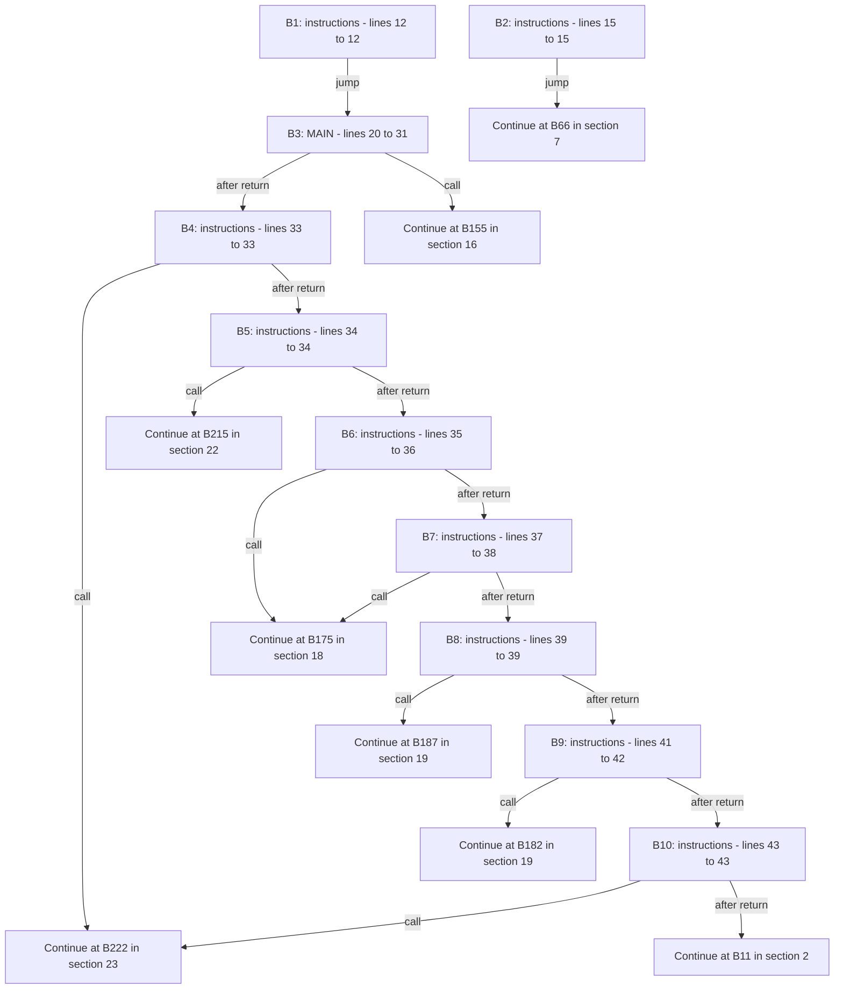

### B1

```asm
LJMP MAIN
```

### B2

```asm
LJMP EX0ISR
```

### B3

```asm
MOV 30H,#0
MOV 40H,#0
MOV 41H,#0
MOV 50H,#00
MOV 51H,#00
MOV 60H,#00
MOV IE,#10000001B
SETB IT0
MOV R3,#0
ACALL INLCD
```

### B4

```asm
ACALL DELAY
```

### B5

```asm
ACALL CLEAR
```

### B6

```asm
MOV A, #8H
ACALL CMD
```

### B7

```asm
MOV A, #0H
ACALL CMD
```

### B8

```asm
ACALL LDELAY
```

### B9

```asm
MOV DPTR, #STR1
ACALL WSTR
```

### B10

```asm
ACALL DELAY
```

## Section 2

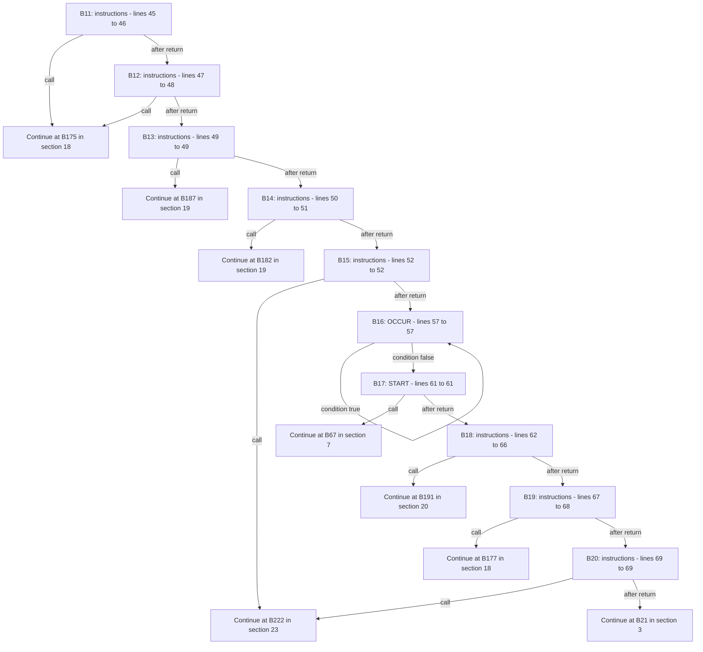

### B11

```asm
MOV A, #1100B
ACALL CMD
```

### B12

```asm
MOV A, #0H
ACALL CMD
```

### B13

```asm
ACALL LDELAY
```

### B14

```asm
MOV DPTR, #STR2
ACALL WSTR
```

### B15

```asm
ACALL DELAY
```

### B16

```asm
CJNE R3,#1,OCCUR
```

### B17

```asm
ACALL MENU
```

### B18

```asm
SETB G
SETB Y
SETB R
ACALL KEYPAD
```

### B19

```asm
MOV 30H,A
ACALL WCHR
```

### B20

```asm
ACALL DELAY
```

## Section 3

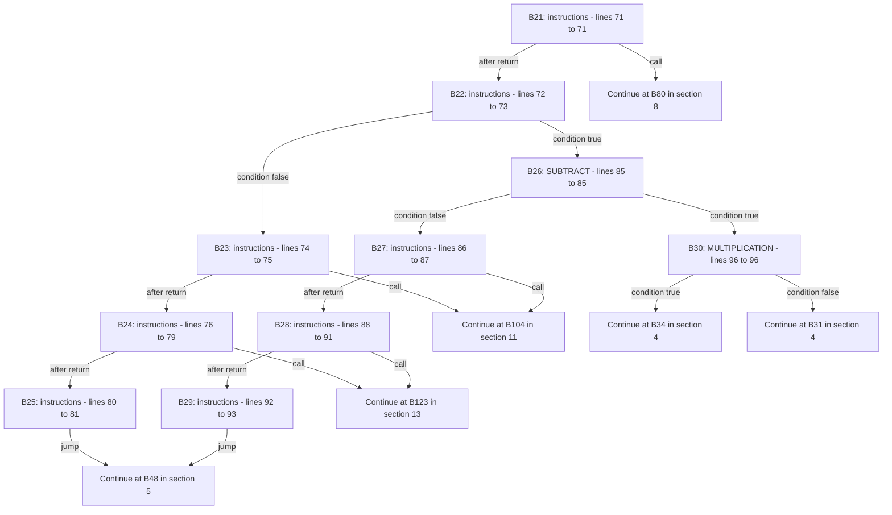

### B21

```asm
ACALL SELECTION
```

### B22

```asm
MOV A,30H
CJNE A,#'1',SUBTRACT
```

### B23

```asm
CLR G
ACALL NUMBERS
```

### B24

```asm
MOV A,40H
ADD A,41H
MOV 50H,A
ACALL RESULTS
```

### B25

```asm
SETB G
SJMP NEXT
```

### B26

```asm
CJNE A,#'2',MULTIPLICATION
```

### B27

```asm
CLR G
ACALL NUMBERS
```

### B28

```asm
MOV A,40H
SUBB A,41H
MOV 50H,A
ACALL RESULTS
```

### B29

```asm
SETB G
SJMP NEXT
```

### B30

```asm
CJNE A,#'3',DIVISION
```

## Section 4

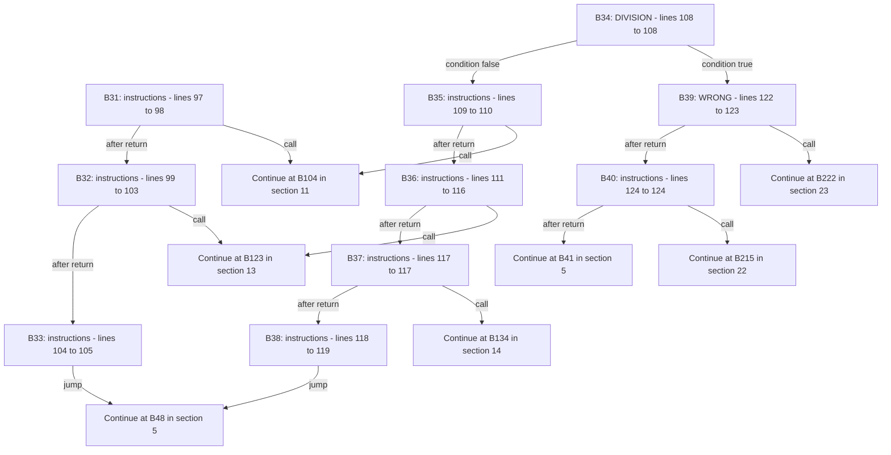

### B31

```asm
CLR G
ACALL NUMBERS
```

### B32

```asm
MOV A,40H
MOV B,41H
MUL AB
MOV 50H,A
ACALL RESULTS
```

### B33

```asm
SETB G
SJMP NEXT
```

### B34

```asm
CJNE A,#'4',WRONG
```

### B35

```asm
CLR G
ACALL NUMBERS
```

### B36

```asm
MOV A,40H
MOV B,41H
DIV AB
MOV 50H,A
MOV 51H,B
ACALL RESULTS
```

### B37

```asm
ACALL REMINDER
```

### B38

```asm
SETB G
SJMP NEXT
```

### B39

```asm
CLR R
ACALL DELAY
```

### B40

```asm
ACALL CLEAR
```

## Section 5

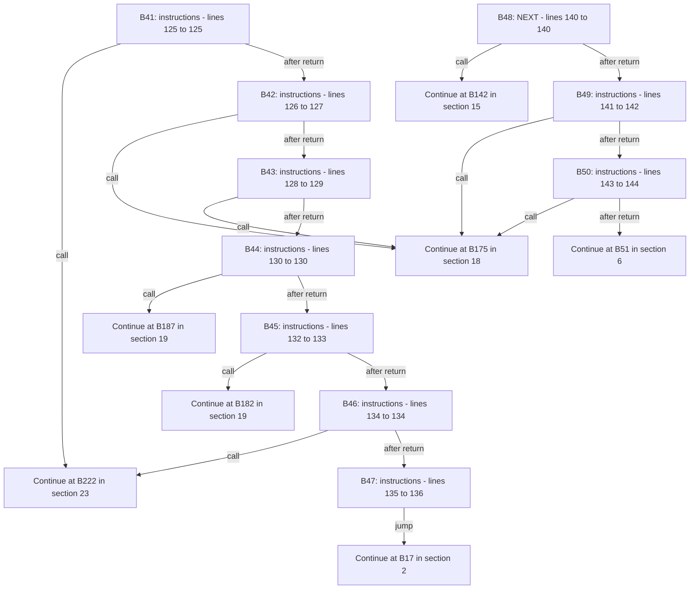

### B41

```asm
ACALL DELAY
```

### B42

```asm
MOV A,#8H
ACALL CMD
```

### B43

```asm
MOV A,#0H
ACALL CMD
```

### B44

```asm
ACALL LDELAY
```

### B45

```asm
MOV DPTR, #STR10
ACALL WSTR
```

### B46

```asm
ACALL DELAY
```

### B47

```asm
SETB R
AJMP START
```

### B48

```asm
ACALL CONTINUE
```

### B49

```asm
MOV A,#8H
ACALL CMD
```

### B50

```asm
MOV A,#1110B
ACALL CMD
```

## Section 6

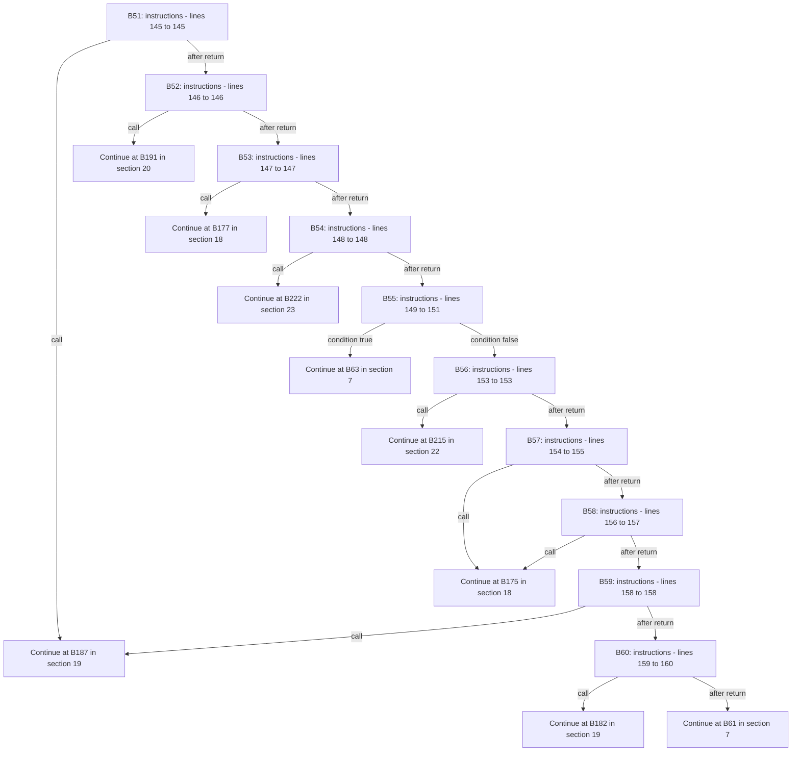

### B51

```asm
ACALL LDELAY
```

### B52

```asm
ACALL KEYPAD
```

### B53

```asm
ACALL WCHR
```

### B54

```asm
ACALL DELAY
```

### B55

```asm
SUBB A,#30H
MOV 60H,A
CJNE A,#2,START1
```

### B56

```asm
ACALL CLEAR
```

### B57

```asm
MOV A,#8H
ACALL CMD
```

### B58

```asm
MOV A,#0H
ACALL CMD
```

### B59

```asm
ACALL LDELAY
```

### B60

```asm
MOV DPTR, #STR13
ACALL WSTR
```

## Section 7

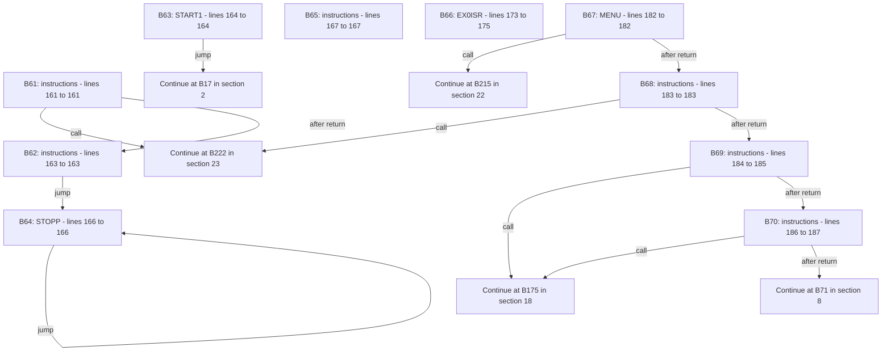

### B61

```asm
ACALL DELAY
```

### B62

```asm
SJMP STOPP
```

### B63

```asm
AJMP START
```

### B64

```asm
SJMP STOPP
```

### B65

Resume the interrupted program.

```asm
RETI
```

### B66

Resume the interrupted program.

```asm
MOV R3,#1
RETI
```

### B67

```asm
ACALL CLEAR
```

### B68

```asm
ACALL DELAY
```

### B69

```asm
MOV A, #8H
ACALL CMD
```

### B70

```asm
MOV A, #0H
ACALL CMD
```

## Section 8

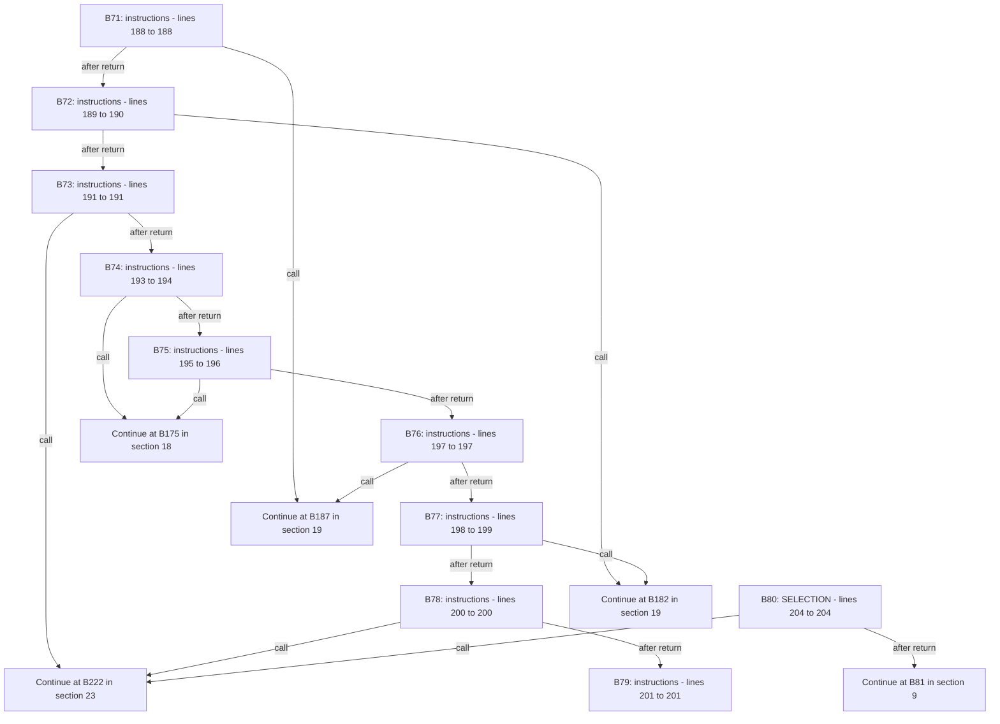

### B71

```asm
ACALL LDELAY
```

### B72

```asm
MOV DPTR, #STR3
ACALL WSTR
```

### B73

```asm
ACALL DELAY
```

### B74

```asm
MOV A, #1100B
ACALL CMD
```

### B75

```asm
MOV A, #0H
ACALL CMD
```

### B76

```asm
ACALL LDELAY
```

### B77

```asm
MOV DPTR, #STR4
ACALL WSTR
```

### B78

```asm
ACALL DELAY
```

### B79

Return to the instruction following the active call.

```asm
RET
```

### B80

```asm
ACALL DELAY
```

## Section 9

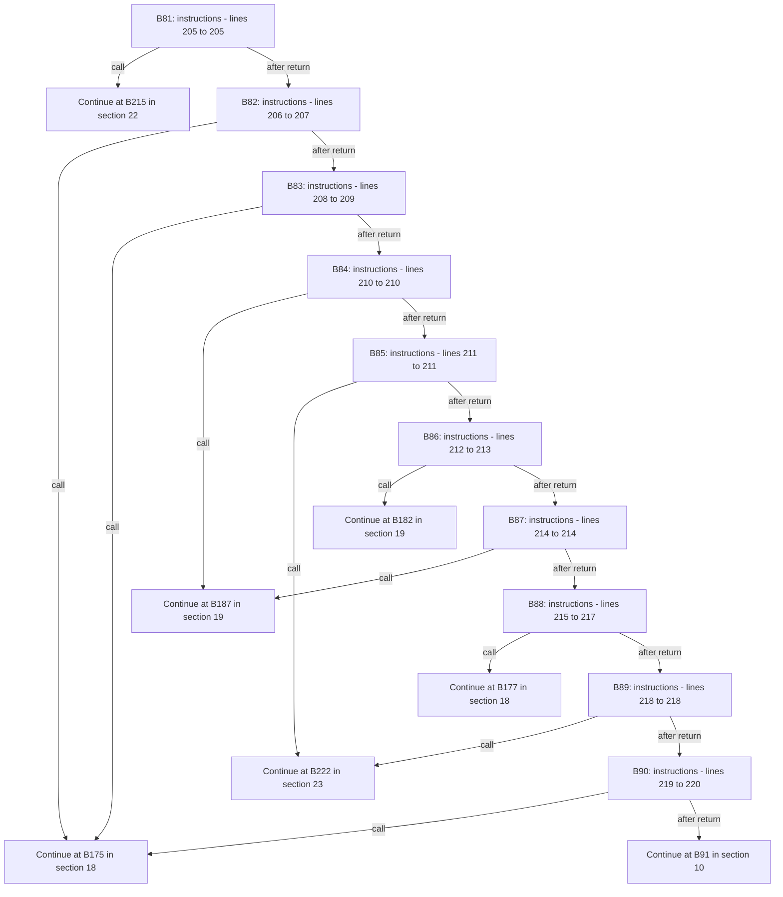

### B81

```asm
ACALL CLEAR
```

### B82

```asm
MOV A, #8H
ACALL CMD
```

### B83

```asm
MOV A, #0H
ACALL CMD
```

### B84

```asm
ACALL LDELAY
```

### B85

```asm
ACALL DELAY
```

### B86

```asm
MOV DPTR, #STR5
ACALL WSTR
```

### B87

```asm
ACALL LDELAY
```

### B88

```asm
MOV A,30H
ACALL WCHR
```

### B89

```asm
ACALL DELAY
```

### B90

```asm
MOV A, #1100B
ACALL CMD
```

## Section 10

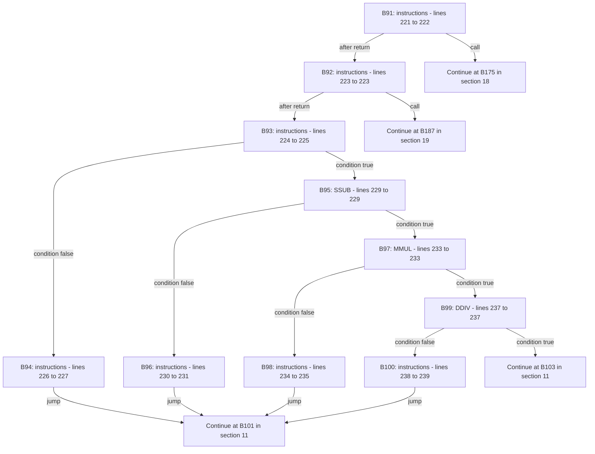

### B91

```asm
MOV A, #0H
ACALL CMD
```

### B92

```asm
ACALL LDELAY
```

### B93

```asm
MOV A,30H
CJNE A,#'1',SSUB
```

### B94

```asm
MOV DPTR, #STR14
SJMP NNEXT
```

### B95

```asm
CJNE A,#'2',MMUL
```

### B96

```asm
MOV DPTR, #STR15
SJMP NNEXT
```

### B97

```asm
CJNE A,#'3',DDIV
```

### B98

```asm
MOV DPTR, #STR16
SJMP NNEXT
```

### B99

```asm
CJNE A,#'4',NNNEXT
```

### B100

```asm
MOV DPTR, #STR17
SJMP NNEXT
```

## Section 11

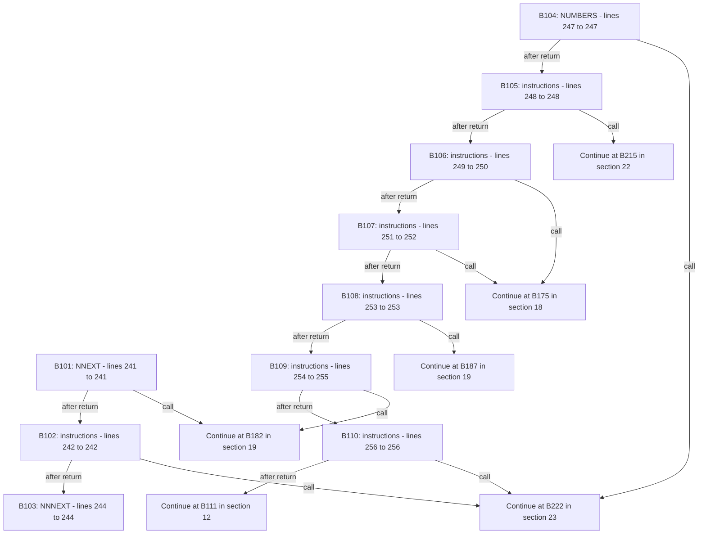

### B101

```asm
ACALL WSTR
```

### B102

```asm
ACALL DELAY
```

### B103

Return to the instruction following the active call.

```asm
RET
```

### B104

```asm
ACALL DELAY
```

### B105

```asm
ACALL CLEAR
```

### B106

```asm
MOV A, #8H
ACALL CMD
```

### B107

```asm
MOV A, #0H
ACALL CMD
```

### B108

```asm
ACALL LDELAY
```

### B109

```asm
MOV DPTR, #STR6
ACALL WSTR
```

### B110

```asm
ACALL DELAY
```

## Section 12

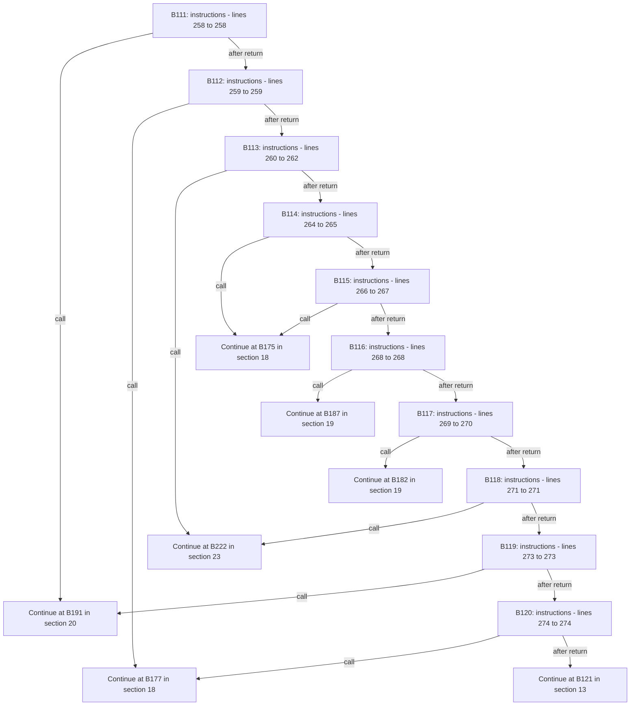

### B111

```asm
ACALL KEYPAD
```

### B112

```asm
ACALL WCHR
```

### B113

```asm
SUBB A,#30H
MOV 40H,A
ACALL DELAY
```

### B114

```asm
MOV A, #1100B
ACALL CMD
```

### B115

```asm
MOV A, #0H
ACALL CMD
```

### B116

```asm
ACALL LDELAY
```

### B117

```asm
MOV DPTR, #STR7
ACALL WSTR
```

### B118

```asm
ACALL DELAY
```

### B119

```asm
ACALL KEYPAD
```

### B120

```asm
ACALL WCHR
```

## Section 13

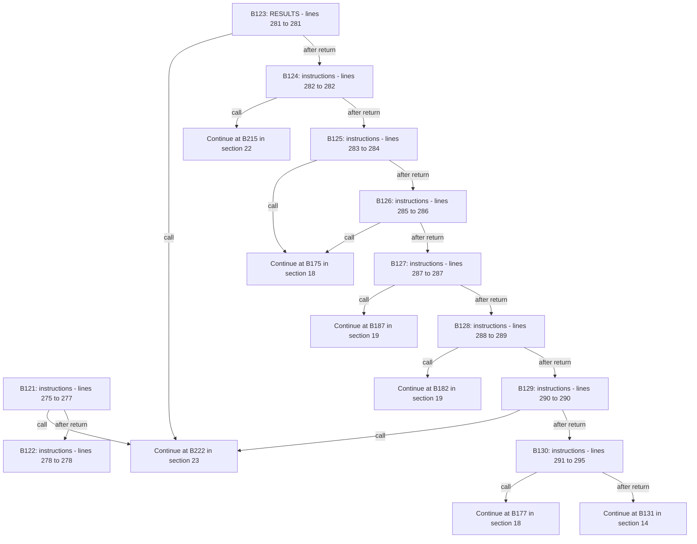

### B121

```asm
SUBB A,#30H
MOV 41H,A
ACALL DELAY
```

### B122

Return to the instruction following the active call.

```asm
RET
```

### B123

```asm
ACALL DELAY
```

### B124

```asm
ACALL CLEAR
```

### B125

```asm
MOV A, #8H
ACALL CMD
```

### B126

```asm
MOV A, #0H
ACALL CMD
```

### B127

```asm
ACALL LDELAY
```

### B128

```asm
MOV DPTR, #STR8
ACALL WSTR
```

### B129

```asm
ACALL DELAY
```

### B130

```asm
MOV A,50H
MOV B,#10
DIV AB
ADD A,#30H
ACALL WCHR
```

## Section 14

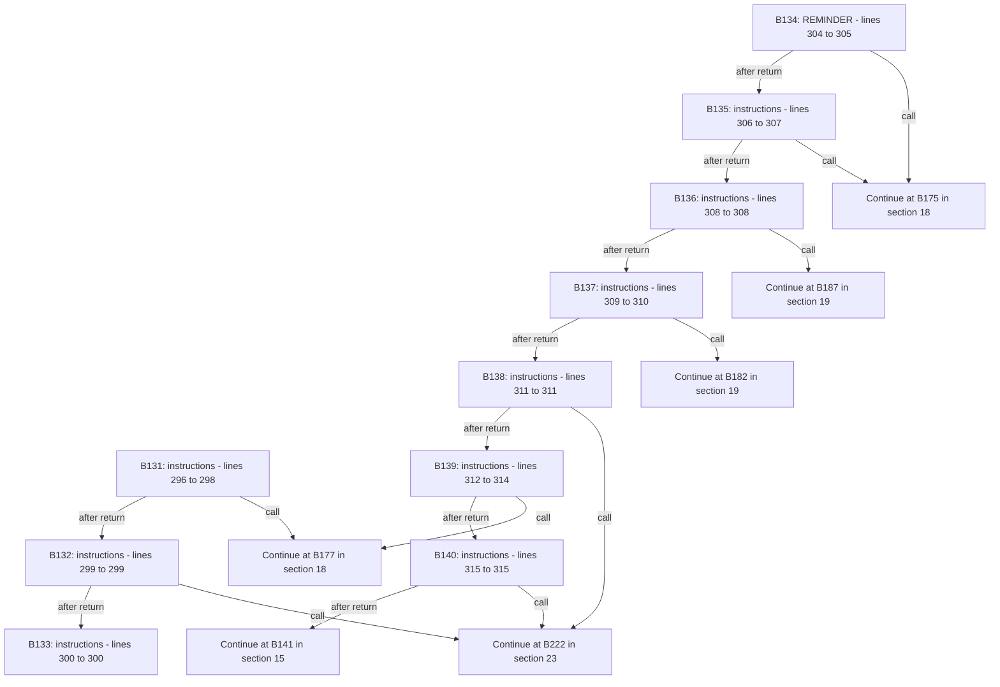

### B131

```asm
MOV A,B
ADD A,#30H
ACALL WCHR
```

### B132

```asm
ACALL DELAY
```

### B133

Return to the instruction following the active call.

```asm
RET
```

### B134

```asm
MOV A, #1100B
ACALL CMD
```

### B135

```asm
MOV A, #0H
ACALL CMD
```

### B136

```asm
ACALL LDELAY
```

### B137

```asm
MOV DPTR, #STR9
ACALL WSTR
```

### B138

```asm
ACALL DELAY
```

### B139

```asm
MOV A,51H
ADD A,#30H
ACALL WCHR
```

### B140

```asm
ACALL DELAY
```

## Section 15

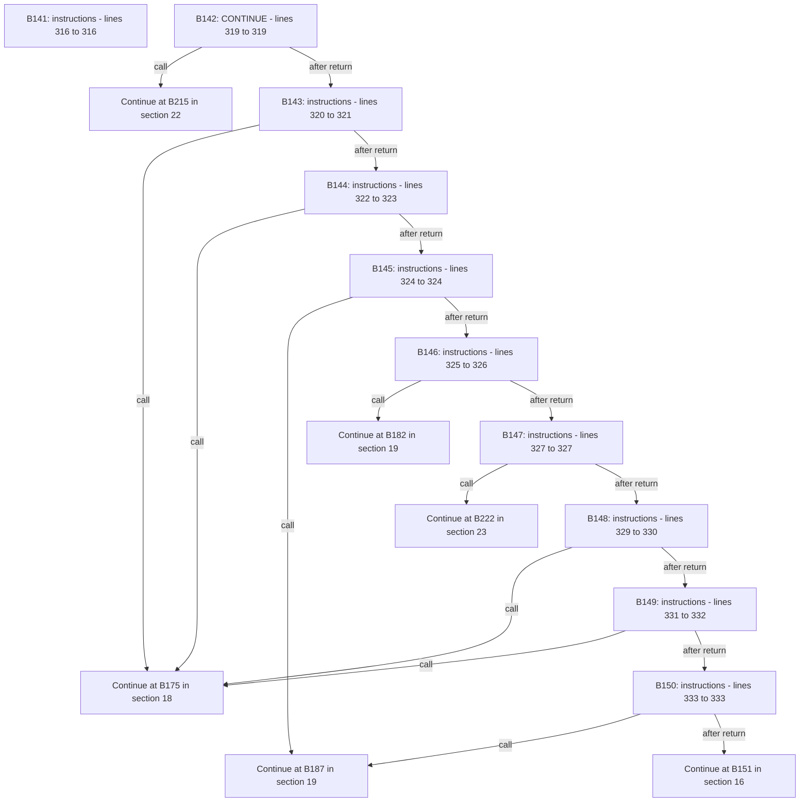

### B141

Return to the instruction following the active call.

```asm
RET
```

### B142

```asm
ACALL CLEAR
```

### B143

```asm
MOV A, #8H
ACALL CMD
```

### B144

```asm
MOV A, #0H
ACALL CMD
```

### B145

```asm
ACALL LDELAY
```

### B146

```asm
MOV DPTR, #STR11
ACALL WSTR
```

### B147

```asm
ACALL DELAY
```

### B148

```asm
MOV A, #1100B
ACALL CMD
```

### B149

```asm
MOV A, #0H
ACALL CMD
```

### B150

```asm
ACALL LDELAY
```

## Section 16

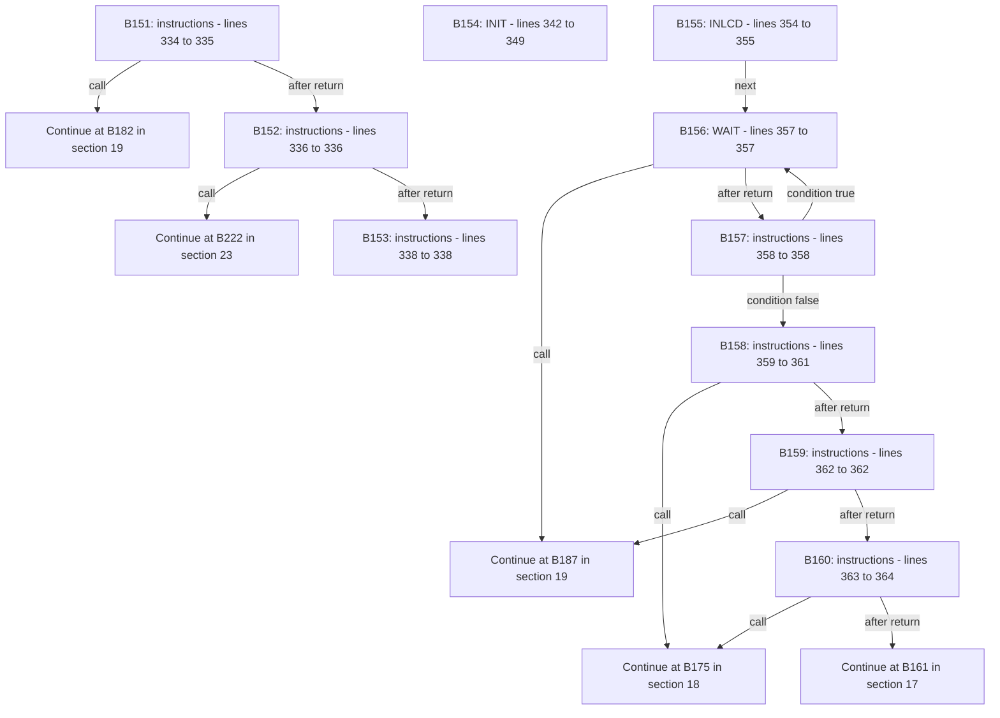

### B151

```asm
MOV DPTR, #STR12
ACALL WSTR
```

### B152

```asm
ACALL DELAY
```

### B153

Return to the instruction following the active call.

```asm
RET
```

### B154

Return to the instruction following the active call.

```asm
MOV A,PCON
CLR ACC.7
MOV PCON,A
MOV SCON,#50H
MOV TMOD,#21H
MOV TH1,#-3
SETB TR1
RET
```

### B155

```asm
PUSH 7
MOV R7,#20
```

### B156

```asm
ACALL LDELAY
```

### B157

```asm
DJNZ R7,WAIT
```

### B158

```asm
MOV P0,#00000111B
MOV A,#0011B
ACALL CMD
```

### B159

```asm
ACALL LDELAY
```

### B160

```asm
MOV A,#0011B
ACALL CMD
```

## Section 17

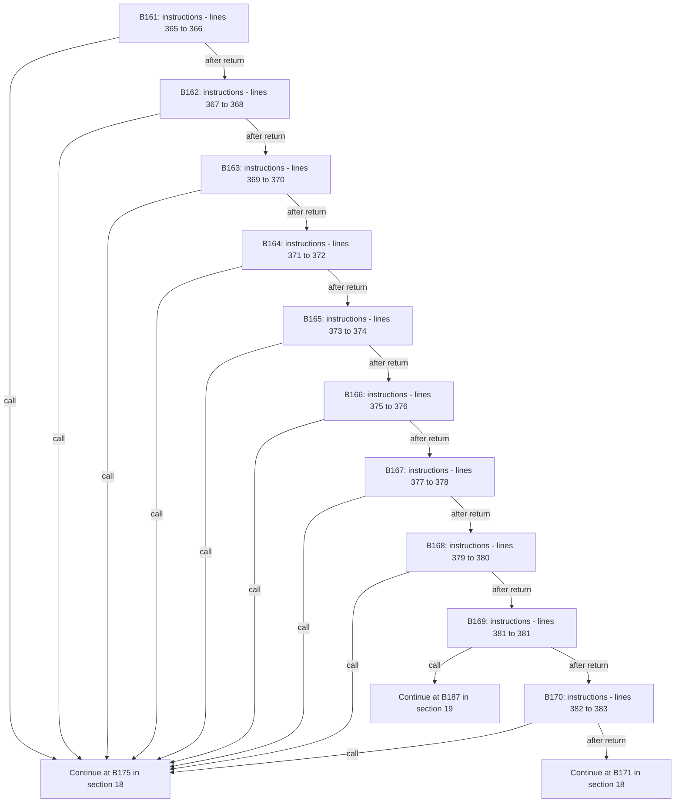

### B161

```asm
MOV A,#0011B
ACALL CMD
```

### B162

```asm
MOV A,#0010B
ACALL CMD
```

### B163

```asm
MOV A,#0010B
ACALL CMD
```

### B164

```asm
MOV A,#1000B
ACALL CMD
```

### B165

```asm
MOV A,#0000B
ACALL CMD
```

### B166

```asm
MOV A,#1000B
ACALL CMD
```

### B167

```asm
MOV A,#0
ACALL CMD
```

### B168

```asm
MOV A,#0001B
ACALL CMD
```

### B169

```asm
ACALL LDELAY
```

### B170

```asm
MOV A,#0000B
ACALL CMD
```

## Section 18

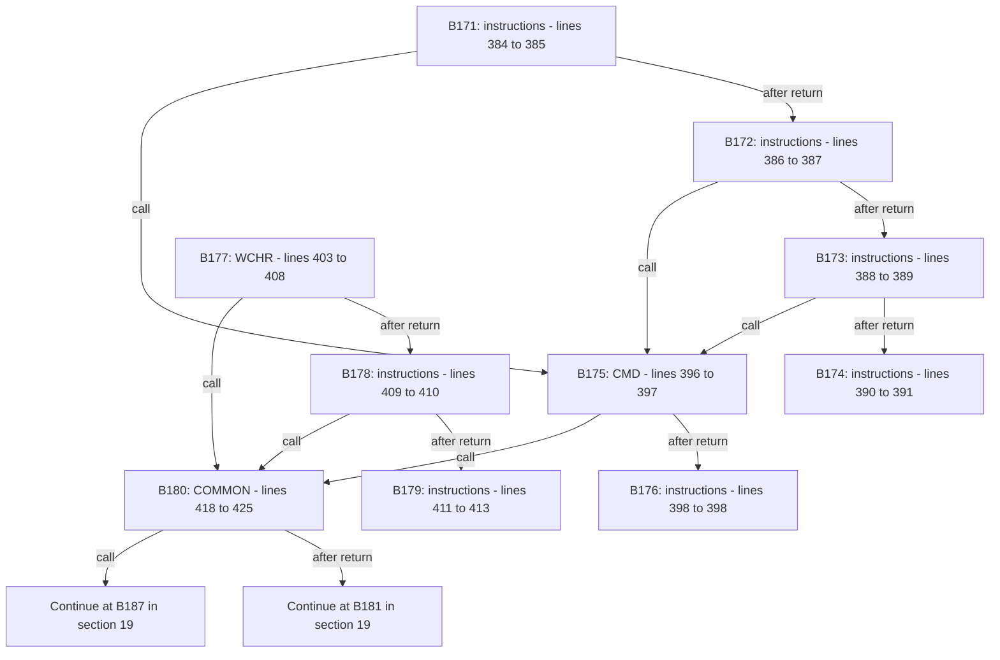

### B171

```asm
MOV A,#0110B
ACALL CMD
```

### B172

```asm
MOV A,#0000B
ACALL CMD
```

### B173

```asm
MOV A,#1111B
ACALL CMD
```

### B174

Return to the instruction following the active call.

```asm
POP 7
RET
```

### B175

```asm
CLR RS
ACALL COMMON
```

### B176

Return to the instruction following the active call.

```asm
RET
```

### B177

```asm
PUSH ACC
PUSH B
SETB RS
MOV B,A
SWAP A
ACALL COMMON
```

### B178

```asm
MOV A,B
ACALL COMMON
```

### B179

Return to the instruction following the active call.

```asm
POP B
POP ACC
RET
```

### B180

```asm
CLR RW
SWAP A
ANL A,#11110000B
ANL P0,#00000111B
ORL P0,A
SETB EN
CLR EN
ACALL LDELAY
```

## Section 19

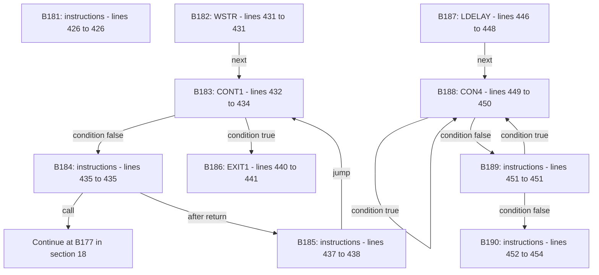

### B181

Return to the instruction following the active call.

```asm
RET
```

### B182

```asm
PUSH ACC
```

### B183

```asm
CLR A
MOVC A,@A+DPTR
JZ EXIT1
```

### B184

```asm
ACALL WCHR
```

### B185

```asm
INC DPTR
AJMP CONT1
```

### B186

Return to the instruction following the active call.

```asm
POP ACC
RET
```

### B187

```asm
PUSH 0
PUSH 1
MOV R1,#20
```

### B188

```asm
MOV R0,#250
DJNZ R0,$
```

### B189

```asm
DJNZ R1,CON4
```

### B190

Return to the instruction following the active call.

```asm
POP 1
POP 0
RET
```

## Section 20

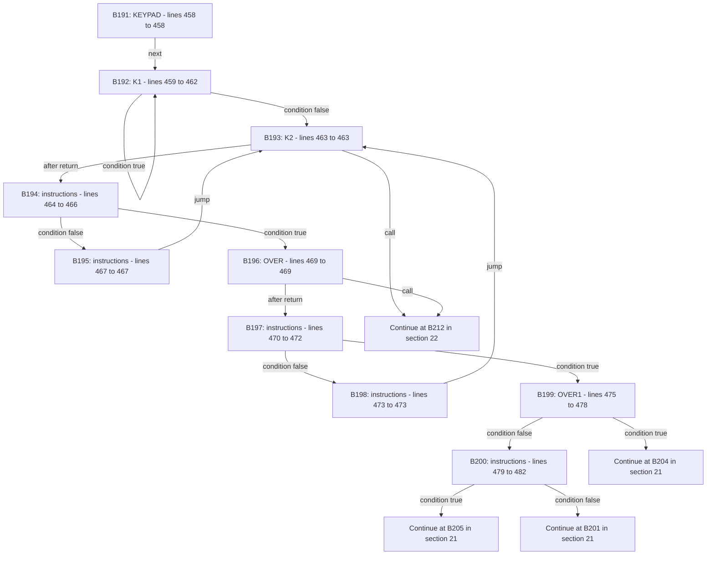

### B191

```asm
MOV P2,#11110000B
```

### B192

```asm
MOV P2,#11110000B
MOV A,P2
ANL A,#11110000B
CJNE A,#11110000B,K1
```

### B193

```asm
ACALL TMSEC
```

### B194

```asm
MOV A,P2
ANL A,#11110000B
CJNE A,#11110000B,OVER
```

### B195

```asm
SJMP K2
```

### B196

```asm
ACALL TMSEC
```

### B197

```asm
MOV A,P2
ANL A,#11110000B
CJNE A,#11110000B,OVER1
```

### B198

```asm
SJMP K2
```

### B199

```asm
MOV P2,#11111110B
MOV A,P2
ANL A,#11110000B
CJNE A,#11110000B,ROW_0
```

### B200

```asm
MOV P2,#11111101B
MOV A,P2
ANL A,#11110000B
CJNE A,#11110000B,ROW_1
```

## Section 21

```mermaid
flowchart TD
B200["B201: instructions - lines 483 to 486"]
B201["B202: instructions - lines 487 to 490"]
B202["B203: instructions - lines 491 to 491"]
B203["B204: ROW_0 - lines 492 to 493"]
B204["B205: ROW_1 - lines 494 to 495"]
B205["B206: ROW_2 - lines 496 to 497"]
B206["B207: ROW_3 - lines 498 to 498"]
B207["B208: FIND - lines 500 to 500"]
B208["B209: FIND1 - lines 502 to 503"]
B209["B210: instructions - lines 504 to 505"]
B200 -->|condition true| B205
B200 -->|condition false| B201
B201 -->|condition true| B206
B201 -->|condition false| B202
B202 -->|jump| B192
B203 -->|jump| B207
B204 -->|jump| B207
B205 -->|jump| B207
B206 -->|next| B207
B207 -->|next| B208
B208 -->|condition true| B210
B208 -->|condition false| B209
B209 -->|jump| B208
B192["Continue at B193 in section 20"]
B210["Continue at B211 in section 22"]
```

### B201

```asm
MOV P2,#11111011B
MOV A,P2
ANL A,#11110000B
CJNE A,#11110000B,ROW_2
```

### B202

```asm
MOV P2,#11110111B
MOV A,P2
ANL A,#11110000B
CJNE A,#11110000B,ROW_3
```

### B203

```asm
LJMP K2
```

### B204

```asm
MOV DPTR,#KCODE0
SJMP FIND
```

### B205

```asm
MOV DPTR,#KCODE1
SJMP FIND
```

### B206

```asm
MOV DPTR,#KCODE2
SJMP FIND
```

### B207

```asm
MOV DPTR,#KCODE3
```

### B208

```asm
SWAP A
```

### B209

```asm
RRC A
JNC MATCH
```

### B210

```asm
INC DPTR
SJMP FIND1
```

## Section 22

```mermaid
flowchart TD
B210["B211: MATCH - lines 507 to 509"]
B211["B212: TMSEC - lines 514 to 517"]
B212["B213: BACK - lines 519 to 519"]
B213["B214: instructions - lines 520 to 522"]
B214["B215: CLEAR - lines 526 to 527"]
B215["B216: instructions - lines 528 to 529"]
B216["B217: instructions - lines 530 to 530"]
B217["B218: instructions - lines 531 to 531"]
B218["B219: WAITT - lines 532 to 532"]
B219["B220: instructions - lines 533 to 533"]
B211 -->|next| B212
B212 -->|condition true| B212
B212 -->|condition false| B213
B214 -->|call| B174
B214 -->|after return| B215
B215 -->|call| B174
B215 -->|after return| B216
B216 -->|call| B186
B216 -->|after return| B217
B217 -->|next| B218
B218 -->|call| B186
B218 -->|after return| B219
B219 -->|condition true| B218
B219 -->|condition false| B220
B174["Continue at B175 in section 18"]
B186["Continue at B187 in section 19"]
B220["Continue at B221 in section 23"]
```

### B211

Return to the instruction following the active call.

```asm
CLR A
MOVC A,@A+DPTR
RET
```

### B212

```asm
MOV TMOD,#21H
MOV TL0,#0CAH
MOV TH0,#27H
SETB TR0
```

### B213

```asm
JNB TF0,BACK
```

### B214

Return to the instruction following the active call.

```asm
CLR TR0
CLR TF0
RET
```

### B215

```asm
MOV A,#0H
ACALL CMD
```

### B216

```asm
MOV A,#1H
ACALL CMD
```

### B217

```asm
ACALL LDELAY
```

### B218

```asm
MOV R7,#14
```

### B219

```asm
ACALL LDELAY
```

### B220

```asm
DJNZ R7,WAITT
```

## Section 23

```mermaid
flowchart TD
B220["B221: instructions - lines 534 to 534"]
B221["B222: DELAY - lines 538 to 538"]
B222["B223: HH - lines 540 to 540"]
B223["B224: instructions - lines 541 to 541"]
B224["B225: instructions - lines 542 to 542"]
B221 -->|next| B222
B222 -->|call| B186
B222 -->|after return| B223
B223 -->|condition true| B222
B223 -->|condition false| B224
B186["Continue at B187 in section 19"]
```

### B221

Return to the instruction following the active call.

```asm
RET
```

### B222

```asm
MOV R5,#170
```

### B223

```asm
ACALL LDELAY
```

### B224

```asm
DJNZ R5,HH
```

### B225

Return to the instruction following the active call.

```asm
RET
```
