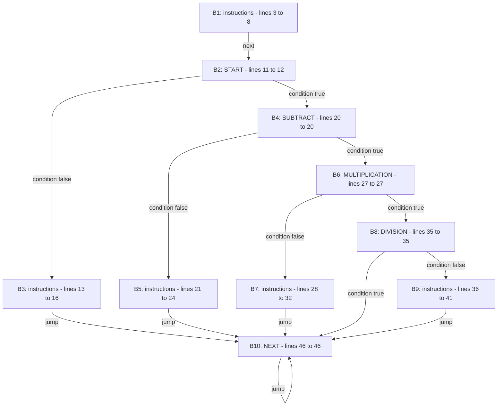

# Program Control Flow

[Back to project](README.md)

Control-flow blocks are indexed by source line. Calls resume at the instruction following the call if the subroutine returns normally.

## Entry locations

- `ORG 00H` begins at B1.

## Navigation

[Section 1](#section-1)

## Section 1



### B1

```asm
MOV 30H,#4
MOV 40H,#6
MOV 41H,#3
MOV 50H,#00
MOV 51H,#00
```

### B2

```asm
MOV A,30H
CJNE A,#1,SUBTRACT
```

### B3

```asm
MOV A,40H
ADD A,41H
MOV 50H,A
SJMP NEXT
```

### B4

```asm
CJNE A,#2,MULTIPLICATION
```

### B5

```asm
MOV A,40H
SUBB A,41H
MOV 50H,A
SJMP NEXT
```

### B6

```asm
CJNE A,#3,DIVISION
```

### B7

```asm
MOV A,40H
MOV B,41H
MUL AB
MOV 50H,A
SJMP NEXT
```

### B8

```asm
CJNE A,#4,NEXT
```

### B9

```asm
MOV A,40H
MOV B,41H
DIV AB
MOV 50H,A
MOV 51H,B
SJMP NEXT
```

### B10

```asm
SJMP NEXT
```
