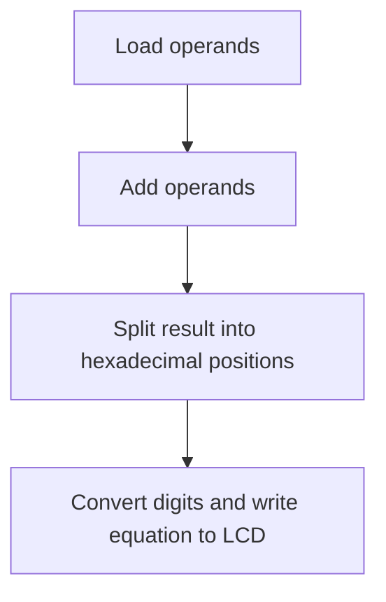
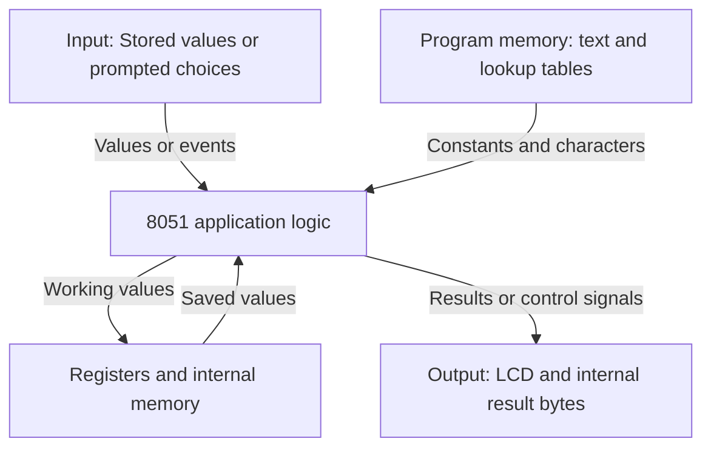

# Hexadecimal Addition Display

[Group overview](../../README.md) · [Compare implementations](../README.md)

Show an addition equation using hexadecimal digits on an LCD.

**Implementation:** LCD Hexadecimal Sum

**Input:** stored values or prompted choices.  
**Output:** LCD and internal result bytes.

## Inputs and results

| Parameter | Description |
| --- | --- |
| Input | Two fixed hexadecimal operands |
| Output | An equation on the display |

## Worked example

F + F = 1E in hexadecimal, equivalent to 15 + 15 = 30 in decimal.

### Calculation details

The preset operands are 0FH and 0FH. Adding them yields 1EH. Dividing by 16 gives quotient 1 and remainder 14, which convert to the characters 1 and E. The intended LCD equation is F+F=1E.

## Program operation

1. Load operands.
2. Add operands.
3. Split result into hexadecimal positions.
4. Convert digits and write equation to LCD.

### Functional flowchart

[Detailed control flow](source-flow.md)

### Simplified block diagram

**Port registers:** `P0`, `P0.0`, `P0.1`, `P0.2`.

## Technical limitations

No additional defect was recorded in the earlier source review. This is not evidence of a successful build or hardware test.

## Build and test

1. Open the [assembly source](source.asm) in an 8051 assembler or simulator.
2. Review the technical limitations and configure the peripherals required by this implementation.
3. Check the expected result using the example inputs.
