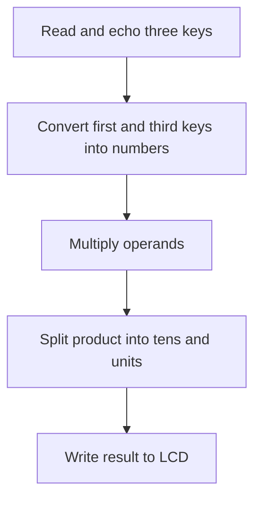
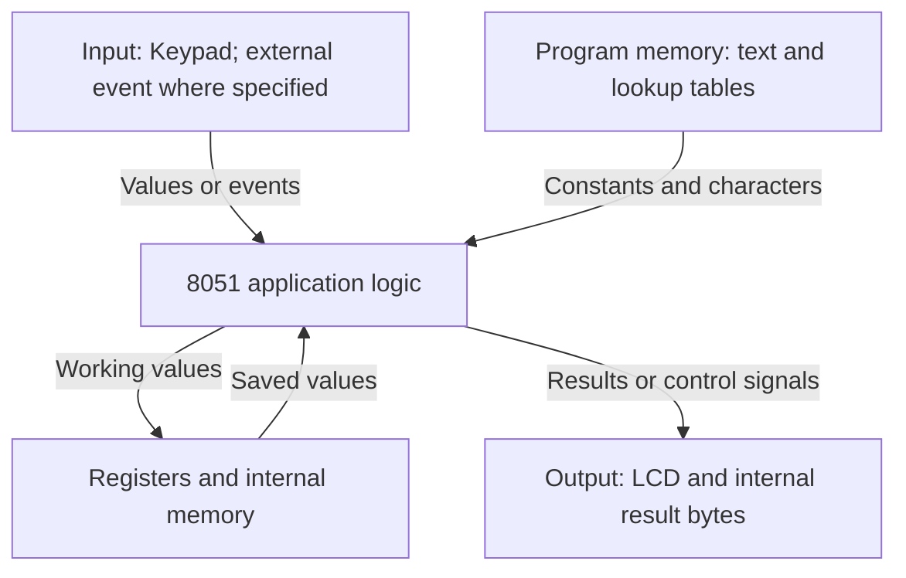

# Keypad Multiplication

[Group overview](../../README.md) · [Compare implementations](../README.md)

Read two single-digit operands separated by a key and display their product.

**Implementation:** Keypad Product Display

**Input:** keypad.  
**Output:** LCD and internal result bytes.

## Inputs and results

| Parameter | Description |
| --- | --- |
| Input | Three key presses: first digit, separator, second digit |
| Output | Two decimal result characters |

## Worked example

Enter 3, then *, then 4. The product is 12. The middle key is displayed; this code does not use it to select an operation.

### Calculation details

Enter 3, *, 4 and begin the conversion with carry clear. The outer two ASCII bytes 33H and 34H become 3 and 4. MUL AB gives 12. DIV AB by 10 yields quotient 1 and remainder 2, which become the displayed characters 1 and 2.

## Program operation

1. Read and echo three keys.
2. Convert first and third keys into numbers.
3. Multiply operands.
4. Split product into tens and units.
5. Write result to LCD.

### Functional flowchart

[Detailed control flow](source-flow.md)

### Simplified block diagram

**Port registers:** `P0`, `P0.0`, `P0.1`, `P0.2`, `P2`, `P2.0`, `P2.3`, `P2.4`, `P2.7`.

## Technical limitations

No additional defect was recorded in the earlier source review. This is not evidence of a successful build or hardware test.

## Build and test

1. Open the [assembly source](source.a51) in an 8051 assembler or simulator.
2. Review the technical limitations and configure the peripherals required by this implementation.
3. Check the expected result using the example inputs.
