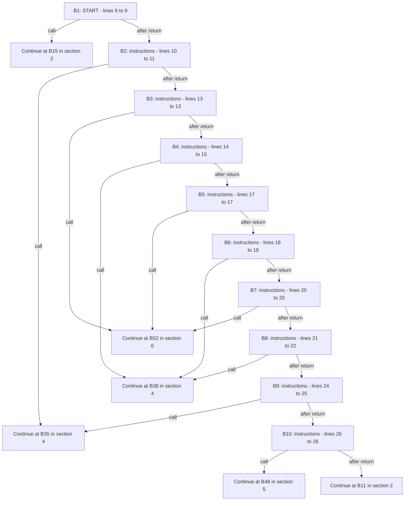
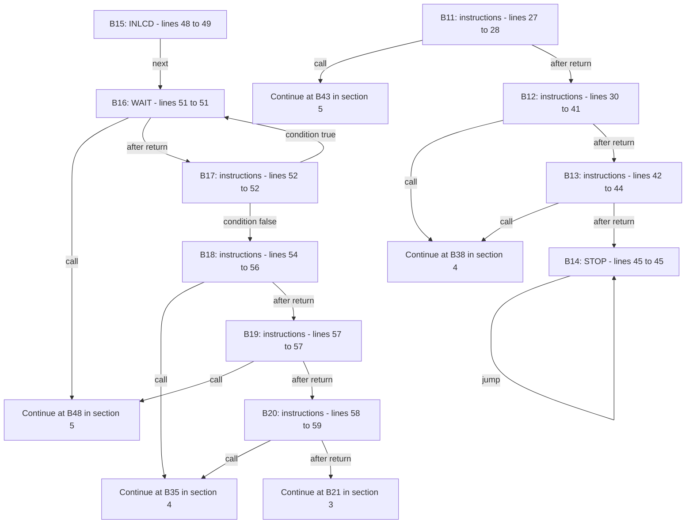
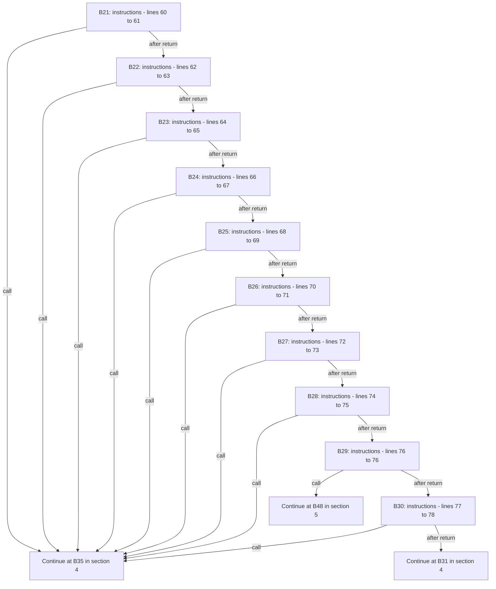
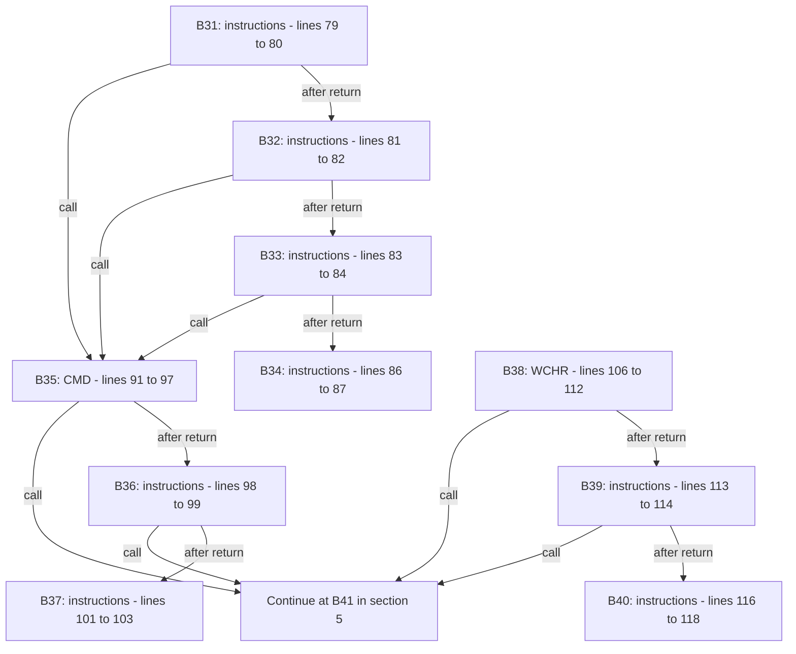
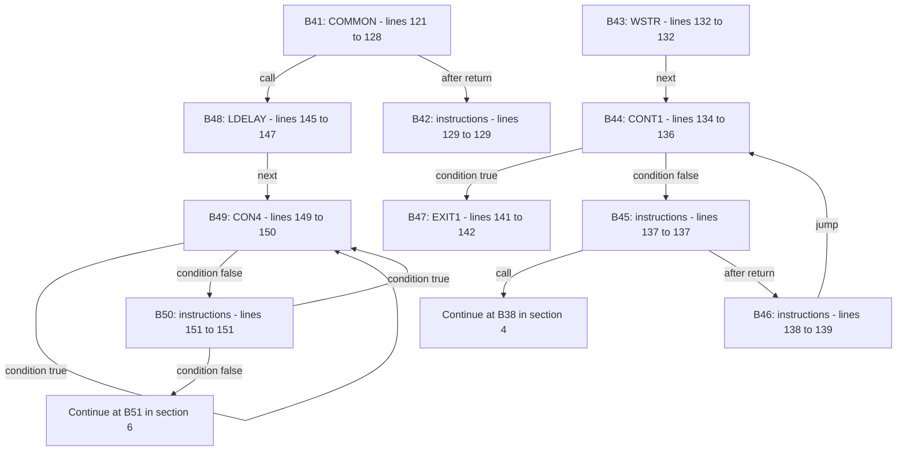
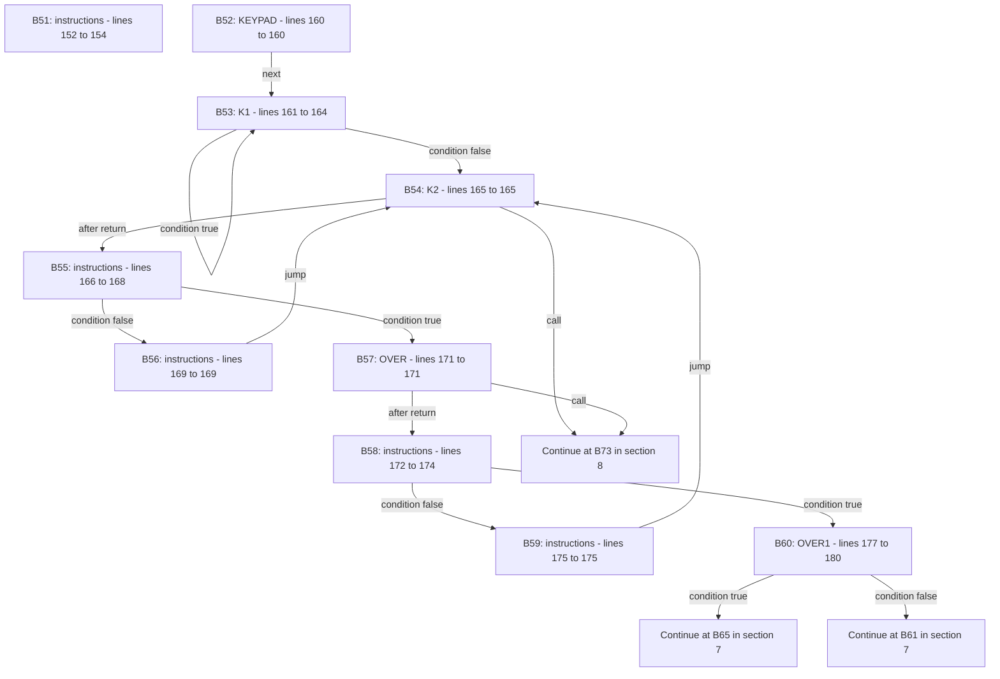
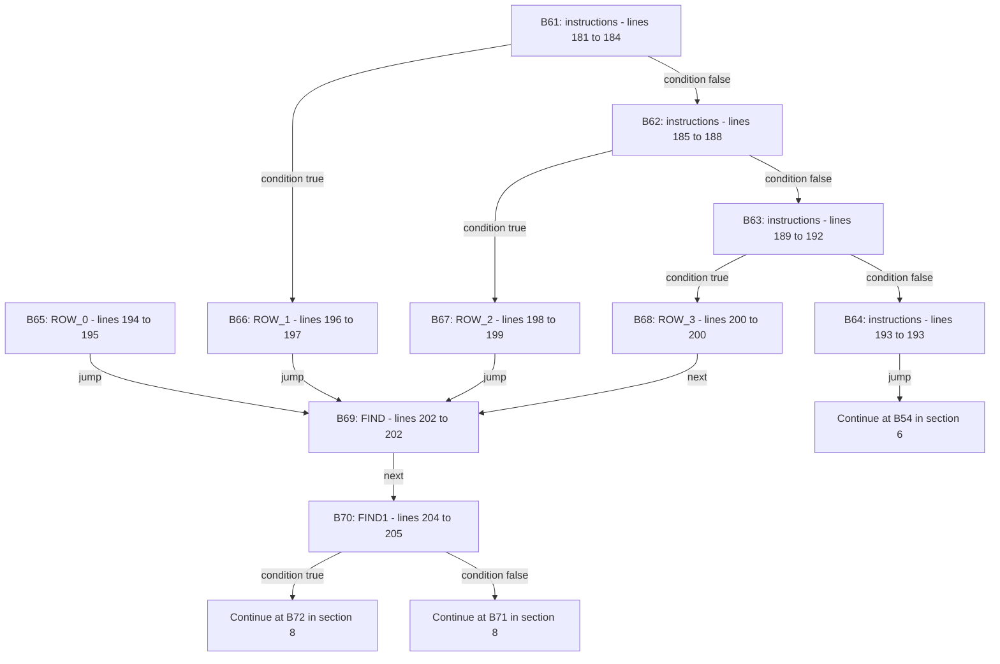
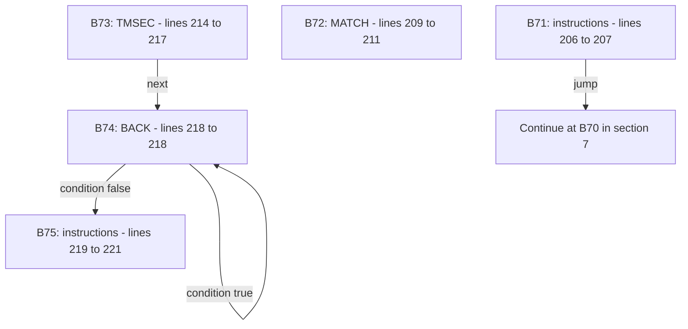

# Program Control Flow

[Back to project](README.md)

Control-flow blocks are indexed by source line. Calls resume at the instruction following the call if the subroutine returns normally.

## Entry locations

- `ORG 0H` begins at B1.

## Navigation

[Section 1](#section-1) · [Section 2](#section-2) · [Section 3](#section-3) · [Section 4](#section-4) · [Section 5](#section-5) · [Section 6](#section-6) · [Section 7](#section-7) · [Section 8](#section-8)

## Section 1



### B1

```asm
ACALL INLCD
```

### B2

```asm
MOV A,#80H
ACALL CMD
```

### B3

```asm
ACALL KEYPAD
```

### B4

```asm
MOV 40H,A
ACALL WCHR
```

### B5

```asm
ACALL KEYPAD
```

### B6

```asm
ACALL WCHR
```

### B7

```asm
ACALL KEYPAD
```

### B8

```asm
MOV 41H,A
ACALL WCHR
```

### B9

```asm
MOV A,#0c0H
ACALL CMD
```

### B10

```asm
ACALL LDELAY
```

## Section 2



### B11

```asm
MOV DPTR,#RESULT
ACALL WSTR
```

### B12

```asm
MOV A,40H
SUBB A,#30H
MOV 40H,A
MOV B,A
MOV A,41H
SUBB A,#30H
MOV 41H,A
MUL AB
MOV B,#10
DIV AB
ADD A,#30H
ACALL WCHR
```

### B13

```asm
MOV A,B
ADD A,#30H
ACALL WCHR
```

### B14

```asm
AJMP $
```

### B15

```asm
PUSH 7
MOV R7,#20
```

### B16

```asm
ACALL LDELAY
```

### B17

```asm
DJNZ R7,WAIT
```

### B18

```asm
MOV P0,#00000111B
MOV A,#0011B
ACALL CMD
```

### B19

```asm
ACALL LDELAY
```

### B20

```asm
MOV A,#0011B
ACALL CMD
```

## Section 3



### B21

```asm
MOV A,#0011B
ACALL CMD
```

### B22

```asm
MOV A,#0010B
ACALL CMD
```

### B23

```asm
MOV A,#0010B
ACALL CMD
```

### B24

```asm
MOV A,#1000B
ACALL CMD
```

### B25

```asm
MOV A,#0000B
ACALL CMD
```

### B26

```asm
MOV A,#1000B
ACALL CMD
```

### B27

```asm
MOV A,#0
ACALL CMD
```

### B28

```asm
MOV A,#0001B
ACALL CMD
```

### B29

```asm
ACALL LDELAY
```

### B30

```asm
MOV A,#0000B
ACALL CMD
```

## Section 4



### B31

```asm
MOV A,#0110B
ACALL CMD
```

### B32

```asm
MOV A,#0000B
ACALL CMD
```

### B33

```asm
MOV A,#1111B
ACALL CMD
```

### B34

Return to the instruction following the active call.

```asm
POP 7
RET
```

### B35

```asm
PUSH ACC
PUSH B
CLR RS
MOV B,A
SWAP A
ACALL COMMON
```

### B36

```asm
MOV A,B
ACALL COMMON
```

### B37

Return to the instruction following the active call.

```asm
POP B
POP ACC
RET
```

### B38

```asm
PUSH ACC
PUSH B
SETB RS
MOV B,A
SWAP A
ACALL COMMON
```

### B39

```asm
MOV A,B
ACALL COMMON
```

### B40

Return to the instruction following the active call.

```asm
POP B
POP ACC
RET
```

## Section 5



### B41

```asm
CLR RW
SWAP A
ANL A,#11110000B
ANL P0,#00000111B
ORL P0,A
SETB EN
CLR EN
ACALL LDELAY
```

### B42

Return to the instruction following the active call.

```asm
RET
```

### B43

```asm
PUSH ACC
```

### B44

```asm
CLR A
MOVC A,@A+DPTR
JZ EXIT1
```

### B45

```asm
ACALL WCHR
```

### B46

```asm
INC DPTR
AJMP CONT1
```

### B47

Return to the instruction following the active call.

```asm
POP ACC
RET
```

### B48

```asm
PUSH 0
PUSH 1
MOV R1,#20
```

### B49

```asm
MOV R0,#250
DJNZ R0,$
```

### B50

```asm
DJNZ R1,CON4
```

## Section 6



### B51

Return to the instruction following the active call.

```asm
POP 1
POP 0
RET
```

### B52

```asm
MOV P2,#11110000B
```

### B53

```asm
MOV P2,#11110000B
MOV A,P2
ANL A,#11110000B
CJNE A,#11110000B,K1
```

### B54

```asm
ACALL TMSEC
```

### B55

```asm
MOV A,P2
ANL A,#11110000B
CJNE A,#11110000B,OVER
```

### B56

```asm
SJMP K2
```

### B57

```asm
ACALL TMSEC
```

### B58

```asm
MOV A,P2
ANL A,#11110000B
CJNE A,#11110000B,OVER1
```

### B59

```asm
SJMP K2
```

### B60

```asm
MOV P2,#11111110B
MOV A,P2
ANL A,#11110000B
CJNE A,#11110000B,ROW_0
```

## Section 7



### B61

```asm
MOV P2,#11111101B
MOV A,P2
ANL A,#11110000B
CJNE A,#11110000B,ROW_1
```

### B62

```asm
MOV P2,#11111011B
MOV A,P2
ANL A,#11110000B
CJNE A,#11110000B,ROW_2
```

### B63

```asm
MOV P2,#11110111B
MOV A,P2
ANL A,#11110000B
CJNE A,#11110000B,ROW_3
```

### B64

```asm
LJMP K2
```

### B65

```asm
MOV DPTR,#KCODE0
SJMP FIND
```

### B66

```asm
MOV DPTR,#KCODE1
SJMP FIND
```

### B67

```asm
MOV DPTR,#KCODE2
SJMP FIND
```

### B68

```asm
MOV DPTR,#KCODE3
```

### B69

```asm
SWAP A
```

### B70

```asm
RRC A
JNC MATCH
```

## Section 8



### B71

```asm
INC DPTR
SJMP FIND1
```

### B72

Return to the instruction following the active call.

```asm
CLR A
MOVC A,@A+DPTR
RET
```

### B73

```asm
MOV TMOD,#00000001B
MOV TL0,#0CAH
MOV TH0,#27H
SETB TR0
```

### B74

```asm
JNB TF0,BACK
```

### B75

Return to the instruction following the active call.

```asm
CLR TR0
CLR TF0
RET
```
