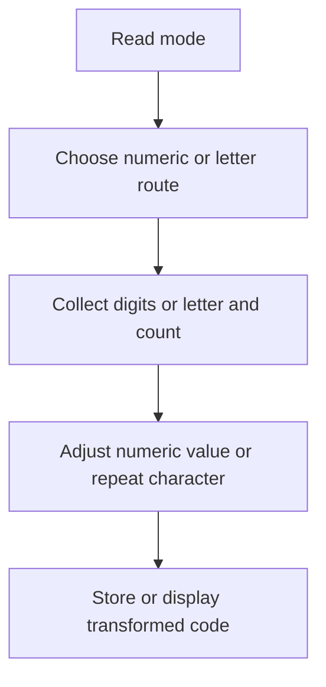
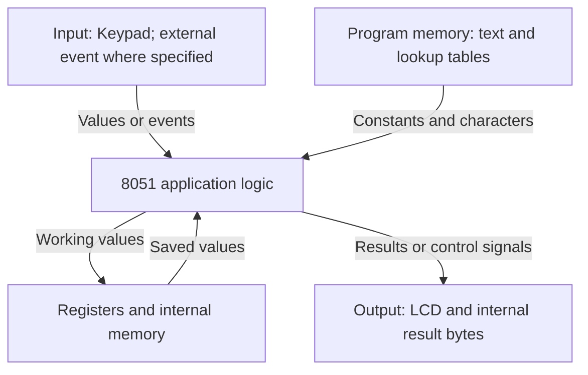

# Number and Letter Transformations

[Group overview](../../README.md) · [Compare implementations](../README.md)

Transform a number assembled from digits, or repeat a letter a chosen number of times.

**Implementation:** Interrupt Code Numeric Entry

**Input:** keypad.  
**Output:** LCD and internal result bytes.

## Inputs and results

| Parameter | Description |
| --- | --- |
| Input | Numeric mode with digits, or letter mode with a character and repetition count |
| Output | A transformed number or repeated characters |

## Worked example

Digits 1, 2, and 3 form 123. The odd-number transformation adds 2, producing 125. Letter mode follows a separate repetition routine.

### Calculation details

For the decimal digit-combination stage, use digits 1, 2, 3. The hundreds and tens terms are 1 × 100 and 2 × 10. Adding the units gives 123 (7BH). Its low bit is set, so an odd/even dispatch on ACC.0 selects the odd case.

## Program operation

1. Read mode.
2. Choose numeric or letter route.
3. Collect digits or letter and count.
4. Adjust numeric value or repeat character.
5. Store or display transformed code.

### Functional flowchart

[Detailed control flow](source-flow.md)

### Simplified block diagram

**Port registers:** `P0`, `P0.0`, `P0.1`, `P0.2`, `P2`, `P2.4`, `P2.7`, `p3`.

## Technical limitations

No additional defect was recorded in the earlier source review. This is not evidence of a successful build or hardware test.

## Build and test

1. Open the [assembly source](source.a51) in an 8051 assembler or simulator.
2. Review the technical limitations and configure the peripherals required by this implementation.
3. Check the expected result using the example inputs.
