# Program Control Flow

[Back to project](README.md)

Control-flow blocks are indexed by source line. Calls resume at the instruction following the call if the subroutine returns normally.

## Entry locations

- `ORG 0H` begins at B1.
- `ORG 03H` begins at B2.
- `ORG 30h` begins at B3.

## Navigation

[Section 1](#section-1) · [Section 2](#section-2) · [Section 3](#section-3) · [Section 4](#section-4) · [Section 5](#section-5) · [Section 6](#section-6) · [Section 7](#section-7) · [Section 8](#section-8) · [Section 9](#section-9) · [Section 10](#section-10) · [Section 11](#section-11) · [Section 12](#section-12) · [Section 13](#section-13) · [Section 14](#section-14) · [Section 15](#section-15) · [Section 16](#section-16) · [Section 17](#section-17) · [Section 18](#section-18) · [Section 19](#section-19) · [Section 20](#section-20) · [Section 21](#section-21) · [Section 22](#section-22) · [Section 23](#section-23) · [Section 24](#section-24)

## Section 1

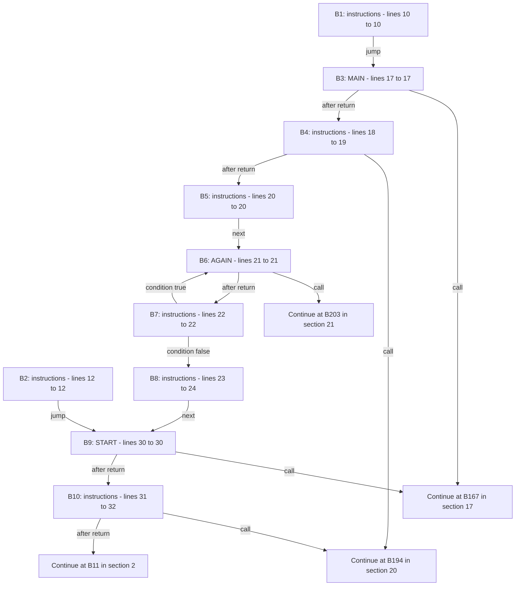

### B1

```asm
Ljmp Main
```

### B2

```asm
LJMP START
```

### B3

```asm
LCALL INLCD
```

### B4

```asm
MOV DPTR,#Welcome
LCALL WSTR
```

### B5

```asm
mov r5,#2
```

### B6

```asm
lcall delay
```

### B7

```asm
djnz r5,again
```

### B8

```asm
MOV IE,#10000001B
SETB IT0
```

### B9

```asm
LCALL INLCD
```

### B10

```asm
MOV DPTR,#ONE
LCALL WSTR
```

## Section 2

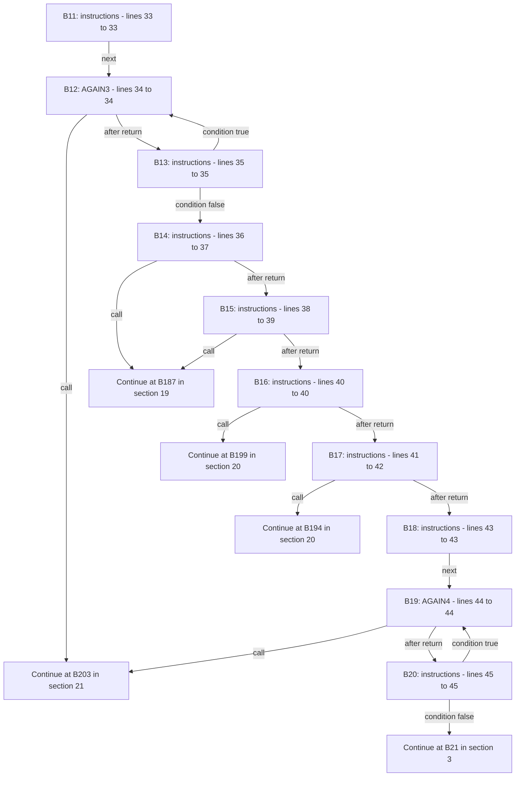

### B11

```asm
mov r5,#2
```

### B12

```asm
lcall delay
```

### B13

```asm
djnz r5,again3
```

### B14

```asm
mov a,#0CH
acall cmd
```

### B15

```asm
mov a,#0h
acall cmd
```

### B16

```asm
acall ldelay
```

### B17

```asm
MOV DPTR,#ONE_
LCALL WSTR
```

### B18

```asm
mov r5,#3
```

### B19

```asm
lcall delay
```

### B20

```asm
djnz r5,again4
```

## Section 3

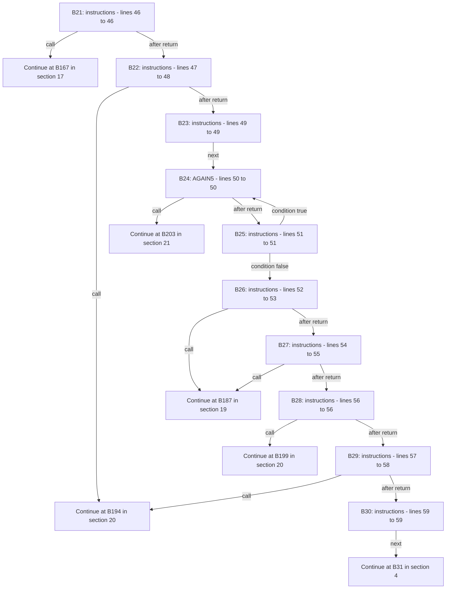

### B21

```asm
LCALL INLCD
```

### B22

```asm
MOV DPTR,#TWO
LCALL WSTR
```

### B23

```asm
mov r5,#2
```

### B24

```asm
lcall delay
```

### B25

```asm
djnz r5,again5
```

### B26

```asm
mov a,#0CH
acall cmd
```

### B27

```asm
mov a,#0h
acall cmd
```

### B28

```asm
acall ldelay
```

### B29

```asm
MOV DPTR,#TWOL
LCALL WSTR
```

### B30

```asm
mov r5,#3
```

## Section 4

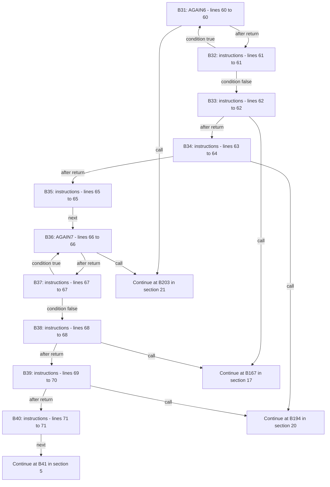

### B31

```asm
lcall delay
```

### B32

```asm
djnz r5,again6
```

### B33

```asm
LCALL INLCD
```

### B34

```asm
MOV DPTR,#TWOD
LCALL WSTR
```

### B35

```asm
mov r5,#2
```

### B36

```asm
lcall delay
```

### B37

```asm
djnz r5,again7
```

### B38

```asm
LCALL INLCD
```

### B39

```asm
MOV DPTR,#EXITT
LCALL WSTR
```

### B40

```asm
mov r5,#2
```

## Section 5

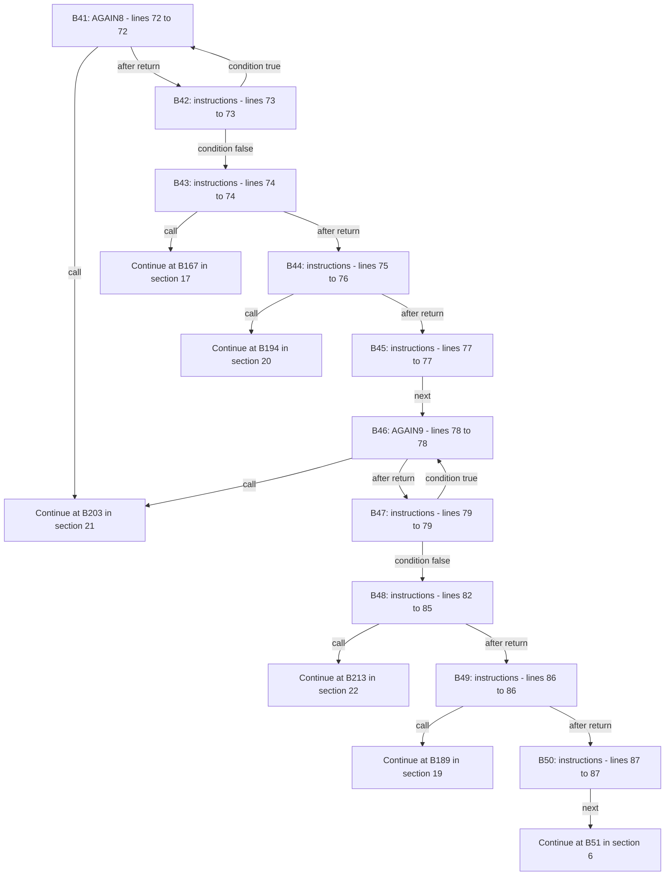

### B41

```asm
lcall delay
```

### B42

```asm
djnz r5,again8
```

### B43

```asm
LCALL INLCD
```

### B44

```asm
MOV DPTR,#ENTERSEL
LCALL WSTR
```

### B45

```asm
mov r5,#2
```

### B46

```asm
lcall delay
```

### B47

```asm
djnz r5,again9
```

### B48

```asm
mov a,#1
ACALL KEYPAD
```

### B49

```asm
ACALL WCHR
```

### B50

```asm
SUBB A,#30H
```

## Section 6

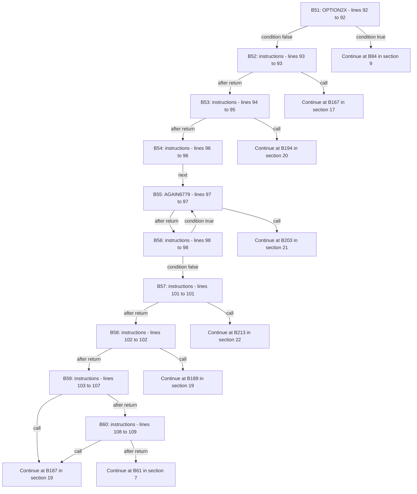

### B51

```asm
cjne a,#2,exit
```

### B52

```asm
LCALL INLCD
```

### B53

```asm
MOV DPTR,#ENTERL
LCALL WSTR
```

### B54

```asm
mov r5,#2
```

### B55

```asm
lcall delay
```

### B56

```asm
djnz r5,again6779
```

### B57

```asm
ACALL KEYPAD
```

### B58

```asm
ACALL WCHR
```

### B59

```asm
mov r7,a
MOV A,#0CH
ACALL CMD
```

### B60

```asm
MOV A,#0H
ACALL CMD
```

## Section 7

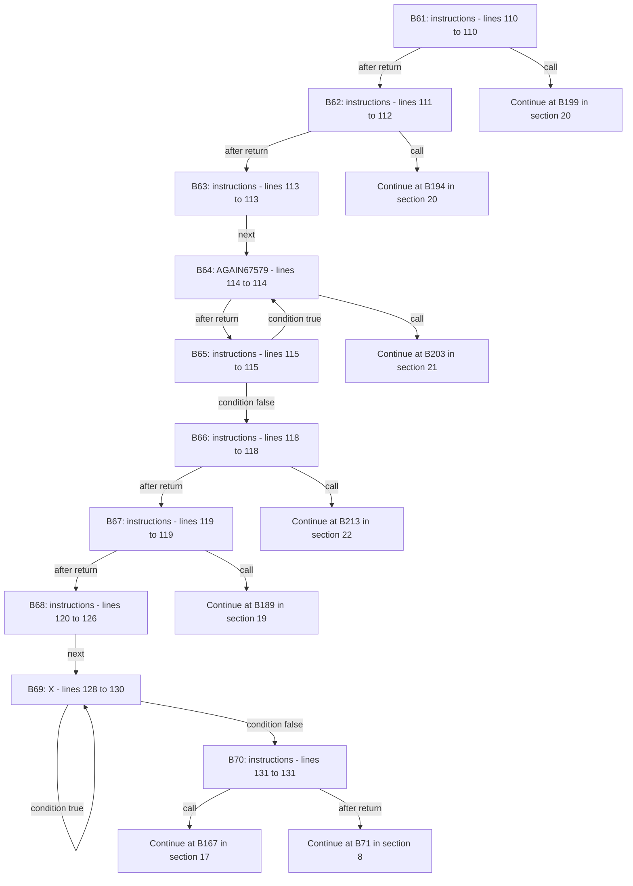

### B61

```asm
ACALL LDELAY
```

### B62

```asm
MOV DPTR,#ENTERD
LCALL WSTR
```

### B63

```asm
mov r5,#2
```

### B64

```asm
lcall delay
```

### B65

```asm
djnz r5,again67579
```

### B66

```asm
ACALL KEYPAD
```

### B67

```asm
ACALL WCHR
```

### B68

```asm
SUBB A,#30H
ADD A,#1
MOV 78H,A
mov r1,a
mov r0,#70h
mov a,r7
```

### B69

```asm
mov @r0,a
inc r0
djnz r1,x
```

### B70

```asm
ACALL INLCD
```

## Section 8

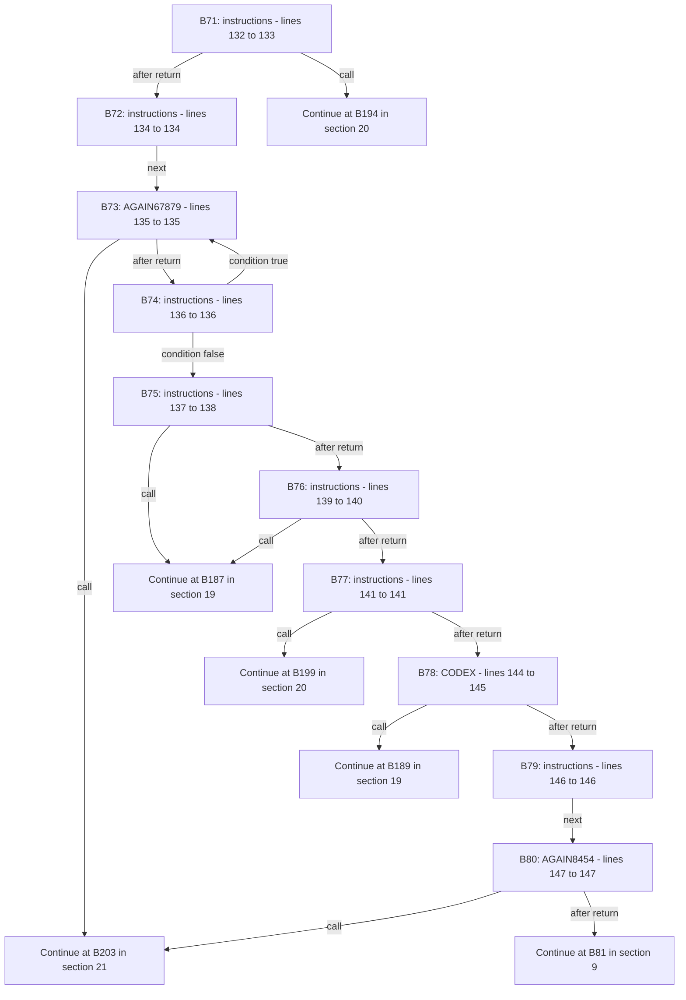

### B71

```asm
MOV DPTR,#SECRET
LCALL WSTR
```

### B72

```asm
mov r5,#2
```

### B73

```asm
lcall delay
```

### B74

```asm
djnz r5,again67879
```

### B75

```asm
MOV A,#0CH
ACALL CMD
```

### B76

```asm
MOV A,#0H
ACALL CMD
```

### B77

```asm
ACALL LDELAY
```

### B78

```asm
MOV A,R7
ACALL WCHR
```

### B79

```asm
mov r5,#2
```

### B80

```asm
lcall delay
```

## Section 9

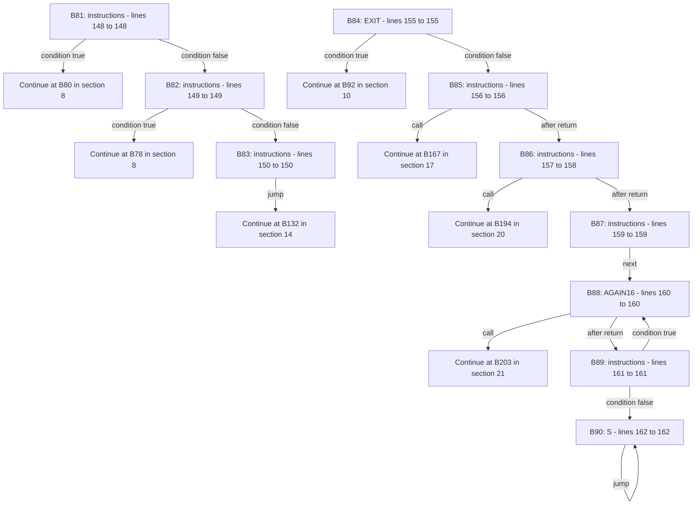

### B81

```asm
djnz r5,again8454
```

### B82

```asm
DJNZ 78H,CODEX
```

### B83

```asm
LJMP EXITORMENU
```

### B84

```asm
cjne a,#3,OPTION1
```

### B85

```asm
LCALL INLCD
```

### B86

```asm
MOV DPTR,#THANKYOU
LCALL WSTR
```

### B87

```asm
mov r5,#2
```

### B88

```asm
lcall delay
```

### B89

```asm
djnz r5,again16
```

### B90

```asm
SJMP S
```

## Section 10

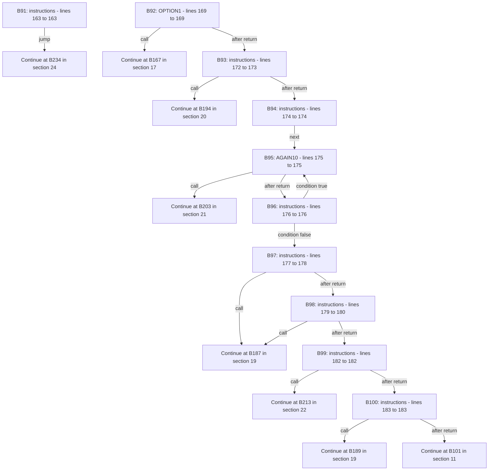

### B91

```asm
LJMP endofcode
```

### B92

```asm
LCALL INLCD
```

### B93

```asm
MOV DPTR,#ENTERC
LCALL WSTR
```

### B94

```asm
mov r5,#3
```

### B95

```asm
lcall delay
```

### B96

```asm
djnz r5,again10
```

### B97

```asm
MOV A,#0CH
LCALL CMD
```

### B98

```asm
MOV A,#2H
LCALL CMD
```

### B99

```asm
ACALL KEYPAD
```

### B100

```asm
ACALL WCHR
```

## Section 11

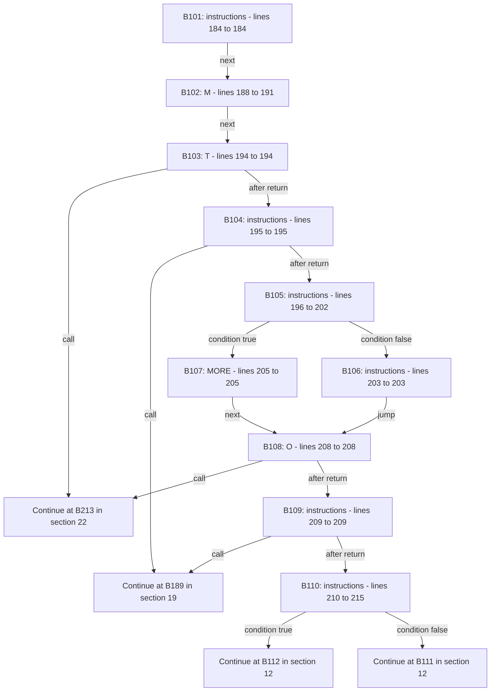

### B101

```asm
SUBB A,#30H
```

### B102

```asm
mov b,#100
mul ab
mov r5,a
mov r6,b
```

### B103

```asm
ACALL KEYPAD
```

### B104

```asm
ACALL WCHR
```

### B105

```asm
SUBB A,#30H
mov b,#10
mul ab
add a,r5
mov r5,a
jc more
```

### B106

```asm
sjmp O
```

### B107

```asm
inc r6
```

### B108

```asm
ACALL KEYPAD
```

### B109

```asm
ACALL WCHR
```

### B110

```asm
SUBB A,#30H
add a,r5
mov r5,a
jc more2
```

## Section 12

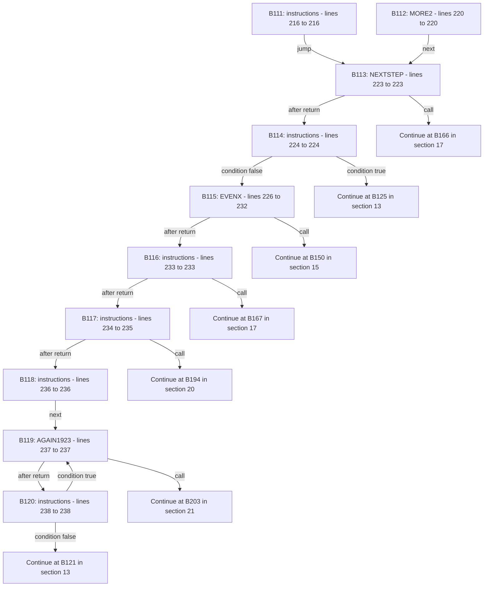

### B111

```asm
sjmp nextstep
```

### B112

```asm
inc r6
```

### B113

```asm
ACALL ENTERED_NUMER
```

### B114

```asm
jb acc.0,ODDX
```

### B115

```asm
MOV A,R5
subb a,#2
mov r5,a
mov r0,#3
LCALL PRINTOP2
```

### B116

```asm
LCALL INLCD
```

### B117

```asm
MOV DPTR,#EVENN
LCALL WSTR
```

### B118

```asm
mov r4,#3
```

### B119

```asm
lcall delay
```

### B120

```asm
djnz r4,again1923
```

## Section 13

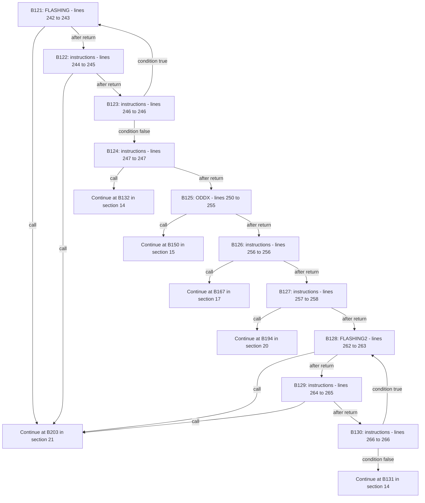

### B121

```asm
mov p3,#0
acall delay
```

### B122

```asm
mov p3,#0ffh
acall delay
```

### B123

```asm
djnz r0,flashing
```

### B124

```asm
LCALL exitORmenu
```

### B125

```asm
MOV A,R5
add a,#2
mov r5,a
mov r0,#2
LCALL PRINTOP2
```

### B126

```asm
LCALL INLCD
```

### B127

```asm
MOV DPTR,#ODDD
LCALL WSTR
```

### B128

```asm
mov p3,#0
acall delay
```

### B129

```asm
mov p3,#0ffh
acall delay
```

### B130

```asm
djnz r0,flashing2
```

## Section 14

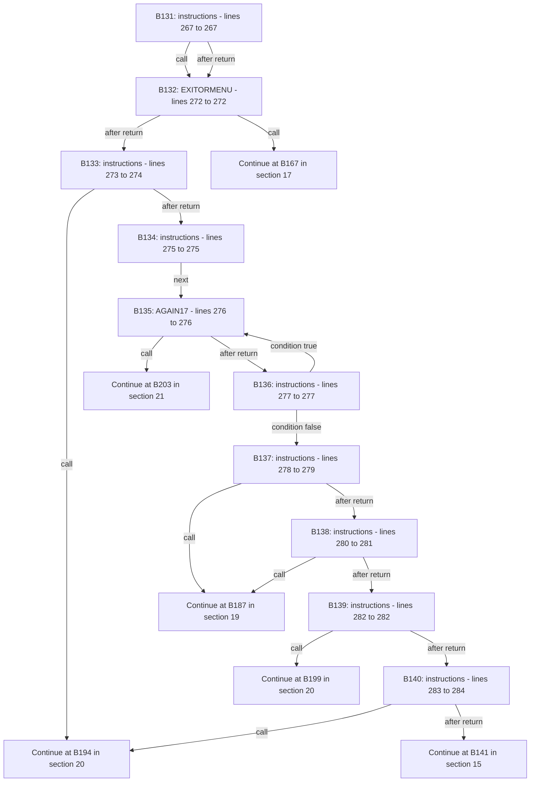

### B131

```asm
LCALL exitORmenu
```

### B132

```asm
LCALL INLCD
```

### B133

```asm
MOV DPTR,#EXIT_MEN
LCALL WSTR
```

### B134

```asm
mov r5,#3
```

### B135

```asm
lcall delay
```

### B136

```asm
djnz r5,again17
```

### B137

```asm
MOV A,#0CH
LCALL CMD
```

### B138

```asm
MOV A,#0H
LCALL CMD
```

### B139

```asm
LCALL LDELAY
```

### B140

```asm
MOV DPTR,#EXIT_MENU
LCALL WSTR
```

## Section 15

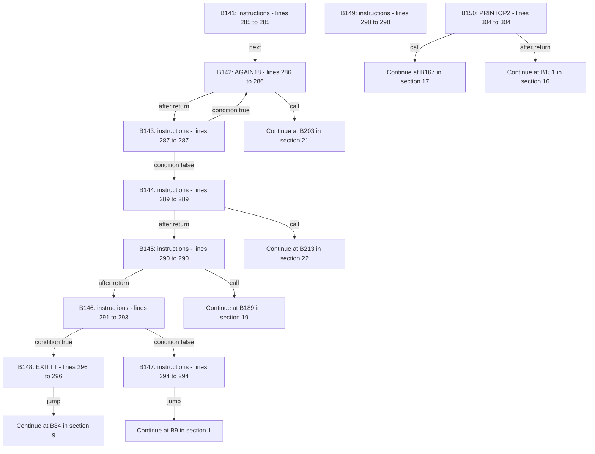

### B141

```asm
mov r5,#3
```

### B142

```asm
lcall delay
```

### B143

```asm
djnz r5,again18
```

### B144

```asm
ACALL KEYPAD
```

### B145

```asm
ACALL WCHR
```

### B146

```asm
SUBB A,#30H
CJNE A,#0,EXITTT
```

### B147

```asm
AJMP MENU
```

### B148

```asm
LJMP EXIT
```

### B149

Return to the instruction following the active call.

```asm
ret
```

### B150

```asm
LCALL INLCD
```

## Section 16

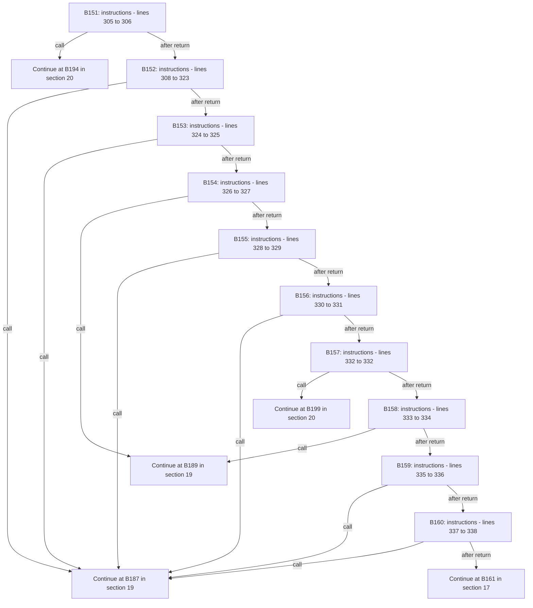

### B151

```asm
MOV DPTR,#SECRET
LCALL WSTR
```

### B152

```asm
MOV A,r5
MOV B,#100
DIV AB
ADD A,#30H
MOV 32h,A
MOV A,B
MOV B,#10
DIV AB
ADD A,#30H
MOV 33H,A
MOV A,B
ADD A,#30H
MOV 34H,A
MOV A,#0CH
LCALL CMD
```

### B153

```asm
MOV A,#1H
LCALL CMD
```

### B154

```asm
MOV A,32H
LCALL WCHR
```

### B155

```asm
MOV A,#0CH
LCALL CMD
```

### B156

```asm
MOV A,#2H
LCALL CMD
```

### B157

```asm
LCALL LDELAY
```

### B158

```asm
MOV A,33H
LCALL WCHR
```

### B159

```asm
MOV A,#0CH
LCALL CMD
```

### B160

```asm
MOV A,#3H
LCALL CMD
```

## Section 17

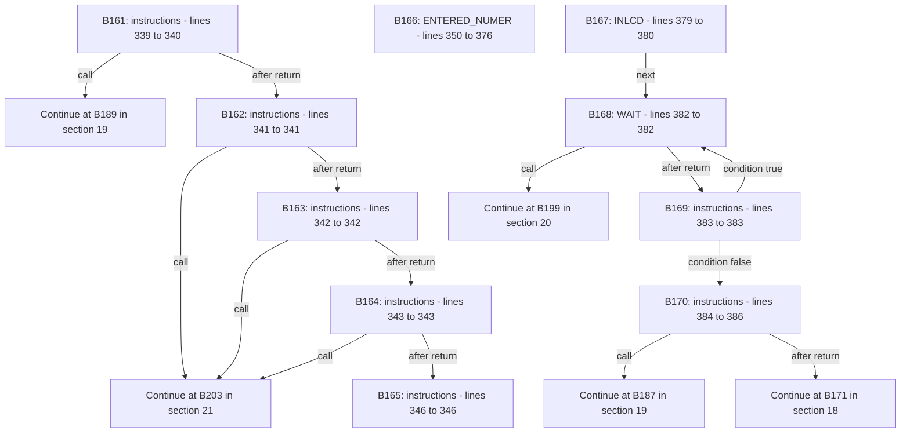

### B161

```asm
MOV A,34H
LCALL WCHR
```

### B162

```asm
LCALL DELAY
```

### B163

```asm
LCALL DELAY
```

### B164

```asm
LCALL DELAY
```

### B165

Return to the instruction following the active call.

```asm
RET
```

### B166

Return to the instruction following the active call.

```asm
MOV A,r5
MOV B,#100
DIV AB
MOV 32h,A
MOV A,B
MOV B,#10
DIV AB
MOV 33H,A
MOV A,B
MOV 34H,A
MOV A,34H
MOV B,#100
MUL AB
MOV 77H,A
MOV B,#10
MOV A,33H
MUL AB
ADD A,77H
ADD A,32H
MOV 77H,A
MOV R5,A
RET
```

### B167

```asm
PUSH 7
MOV R7,#20
```

### B168

```asm
ACALL LDELAY
```

### B169

```asm
DJNZ R7,WAIT
```

### B170

```asm
MOV P0,#00000111B
MOV A,#0011B
ACALL CMD
```

## Section 18

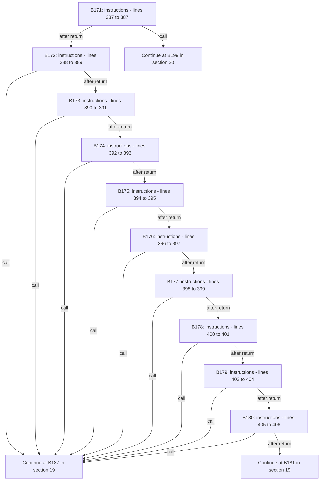

### B171

```asm
ACALL LDELAY
```

### B172

```asm
MOV A,#0011B
ACALL CMD
```

### B173

```asm
MOV A,#0011B
ACALL CMD
```

### B174

```asm
MOV A,#0010B
ACALL CMD
```

### B175

```asm
MOV A,#0010B
ACALL CMD
```

### B176

```asm
MOV A,#1000B
ACALL CMD
```

### B177

```asm
MOV A,#0000B
ACALL CMD
```

### B178

```asm
MOV A,#1000B
ACALL CMD
```

### B179

```asm
MOV A,#0
ACALL CMD
```

### B180

```asm
MOV A,#0001B
ACALL CMD
```

## Section 19

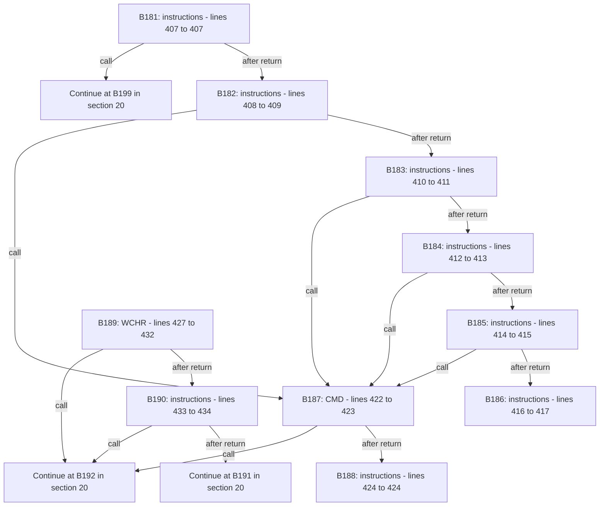

### B181

```asm
ACALL LDELAY
```

### B182

```asm
MOV A,#0000B
ACALL CMD
```

### B183

```asm
MOV A,#0110B
ACALL CMD
```

### B184

```asm
MOV A,#0000B
ACALL CMD
```

### B185

```asm
MOV A,#1111B
ACALL CMD
```

### B186

Return to the instruction following the active call.

```asm
POP 7
RET
```

### B187

```asm
CLR RS
ACALL COMMON
```

### B188

Return to the instruction following the active call.

```asm
RET
```

### B189

```asm
PUSH ACC
PUSH B
SETB RS
MOV B,A
SWAP A
ACALL COMMON
```

### B190

```asm
MOV A,B
ACALL COMMON
```

## Section 20

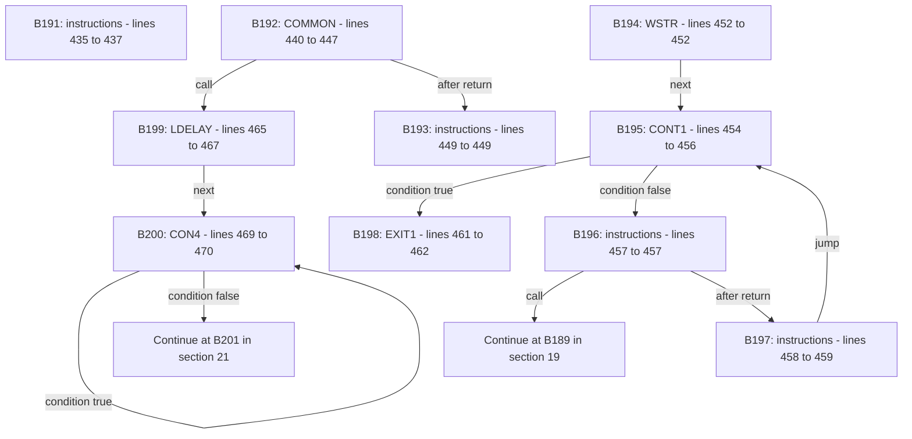

### B191

Return to the instruction following the active call.

```asm
POP B
POP ACC
RET
```

### B192

```asm
CLR RW
SWAP A
ANL A,#11110000B
ANL P0,#00000111B
ORL P0,A
SETB EN
CLR EN
ACALL LDELAY
```

### B193

Return to the instruction following the active call.

```asm
RET
```

### B194

```asm
PUSH ACC
```

### B195

```asm
CLR A
MOVC A,@A+DPTR
JZ EXIT1
```

### B196

```asm
ACALL WCHR
```

### B197

```asm
INC DPTR
AJMP CONT1
```

### B198

Return to the instruction following the active call.

```asm
POP ACC
RET
```

### B199

```asm
PUSH 0
PUSH 1
MOV R1,#20
```

### B200

```asm
MOV R0,#250
DJNZ R0,$
```

## Section 21

```mermaid
flowchart TD
B200["B201: instructions - lines 471 to 471"]
B201["B202: instructions - lines 472 to 474"]
B202["B203: DELAY - lines 476 to 479"]
B203["B204: X36 - lines 480 to 480"]
B204["B205: X26 - lines 481 to 481"]
B205["B206: X16 - lines 482 to 482"]
B206["B207: instructions - lines 483 to 483"]
B207["B208: instructions - lines 484 to 484"]
B208["B209: instructions - lines 485 to 488"]
B209["B210: TMSEC - lines 490 to 493"]
B200 -->|condition true| B199
B200 -->|condition false| B201
B202 -->|next| B203
B203 -->|next| B204
B204 -->|next| B205
B205 -->|condition true| B205
B205 -->|condition false| B206
B206 -->|condition true| B204
B206 -->|condition false| B207
B207 -->|condition true| B203
B207 -->|condition false| B208
B209 -->|next| B210
B199["Continue at B200 in section 20"]
B210["Continue at B211 in section 22"]
```

### B201

```asm
DJNZ R1,CON4
```

### B202

Return to the instruction following the active call.

```asm
POP 1
POP 0
RET
```

### B203

```asm
PUSH 5
PUSH 4
PUSH 3
MOV R5,#20
```

### B204

```asm
MOV R4,#200
```

### B205

```asm
MOV R3,#250
```

### B206

```asm
DJNZ R3,X16
```

### B207

```asm
DJNZ R4,X26
```

### B208

```asm
DJNZ R5,X36
```

### B209

Return to the instruction following the active call.

```asm
POP 3
POP 4
POP 5
RET
```

### B210

```asm
MOV TMOD,#00000001B
MOV TL0,#0CAH
MOV TH0,#27H
SETB TR0
```

## Section 22

```mermaid
flowchart TD
B210["B211: BACK - lines 494 to 494"]
B211["B212: instructions - lines 495 to 497"]
B212["B213: KEYPAD - lines 501 to 501"]
B213["B214: K1 - lines 503 to 506"]
B214["B215: K2 - lines 508 to 508"]
B215["B216: instructions - lines 509 to 511"]
B216["B217: instructions - lines 512 to 512"]
B217["B218: OVER - lines 515 to 515"]
B218["B219: instructions - lines 516 to 518"]
B219["B220: instructions - lines 519 to 519"]
B210 -->|condition true| B210
B210 -->|condition false| B211
B212 -->|next| B213
B213 -->|condition true| B213
B213 -->|condition false| B214
B214 -->|call| B209
B214 -->|after return| B215
B215 -->|condition true| B217
B215 -->|condition false| B216
B216 -->|jump| B214
B217 -->|call| B209
B217 -->|after return| B218
B218 -->|condition true| B220
B218 -->|condition false| B219
B219 -->|jump| B214
B209["Continue at B210 in section 21"]
B220["Continue at B221 in section 23"]
```

### B211

```asm
JNB TF0,BACK
```

### B212

Return to the instruction following the active call.

```asm
CLR TR0
CLR TF0
RET
```

### B213

```asm
MOV P2,#11110000B
```

### B214

```asm
MOV P2,#11110000B
MOV A,P2
ANL A,#11110000B
CJNE A,#11110000B,K1
```

### B215

```asm
ACALL TMSEC
```

### B216

```asm
MOV A,P2
ANL A,#11110000B
CJNE A,#11110000B,OVER
```

### B217

```asm
SJMP K2
```

### B218

```asm
ACALL TMSEC
```

### B219

```asm
MOV A,P2
ANL A,#11110000B
CJNE A,#11110000B,OVER1
```

### B220

```asm
SJMP K2
```

## Section 23

```mermaid
flowchart TD
B220["B221: OVER1 - lines 522 to 525"]
B221["B222: instructions - lines 527 to 530"]
B222["B223: instructions - lines 532 to 535"]
B223["B224: instructions - lines 537 to 540"]
B224["B225: instructions - lines 542 to 542"]
B225["B226: ROW_0 - lines 544 to 545"]
B226["B227: ROW_1 - lines 547 to 548"]
B227["B228: ROW_2 - lines 550 to 551"]
B228["B229: ROW_3 - lines 553 to 553"]
B229["B230: FIND - lines 556 to 556"]
B220 -->|condition true| B225
B220 -->|condition false| B221
B221 -->|condition true| B226
B221 -->|condition false| B222
B222 -->|condition true| B227
B222 -->|condition false| B223
B223 -->|condition true| B228
B223 -->|condition false| B224
B224 -->|jump| B214
B225 -->|jump| B229
B226 -->|jump| B229
B227 -->|jump| B229
B228 -->|next| B229
B229 -->|next| B230
B214["Continue at B215 in section 22"]
B230["Continue at B231 in section 24"]
```

### B221

```asm
MOV P2,#11111110B
MOV A,P2
ANL A,#11110000B
CJNE A,#11110000B,ROW_0
```

### B222

```asm
MOV P2,#11111101B
MOV A,P2
ANL A,#11110000B
CJNE A,#11110000B,ROW_1
```

### B223

```asm
MOV P2,#11111011B
MOV A,P2
ANL A,#11110000B
CJNE A,#11110000B,ROW_2
```

### B224

```asm
MOV P2,#11110111B
MOV A,P2
ANL A,#11110000B
CJNE A,#11110000B,ROW_3
```

### B225

```asm
LJMP K2
```

### B226

```asm
MOV DPTR,#KCODE0
SJMP FIND
```

### B227

```asm
MOV DPTR,#KCODE1
SJMP FIND
```

### B228

```asm
MOV DPTR,#KCODE2
SJMP FIND
```

### B229

```asm
MOV DPTR,#KCODE3
```

### B230

```asm
SWAP A
```

## Section 24

```mermaid
flowchart TD
B230["B231: FIND1 - lines 559 to 560"]
B231["B232: instructions - lines 561 to 562"]
B232["B233: MATCH - lines 565 to 567"]
B233["B234: ENDOFCODE - lines 599 to 599"]
B230 -->|condition true| B232
B230 -->|condition false| B231
B231 -->|jump| B230
```

### B231

```asm
RRC A
JNC MATCH
```

### B232

```asm
INC DPTR
SJMP FIND1
```

### B233

Return to the instruction following the active call.

```asm
CLR A
MOVC A,@A+DPTR
RET
```

### B234

Resume the interrupted program.

```asm
RETI
```
