# Program Control Flow

[Back to project](README.md)

Control-flow blocks are indexed by source line. Calls resume at the instruction following the call if the subroutine returns normally.

## Entry locations

- `ORG 0H` begins at B1.

## Navigation

[Section 1](#section-1) · [Section 2](#section-2) · [Section 3](#section-3) · [Section 4](#section-4) · [Section 5](#section-5) · [Section 6](#section-6) · [Section 7](#section-7) · [Section 8](#section-8) · [Section 9](#section-9) · [Section 10](#section-10) · [Section 11](#section-11) · [Section 12](#section-12)

## Destinations requiring review

`CONVERTER`. A repeated label is also unresolved because it has more than one candidate target.

## Lines outside the instruction parser

These may be assembler directives, macros, or malformed source; inspect them before building.

```asm
135: ;100's digit
140: ;10's digit
146: ;1's digit
```

## Section 1

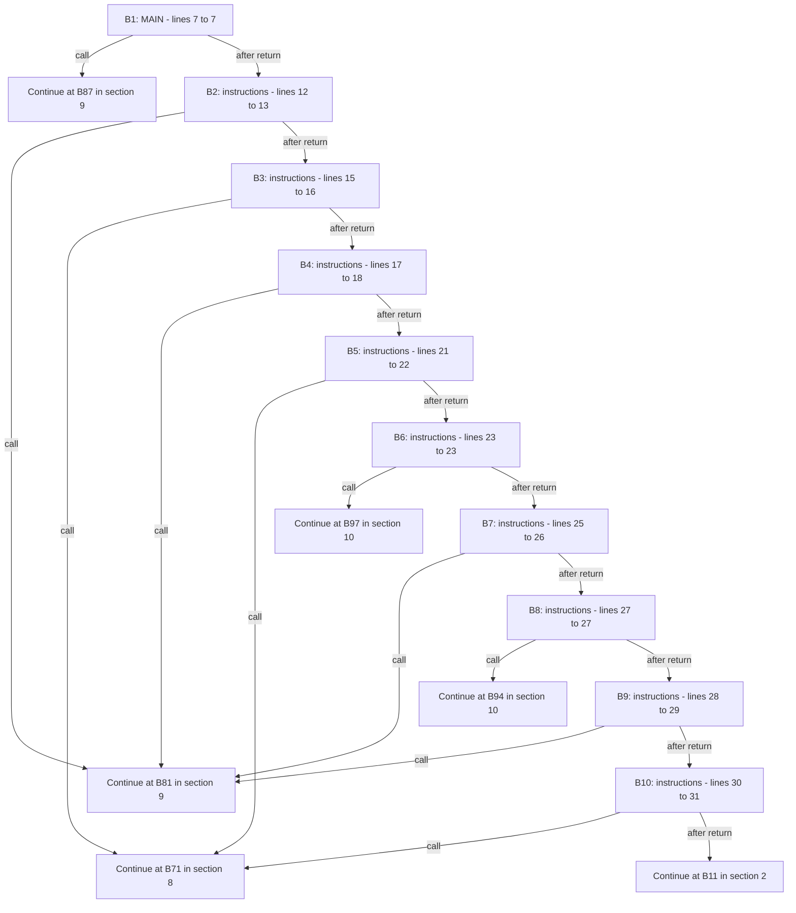

### B1

```asm
ACALL INLCD
```

### B2

```asm
MOV A,#80H
ACALL CMD
```

### B3

```asm
MOV DPTR, #WELCOME1
ACALL WSTR
```

### B4

```asm
MOV A,#0C0H
ACALL CMD
```

### B5

```asm
MOV DPTR, #WELCOME2
ACALL WSTR
```

### B6

```asm
ACALL DELAY_1SEC
```

### B7

```asm
MOV A, #1H
ACALL CMD
```

### B8

```asm
ACALL TMSEC
```

### B9

```asm
MOV A,#80H
ACALL CMD
```

### B10

```asm
MOV DPTR, #MSG1
ACALL WSTR
```

## Section 2

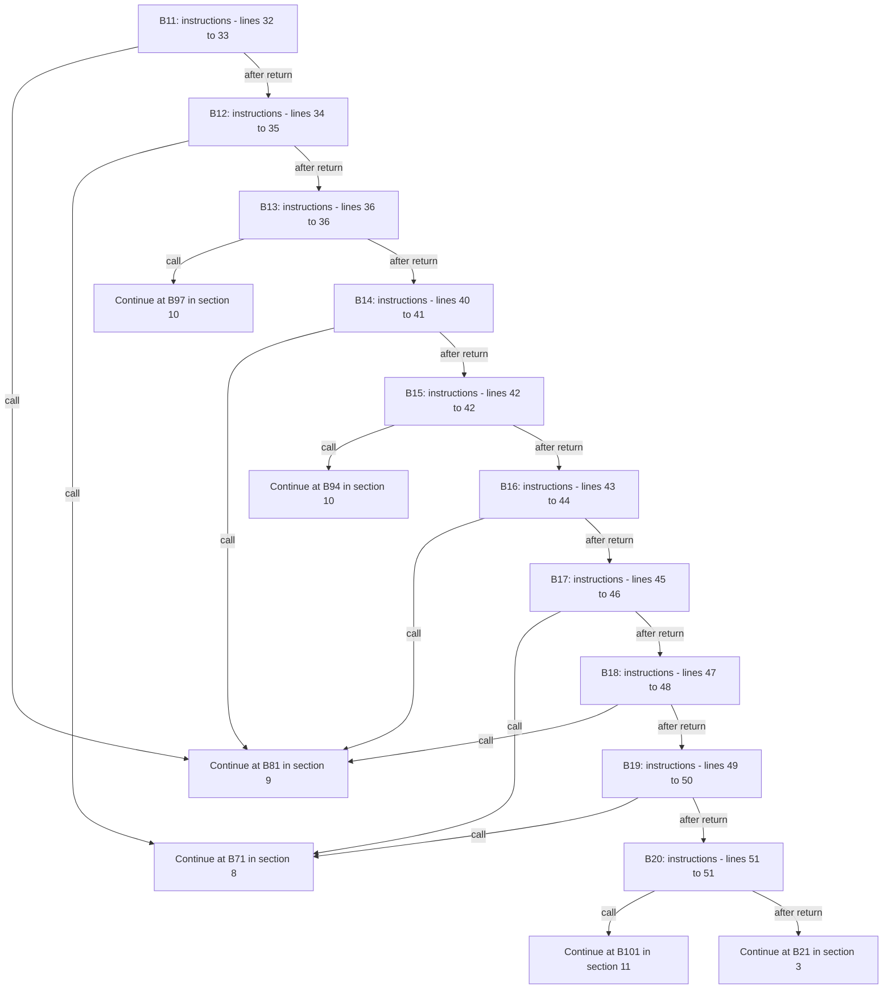

### B11

```asm
MOV A,#0C0H
ACALL CMD
```

### B12

```asm
MOV DPTR, #MSG2
ACALL WSTR
```

### B13

```asm
ACALL DELAY_1SEC
```

### B14

```asm
MOV A, #1H
ACALL CMD
```

### B15

```asm
ACALL TMSEC
```

### B16

```asm
MOV A,#80H
ACALL CMD
```

### B17

```asm
MOV DPTR, #ENTER
ACALL WSTR
```

### B18

```asm
MOV A,#0C0H
ACALL CMD
```

### B19

```asm
MOV DPTR, #CHOICE
ACALL WSTR
```

### B20

```asm
ACALL KEYPAD
```

## Section 3

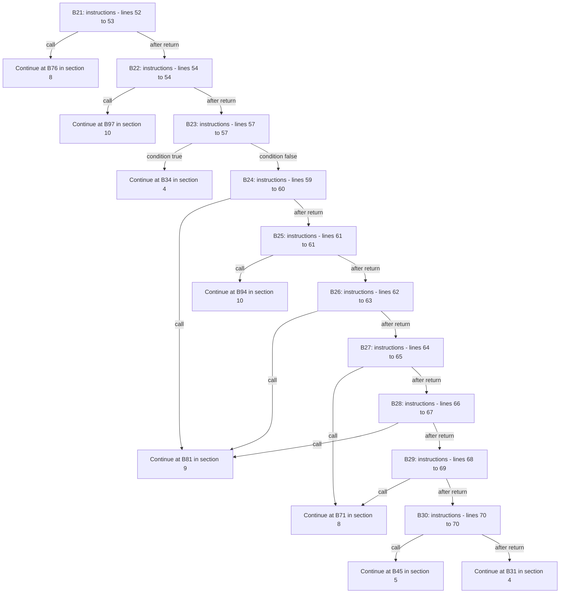

### B21

```asm
MOV R5,A
ACALL WCHR
```

### B22

```asm
ACALL DELAY_1SEC
```

### B23

```asm
CJNE R5, #'1', HEXADECIMAL
```

### B24

```asm
MOV A, #1H
ACALL CMD
```

### B25

```asm
ACALL TMSEC
```

### B26

```asm
MOV A,#80H
ACALL CMD
```

### B27

```asm
MOV DPTR, #ENTER1
ACALL WSTR
```

### B28

```asm
MOV A,#0C0H
ACALL CMD
```

### B29

```asm
MOV DPTR, #NUMBER_MSG
ACALL WSTR
```

### B30

```asm
ACALL BinToDec
```

## Section 4

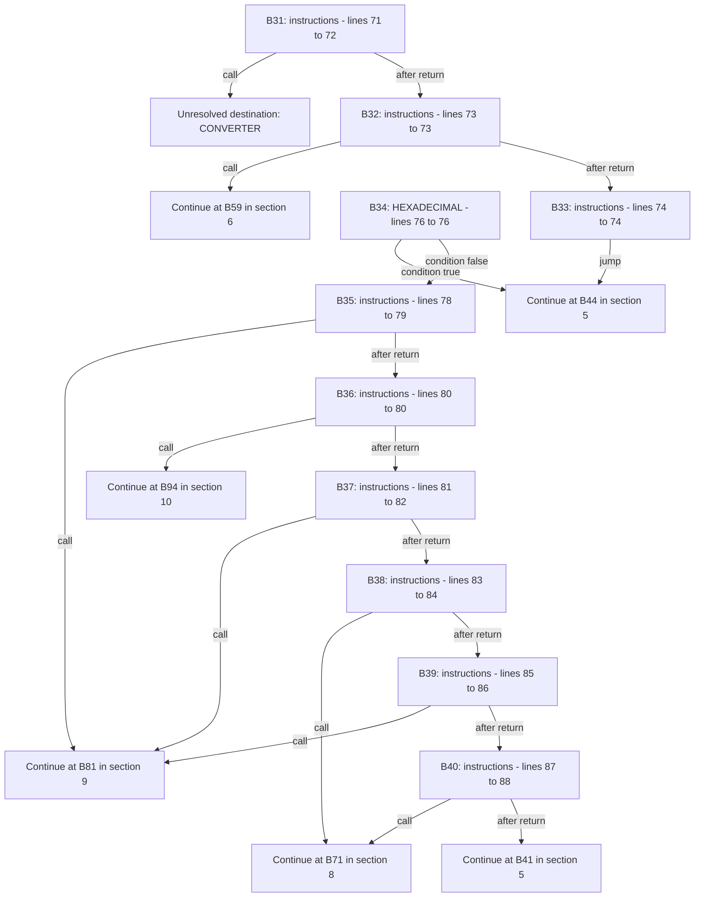

### B31

```asm
MOV A, R0
ACALL Converter
```

### B32

```asm
ACALL DISPLAY
```

### B33

```asm
SJMP STOP
```

### B34

```asm
CJNE R5, #'2', STOP
```

### B35

```asm
MOV A, #1H
ACALL CMD
```

### B36

```asm
ACALL TMSEC
```

### B37

```asm
MOV A,#80H
ACALL CMD
```

### B38

```asm
MOV DPTR, #ENTER2
ACALL WSTR
```

### B39

```asm
MOV A,#0C0H
ACALL CMD
```

### B40

```asm
MOV DPTR, #NUMBER_MSG
ACALL WSTR
```

## Section 5

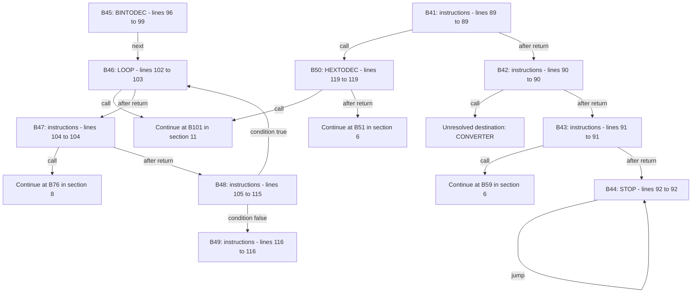

### B41

```asm
ACALL HexToDec
```

### B42

```asm
ACALL Converter
```

### B43

```asm
ACALL DISPLAY
```

### B44

```asm
SJMP $
```

### B45

```asm
mov R2,#8
MOV R0,#0
MOV R1,#128
MOV DPTR,#Binary
```

### B46

```asm
CLR A
ACALL KEYPAD
```

### B47

```asm
ACALL WCHR
```

### B48

```asm
CLR C
SUBB A,#30H
MOV B,R1
MUL AB
ADD A,R0
MOV R0,A
MOV A,R1
MOV B,#2
DIV AB
MOV R1,A
DJNZ R2,LOOP
```

### B49

Return to the instruction following the active call.

```asm
RET
```

### B50

```asm
ACALL KEYPAD
```

## Section 6

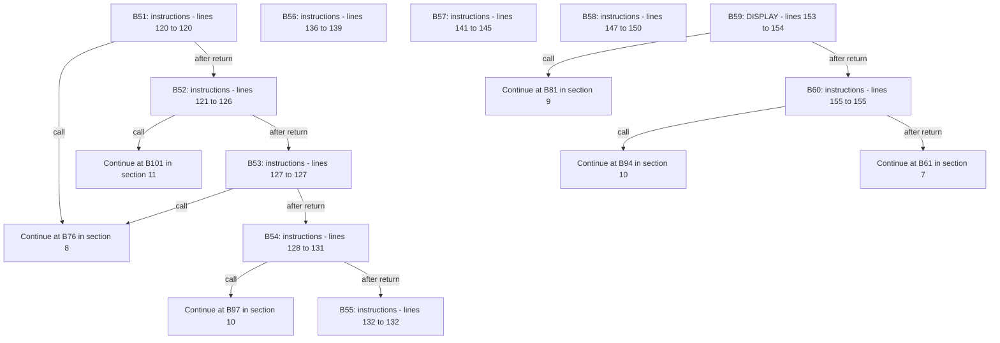

### B51

```asm
ACALL WCHR
```

### B52

```asm
CLR C
SUBB A,#30H
MOV B,#16
MUL AB
MOV R0,A
ACALL KEYPAD
```

### B53

```asm
ACALL WCHR
```

### B54

```asm
CLR C
SUBB A,#30H
ADD A,R0
ACALL DELAY_1SEC
```

### B55

Return to the instruction following the active call.

```asm
RET
```

### B56

```asm
MOV B, #100
DIV AB
ADD A, #30H
MOV 40H, A ;Store the 100's digit to RAM location 40H
```

### B57

```asm
MOV A, B
MOV B, #10
DIV AB
ADD A, #30H
MOV 41H, A ;Store the 10's digit to RAM location 41H
```

### B58

Return to the instruction following the active call.

```asm
MOV A, B
ADD A, #30H
MOV 42H, A ;Store the 1's digit to RAM location 42H
RET
```

### B59

```asm
MOV A, #1H
ACALL CMD
```

### B60

```asm
ACALL TMSEC
```

## Section 7

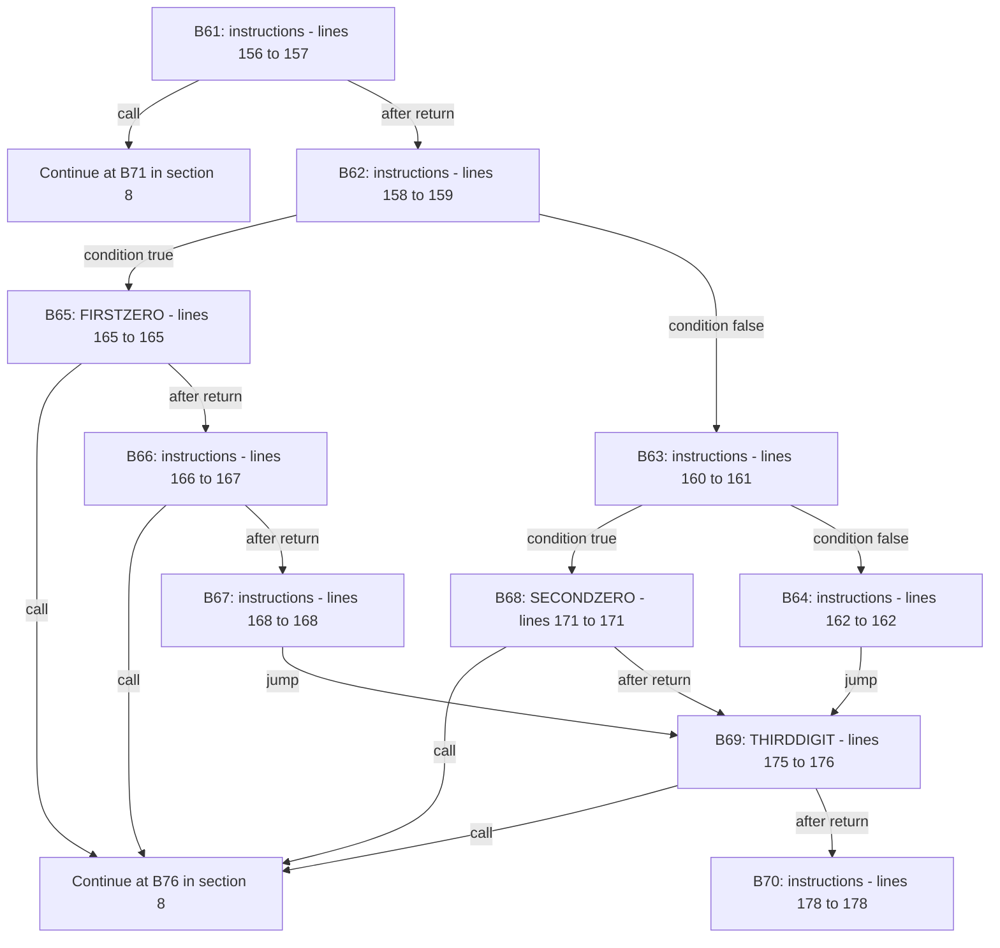

### B61

```asm
MOV DPTR ,#DISPLAY_MSG
ACALL WSTR
```

### B62

```asm
MOV A,40H
CJNE A,#'0',FIRSTZERO
```

### B63

```asm
MOV A, 41H
CJNE A,#'0',SECONDZERO
```

### B64

```asm
SJMP THIRDDIGIT
```

### B65

```asm
ACALL WCHR
```

### B66

```asm
MOV A,41H
ACALL WCHR
```

### B67

```asm
SJMP THIRDDIGIT
```

### B68

```asm
ACALL WCHR
```

### B69

```asm
MOV A,42H
ACALL WCHR
```

### B70

Return to the instruction following the active call.

```asm
RET
```

## Section 8

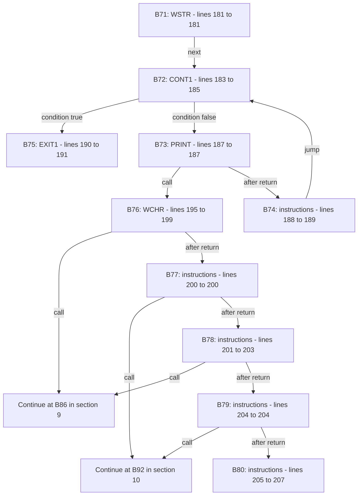

### B71

```asm
PUSH ACC
```

### B72

```asm
CLR A
MOVC A,@A+DPTR
JZ Exit1
```

### B73

```asm
ACALL WCHR
```

### B74

```asm
INC DPTR
AJMP CONT1
```

### B75

Return to the instruction following the active call.

```asm
POP ACC
RET
```

### B76

```asm
PUSH ACC
PUSH B
SETB P1.3
MOV B,A
ACALL COMMON
```

### B77

```asm
ACALL LDELAY
```

### B78

```asm
MOV A,B
SWAP A
ACALL COMMON
```

### B79

```asm
ACALL LDELAY
```

### B80

Return to the instruction following the active call.

```asm
POP B
POP ACC
RET
```

## Section 9

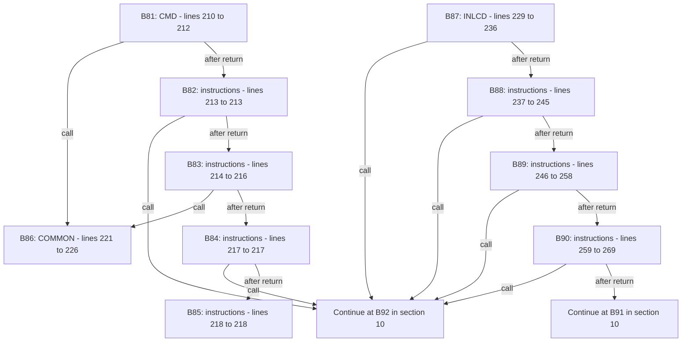

### B81

```asm
CLR P1.3
MOV B,A
ACALL COMMON
```

### B82

```asm
ACALL LDELAY
```

### B83

```asm
MOV A,B
SWAP A
ACALL COMMON
```

### B84

```asm
ACALL LDELAY
```

### B85

Return to the instruction following the active call.

```asm
RET
```

### B86

Return to the instruction following the active call.

```asm
ANL a,#11110000B
ANL P1, #00001111B
ORL P1,A
SETB P1.2
CLR P1.2
RET
```

### B87

```asm
CLR P1.3
CLR P1.7
CLR P1.6
SETB P1.5
CLR P1.4
SETB P1.2
CLR P1.2
ACALL LDELAY
```

### B88

```asm
SETB P1.2
CLR P1.2
SETB P1.7
CLR P1.6
CLR P1.5
CLR P1.4
SETB P1.2
CLR P1.2
ACALL LDELAY
```

### B89

```asm
CLR P1.7
CLR P1.6
CLR P1.5
CLR P1.4
SETB P1.2
CLR P1.2
SETB P1.7
SETB P1.6
SETB P1.5
SETB P1.4
SETB P1.2
CLR P1.2
ACALL LDELAY
```

### B90

```asm
CLR P1.7
CLR P1.6
CLR P1.5
CLR P1.4
SETB P1.2
CLR P1.2
SETB P1.6
SETB P1.5
SETB P1.2
CLR P1.2
ACALL LDELAY
```

## Section 10

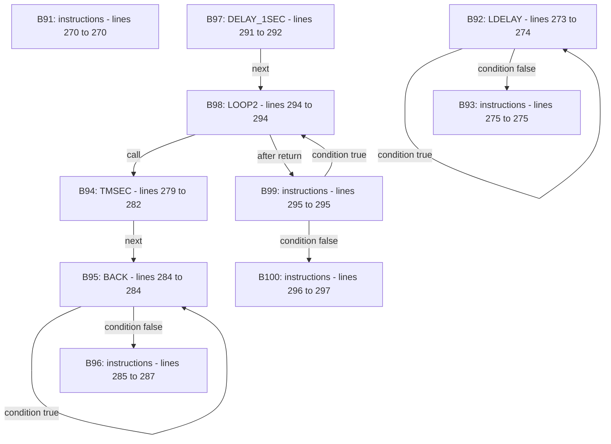

### B91

Return to the instruction following the active call.

```asm
RET
```

### B92

```asm
MOV R3, #50
DJNZ R3, $
```

### B93

Return to the instruction following the active call.

```asm
RET
```

### B94

```asm
MOV TMOD,#01H
MOV TL0,#0B0H
MOV TH0,#3CH
SETB TR0
```

### B95

```asm
JNB TF0,BACK
```

### B96

Return to the instruction following the active call.

```asm
CLR TR0
CLR TF0
RET
```

### B97

```asm
PUSH 07H
MOV R7, #20
```

### B98

```asm
ACALL TMSEC
```

### B99

```asm
DJNZ R7, LOOP2
```

### B100

Return to the instruction following the active call.

```asm
POP 07H
RET
```

## Section 11

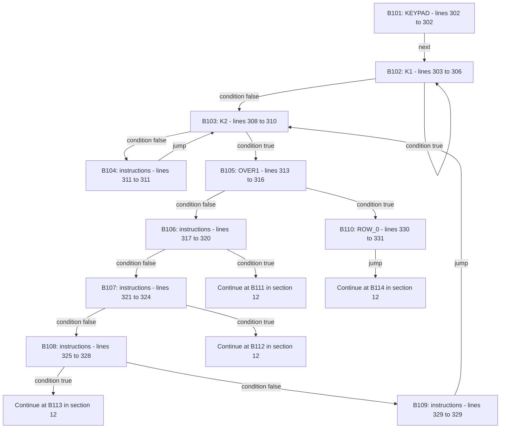

### B101

```asm
MOV P0,#01110000B
```

### B102

```asm
MOV P0,#01110000B
MOV A,P0
ANL A,#01110000B
CJNE A,#01110000B,K1
```

### B103

```asm
MOV A,P0
ANL A,#01110000B
CJNE A,#01110000B,OVER1
```

### B104

```asm
SJMP K2
```

### B105

```asm
MOV P0,#01111110B
MOV A,P0
ANL A,#01110000B
CJNE A,#01110000B,ROW_0
```

### B106

```asm
MOV P0,#01111101B
MOV A,P0
ANL A,#01110000B
CJNE A,#01110000B,ROW_1
```

### B107

```asm
MOV P0,#01111011B
MOV A,P0
ANL A,#01110000B
CJNE A,#01110000B,ROW_2
```

### B108

```asm
MOV P0,#01110111B
MOV A,P0
ANL A,#01110000B
CJNE A,#01110000B,ROW_3
```

### B109

```asm
LJMP K2
```

### B110

```asm
MOV DPTR,#KCODE0
SJMP FIND
```

## Section 12

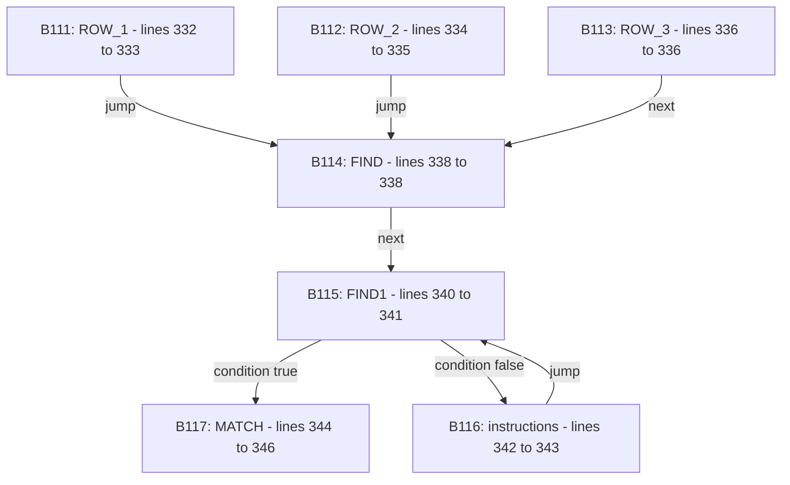

### B111

```asm
MOV DPTR,#KCODE1
SJMP FIND
```

### B112

```asm
MOV DPTR,#KCODE2
SJMP FIND
```

### B113

```asm
MOV DPTR,#KCODE3
```

### B114

```asm
RLC A
```

### B115

```asm
RLC A
JNC MATCH
```

### B116

```asm
INC DPTR
SJMP FIND1
```

### B117

Return to the instruction following the active call.

```asm
CLR A
MOVC A,@A+DPTR
RET
```
