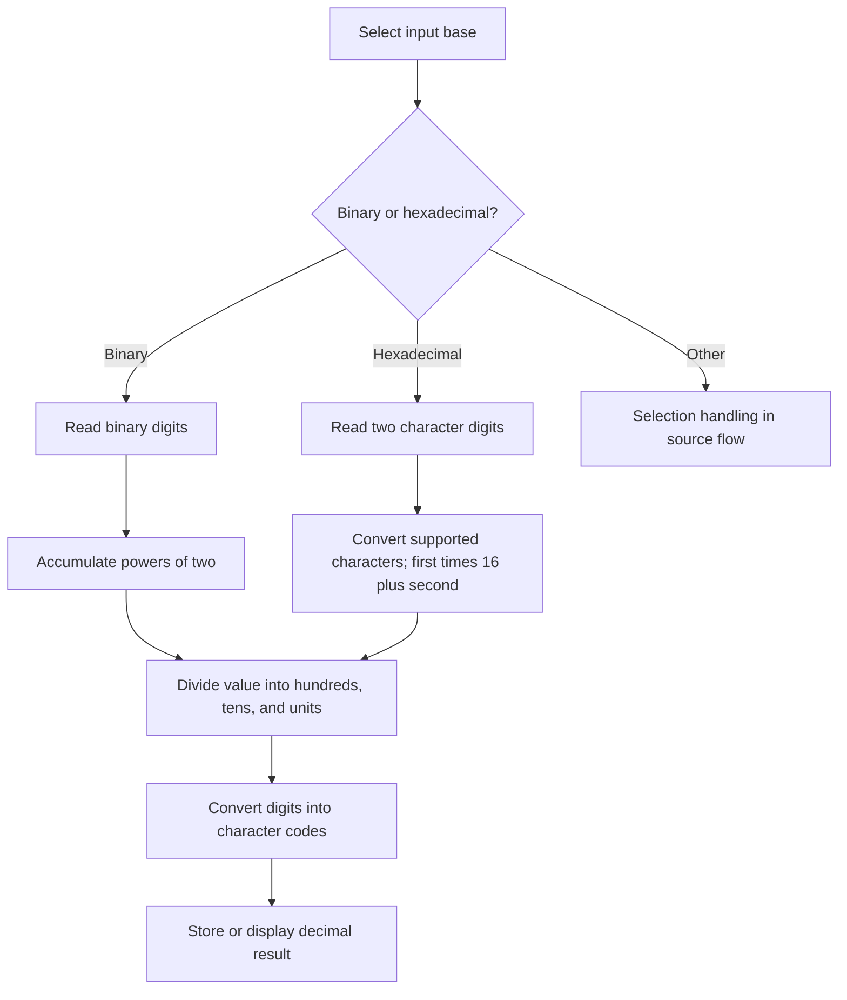
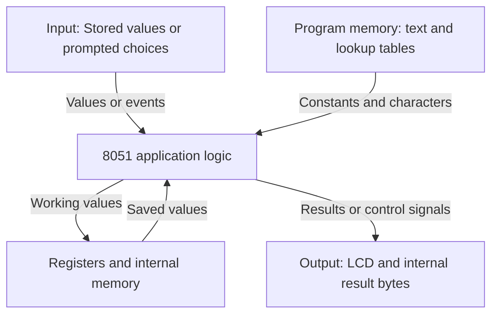

# Number Base Converter

[Group overview](../../README.md) · [Compare implementations](../README.md)

Convert a binary or hexadecimal-position number into decimal digits.

**Implementation:** LCD Binary Hex Conversion

**Input:** stored values or prompted choices.  
**Output:** LCD and internal result bytes.

## Inputs and results

| Parameter | Description |
| --- | --- |
| Input | A conversion mode and digits in that input format |
| Output | Decimal characters or decimal digit bytes |

## Worked example

Binary 10101011 equals 128 + 32 + 8 + 2 + 1 = 171. Hexadecimal 51 equals 5 × 16 + 1 = 81.

### Calculation details

Use binary input 10101011. The set positions contribute 128 + 32 + 8 + 2 + 1 = 171. Division by 100 and then by 10 gives digits 1, 7, 1. The corresponding ASCII bytes are 31H, 37H, 31H.

## Program operation

### Functional flowchart

[Detailed control flow](source-flow.md)

### Simplified block diagram

**Port registers:** `P1`, `P1.2`, `P1.3`, `P1.4`, `P1.5`, `P1.6`, `P1.7`.

## Technical limitations

No additional defect was recorded in the earlier source review. This is not evidence of a successful build or hardware test.

## Build and test

1. Open the [assembly source](source.asm) in an 8051 assembler or simulator.
2. Review the technical limitations and configure the peripherals required by this implementation.
3. Check the expected result using the example inputs.
