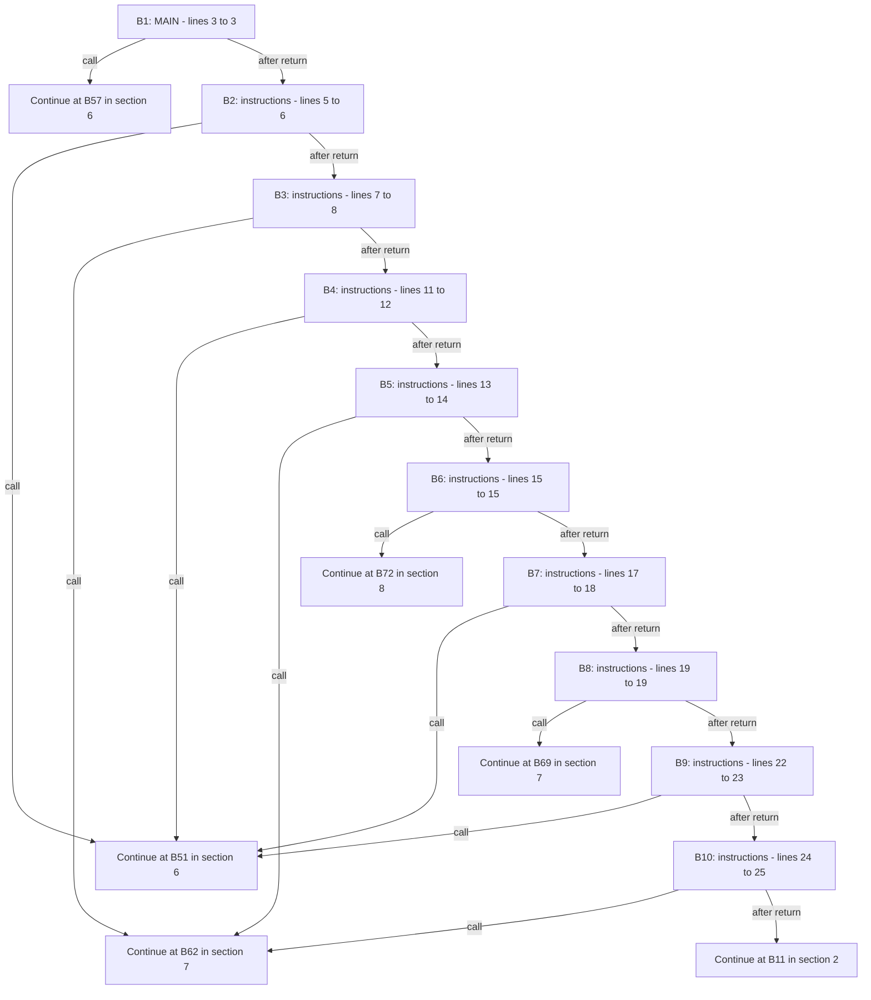
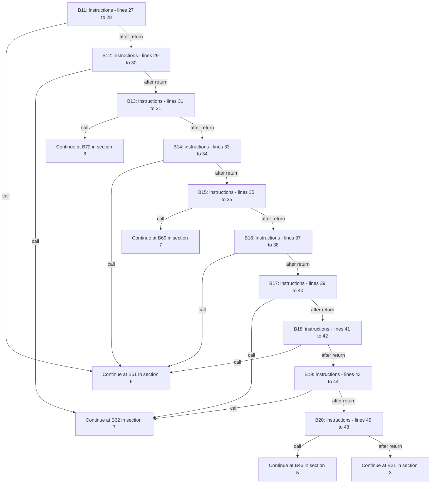
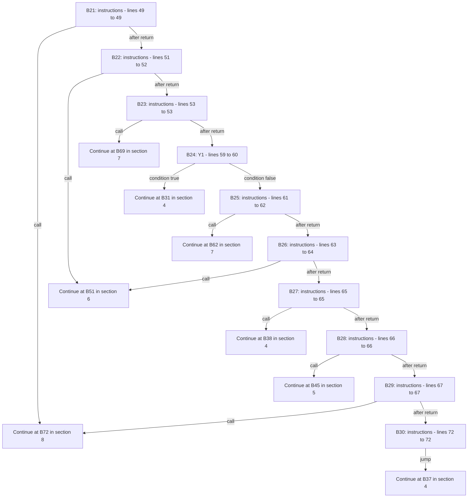
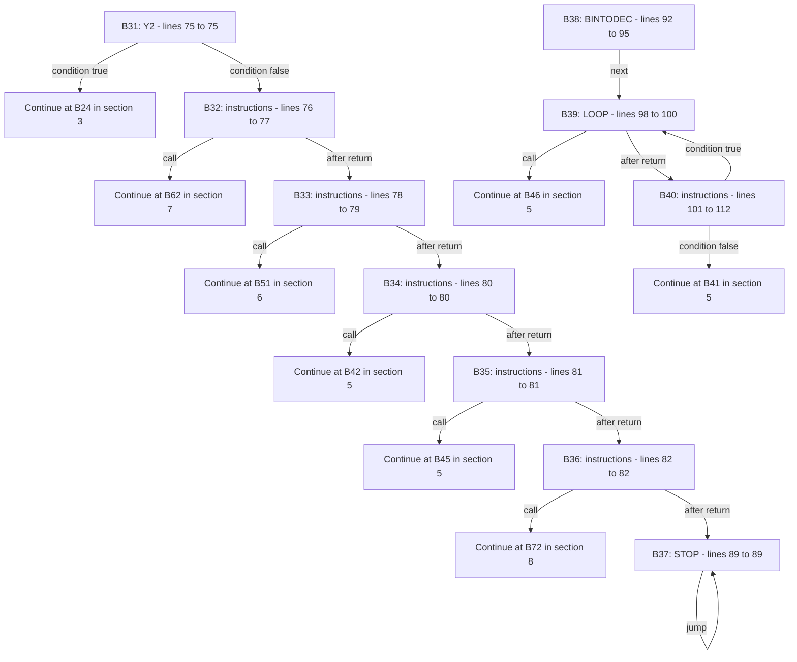
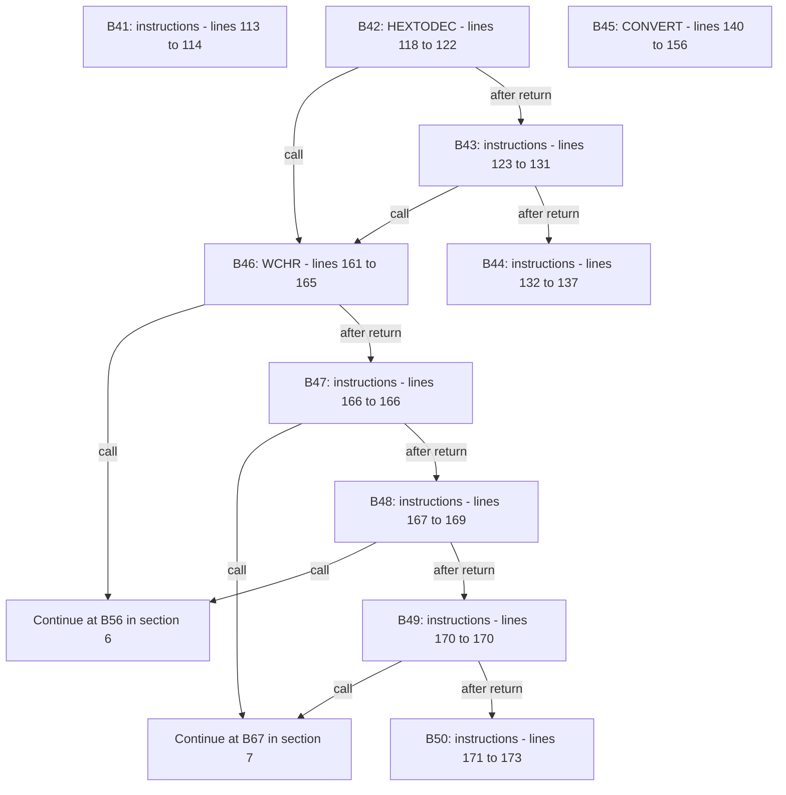
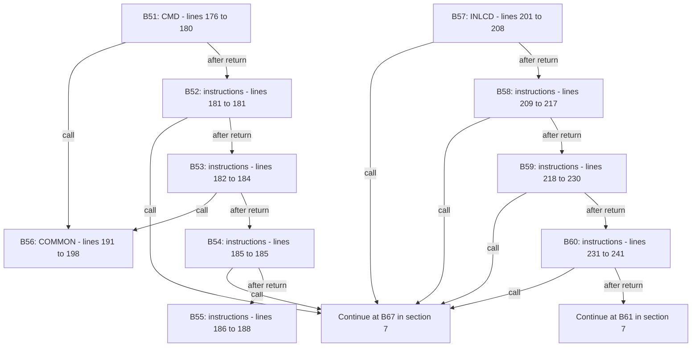
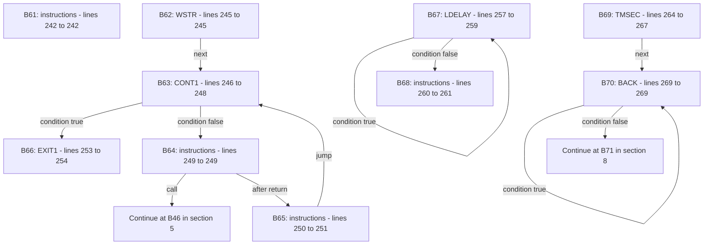
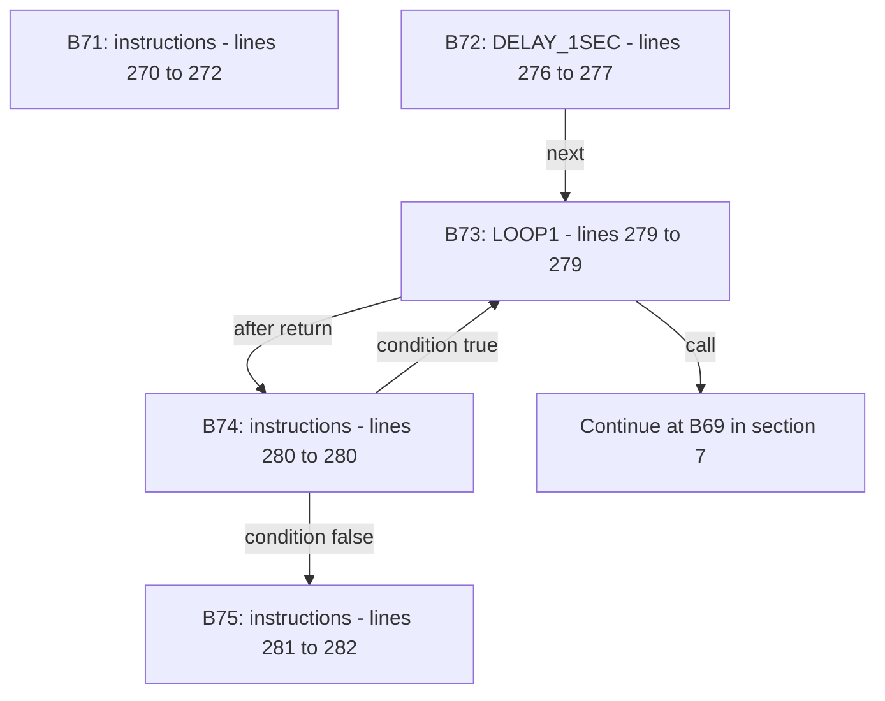

# Program Control Flow

[Back to project](README.md)

Control-flow blocks are indexed by source line. Calls resume at the instruction following the call if the subroutine returns normally.

## Entry locations

- `ORG 0H` begins at B1.

## Navigation

[Section 1](#section-1) · [Section 2](#section-2) · [Section 3](#section-3) · [Section 4](#section-4) · [Section 5](#section-5) · [Section 6](#section-6) · [Section 7](#section-7) · [Section 8](#section-8)

## Section 1



### B1

```asm
ACALL INLCD
```

### B2

```asm
MOV A, #80H
ACALL CMD
```

### B3

```asm
MOV DPTR, #X1
ACALL WSTR
```

### B4

```asm
MOV A,#0C0H
ACALL CMD
```

### B5

```asm
MOV DPTR, #X2
ACALL WSTR
```

### B6

```asm
ACALL DELAY_1SEC
```

### B7

```asm
MOV A, #01H
ACALL CMD
```

### B8

```asm
ACALL TMSEC
```

### B9

```asm
MOV A, #80H
ACALL CMD
```

### B10

```asm
MOV DPTR, #X3
ACALL WSTR
```

## Section 2



### B11

```asm
MOV A,#0C0H
ACALL CMD
```

### B12

```asm
MOV DPTR, #X4
ACALL WSTR
```

### B13

```asm
ACALL DELAY_1SEC
```

### B14

```asm
MOV A, #01H
ACALL CMD
```

### B15

```asm
ACALL TMSEC
```

### B16

```asm
MOV A, #80H
ACALL CMD
```

### B17

```asm
MOV DPTR, #ENTER
ACALL WSTR
```

### B18

```asm
MOV A,#0C0H
ACALL CMD
```

### B19

```asm
MOV DPTR, #CHOICE
ACALL WSTR
```

### B20

```asm
MOV 50H,#'1'
MOV A, 50H
MOV R5, A
ACALL WCHR
```

## Section 3



### B21

```asm
ACALL DELAY_1SEC
```

### B22

```asm
MOV A, #01H
ACALL CMD
```

### B23

```asm
ACALL TMSEC
```

### B24

```asm
MOV A,50H
CJNE A,#'1',Y2
```

### B25

```asm
MOV DPTR ,#ENTER_BIN
ACALL WSTR
```

### B26

```asm
MOV A,#0C0H
ACALL CMD
```

### B27

```asm
ACALL BinToDec
```

### B28

```asm
ACALL CONVERT
```

### B29

```asm
ACALL DELAY_1SEC
```

### B30

```asm
SJMP STOP
```

## Section 4



### B31

```asm
CJNE A,#'2',Y1
```

### B32

```asm
MOV DPTR ,#ENTER_HEX
ACALL WSTR
```

### B33

```asm
MOV A,#0C0H
ACALL CMD
```

### B34

```asm
ACALL HexToDec
```

### B35

```asm
ACALL CONVERT
```

### B36

```asm
ACALL DELAY_1SEC
```

### B37

```asm
SJMP $
```

### B38

```asm
MOV R6,#0
MOV DPTR,#BINARY
MOV R0,#8
MOV R7,#128
```

### B39

```asm
CLR A
MOVC A,@A+DPTR
ACALL WCHR
```

### B40

```asm
CLR C
SUBB A,#30H
MOV B ,R7
MUL AB
ADD A ,R6
MOV R6 ,A
MOV A,R7
MOV B,#2
DIV AB
MOV R7,A
INC DPTR
DJNZ R0,LOOP
```

## Section 5



### B41

Return to the instruction following the active call.

```asm
MOV 40H ,R6
RET
```

### B42

```asm
MOV R6,#16
MOV DPTR ,#HEX
CLR A
MOVC A,@A+DPTR
ACALL WCHR
```

### B43

```asm
CLR C
SUBB A,#30H
MOV B,R6
MUL AB
MOV R7,A
INC DPTR
CLR A
MOVC A,@A+DPTR
ACALL WCHR
```

### B44

Return to the instruction following the active call.

```asm
CLR C
SUBB A,#30H
ADD A,R7
MOV 40H,A
RET
```

### B45

Return to the instruction following the active call.

```asm
MOV A,40H
MOV R1,A
MOV B,#100
DIV AB
ADD A,#30H
MOV 40H,A
MOV A,B
MOV B,#10
DIV AB
ADD A,#30H
MOV 41H,A
MOV A,B
ADD A,#30H
MOV 42H,A
RET
```

### B46

```asm
PUSH ACC
PUSH B
SETB P1.3
MOV B,A
ACALL COMMON
```

### B47

```asm
ACALL LDELAY
```

### B48

```asm
MOV A,B
SWAP A
ACALL COMMON
```

### B49

```asm
ACALL LDELAY
```

### B50

Return to the instruction following the active call.

```asm
POP B
POP ACC
RET
```

## Section 6



### B51

```asm
PUSH ACC
PUSH B
CLR P1.3
MOV B,A
ACALL COMMON
```

### B52

```asm
ACALL LDELAY
```

### B53

```asm
MOV A,B
SWAP A
ACALL COMMON
```

### B54

```asm
ACALL LDELAY
```

### B55

Return to the instruction following the active call.

```asm
POP B
POP ACC
RET
```

### B56

Return to the instruction following the active call.

```asm
PUSH ACC
ANL A,#11110000B
ANL P1, #00001111B
ORL P1,A
SETB P1.2
CLR P1.2
POP ACC
RET
```

### B57

```asm
CLR P1.3
CLR P1.7
CLR P1.6
SETB P1.5
CLR P1.4
SETB P1.2
CLR P1.2
ACALL LDELAY
```

### B58

```asm
SETB P1.2
CLR P1.2
SETB P1.7
CLR P1.6
CLR P1.5
CLR P1.4
SETB P1.2
CLR P1.2
ACALL LDELAY
```

### B59

```asm
CLR P1.7
CLR P1.6
CLR P1.5
CLR P1.4
SETB P1.2
CLR P1.2
SETB P1.7
SETB P1.6
SETB P1.5
SETB P1.4
SETB P1.2
CLR P1.2
ACALL LDELAY
```

### B60

```asm
CLR P1.7
CLR P1.6
CLR P1.5
CLR P1.4
SETB P1.2
CLR P1.2
SETB P1.6
SETB P1.5
SETB P1.2
CLR P1.2
ACALL LDELAY
```

## Section 7



### B61

Return to the instruction following the active call.

```asm
RET
```

### B62

```asm
PUSH ACC
```

### B63

```asm
CLR A
MOVC A,@A+DPTR
JZ EXIT1
```

### B64

```asm
ACALL WCHR
```

### B65

```asm
INC DPTR
AJMP CONT1
```

### B66

Return to the instruction following the active call.

```asm
POP ACC
RET
```

### B67

```asm
PUSH 0H
MOV R0, #50
DJNZ R0, $
```

### B68

Return to the instruction following the active call.

```asm
POP 0H
RET
```

### B69

```asm
MOV TMOD,#01H
MOV TL0,#0B0H
MOV TH0,#3CH
SETB TR0
```

### B70

```asm
JNB TF0,BACK
```

## Section 8



### B71

Return to the instruction following the active call.

```asm
CLR TR0
CLR TF0
RET
```

### B72

```asm
PUSH 4H
MOV R4, #20
```

### B73

```asm
ACALL TMSEC
```

### B74

```asm
DJNZ R4, LOOP1
```

### B75

Return to the instruction following the active call.

```asm
POP 4H
RET
```
