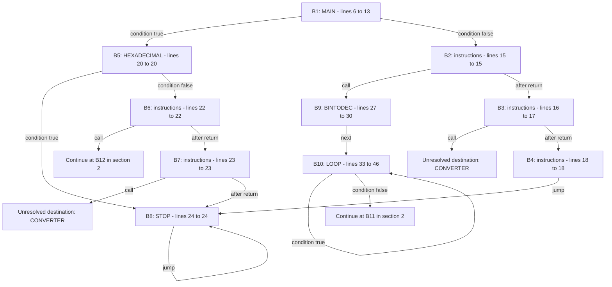
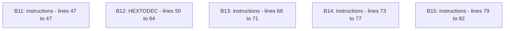

# Program Control Flow

[Back to project](README.md)

Control-flow blocks are indexed by source line. Calls resume at the instruction following the call if the subroutine returns normally.

## Entry locations

- `ORG 0H` begins at B1.

## Navigation

[Section 1](#section-1) · [Section 2](#section-2)

## Destinations requiring review

`CONVERTER`. A repeated label is also unresolved because it has more than one candidate target.

## Lines outside the instruction parser

These may be assembler directives, macros, or malformed source; inspect them before building.

```asm
67: ;100's digit
72: ;10's digit
78: ;1's digit
```

## Section 1



### B1

```asm
MOV 50H, #'1'
MOV 40H, #'0'
MOV 41H, #'0'
MOV 42H, #'0'
MOV A, 50H
CJNE A, #'1', HEXADECIMAL
```

### B2

```asm
ACALL BinToDec
```

### B3

```asm
MOV A, R0
ACALL Converter
```

### B4

```asm
SJMP STOP
```

### B5

```asm
CJNE A, #'2', STOP
```

### B6

```asm
ACALL HexToDec
```

### B7

```asm
ACALL Converter
```

### B8

```asm
SJMP $
```

### B9

```asm
mov R2,#8
MOV R0,#0
MOV R1,#128
MOV DPTR,#Binary
```

### B10

```asm
CLR A
MOVC A,@A+DPTR
CLR C
SUBB A,#30H
MOV B,R1
MUL AB
ADD A,R0
MOV R0,A
MOV A,R1
MOV B,#2
DIV AB
MOV R1,A
INC DPTR
DJNZ R2,LOOP
```

## Section 2



### B11

Return to the instruction following the active call.

```asm
RET
```

### B12

Return to the instruction following the active call.

```asm
MOV DPTR,#HEX
CLR A
MOVC A,@A+DPTR
CLR C
SUBB A,#30H
MOV B,#16
MUL AB
MOV R0,A
INC DPTR
CLR A
MOVC A,@A+DPTR
CLR C
SUBB A,#30H
ADD A,R0
RET
```

### B13

```asm
MOV B, #100
DIV AB
ADD A, #30H
MOV 40H, A ;Store the 100's digit to RAM location 40H
```

### B14

```asm
MOV A, B
MOV B, #10
DIV AB
ADD A, #30H
MOV 41H, A ;Store the 10's digit to RAM location 41H
```

### B15

Return to the instruction following the active call.

```asm
MOV A, B
ADD A, #30H
MOV 42H, A ;Store the 1's digit to RAM location 42H
RET
```
