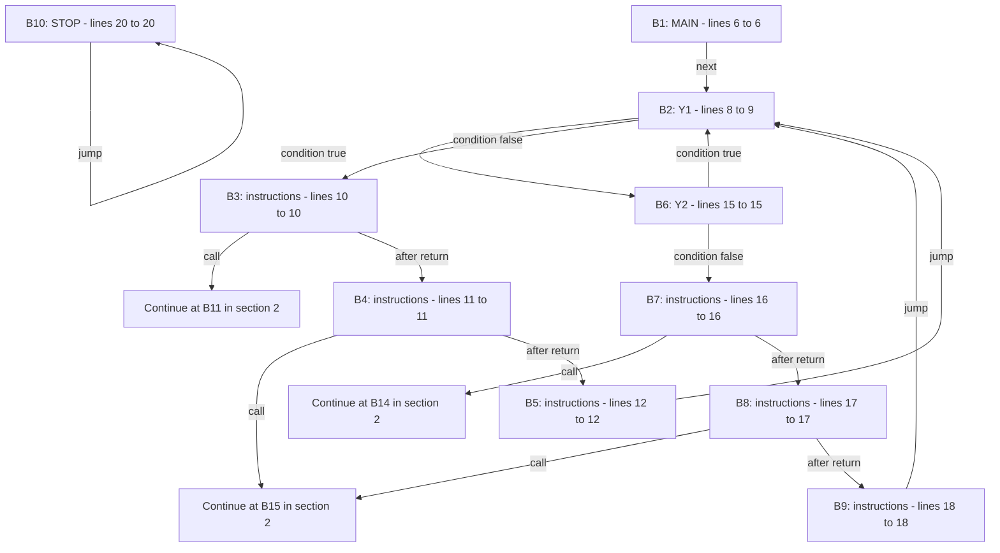
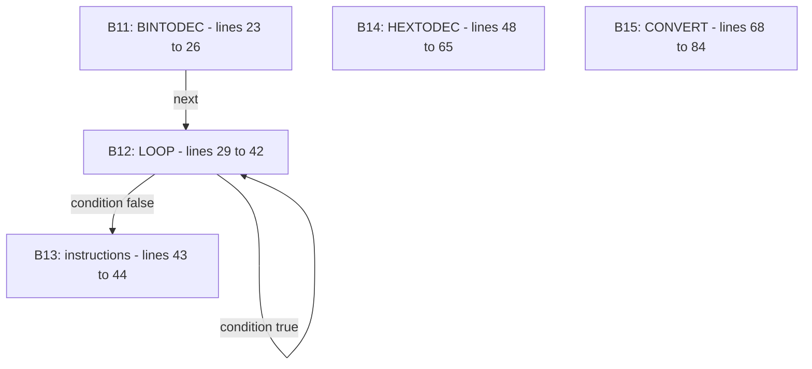

# Program Control Flow

[Back to project](README.md)

Control-flow blocks are indexed by source line. Calls resume at the instruction following the call if the subroutine returns normally.

## Entry locations

- `ORG 0H` begins at B1.

## Navigation

[Section 1](#section-1) · [Section 2](#section-2)

## Section 1



### B1

```asm
MOV 50H,#'2'
```

### B2

```asm
MOV A,50H
CJNE A,#'1',Y2
```

### B3

```asm
ACALL BinToDec
```

### B4

```asm
ACALL CONVERT
```

### B5

```asm
SJMP Y1
```

### B6

```asm
CJNE A,#'2',Y1
```

### B7

```asm
ACALL HexToDec
```

### B8

```asm
ACALL CONVERT
```

### B9

```asm
SJMP Y1
```

### B10

```asm
SJMP $
```

## Section 2



### B11

```asm
MOV R6,#0
MOV DPTR,#BINARY
MOV R0,#8
MOV R7,#128
```

### B12

```asm
CLR A
MOVC A,@A+DPTR
CLR C
SUBB A,#30H
MOV B ,R7
MUL AB
ADD A ,R6
MOV R6 ,A
MOV A,R7
MOV B,#2
DIV AB
MOV R7,A
INC DPTR
DJNZ R0,LOOP
```

### B13

Return to the instruction following the active call.

```asm
MOV 40H ,R6
RET
```

### B14

Return to the instruction following the active call.

```asm
MOV R6,#16
MOV DPTR ,#HEX
CLR A
MOVC A,@A+DPTR
CLR C
SUBB A,#30H
MOV B,R6
MUL AB
MOV R7,A
INC DPTR
CLR A
MOVC A,@A+DPTR
CLR C
SUBB A,#30H
ADD A,R7
MOV 40H,A
RET
```

### B15

Return to the instruction following the active call.

```asm
MOV A,40H
MOV R1,A
MOV B,#100
DIV AB
ADD A,#30H
MOV 40H,A
MOV A,B
MOV B,#10
DIV AB
ADD A,#30H
MOV 41H,A
MOV A,B
ADD A,#30H
MOV 42H,A
RET
```
