# Program Control Flow

[Back to project](README.md)

Control-flow blocks are indexed by source line. Calls resume at the instruction following the call if the subroutine returns normally.

## Entry locations

- `ORG 0000H` begins at B1.
- `ORG 0003H` begins at B2.
- `ORG 0030H` begins at B3.

## Navigation

[Section 1](#section-1) · [Section 2](#section-2) · [Section 3](#section-3) · [Section 4](#section-4) · [Section 5](#section-5) · [Section 6](#section-6) · [Section 7](#section-7) · [Section 8](#section-8) · [Section 9](#section-9) · [Section 10](#section-10) · [Section 11](#section-11) · [Section 12](#section-12) · [Section 13](#section-13) · [Section 14](#section-14) · [Section 15](#section-15) · [Section 16](#section-16) · [Section 17](#section-17) · [Section 18](#section-18) · [Section 19](#section-19) · [Section 20](#section-20) · [Section 21](#section-21) · [Section 22](#section-22)

## Section 1

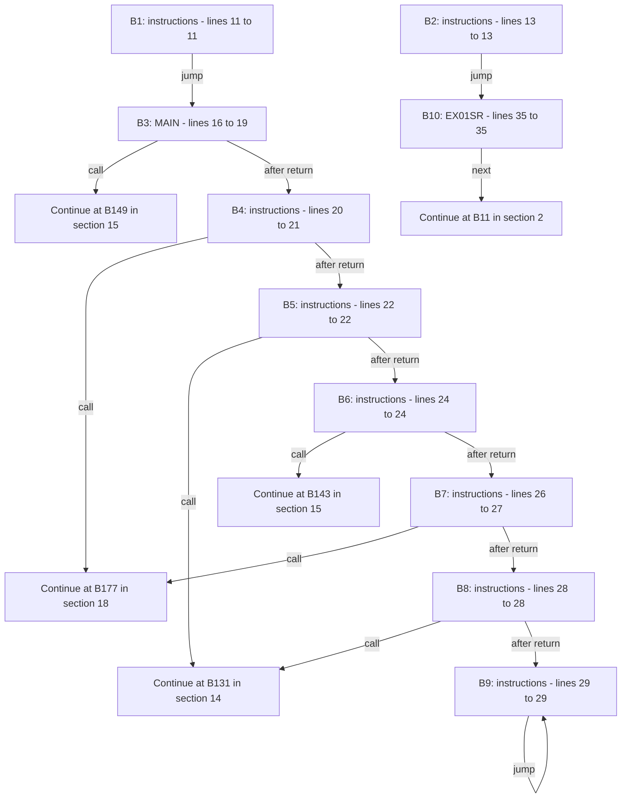

### B1

```asm
LJMP MAIN
```

### B2

```asm
LJMP EX01SR
```

### B3

```asm
MOV IE,#10000001B
SETB IT0
ACALL INLCD
```

### B4

```asm
MOV DPTR,#B12
ACALL WSTR
```

### B5

```asm
ACALL TIME
```

### B6

```asm
ACALL LINE2
```

### B7

```asm
MOV DPTR,#B13
ACALL WSTR
```

### B8

```asm
ACALL TIME
```

### B9

```asm
SJMP $
```

### B10

```asm
MOV R0,#20H
```

## Section 2

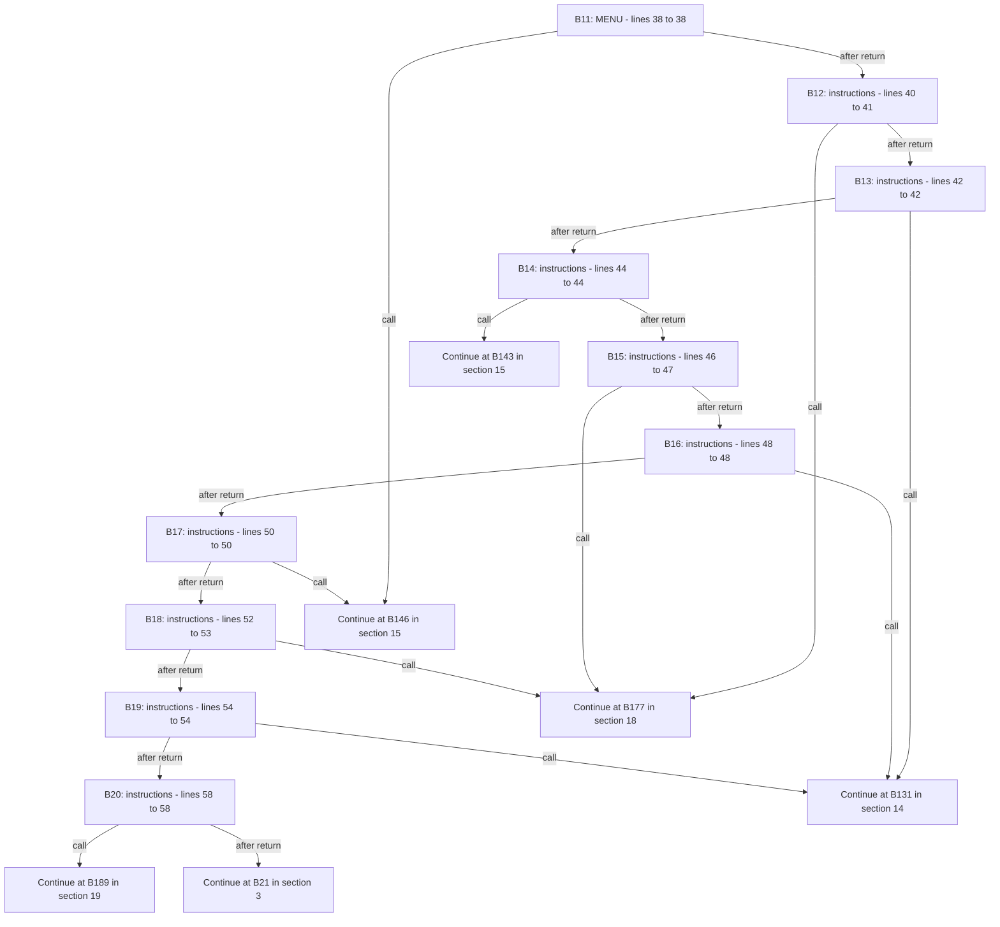

### B11

```asm
ACALL CLCD
```

### B12

```asm
MOV DPTR,#B1
ACALL WSTR
```

### B13

```asm
ACALL TIME
```

### B14

```asm
ACALL LINE2
```

### B15

```asm
MOV DPTR,#B2
ACALL WSTR
```

### B16

```asm
ACALL TIME
```

### B17

```asm
ACALL CLCD
```

### B18

```asm
MOV DPTR,#B3
ACALL WSTR
```

### B19

```asm
ACALL TIME
```

### B20

```asm
ACALL KEYPAD
```

## Section 3

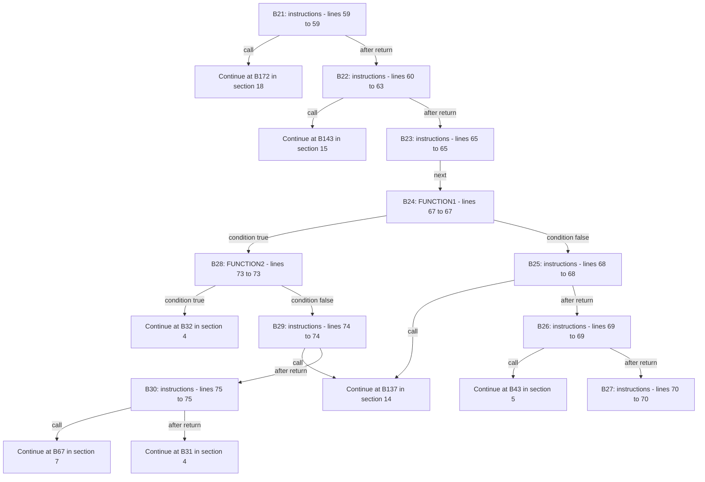

### B21

```asm
ACALL WCHR
```

### B22

```asm
SUBB A,#30H
MOV 66H,A
ACALL LINE2
```

### B23

```asm
MOV A,66H
```

### B24

```asm
CJNE A,#1,FUNCTION2
```

### B25

```asm
ACALL GLED
```

### B26

```asm
ACALL OPTION1
```

### B27

Resume the interrupted program.

```asm
RETI
```

### B28

```asm
CJNE A,#2,FUNCTION3
```

### B29

```asm
ACALL GLED
```

### B30

```asm
ACALL OPTION2
```

## Section 4

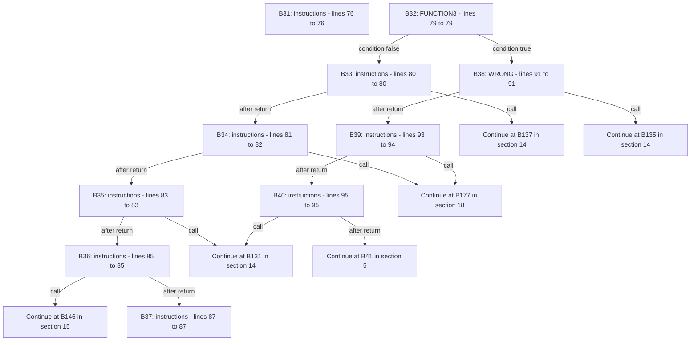

### B31

Resume the interrupted program.

```asm
RETI
```

### B32

```asm
CJNE A,#3,WRONG
```

### B33

```asm
ACALL GLED
```

### B34

```asm
MOV DPTR,#B10
ACALL WSTR
```

### B35

```asm
ACALL TIME
```

### B36

```asm
ACALL CLCD
```

### B37

Resume the interrupted program.

```asm
RETI
```

### B38

```asm
ACALL RLED
```

### B39

```asm
MOV DPTR,#B6
ACALL WSTR
```

### B40

```asm
ACALL TIME
```

## Section 5

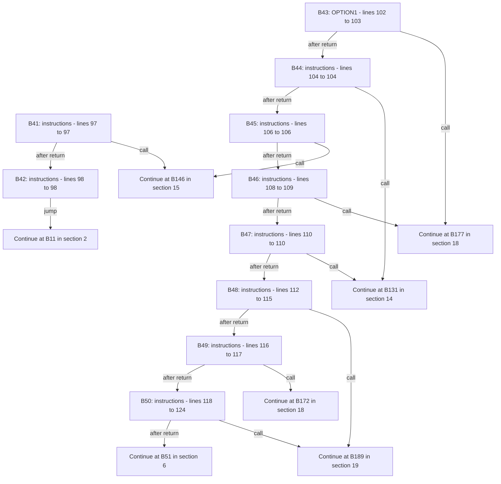

### B41

```asm
ACALL CLCD
```

### B42

```asm
SJMP MENU
```

### B43

```asm
MOV DPTR,#B4
ACALL WSTR
```

### B44

```asm
ACALL TIME
```

### B45

```asm
ACALL CLCD
```

### B46

```asm
MOV DPTR,#B5
ACALL WSTR
```

### B47

```asm
ACALL TIME
```

### B48

```asm
MOV R7,#6
ACALL KEYPAD
```

### B49

```asm
MOV 30H,A
ACALL WCHR
```

### B50

```asm
SUBB A,#30H
MOV @R0,A
INC R0
ACALL KEYPAD
```

## Section 6

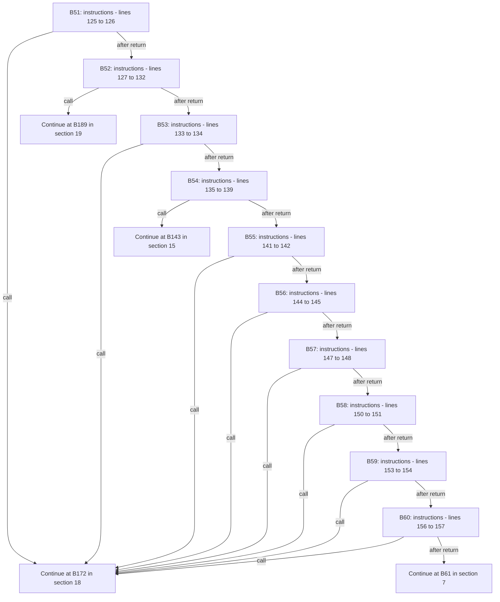

### B51

```asm
MOV 31H,A
ACALL WCHR
```

### B52

```asm
SUBB A,#30H
MOV @R0,A
INC R0
ACALL KEYPAD
```

### B53

```asm
MOV 32H,A
ACALL WCHR
```

### B54

```asm
SUBB A,#30H
MOV @R0,A
ACALL LINE2
```

### B55

```asm
MOV A,30H
ACALL WCHR
```

### B56

```asm
MOV A,#' '
ACALL WCHR
```

### B57

```asm
MOV A,31H
ACALL WCHR
```

### B58

```asm
MOV A,#' '
ACALL WCHR
```

### B59

```asm
MOV A,32H
ACALL WCHR
```

### B60

```asm
MOV A,#' '
ACALL WCHR
```

## Section 7

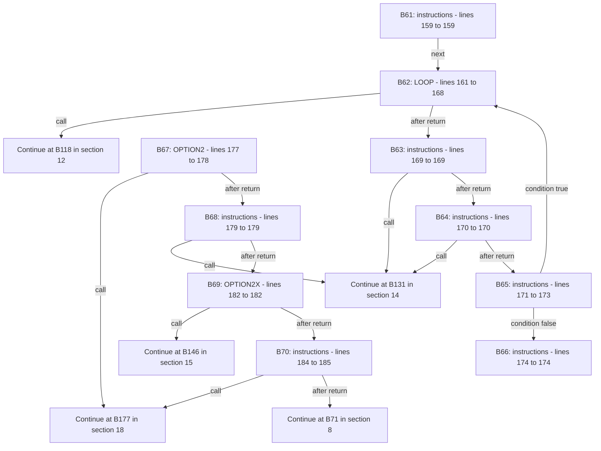

### B61

```asm
MOV R0,#20H
```

### B62

```asm
MOV A,@R0
INC R0
MOV B,@R0
INC R0
INC R0
ADD A,B
MOV @R0,A
ACALL WRITE
```

### B63

```asm
ACALL TIME
```

### B64

```asm
ACALL TIME
```

### B65

```asm
DEC R0
DEC R0
DJNZ R7,LOOP
```

### B66

Return to the instruction following the active call.

```asm
RET
```

### B67

```asm
MOV DPTR,#B7
ACALL WSTR
```

### B68

```asm
ACALL TIME
```

### B69

```asm
ACALL CLCD
```

### B70

```asm
MOV DPTR,#B5
ACALL WSTR
```

## Section 8

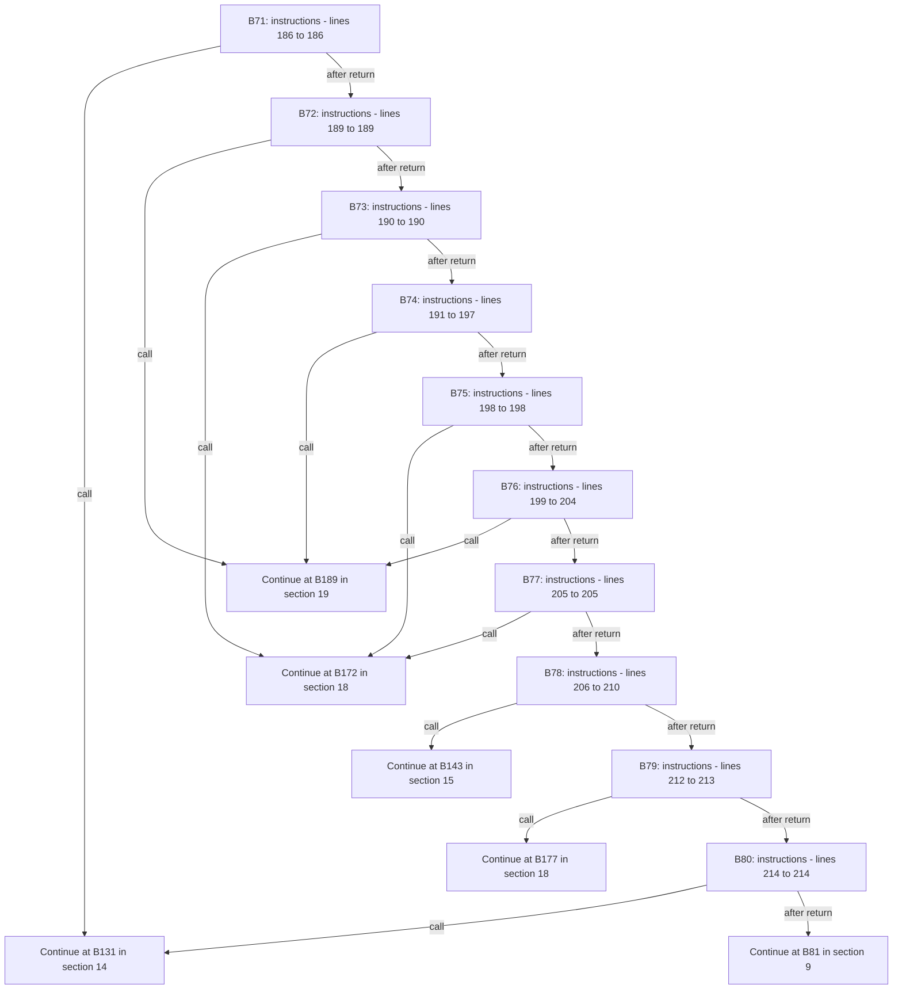

### B71

```asm
ACALL TIME
```

### B72

```asm
ACALL KEYPAD
```

### B73

```asm
ACALL WCHR
```

### B74

```asm
SUBB A,#30H
MOV @R0,A
INC R0
ACALL KEYPAD
```

### B75

```asm
ACALL WCHR
```

### B76

```asm
SUBB A,#30H
MOV @R0,A
INC R0
ACALL KEYPAD
```

### B77

```asm
ACALL WCHR
```

### B78

```asm
SUBB A,#30H
MOV @R0,A
ACALL LINE2
```

### B79

```asm
MOV DPTR,#B8
ACALL WSTR
```

### B80

```asm
ACALL TIME
```

## Section 9

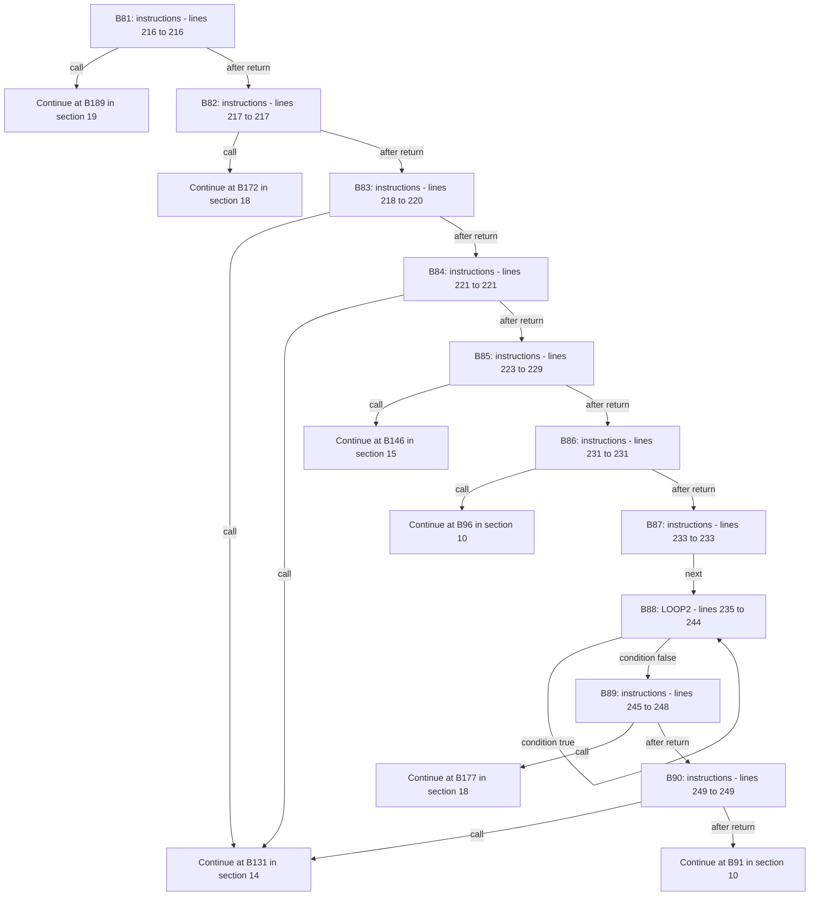

### B81

```asm
ACALL KEYPAD
```

### B82

```asm
ACALL WCHR
```

### B83

```asm
SUBB A,#30H
MOV 30H,A
ACALL TIME
```

### B84

```asm
ACALL TIME
```

### B85

```asm
MOV R1,#30H
MOV A,30H
SUBB A,#3
MOV R7,A
ACALL CLCD
```

### B86

```asm
ACALL CHECK
```

### B87

```asm
MOV R0,#20H
```

### B88

```asm
MOV A,@R0
INC R0
MOV B,@R0
INC R0
INC R0
ADD A,B
MOV @R0,A
DEC R0
DEC R0
DJNZ R7,LOOP2
```

### B89

```asm
MOV @R1,A
MOV DPTR,#B9
ACALL WSTR
```

### B90

```asm
ACALL TIME
```

## Section 10

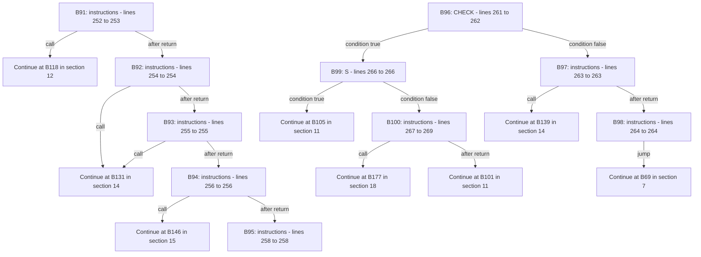

### B91

```asm
MOV A,@R1
ACALL WRITE
```

### B92

```asm
ACALL TIME
```

### B93

```asm
ACALL TIME
```

### B94

```asm
ACALL CLCD
```

### B95

Return to the instruction following the active call.

```asm
RET
```

### B96

```asm
MOV A,30H
CJNE A,#0,S
```

### B97

```asm
ACALL YLED
```

### B98

```asm
AJMP OPTION2X
```

### B99

```asm
CJNE A,#1,S2
```

### B100

```asm
MOV @R1,20H
MOV DPTR,#B9
ACALL WSTR
```

## Section 11

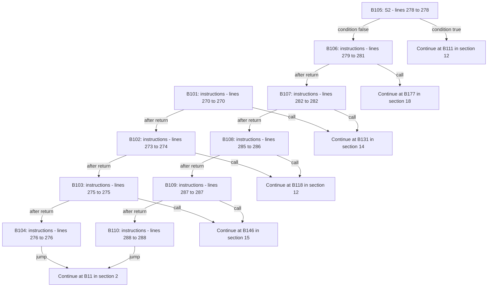

### B101

```asm
ACALL TIME
```

### B102

```asm
MOV A,@R1
ACALL WRITE
```

### B103

```asm
ACALL CLCD
```

### B104

```asm
AJMP MENU
```

### B105

```asm
CJNE A,#2,S3
```

### B106

```asm
MOV @R1,21H
MOV DPTR,#B9
ACALL WSTR
```

### B107

```asm
ACALL TIME
```

### B108

```asm
MOV A,@R1
ACALL WRITE
```

### B109

```asm
ACALL CLCD
```

### B110

```asm
AJMP MENU
```

## Section 12

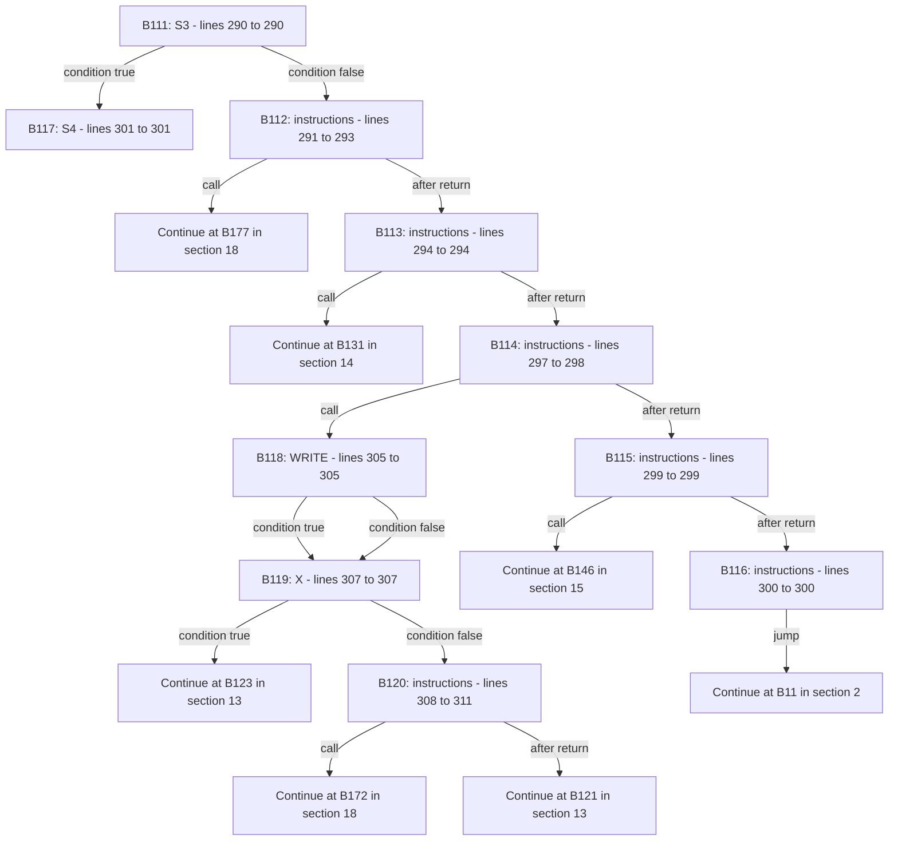

### B111

```asm
CJNE A,#3,S4
```

### B112

```asm
MOV @R1,22H
MOV DPTR,#B9
ACALL WSTR
```

### B113

```asm
ACALL TIME
```

### B114

```asm
MOV A,@R1
ACALL WRITE
```

### B115

```asm
ACALL CLCD
```

### B116

```asm
AJMP MENU
```

### B117

Return to the instruction following the active call.

```asm
RET
```

### B118

```asm
CJNE A,#10,X
```

### B119

```asm
JC ONE
```

### B120

```asm
MOV B,#10
DIV AB
ADD A,#30H
ACALL WCHR
```

## Section 13

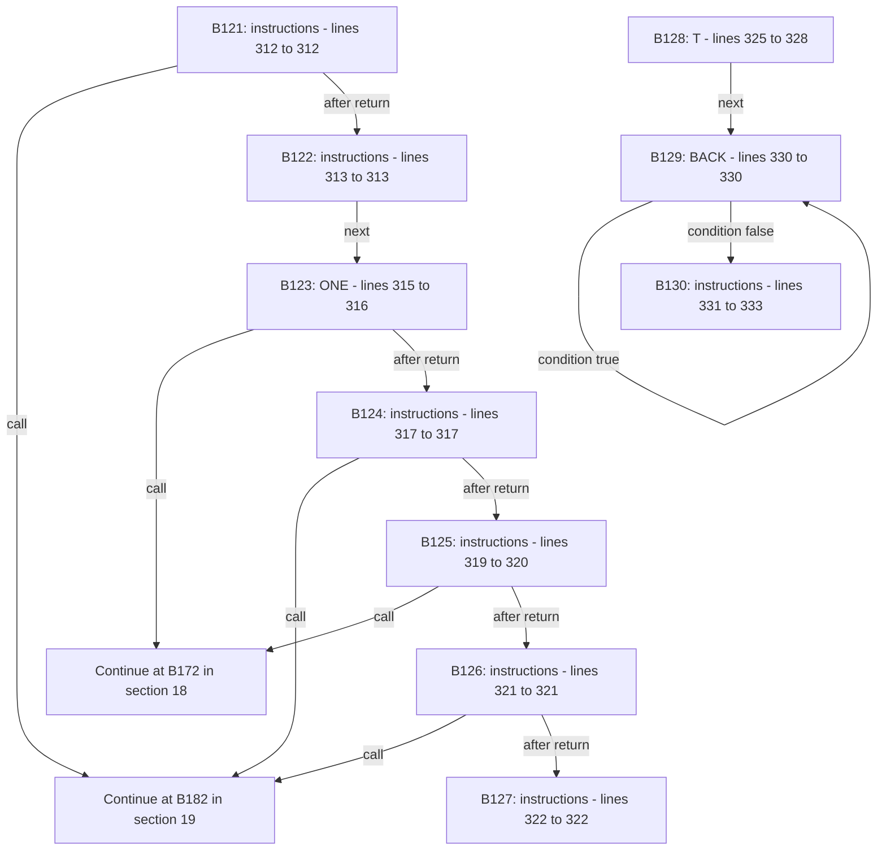

### B121

```asm
ACALL LDELAY
```

### B122

```asm
MOV A,B
```

### B123

```asm
ADD A,#30H
ACALL WCHR
```

### B124

```asm
ACALL LDELAY
```

### B125

```asm
MOV A,#' '
ACALL WCHR
```

### B126

```asm
ACALL LDELAY
```

### B127

Return to the instruction following the active call.

```asm
RET
```

### B128

```asm
MOV TMOD,#21H
MOV TL0,#0EEH
MOV TH0,#0B7H
SETB TR0
```

### B129

```asm
JNB TF0,BACK
```

### B130

Return to the instruction following the active call.

```asm
CLR TR0
CLR TF0
RET
```

## Section 14

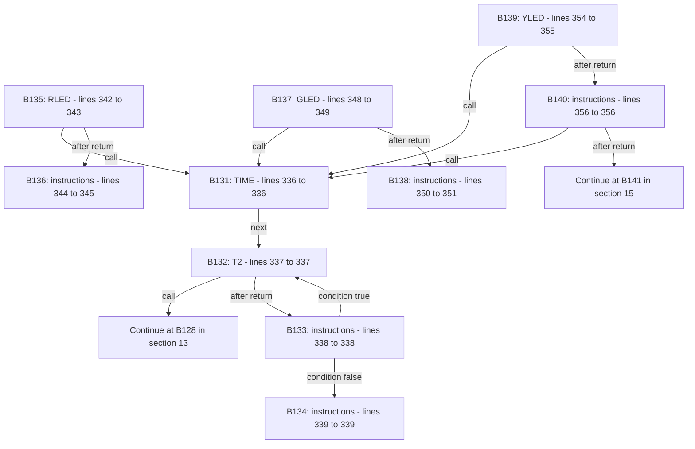

### B131

```asm
MOV R6,#200
```

### B132

```asm
ACALL T
```

### B133

```asm
DJNZ R6,T2
```

### B134

Return to the instruction following the active call.

```asm
RET
```

### B135

```asm
CLR R
ACALL TIME
```

### B136

Return to the instruction following the active call.

```asm
SETB R
RET
```

### B137

```asm
CLR G
ACALL TIME
```

### B138

Return to the instruction following the active call.

```asm
SETB G
RET
```

### B139

```asm
CLR Y
ACALL TIME
```

### B140

```asm
ACALL TIME
```

## Section 15

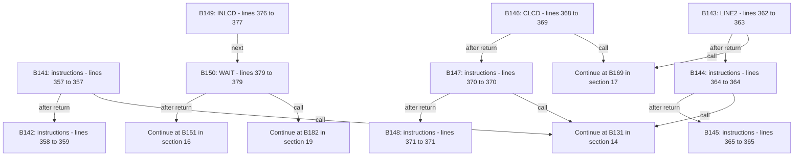

### B141

```asm
ACALL TIME
```

### B142

Return to the instruction following the active call.

```asm
SETB Y
RET
```

### B143

```asm
MOV A,#0C0H
ACALL CMD
```

### B144

```asm
ACALL TIME
```

### B145

Return to the instruction following the active call.

```asm
RET
```

### B146

```asm
MOV A,#1
ACALL CMD
```

### B147

```asm
ACALL TIME
```

### B148

Return to the instruction following the active call.

```asm
RET
```

### B149

```asm
PUSH 7
MOV R7,#20
```

### B150

```asm
ACALL LDELAY
```

## Section 16

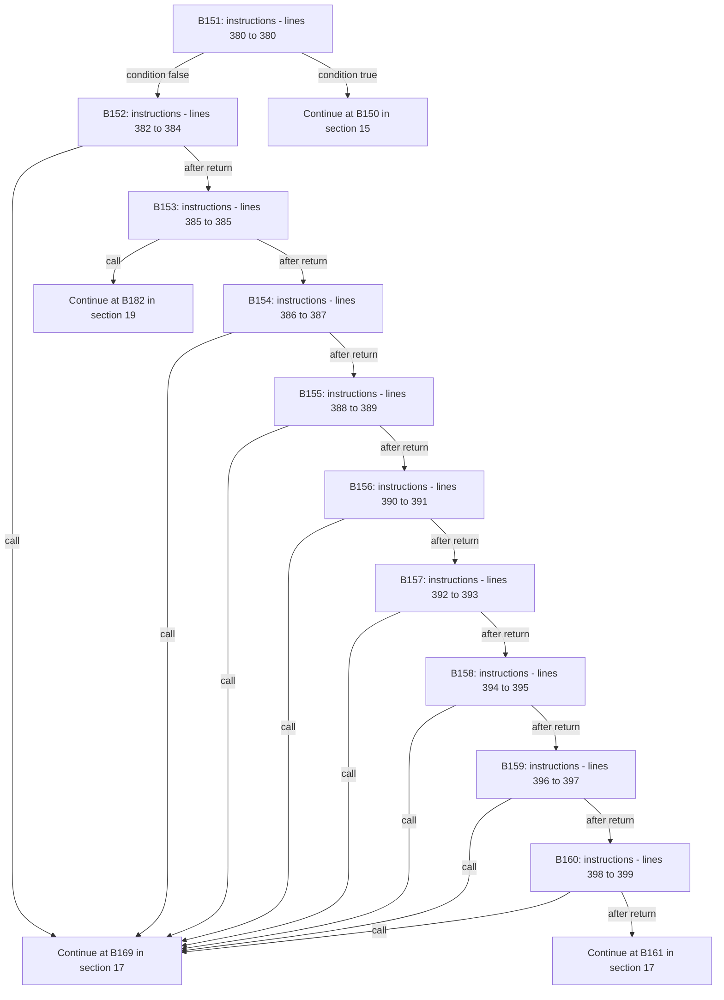

### B151

```asm
DJNZ R7,WAIT
```

### B152

```asm
MOV P0,#00000111B
MOV A,#0011B
ACALL CMD
```

### B153

```asm
ACALL LDELAY
```

### B154

```asm
MOV A,#0011B
ACALL CMD
```

### B155

```asm
MOV A,#0011B
ACALL CMD
```

### B156

```asm
MOV A,#0010B
ACALL CMD
```

### B157

```asm
MOV A,#0010B
ACALL CMD
```

### B158

```asm
MOV A,#1000B
ACALL CMD
```

### B159

```asm
MOV A,#0000B
ACALL CMD
```

### B160

```asm
MOV A,#1000B
ACALL CMD
```

## Section 17

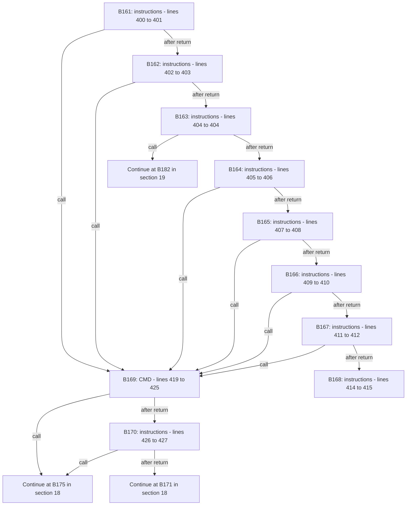

### B161

```asm
MOV A,#0
ACALL CMD
```

### B162

```asm
MOV A,#0001B
ACALL CMD
```

### B163

```asm
ACALL LDELAY
```

### B164

```asm
MOV A,#0000B
ACALL CMD
```

### B165

```asm
MOV A,#0110B
ACALL CMD
```

### B166

```asm
MOV A,#0000B
ACALL CMD
```

### B167

```asm
MOV A,#1111B
ACALL CMD
```

### B168

Return to the instruction following the active call.

```asm
POP 7
RET
```

### B169

```asm
PUSH ACC
PUSH B
CLR RS
MOV B,A
SWAP A
ACALL COMMON
```

### B170

```asm
MOV A,B
ACALL COMMON
```

## Section 18

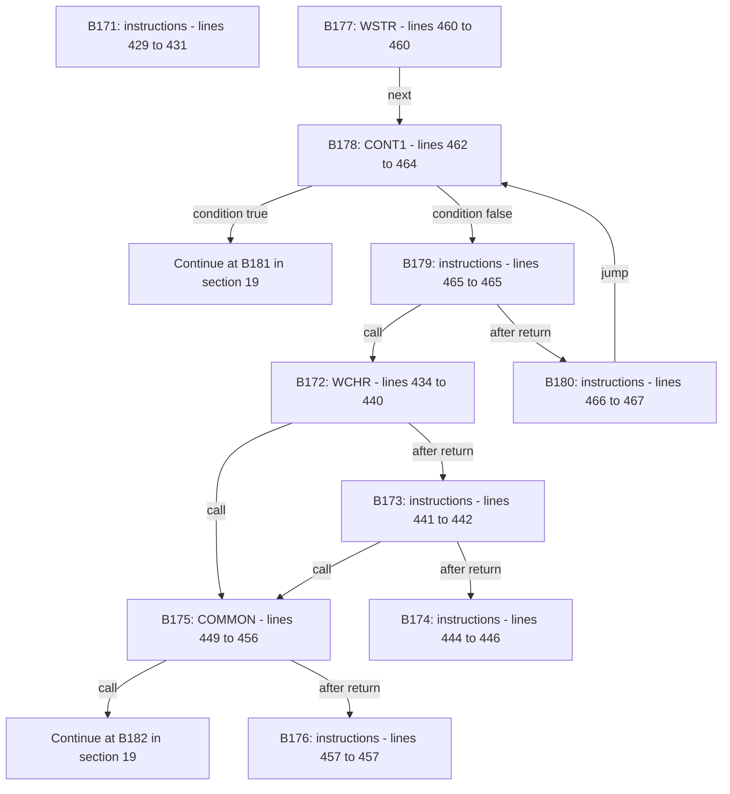

### B171

Return to the instruction following the active call.

```asm
POP B
POP ACC
RET
```

### B172

```asm
PUSH ACC
PUSH B
SETB RS
MOV B,A
SWAP A
ACALL COMMON
```

### B173

```asm
MOV A,B
ACALL COMMON
```

### B174

Return to the instruction following the active call.

```asm
POP B
POP ACC
RET
```

### B175

```asm
CLR RW
SWAP A
ANL A,#11110000B
ANL P0,#00000111B
ORL P0,A
SETB EN
CLR EN
ACALL LDELAY
```

### B176

Return to the instruction following the active call.

```asm
RET
```

### B177

```asm
PUSH ACC
```

### B178

```asm
CLR A
MOVC A,@A+DPTR
JZ EXIT1
```

### B179

```asm
ACALL WCHR
```

### B180

```asm
INC DPTR
AJMP CONT1
```

## Section 19

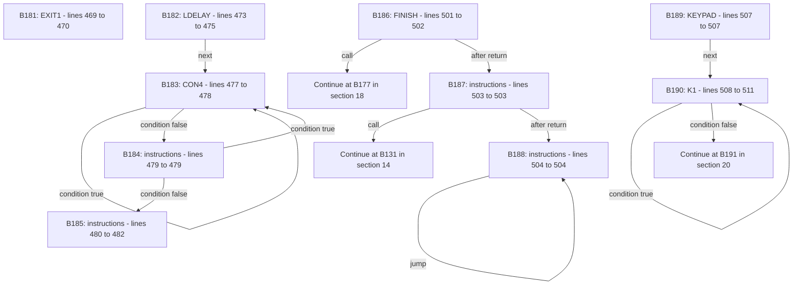

### B181

Return to the instruction following the active call.

```asm
POP ACC
RET
```

### B182

```asm
PUSH 0
PUSH 1
MOV R1,#20
```

### B183

```asm
MOV R0,#250
DJNZ R0,$
```

### B184

```asm
DJNZ R1,CON4
```

### B185

Return to the instruction following the active call.

```asm
POP 1
POP 0
RET
```

### B186

```asm
MOV DPTR,#B11
ACALL WSTR
```

### B187

```asm
ACALL TIME
```

### B188

```asm
AJMP $
```

### B189

```asm
MOV P2,#11110000B
```

### B190

```asm
MOV P2,#11110000B
MOV A,P2
ANL A,#11110000B
CJNE A,#11110000B,K1
```

## Section 20

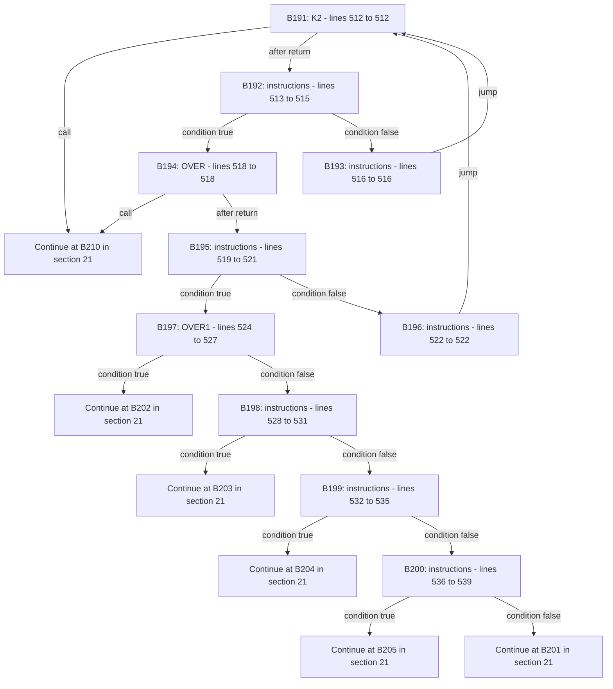

### B191

```asm
ACALL TMSEC
```

### B192

```asm
MOV A,P2
ANL A,#11110000B
CJNE A,#11110000B,OVER
```

### B193

```asm
SJMP K2
```

### B194

```asm
ACALL TMSEC
```

### B195

```asm
MOV A,P2
ANL A,#11110000B
CJNE A,#11110000B,OVER1
```

### B196

```asm
SJMP K2
```

### B197

```asm
MOV P2,#11111110B
MOV A,P2
ANL A,#11110000B
CJNE A,#11110000B,ROW_0
```

### B198

```asm
MOV P2,#11111101B
MOV A,P2
ANL A,#11110000B
CJNE A,#11110000B,ROW_1
```

### B199

```asm
MOV P2,#11111011B
MOV A,P2
ANL A,#11110000B
CJNE A,#11110000B,ROW_2
```

### B200

```asm
MOV P2,#11110111B
MOV A,P2
ANL A,#11110000B
CJNE A,#11110000B,ROW_3
```

## Section 21

```mermaid
flowchart TD
B200["B201: instructions - lines 540 to 540"]
B201["B202: ROW_0 - lines 541 to 542"]
B202["B203: ROW_1 - lines 543 to 544"]
B203["B204: ROW_2 - lines 545 to 546"]
B204["B205: ROW_3 - lines 547 to 547"]
B205["B206: FIND - lines 549 to 549"]
B206["B207: FIND1 - lines 551 to 552"]
B207["B208: instructions - lines 553 to 554"]
B208["B209: MATCH - lines 556 to 558"]
B209["B210: TMSEC - lines 563 to 566"]
B200 -->|jump| B190
B201 -->|jump| B205
B202 -->|jump| B205
B203 -->|jump| B205
B204 -->|next| B205
B205 -->|next| B206
B206 -->|condition true| B208
B206 -->|condition false| B207
B207 -->|jump| B206
B209 -->|next| B210
B190["Continue at B191 in section 20"]
B210["Continue at B211 in section 22"]
```

### B201

```asm
LJMP K2
```

### B202

```asm
MOV DPTR,#KCODE0
SJMP FIND
```

### B203

```asm
MOV DPTR,#KCODE1
SJMP FIND
```

### B204

```asm
MOV DPTR,#KCODE2
SJMP FIND
```

### B205

```asm
MOV DPTR,#KCODE3
```

### B206

```asm
SWAP A
```

### B207

```asm
RRC A
JNC MATCH
```

### B208

```asm
INC DPTR
SJMP FIND1
```

### B209

Return to the instruction following the active call.

```asm
CLR A
MOVC A,@A+DPTR
RET
```

### B210

```asm
MOV TMOD,#00000001B
MOV TL0,#0CAH
MOV TH0,#27H
SETB TR0
```

## Section 22

```mermaid
flowchart TD
B210["B211: BACK8 - lines 567 to 567"]
B211["B212: instructions - lines 568 to 570"]
B210 -->|condition true| B210
B210 -->|condition false| B211
```

### B211

```asm
JNB TF0,BACK8
```

### B212

Return to the instruction following the active call.

```asm
CLR TR0
CLR TF0
RET
```
