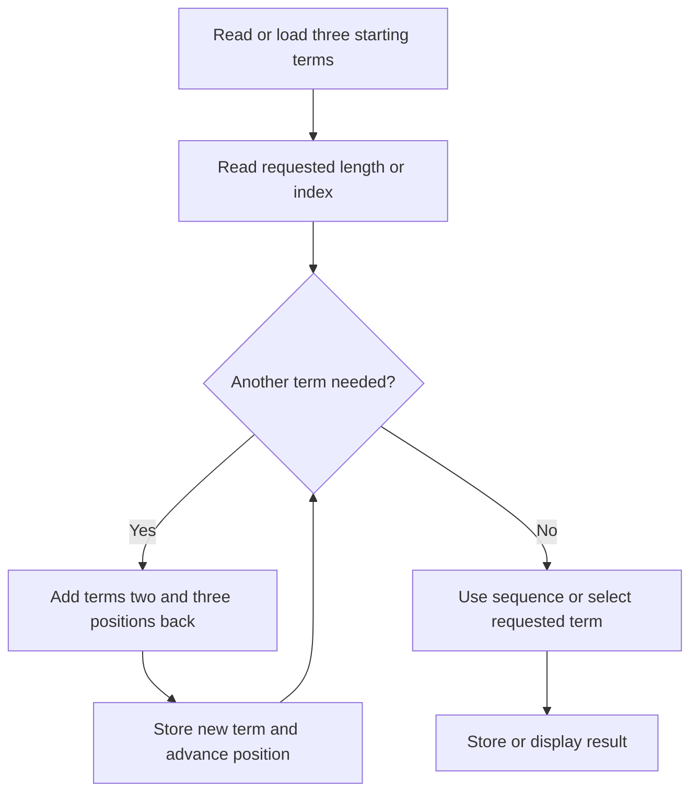
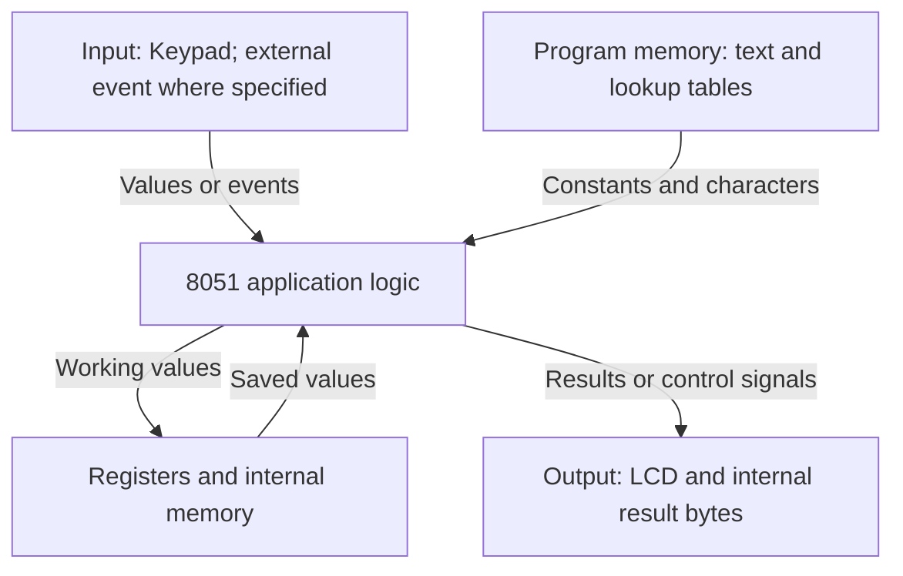

# Perrin Sequence

[Group overview](../../README.md) · [Compare implementations](../README.md)

Generate a number sequence in which each new value is the sum of the values two and three places before it. Some versions also let you request a particular term.

**Implementation:** Keypad Indexed Sequence

**Input:** keypad.  
**Output:** LCD and internal result bytes.

## Inputs and results

| Parameter | Description |
| --- | --- |
| Input | Three starting numbers and a length or position |
| Output | A sequence of numbers or the requested term |

## Worked example

Starting with 3, 0, 2 gives 3, 0, 2, 3, 2, 5, 5. For example, the fourth value is 3 + 0 = 3.

### Calculation details

With the seeds 3, 0, 2 at 40H–42H and N = 6, the loop writes 3, 2, 5, 5 to 43H–46H. Reading from 40H through index 6 gives 3, 0, 2, 3, 2, 5, 5. Here N is the last index, so the print loop can emit seven terms.

## Program operation

### Functional flowchart

[Detailed control flow](source-flow.md)

### Simplified block diagram

**Port registers:** `P1`, `P1.2`, `P1.3`, `P1.4`, `P1.5`, `P1.6`, `P1.7`, `p0`, `p0.4`, `p0.6`.

## Technical limitations

No additional defect was recorded in the earlier source review. This is not evidence of a successful build or hardware test.

## Build and test

1. Open the [assembly source](source.asm) in an 8051 assembler or simulator.
2. Review the technical limitations and configure the peripherals required by this implementation.
3. Check the expected result using the example inputs.
