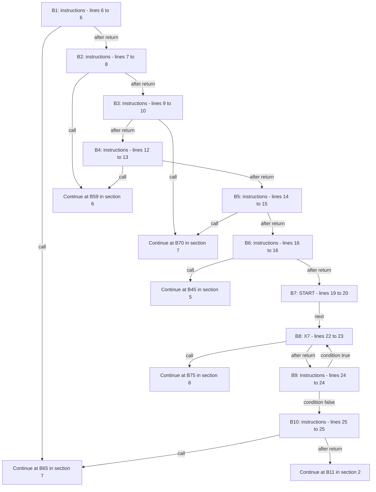
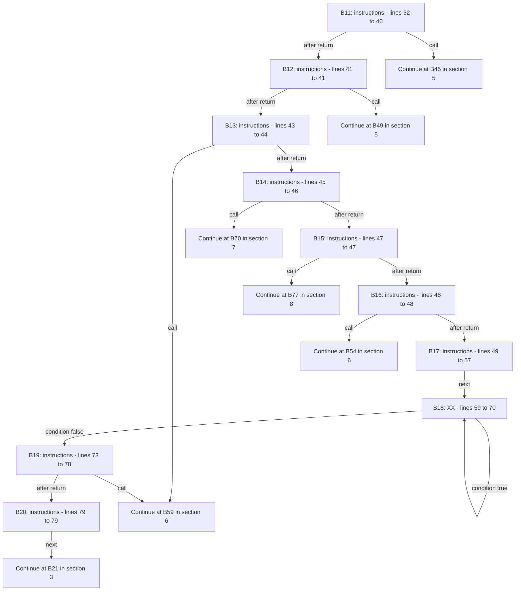
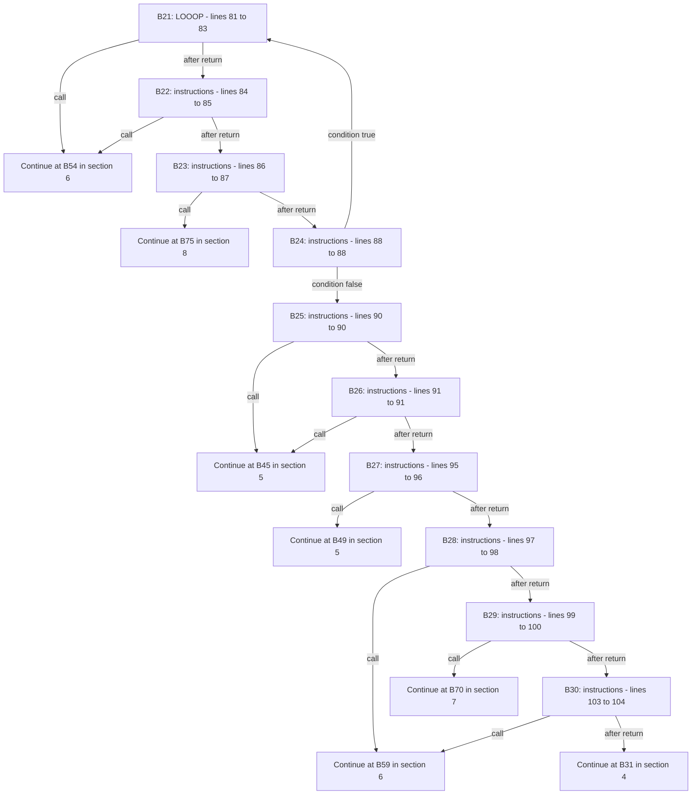
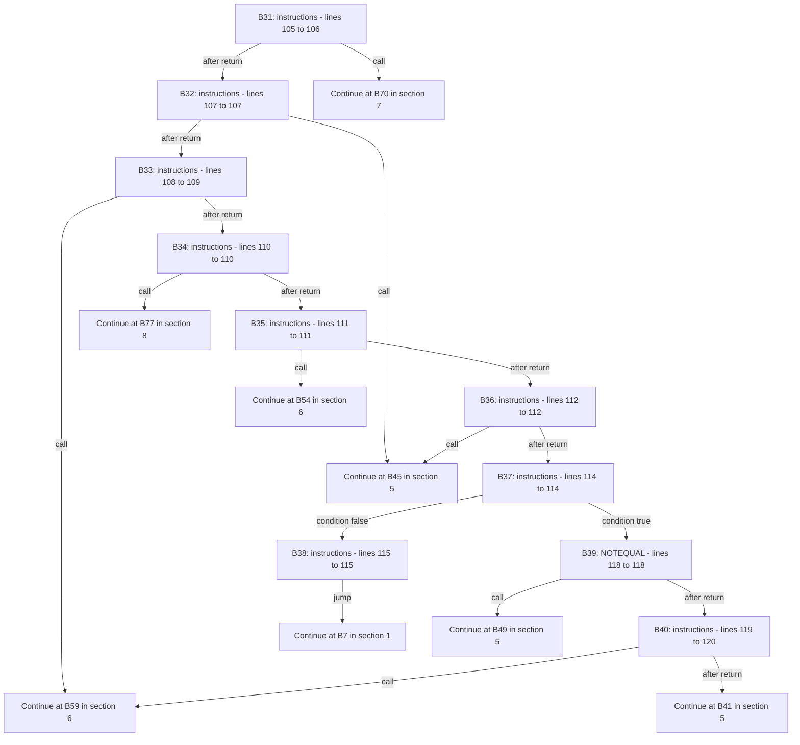
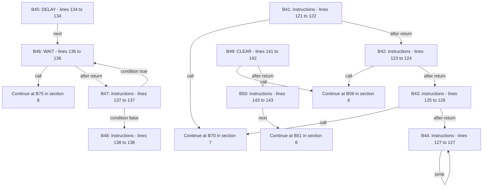
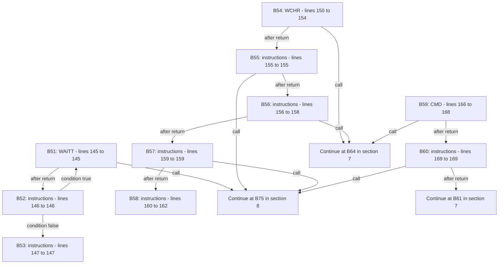
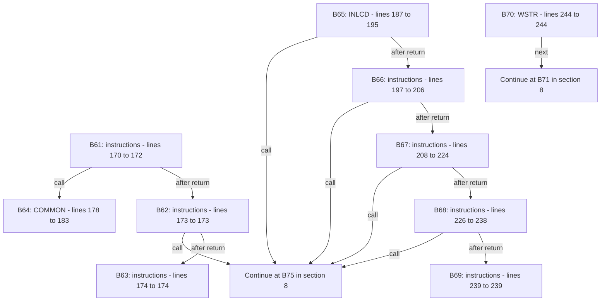
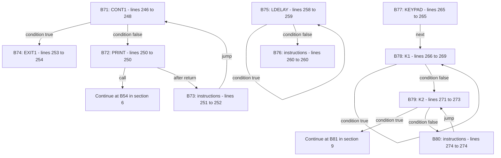
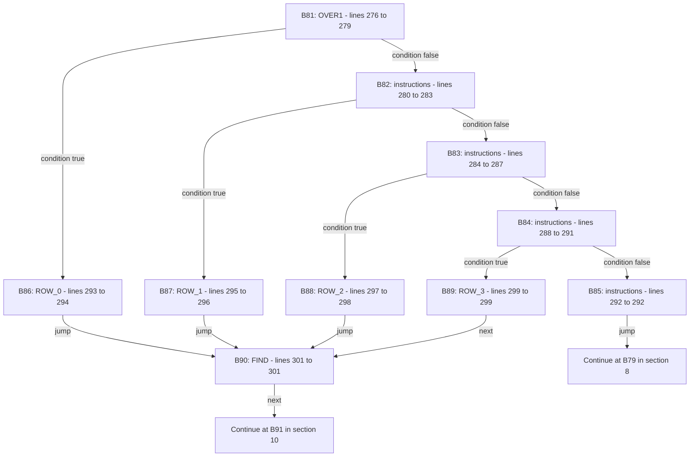
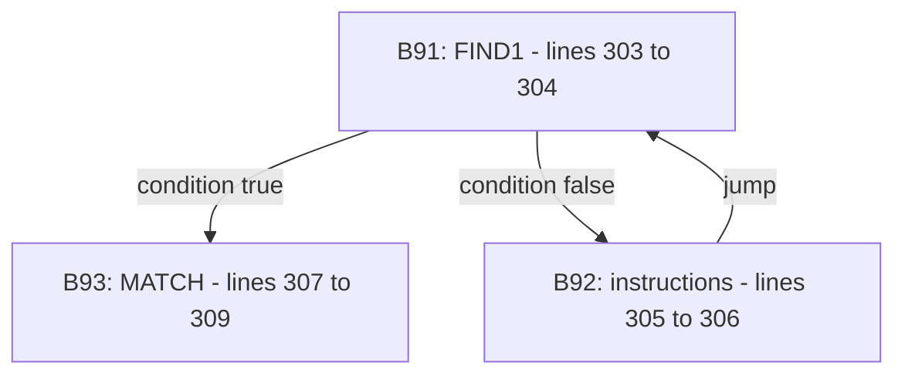

# Program Control Flow

[Back to project](README.md)

Control-flow blocks are indexed by source line. Calls resume at the instruction following the call if the subroutine returns normally.

## Entry locations

- `ORG 0H` begins at B1.

## Navigation

[Section 1](#section-1) · [Section 2](#section-2) · [Section 3](#section-3) · [Section 4](#section-4) · [Section 5](#section-5) · [Section 6](#section-6) · [Section 7](#section-7) · [Section 8](#section-8) · [Section 9](#section-9) · [Section 10](#section-10)

## Section 1



### B1

```asm
ACALL INLCD
```

### B2

```asm
MOV A,#80H
ACALL CMD
```

### B3

```asm
MOV DPTR,#NAME
ACALL WSTR
```

### B4

```asm
MOV A,#0C0H
ACALL CMD
```

### B5

```asm
MOV DPTR,#NAME1
ACALL WSTR
```

### B6

```asm
ACALL DELAY
```

### B7

```asm
MOV R2,#3
MOV P1,#0FFH
```

### B8

```asm
MOV P1,#00000000B
ACALL LDELAY
```

### B9

```asm
DJNZ R2,X7
```

### B10

```asm
ACALL INLCD
```

## Section 2



### B11

```asm
MOV R1,#3
MOV 40H,R1
MOV R1,#0
MOV 41H,R1
MOV R1,#2
MOV 42H,R1
ACALL DELAY
```

### B12

```asm
ACALL CLEAR
```

### B13

```asm
MOV A,#80H
ACALL CMD
```

### B14

```asm
MOV DPTR,#N
ACALL WSTR
```

### B15

```asm
ACALL KEYPAD
```

### B16

```asm
ACALL WCHR
```

### B17

```asm
SUBB A,#30H
MOV 30H,A
MOV R7,30H
DEC R7
DEC R7
MOV R0,#43H
MOV R1,#43H
```

### B18

```asm
DEC R1
DEC R1
MOV A,@R1
MOV R2,A
DEC R1
MOV A,@R1
ADD A,R2
MOV @R0,A
INC R0
MOV B,R0
MOV R1,B
DJNZ R7,XX
```

### B19

```asm
MOV R2,30H
INC R2
MOV A,#0C0H
ACALL CMD
```

### B20

```asm
MOV R1,#40H
```

## Section 3



### B21

```asm
MOV A,@R1
ADD A,#30H
ACALL WCHR
```

### B22

```asm
MOV A,#','
ACALL WCHR
```

### B23

```asm
INC R1
ACALL LDELAY
```

### B24

```asm
DJNZ R2,LOOOP
```

### B25

```asm
ACALL DELAY
```

### B26

```asm
ACALL DELAY
```

### B27

```asm
MOV 31H,#0
ACALL CLEAR
```

### B28

```asm
MOV A,#80H
ACALL CMD
```

### B29

```asm
MOV DPTR,#CONT
ACALL WSTR
```

### B30

```asm
MOV A,#0C0H
ACALL CMD
```

## Section 4



### B31

```asm
MOV DPTR,#YES
ACALL WSTR
```

### B32

```asm
ACALL DELAY
```

### B33

```asm
MOV A,#0CDH
ACALL CMD
```

### B34

```asm
ACALL KEYPAD
```

### B35

```asm
ACALL WCHR
```

### B36

```asm
ACALL DELAY
```

### B37

```asm
CJNE A,#'1',NOTEQUAL
```

### B38

```asm
AJMP START
```

### B39

```asm
ACALL CLEAR
```

### B40

```asm
MOV A,#80H
ACALL CMD
```

## Section 5



### B41

```asm
MOV DPTR,#THANK
ACALL WSTR
```

### B42

```asm
MOV A,#0C0H
ACALL CMD
```

### B43

```asm
MOV DPTR,#BYE
ACALL WSTR
```

### B44

```asm
SJMP $
```

### B45

```asm
MOV R7,#250
```

### B46

```asm
ACALL LDELAY
```

### B47

```asm
DJNZ R7,WAIT
```

### B48

Return to the instruction following the active call.

```asm
RET
```

### B49

```asm
MOV A, #01H
ACALL CMD
```

### B50

```asm
MOV R7, #14
```

## Section 6



### B51

```asm
ACALL LDELAY
```

### B52

```asm
DJNZ R7, WaitT
```

### B53

Return to the instruction following the active call.

```asm
RET
```

### B54

```asm
PUSH ACC
PUSH B
SETB P1.3
MOV B,A
ACALL COMMON
```

### B55

```asm
ACALL LDELAY
```

### B56

```asm
MOV A,B
SWAP A
ACALL COMMON
```

### B57

```asm
ACALL LDELAY
```

### B58

Return to the instruction following the active call.

```asm
POP B
POP ACC
RET
```

### B59

```asm
CLR P1.3
MOV B,A
ACALL COMMON
```

### B60

```asm
ACALL LDELAY
```

## Section 7



### B61

```asm
MOV A,B
SWAP A
ACALL COMMON
```

### B62

```asm
ACALL LDELAY
```

### B63

Return to the instruction following the active call.

```asm
RET
```

### B64

Return to the instruction following the active call.

```asm
ANL a,#11110000B
ANL P1, #00001111B
ORL P1,A
SETB P1.2
CLR P1.2
RET
```

### B65

```asm
CLR P1.3
CLR P1.7
CLR P1.6
SETB P1.5
CLR P1.4
SETB P1.2
CLR P1.2
ACALL LDELAY
```

### B66

```asm
SETB P1.2
CLR P1.2
SETB P1.7
CLR P1.6
CLR P1.5
CLR P1.4
SETB P1.2
CLR P1.2
ACALL LDELAY
```

### B67

```asm
CLR P1.7
CLR P1.6
CLR P1.5
CLR P1.4
SETB P1.2
CLR P1.2
SETB P1.7
SETB P1.6
SETB P1.5
SETB P1.4
SETB P1.2
CLR P1.2
ACALL LDELAY
```

### B68

```asm
CLR P1.7
CLR P1.6
CLR P1.5
CLR P1.4
SETB P1.2
CLR P1.2
SETB P1.6
SETB P1.5
SETB P1.2
CLR P1.2
ACALL LDELAY
```

### B69

Return to the instruction following the active call.

```asm
RET
```

### B70

```asm
PUSH    ACC
```

## Section 8



### B71

```asm
CLR     A
MOVC    A,@A+DPTR
JZ Exit1
```

### B72

```asm
ACALL    WCHR
```

### B73

```asm
INC DPTR
AJMP    CONT1
```

### B74

Return to the instruction following the active call.

```asm
POP     ACC
RET
```

### B75

```asm
MOV R0, #50
DJNZ R0, $
```

### B76

Return to the instruction following the active call.

```asm
RET
```

### B77

```asm
mov p0,#01110000b
```

### B78

```asm
mov p0,#01110000b
mov a,p0
anl a,#01110000b
cjne a,#01110000b,k1
```

### B79

```asm
mov a,p0
anl a,#01110000b
cjne a,#01110000b,over1
```

### B80

```asm
sjmp k2
```

## Section 9



### B81

```asm
mov p0,#01111110b
mov a,p0
anl a,#01110000b
cjne a,#01110000b,row_0
```

### B82

```asm
mov p0,#01111101b
mov a,p0
anl a,#01110000b
cjne a,#01110000b,row_1
```

### B83

```asm
mov p0,#01111011b
mov a,p0
anl a,#01110000b
cjne a,#01110000b,row_2
```

### B84

```asm
mov p0,#01110111b
mov a,p0
anl a,#01110000b
cjne a,#01110000b,row_3
```

### B85

```asm
ljmp k2
```

### B86

```asm
mov dptr,#kcode0
sjmp find
```

### B87

```asm
mov dptr,#kcode1
sjmp find
```

### B88

```asm
mov dptr,#kcode2
sjmp find
```

### B89

```asm
mov dptr,#kcode3
```

### B90

```asm
rlc a
```

## Section 10



### B91

```asm
rlc a
jnc match
```

### B92

```asm
inc dptr
sjmp find1
```

### B93

Return to the instruction following the active call.

```asm
clr a
movc a,@a+dptr
ret
```
