# Program Control Flow

[Back to project](README.md)

Control-flow blocks are indexed by source line. Calls resume at the instruction following the call if the subroutine returns normally.

## Entry locations

- `ORG 00H` begins at B1.

## Navigation

[Section 1](#section-1) · [Section 2](#section-2) · [Section 3](#section-3) · [Section 4](#section-4) · [Section 5](#section-5) · [Section 6](#section-6) · [Section 7](#section-7) · [Section 8](#section-8) · [Section 9](#section-9) · [Section 10](#section-10) · [Section 11](#section-11) · [Section 12](#section-12) · [Section 13](#section-13) · [Section 14](#section-14) · [Section 15](#section-15) · [Section 16](#section-16) · [Section 17](#section-17) · [Section 18](#section-18)

## Destinations requiring review

`HH`. A repeated label is also unresolved because it has more than one candidate target.

## Section 1

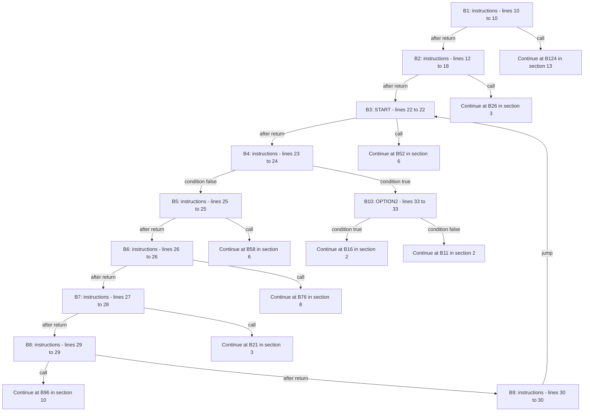

### B1

```asm
ACALL INLCD
```

### B2

```asm
MOV 70H,#1
MOV R1,#23H
MOV 20H,#4
MOV 21H,#2
MOV 22H,#3
MOV 30H,#6
ACALL WELCOME
```

### B3

```asm
ACALL SELECTT
```

### B4

```asm
MOV A,70H
CJNE A,#1,OPTION2
```

### B5

```asm
ACALL OPTIONN1
```

### B6

```asm
ACALL ENTER3NUMBER
```

### B7

```asm
MOV A,#6
ACALL PERRINSEQ
```

### B8

```asm
ACALL PRINT1
```

### B9

```asm
SJMP START
```

### B10

```asm
CJNE A,#2,OPTION3
```

## Section 2

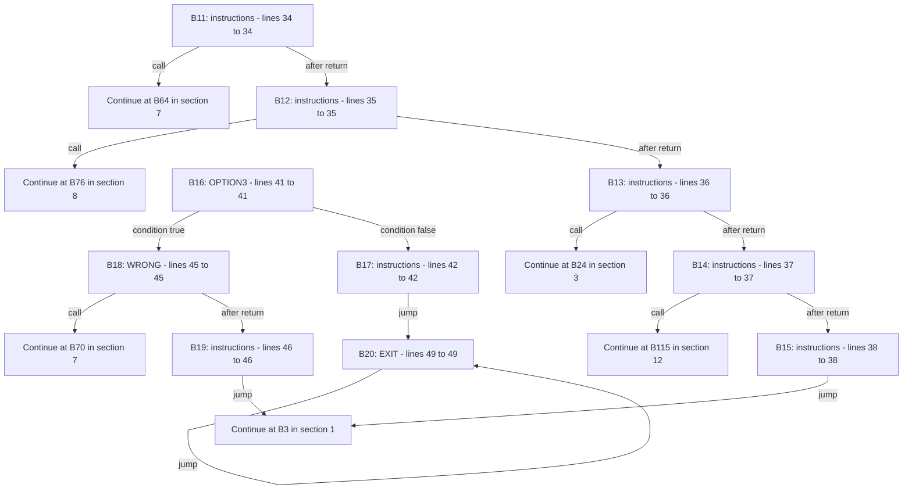

### B11

```asm
ACALL OPTIONN2
```

### B12

```asm
ACALL ENTER3NUMBER
```

### B13

```asm
ACALL NthNumber
```

### B14

```asm
ACALL PRINT2
```

### B15

```asm
SJMP START
```

### B16

```asm
CJNE A,#2,WRONG
```

### B17

```asm
SJMP EXIT
```

### B18

```asm
ACALL WRONGG
```

### B19

```asm
SJMP START
```

### B20

```asm
SJMP $
```

## Section 3

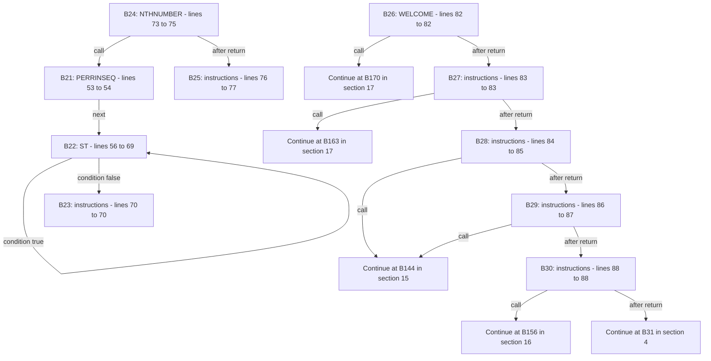

### B21

```asm
MOV R7,A
MOV R0,#22H
```

### B22

```asm
INC R0
MOV A,R0
DEC R0
DEC R0
MOV A,@R0
DEC R0
ADD A,@R0
MOV R3,A
MOV A,R0
ADD A,#3
MOV R0,A
MOV A,R3
MOV @R0,A
DJNZ R7,ST
```

### B23

Return to the instruction following the active call.

```asm
RET
```

### B24

```asm
MOV A,30H
SUBB A,#3
ACALL PERRINSEQ
```

### B25

Return to the instruction following the active call.

```asm
MOV 31H,R3
RET
```

### B26

```asm
ACALL DELAY
```

### B27

```asm
ACALL CLEAR
```

### B28

```asm
MOV A, #8H
ACALL CMD
```

### B29

```asm
MOV A, #0H
ACALL CMD
```

### B30

```asm
ACALL LDELAY
```

## Section 4

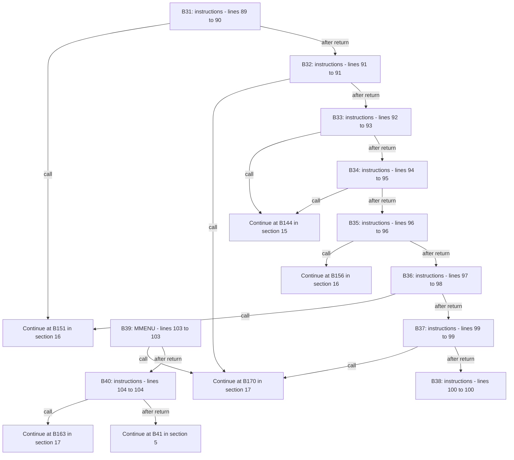

### B31

```asm
mov dptr, #NAME1
acall wstr
```

### B32

```asm
ACALL DELAY
```

### B33

```asm
MOV A, #1100B
ACALL CMD
```

### B34

```asm
MOV A, #0H
ACALL CMD
```

### B35

```asm
ACALL LDELAY
```

### B36

```asm
mov dptr, #NAME2
acall wstr
```

### B37

```asm
acall delay
```

### B38

Return to the instruction following the active call.

```asm
ret
```

### B39

```asm
ACALL DELAY
```

### B40

```asm
ACALL CLEAR
```

## Section 5

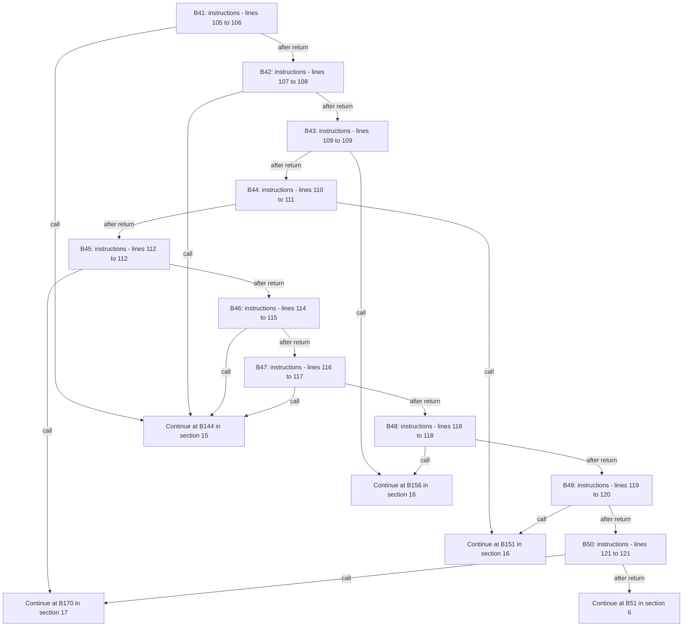

### B41

```asm
MOV A, #8H
ACALL CMD
```

### B42

```asm
MOV A, #0H
ACALL CMD
```

### B43

```asm
ACALL LDELAY
```

### B44

```asm
mov dptr, #OP1
acall wstr
```

### B45

```asm
ACALL DELAY
```

### B46

```asm
MOV A, #1100B
ACALL CMD
```

### B47

```asm
MOV A, #0H
ACALL CMD
```

### B48

```asm
ACALL LDELAY
```

### B49

```asm
mov dptr, #OP2
acall wstr
```

### B50

```asm
acall delay
```

## Section 6

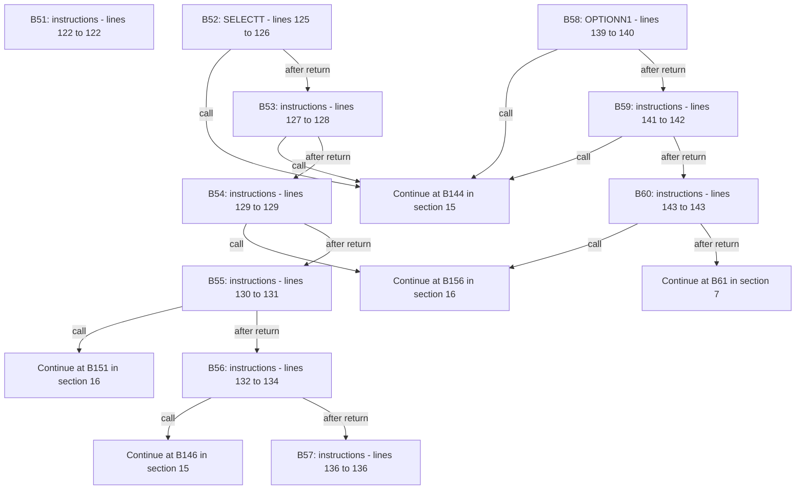

### B51

Return to the instruction following the active call.

```asm
ret
```

### B52

```asm
MOV A, #8H
ACALL CMD
```

### B53

```asm
MOV A, #0H
ACALL CMD
```

### B54

```asm
ACALL LDELAY
```

### B55

```asm
mov dptr, #MSG
acall wstr
```

### B56

```asm
MOV A,70H
ADD A,#30H
ACALL WCHR
```

### B57

Return to the instruction following the active call.

```asm
RET
```

### B58

```asm
MOV A, #1100B
ACALL CMD
```

### B59

```asm
MOV A, #0H
ACALL CMD
```

### B60

```asm
ACALL LDELAY
```

## Section 7

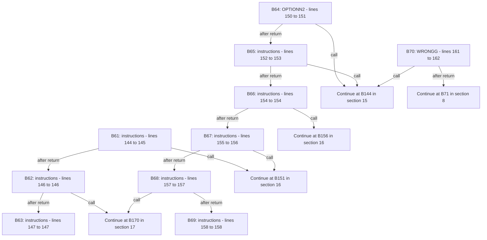

### B61

```asm
mov dptr, #MSG1
acall wstr
```

### B62

```asm
acall delay
```

### B63

Return to the instruction following the active call.

```asm
ret
```

### B64

```asm
MOV A, #1100B
ACALL CMD
```

### B65

```asm
MOV A, #0H
ACALL CMD
```

### B66

```asm
ACALL LDELAY
```

### B67

```asm
mov dptr, #MSG2
acall wstr
```

### B68

```asm
acall delay
```

### B69

Return to the instruction following the active call.

```asm
ret
```

### B70

```asm
MOV A, #1100B
ACALL CMD
```

## Section 8

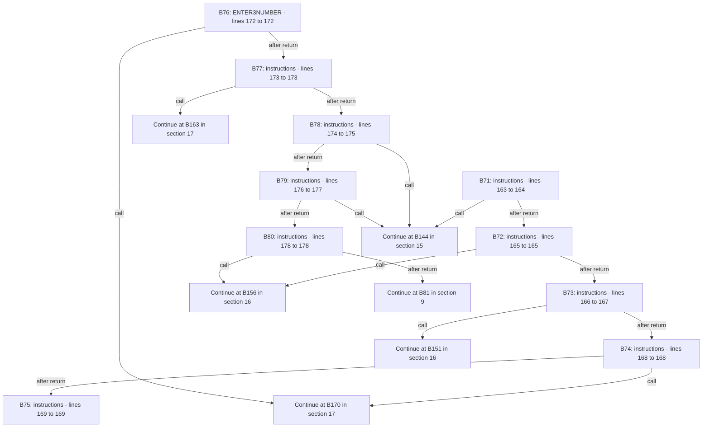

### B71

```asm
MOV A, #0H
ACALL CMD
```

### B72

```asm
ACALL LDELAY
```

### B73

```asm
mov dptr, #WRONGGG
acall wstr
```

### B74

```asm
acall delay
```

### B75

Return to the instruction following the active call.

```asm
ret
```

### B76

```asm
ACALL DELAY
```

### B77

```asm
ACALL CLEAR
```

### B78

```asm
MOV A, #8H
ACALL CMD
```

### B79

```asm
MOV A, #0H
ACALL CMD
```

### B80

```asm
ACALL LDELAY
```

## Section 9

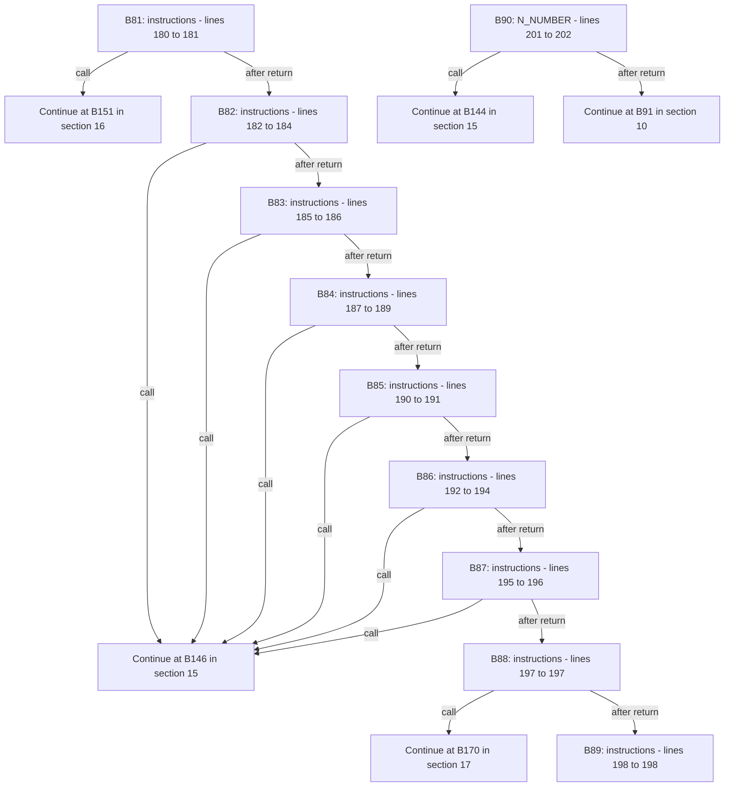

### B81

```asm
mov dptr, #ENTER
acall wstr
```

### B82

```asm
MOV A,20H
ADD A,#30H
ACALL WCHR
```

### B83

```asm
MOV A,#'-'
ACALL WCHR
```

### B84

```asm
MOV A,21H
ADD A,#30H
ACALL WCHR
```

### B85

```asm
MOV A,#'-'
ACALL WCHR
```

### B86

```asm
MOV A,22H
ADD A,#30H
ACALL WCHR
```

### B87

```asm
MOV A,#'-'
ACALL WCHR
```

### B88

```asm
ACALL DELAY
```

### B89

Return to the instruction following the active call.

```asm
RET
```

### B90

```asm
MOV A, #1100B
ACALL CMD
```

## Section 10

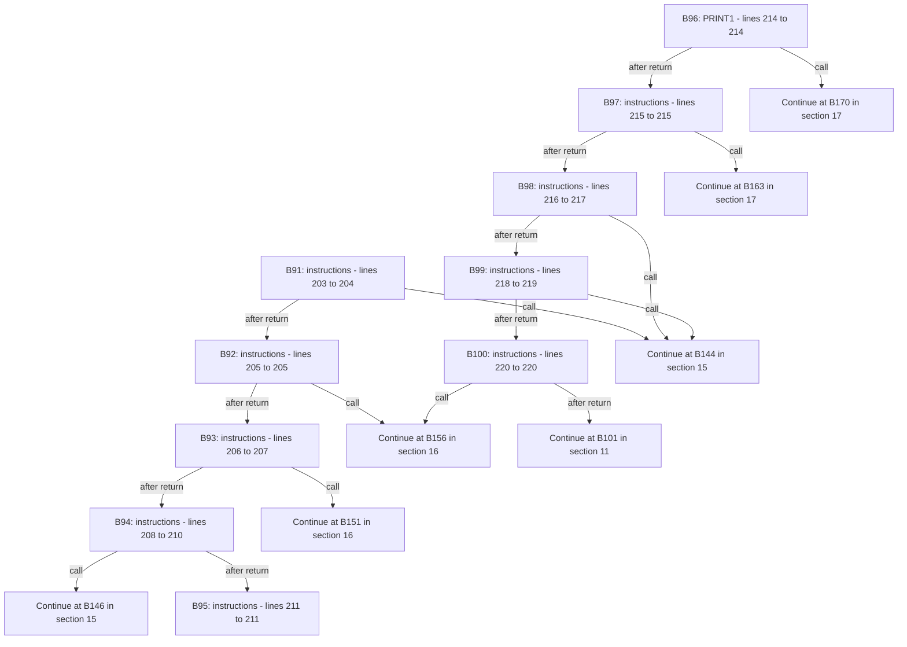

### B91

```asm
MOV A, #0H
ACALL CMD
```

### B92

```asm
ACALL LDELAY
```

### B93

```asm
mov dptr, #ENTERNTH
acall wstr
```

### B94

```asm
MOV A,30H
ADD A,#30H
ACALL WCHR
```

### B95

Return to the instruction following the active call.

```asm
RET
```

### B96

```asm
ACALL DELAY
```

### B97

```asm
ACALL CLEAR
```

### B98

```asm
MOV A, #8H
ACALL CMD
```

### B99

```asm
MOV A, #0H
ACALL CMD
```

### B100

```asm
ACALL LDELAY
```

## Section 11

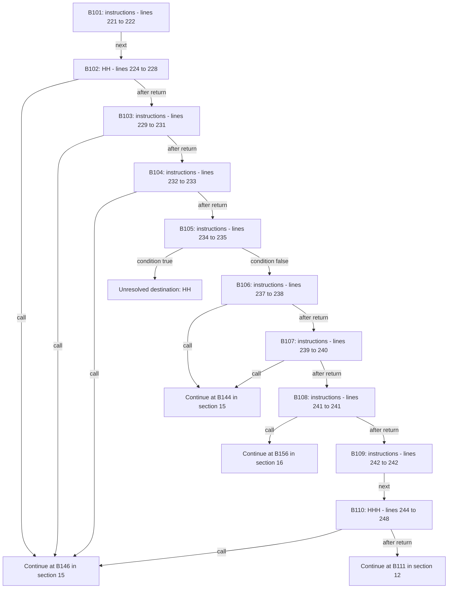

### B101

```asm
MOV R4,#4
MOV R1,#20h
```

### B102

```asm
MOV A,@R1
MOV B,#10
DIV AB
ADD A,#30H
ACALL WCHR
```

### B103

```asm
MOV A,B
ADD A,#30H
ACALL WCHR
```

### B104

```asm
MOV A,#'-'
ACALL WCHR
```

### B105

```asm
INC R1
DJNZ R4,HH
```

### B106

```asm
MOV A, #1100B
ACALL CMD
```

### B107

```asm
MOV A, #0H
ACALL CMD
```

### B108

```asm
ACALL LDELAY
```

### B109

```asm
MOV R4,#4
```

### B110

```asm
MOV A,@R1
MOV B,#10
DIV AB
ADD A,#30H
ACALL WCHR
```

## Section 12

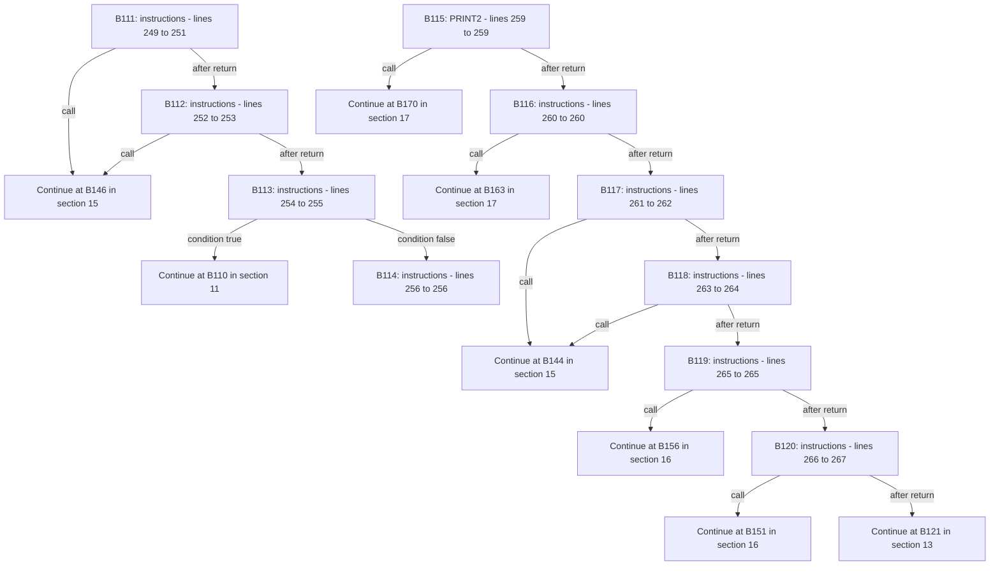

### B111

```asm
MOV A,B
ADD A,#30H
ACALL WCHR
```

### B112

```asm
MOV A,#'-'
ACALL WCHR
```

### B113

```asm
INC R1
DJNZ R4,HHH
```

### B114

Return to the instruction following the active call.

```asm
RET
```

### B115

```asm
ACALL DELAY
```

### B116

```asm
ACALL CLEAR
```

### B117

```asm
MOV A, #8H
ACALL CMD
```

### B118

```asm
MOV A, #0H
ACALL CMD
```

### B119

```asm
ACALL LDELAY
```

### B120

```asm
mov dptr, #ENTERNTH
acall wstr
```

## Section 13

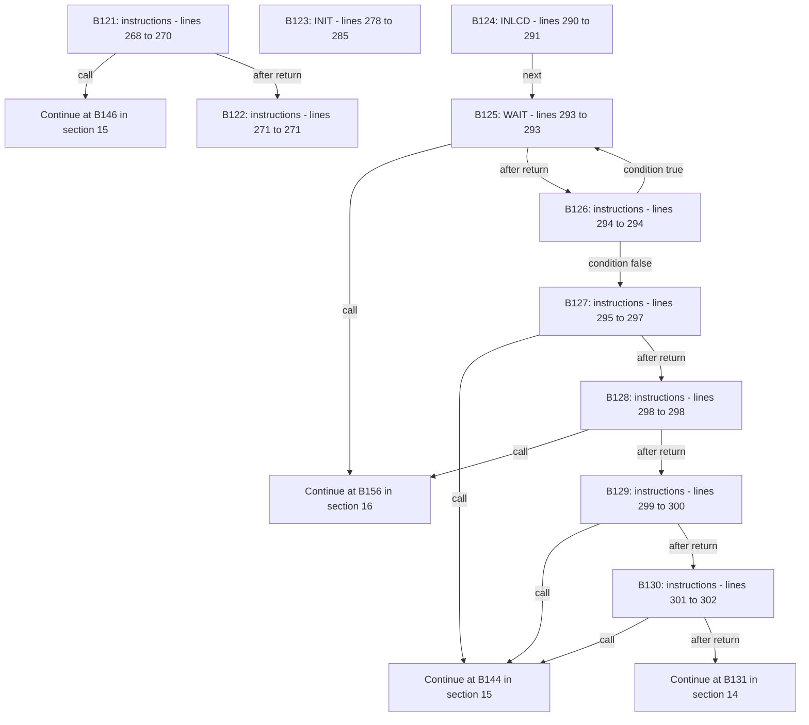

### B121

```asm
MOV A,31H
ADD A,#30H
ACALL WCHR
```

### B122

Return to the instruction following the active call.

```asm
RET
```

### B123

Return to the instruction following the active call.

```asm
MOV A,PCON
CLR ACC.7
MOV PCON,A
MOV SCON,#50H
MOV TMOD,#21H
MOV TH1,#-3
SETB TR1
RET
```

### B124

```asm
PUSH 7
MOV R7,#20
```

### B125

```asm
ACALL LDELAY
```

### B126

```asm
DJNZ R7,WAIT
```

### B127

```asm
MOV P0,#00000111B
MOV A,#0011B
ACALL CMD
```

### B128

```asm
ACALL LDELAY
```

### B129

```asm
MOV A,#0011B
ACALL CMD
```

### B130

```asm
MOV A,#0011B
ACALL CMD
```

## Section 14

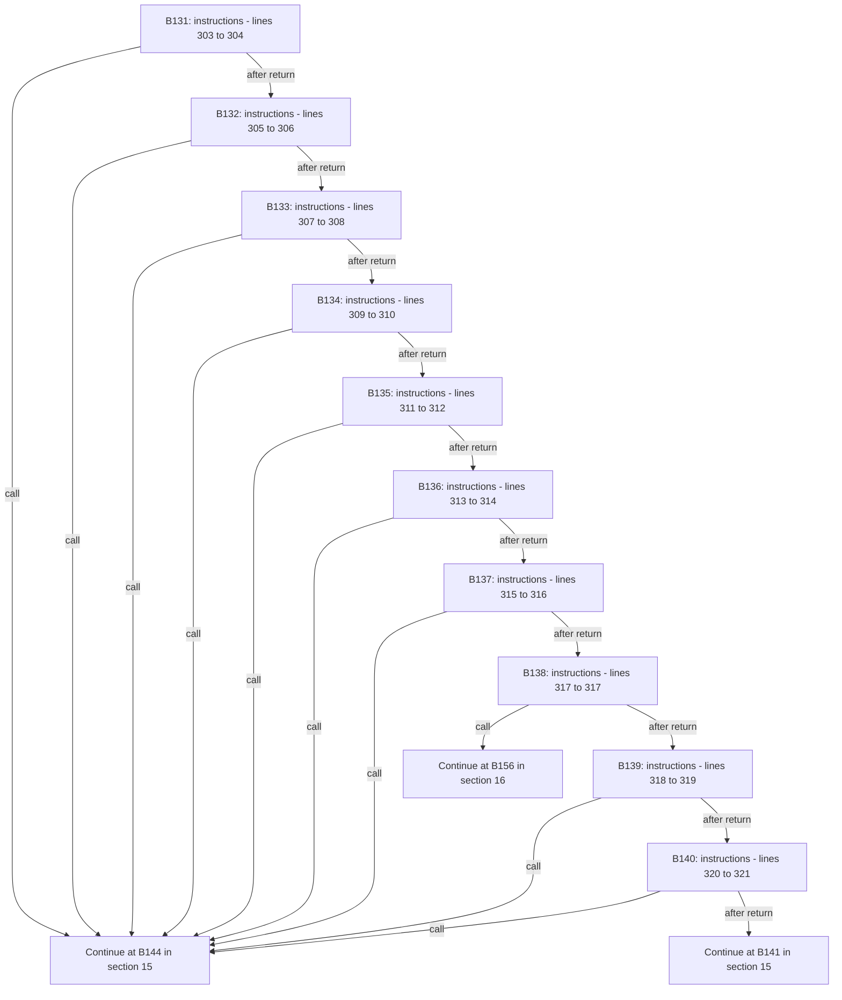

### B131

```asm
MOV A,#0010B
ACALL CMD
```

### B132

```asm
MOV A,#0010B
ACALL CMD
```

### B133

```asm
MOV A,#1000B
ACALL CMD
```

### B134

```asm
MOV A,#0000B
ACALL CMD
```

### B135

```asm
MOV A,#1000B
ACALL CMD
```

### B136

```asm
MOV A,#0
ACALL CMD
```

### B137

```asm
MOV A,#0001B
ACALL CMD
```

### B138

```asm
ACALL LDELAY
```

### B139

```asm
MOV A,#0000B
ACALL CMD
```

### B140

```asm
MOV A,#0110B
ACALL CMD
```

## Section 15

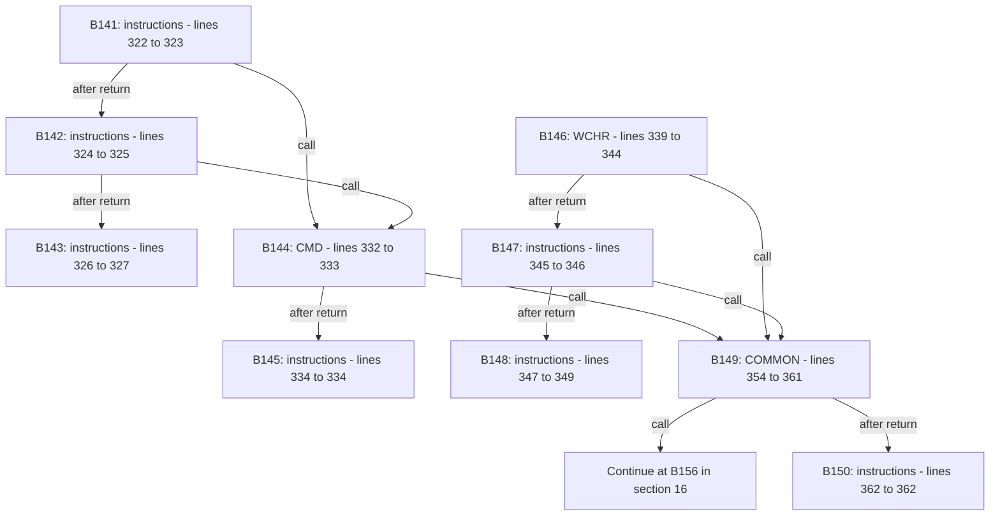

### B141

```asm
MOV A,#0000B
ACALL CMD
```

### B142

```asm
MOV A,#1111B
ACALL CMD
```

### B143

Return to the instruction following the active call.

```asm
POP 7
RET
```

### B144

```asm
CLR RS
ACALL COMMON
```

### B145

Return to the instruction following the active call.

```asm
RET
```

### B146

```asm
PUSH ACC
PUSH B
SETB RS
MOV B,A
SWAP A
ACALL COMMON
```

### B147

```asm
MOV A,B
ACALL COMMON
```

### B148

Return to the instruction following the active call.

```asm
POP B
POP ACC
RET
```

### B149

```asm
CLR RW
SWAP A
ANL A,#11110000B
ANL P0,#00000111B
ORL P0,A
SETB EN
CLR EN
ACALL LDELAY
```

### B150

Return to the instruction following the active call.

```asm
RET
```

## Section 16

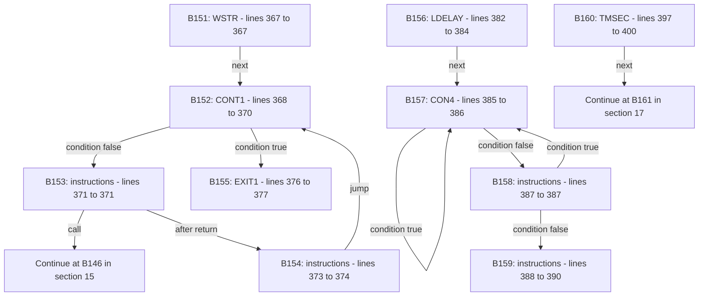

### B151

```asm
PUSH ACC
```

### B152

```asm
CLR A
MOVC A,@A+DPTR
JZ EXIT1
```

### B153

```asm
ACALL WCHR
```

### B154

```asm
INC DPTR
AJMP CONT1
```

### B155

Return to the instruction following the active call.

```asm
POP ACC
RET
```

### B156

```asm
PUSH 0
PUSH 1
MOV R1,#20
```

### B157

```asm
MOV R0,#250
DJNZ R0,$
```

### B158

```asm
DJNZ R1,CON4
```

### B159

Return to the instruction following the active call.

```asm
POP 1
POP 0
RET
```

### B160

```asm
MOV TMOD,#21H
MOV TL0,#0CAH
MOV TH0,#27H
SETB TR0
```

## Section 17

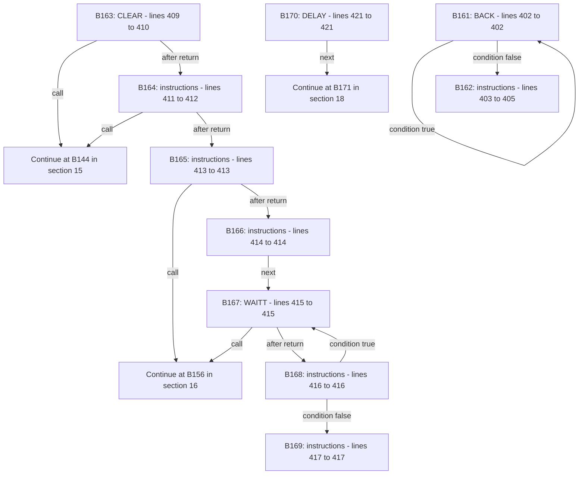

### B161

```asm
JNB TF0,BACK
```

### B162

Return to the instruction following the active call.

```asm
CLR TR0
CLR TF0
RET
```

### B163

```asm
MOV A,#0H
ACALL CMD
```

### B164

```asm
MOV A,#1H
ACALL CMD
```

### B165

```asm
ACALL LDELAY
```

### B166

```asm
MOV R7,#14
```

### B167

```asm
ACALL LDELAY
```

### B168

```asm
DJNZ R7,WAITT
```

### B169

Return to the instruction following the active call.

```asm
RET
```

### B170

```asm
MOV R5,#60
```

## Section 18

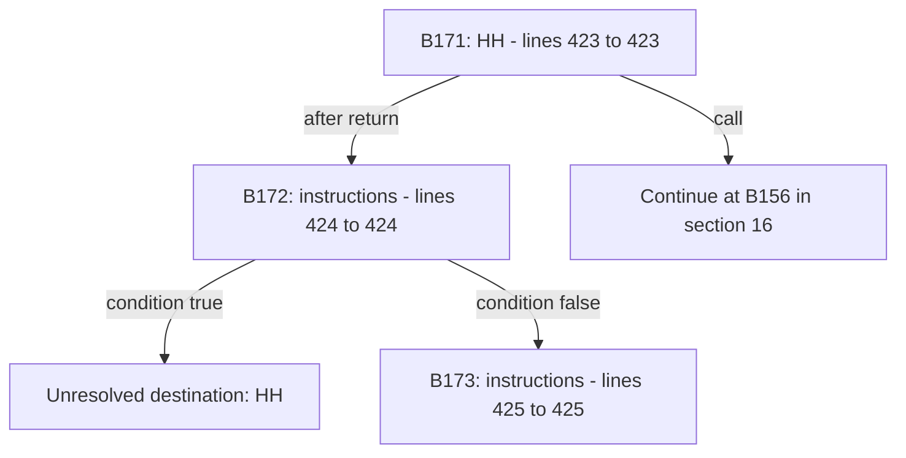

### B171

```asm
ACALL LDELAY
```

### B172

```asm
DJNZ R5,HH
```

### B173

Return to the instruction following the active call.

```asm
RET
```
