# Program Control Flow

[Back to project](README.md)

Control-flow blocks are indexed by source line. Calls resume at the instruction following the call if the subroutine returns normally.

## Entry locations

- `ORG 00H` begins at B1.

## Navigation

[Section 1](#section-1) · [Section 2](#section-2) · [Section 3](#section-3) · [Section 4](#section-4) · [Section 5](#section-5) · [Section 6](#section-6) · [Section 7](#section-7) · [Section 8](#section-8) · [Section 9](#section-9) · [Section 10](#section-10) · [Section 11](#section-11) · [Section 12](#section-12) · [Section 13](#section-13)

## Section 1

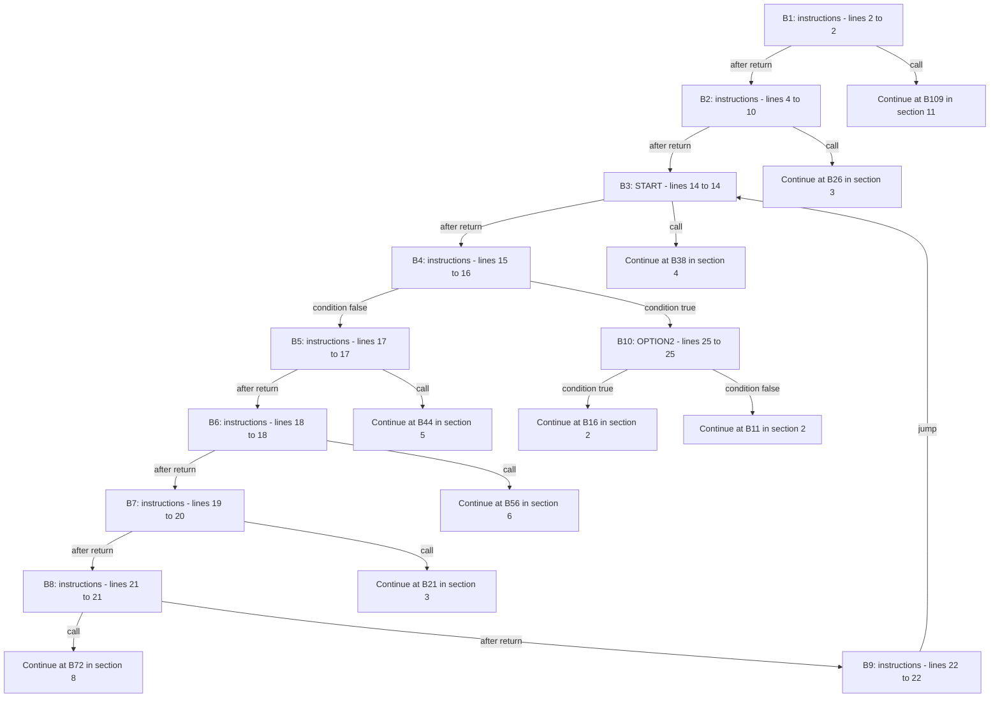

### B1

```asm
ACALL INLCD
```

### B2

```asm
MOV 70H,#1
MOV R1,#23H
MOV 20H,#4
MOV 21H,#2
MOV 22H,#3
MOV 30H,#6
ACALL WELCOME
```

### B3

```asm
ACALL SELECTT
```

### B4

```asm
MOV A,70H
CJNE A,#1,OPTION2
```

### B5

```asm
ACALL OPTIONN1
```

### B6

```asm
ACALL ENTER3NUMBER
```

### B7

```asm
MOV A,#6
ACALL PERRINSEQ
```

### B8

```asm
ACALL PRINT1
```

### B9

```asm
SJMP START
```

### B10

```asm
CJNE A,#2,OPTION3
```

## Section 2

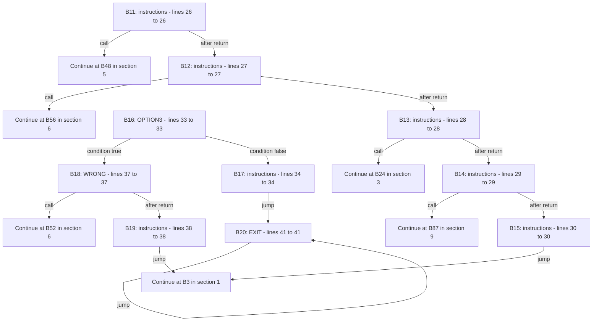

### B11

```asm
ACALL OPTIONN2
```

### B12

```asm
ACALL ENTER3NUMBER
```

### B13

```asm
ACALL NthNumber
```

### B14

```asm
ACALL PRINT2
```

### B15

```asm
SJMP START
```

### B16

```asm
CJNE A,#2,WRONG
```

### B17

```asm
SJMP EXIT
```

### B18

```asm
ACALL WRONGG
```

### B19

```asm
SJMP START
```

### B20

```asm
SJMP $
```

## Section 3

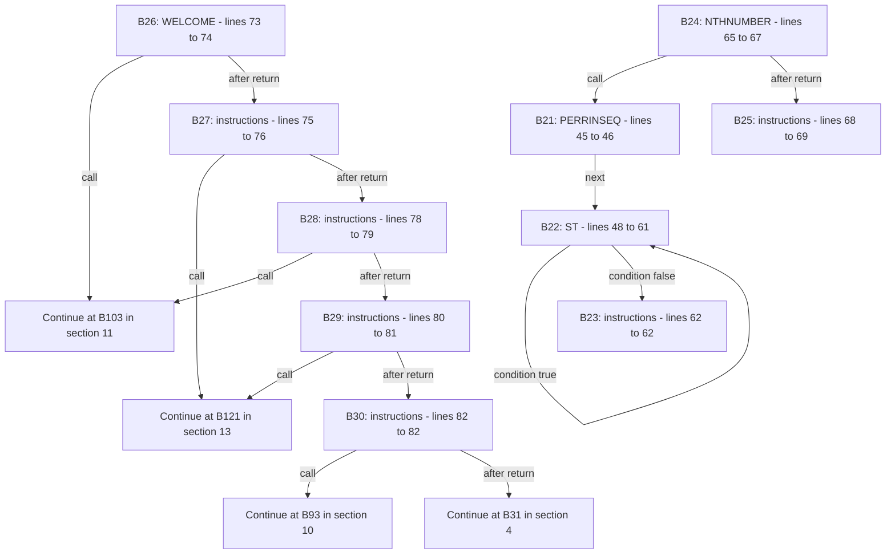

### B21

```asm
MOV R7,A
MOV R0,#22H
```

### B22

```asm
INC R0
MOV A,R0
DEC R0
DEC R0
MOV A,@R0
DEC R0
ADD A,@R0
MOV R3,A
MOV A,R0
ADD A,#3
MOV R0,A
MOV A,R3
MOV @R0,A
DJNZ R7,ST
```

### B23

Return to the instruction following the active call.

```asm
RET
```

### B24

```asm
MOV A,30H
SUBB A,#3
ACALL PERRINSEQ
```

### B25

Return to the instruction following the active call.

```asm
MOV 31H,R3
RET
```

### B26

```asm
mov a, #80H
acall cmd
```

### B27

```asm
mov dptr, #NAME1
acall wstr
```

### B28

```asm
mov a,#0c0h
acall cmd
```

### B29

```asm
mov dptr, #NAME2
acall wstr
```

### B30

```asm
acall delay
```

## Section 4

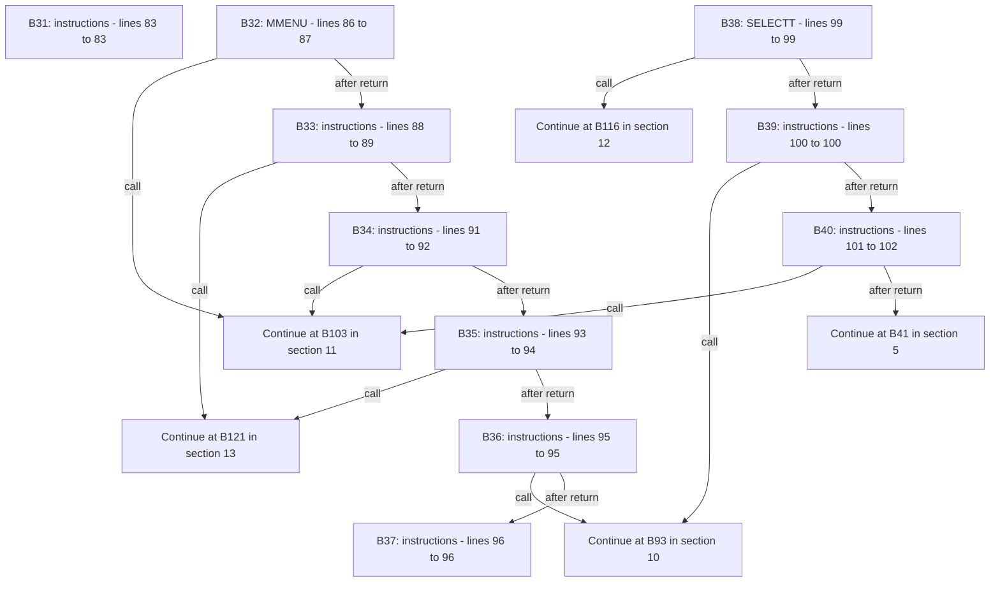

### B31

Return to the instruction following the active call.

```asm
ret
```

### B32

```asm
mov a, #80H
acall cmd
```

### B33

```asm
mov dptr, #OP1
acall wstr
```

### B34

```asm
mov a,#0c0h
acall cmd
```

### B35

```asm
mov dptr, #OP2
acall wstr
```

### B36

```asm
acall delay
```

### B37

Return to the instruction following the active call.

```asm
ret
```

### B38

```asm
ACALL CLEAR
```

### B39

```asm
ACALL DELAY
```

### B40

```asm
mov a, #80H
acall cmd
```

## Section 5

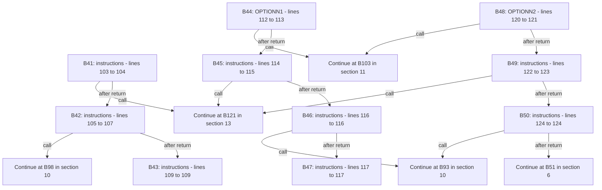

### B41

```asm
mov dptr, #MSG
acall wstr
```

### B42

```asm
MOV A,70H
ADD A,#30H
ACALL WCHR
```

### B43

Return to the instruction following the active call.

```asm
RET
```

### B44

```asm
mov a,#0c0h
acall cmd
```

### B45

```asm
mov dptr, #MSG1
acall wstr
```

### B46

```asm
acall delay
```

### B47

Return to the instruction following the active call.

```asm
ret
```

### B48

```asm
mov a,#0c0h
acall cmd
```

### B49

```asm
mov dptr, #MSG2
acall wstr
```

### B50

```asm
acall delay
```

## Section 6

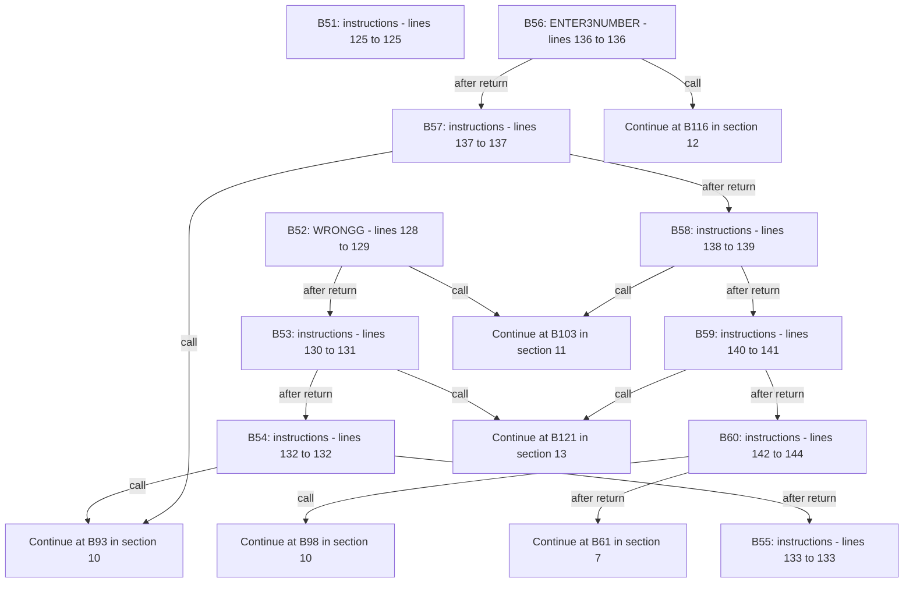

### B51

Return to the instruction following the active call.

```asm
ret
```

### B52

```asm
mov a,#0C0h
acall cmd
```

### B53

```asm
mov dptr, #WRONGGG
acall wstr
```

### B54

```asm
acall delay
```

### B55

Return to the instruction following the active call.

```asm
ret
```

### B56

```asm
ACALL CLEAR
```

### B57

```asm
ACALL DELAY
```

### B58

```asm
mov a, #80H
acall cmd
```

### B59

```asm
mov dptr, #ENTER
acall wstr
```

### B60

```asm
MOV A,20H
ADD A,#30H
ACALL WCHR
```

## Section 7

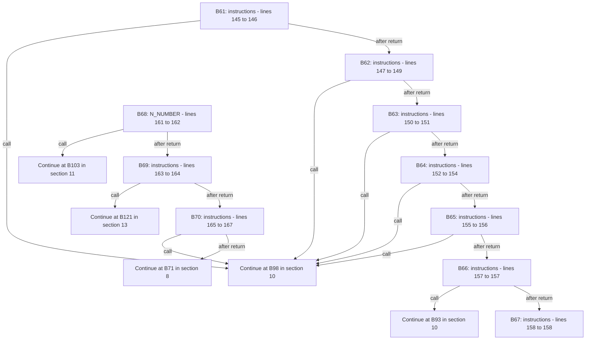

### B61

```asm
MOV A,#'-'
ACALL WCHR
```

### B62

```asm
MOV A,21H
ADD A,#30H
ACALL WCHR
```

### B63

```asm
ADD A,#'-'
ACALL WCHR
```

### B64

```asm
MOV A,22H
ADD A,#30H
ACALL WCHR
```

### B65

```asm
ADD A,#'-'
ACALL WCHR
```

### B66

```asm
ACALL DELAY
```

### B67

Return to the instruction following the active call.

```asm
RET
```

### B68

```asm
mov a, #0CH
acall cmd
```

### B69

```asm
mov dptr, #ENTERNTH
acall wstr
```

### B70

```asm
MOV A,30H
ADD A,#30H
ACALL WCHR
```

## Section 8

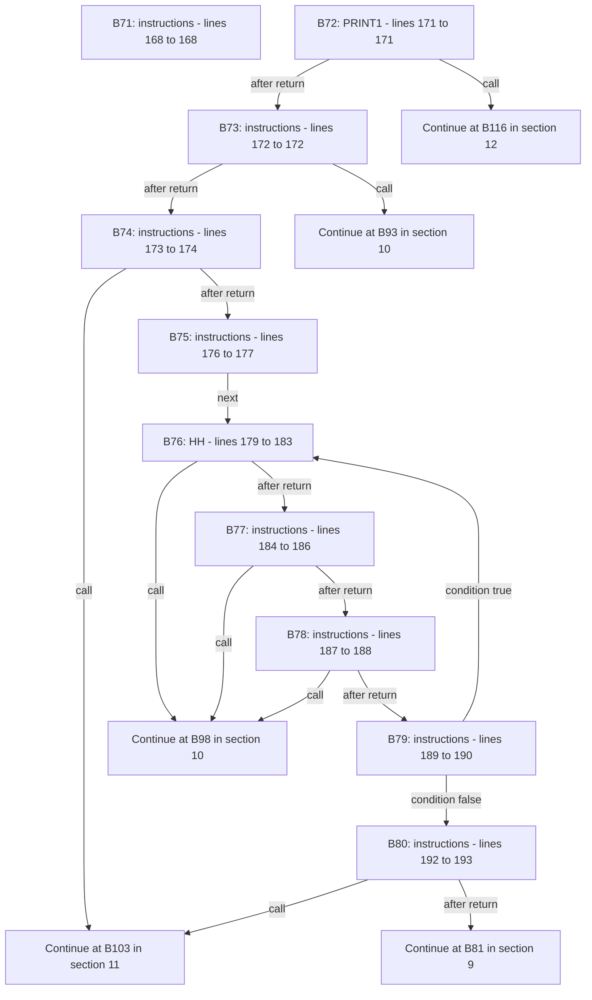

### B71

Return to the instruction following the active call.

```asm
RET
```

### B72

```asm
ACALL CLEAR
```

### B73

```asm
ACALL DELAY
```

### B74

```asm
mov a, #80H
acall cmd
```

### B75

```asm
MOV R4,#4
MOV R1,#20h
```

### B76

```asm
MOV A,@R1
MOV B,#10
DIV AB
ADD A,#30H
ACALL WCHR
```

### B77

```asm
MOV A,B
ADD A,#30H
ACALL WCHR
```

### B78

```asm
MOV A,#'-'
ACALL WCHR
```

### B79

```asm
INC R1
DJNZ R4,HH
```

### B80

```asm
mov a, #0C0H
acall cmd
```

## Section 9

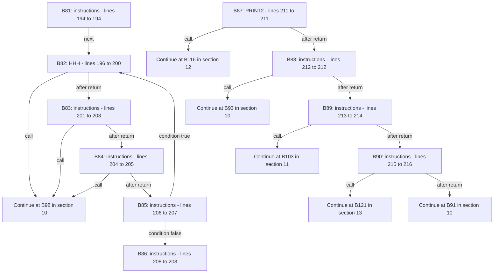

### B81

```asm
MOV R4,#4
```

### B82

```asm
MOV A,@R1
MOV B,#10
DIV AB
ADD A,#30H
ACALL WCHR
```

### B83

```asm
MOV A,B
ADD A,#30H
ACALL WCHR
```

### B84

```asm
MOV A,#'-'
ACALL WCHR
```

### B85

```asm
INC R1
DJNZ R4,HHH
```

### B86

Return to the instruction following the active call.

```asm
RET
```

### B87

```asm
ACALL CLEAR
```

### B88

```asm
ACALL DELAY
```

### B89

```asm
mov a, #80H
acall cmd
```

### B90

```asm
mov dptr, #ENTERNTH
acall wstr
```

## Section 10

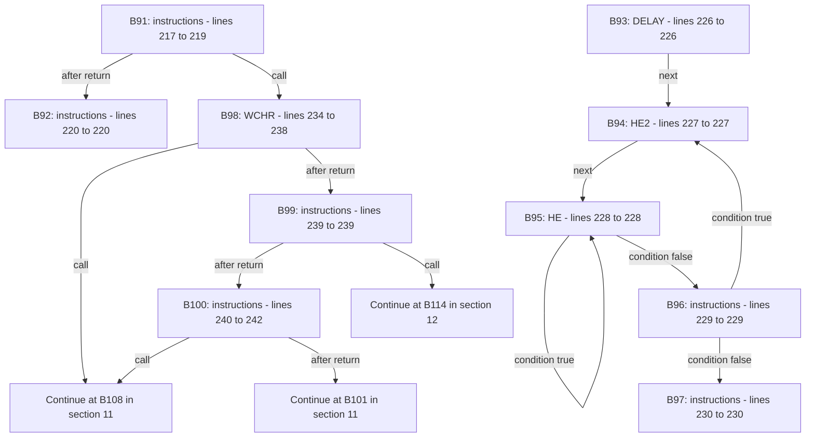

### B91

```asm
MOV A,31H
ADD A,#30H
ACALL WCHR
```

### B92

Return to the instruction following the active call.

```asm
RET
```

### B93

```asm
MOV R1,#100
```

### B94

```asm
MOV R0,#10
```

### B95

```asm
DJNZ R0,he
```

### B96

```asm
djnz r1,he2
```

### B97

Return to the instruction following the active call.

```asm
RET
```

### B98

```asm
PUSH ACC
PUSH B
SETB P1.3
MOV B,A
ACALL COMMON
```

### B99

```asm
ACALL LDELAY
```

### B100

```asm
MOV A,B
SWAP A
ACALL COMMON
```

## Section 11

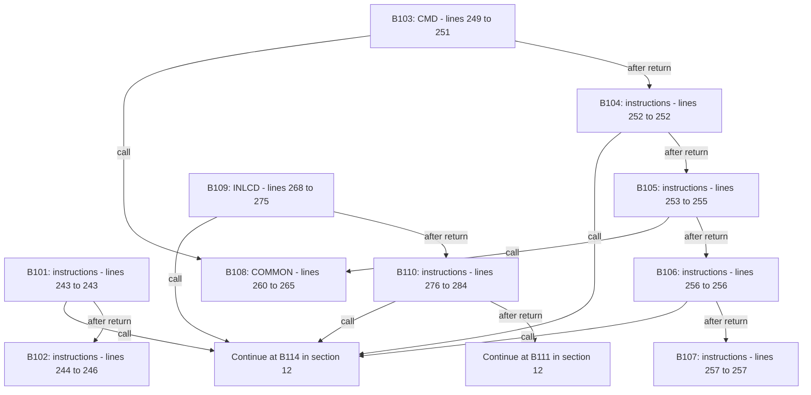

### B101

```asm
ACALL LDELAY
```

### B102

Return to the instruction following the active call.

```asm
POP B
POP ACC
RET
```

### B103

```asm
CLR P1.3
MOV B,A
ACALL COMMON
```

### B104

```asm
ACALL LDELAY
```

### B105

```asm
MOV A,B
SWAP A
ACALL COMMON
```

### B106

```asm
ACALL LDELAY
```

### B107

Return to the instruction following the active call.

```asm
RET
```

### B108

Return to the instruction following the active call.

```asm
ANL a,#11110000B
ANL P1, #00001111B
ORL P1,A
SETB P1.2
CLR P1.2
RET
```

### B109

```asm
CLR P1.3
CLR P1.7
CLR P1.6
SETB P1.5
CLR P1.4
SETB P1.2
CLR P1.2
ACALL LDELAY
```

### B110

```asm
SETB P1.2
CLR P1.2
SETB P1.7
CLR P1.6
CLR P1.5
CLR P1.4
SETB P1.2
CLR P1.2
ACALL LDELAY
```

## Section 12

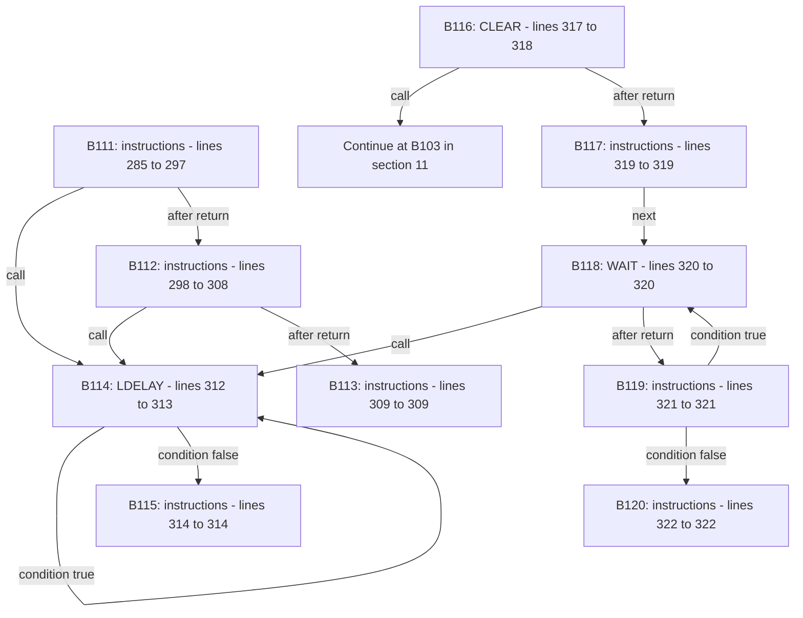

### B111

```asm
CLR P1.7
CLR P1.6
CLR P1.5
CLR P1.4
SETB P1.2
CLR P1.2
SETB P1.7
SETB P1.6
SETB P1.5
SETB P1.4
SETB P1.2
CLR P1.2
ACALL LDELAY
```

### B112

```asm
CLR P1.7
CLR P1.6
CLR P1.5
CLR P1.4
SETB P1.2
CLR P1.2
SETB P1.6
SETB P1.5
SETB P1.2
CLR P1.2
ACALL LDELAY
```

### B113

Return to the instruction following the active call.

```asm
RET
```

### B114

```asm
MOV R0, #50
DJNZ R0, $
```

### B115

Return to the instruction following the active call.

```asm
RET
```

### B116

```asm
MOV A,#01H
ACALL CMD
```

### B117

```asm
MOV R7,#14
```

### B118

```asm
ACALL LDELAY
```

### B119

```asm
DJNZ R7,WAIT
```

### B120

Return to the instruction following the active call.

```asm
ret
```

## Section 13

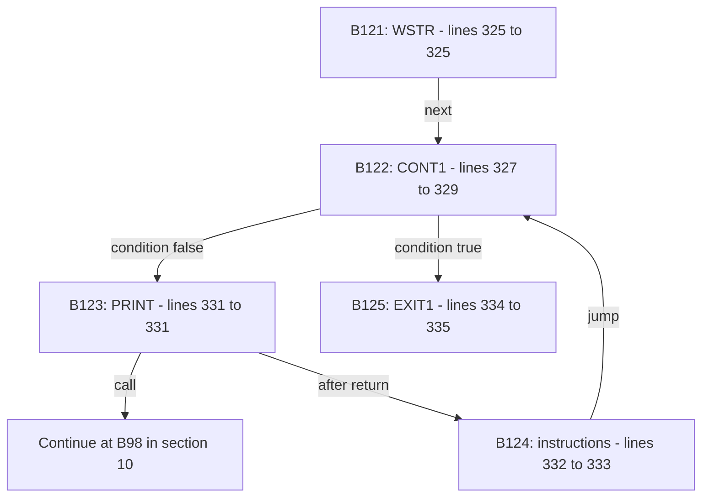

### B121

```asm
PUSH    ACC
```

### B122

```asm
CLR     A
MOVC    A,@A+DPTR
JZ Exit1
```

### B123

```asm
ACALL    WCHR
```

### B124

```asm
INC DPTR
AJMP    CONT1
```

### B125

Return to the instruction following the active call.

```asm
POP     ACC
RET
```
