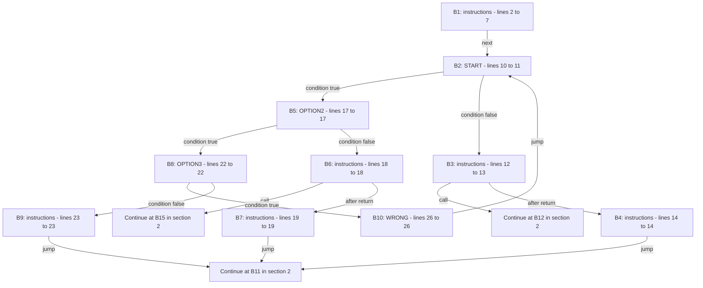
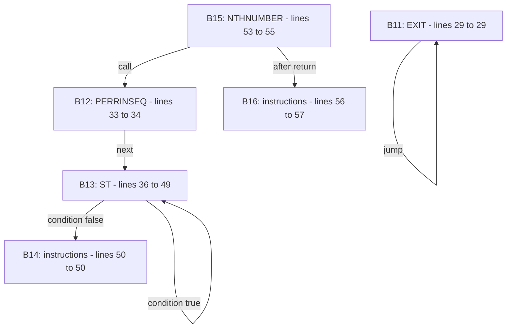

# Program Control Flow

[Back to project](README.md)

Control-flow blocks are indexed by source line. Calls resume at the instruction following the call if the subroutine returns normally.

## Entry locations

- `ORG 00H` begins at B1.

## Navigation

[Section 1](#section-1) · [Section 2](#section-2)

## Section 1



### B1

```asm
MOV 10H,#2
MOV R1,#23H
MOV 20H,#4
MOV 21H,#2
MOV 22H,#3
MOV 30H,#00H
```

### B2

```asm
MOV A,10H
CJNE A,#1,OPTION2
```

### B3

```asm
MOV A,#6
ACALL PERRINSEQ
```

### B4

```asm
SJMP EXIT
```

### B5

```asm
CJNE A,#2,OPTION3
```

### B6

```asm
ACALL NthNumber
```

### B7

```asm
SJMP EXIT
```

### B8

```asm
CJNE A,#2,WRONG
```

### B9

```asm
SJMP EXIT
```

### B10

```asm
SJMP START
```

## Section 2



### B11

```asm
SJMP $
```

### B12

```asm
MOV R7,A
MOV R0,#22H
```

### B13

```asm
INC R0
MOV A,R0
DEC R0
DEC R0
MOV A,@R0
DEC R0
ADD A,@R0
MOV R3,A
MOV A,R0
ADD A,#3
MOV R0,A
MOV A,R3
MOV @R0,A
DJNZ R7,ST
```

### B14

Return to the instruction following the active call.

```asm
RET
```

### B15

```asm
MOV A,#6
SUBB A,#3
ACALL PERRINSEQ
```

### B16

Return to the instruction following the active call.

```asm
MOV 30H,R3
RET
```
