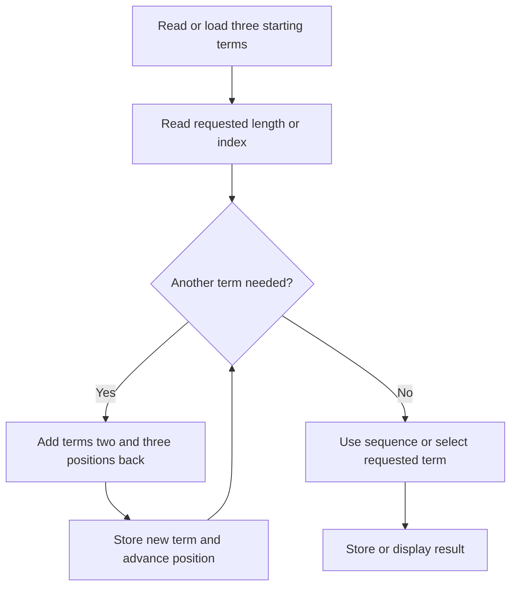
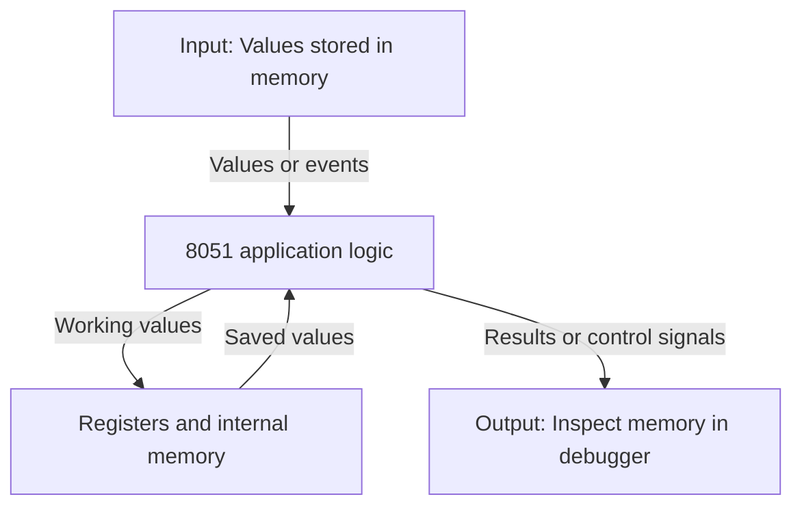

# Perrin Sequence

[Group overview](../../README.md) · [Compare implementations](../README.md)

Generate a number sequence in which each new value is the sum of the values two and three places before it. Some versions also let you request a particular term.

**Implementation:** Memory Sequence And Index

**Input:** values stored in memory.  
**Output:** inspect memory in debugger.

## Inputs and results

| Parameter | Description |
| --- | --- |
| Input | Three starting numbers and a length or position |
| Output | A sequence of numbers or the requested term |

## Worked example

Starting with 3, 0, 2 gives 3, 0, 2, 3, 2, 5, 5. For example, the fourth value is 3 + 0 = 3.

### Calculation details

Use 3, 0, 2 for the three seed bytes. The next term is 3 + 0 = 3, then 0 + 2 = 2, then 2 + 3 = 5. The first six values in the sequence buffer are 3, 0, 2, 3, 2, 5. Inspect the buffer during the sequence option.

## Program operation

### Functional flowchart

[Detailed control flow](source-flow.md)

### Simplified block diagram

Results are available in memory without a display.

## Technical limitations

No additional defect was recorded in the earlier source review. This is not evidence of a successful build or hardware test.

## Build and test

1. Open the [assembly source](source.txt) in an 8051 assembler or simulator.
2. Review the technical limitations and configure the peripherals required by this implementation.
3. Check the expected result using the example inputs.
