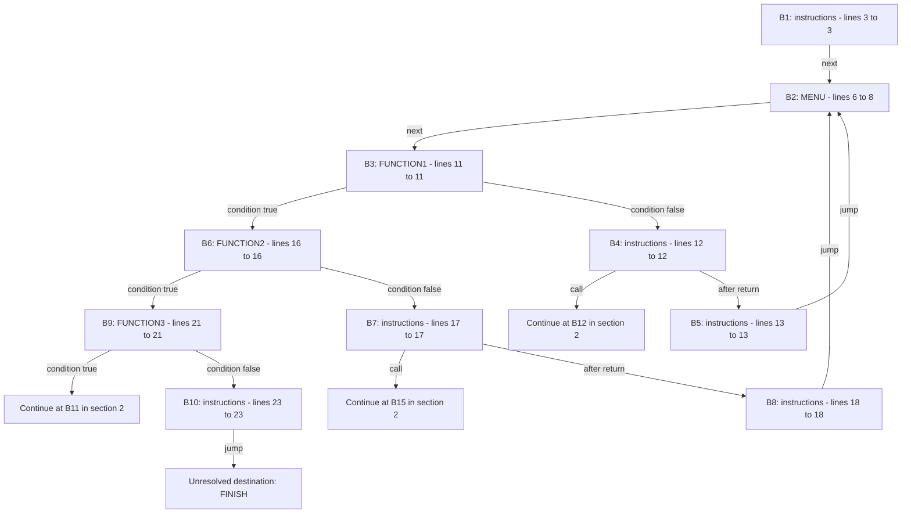
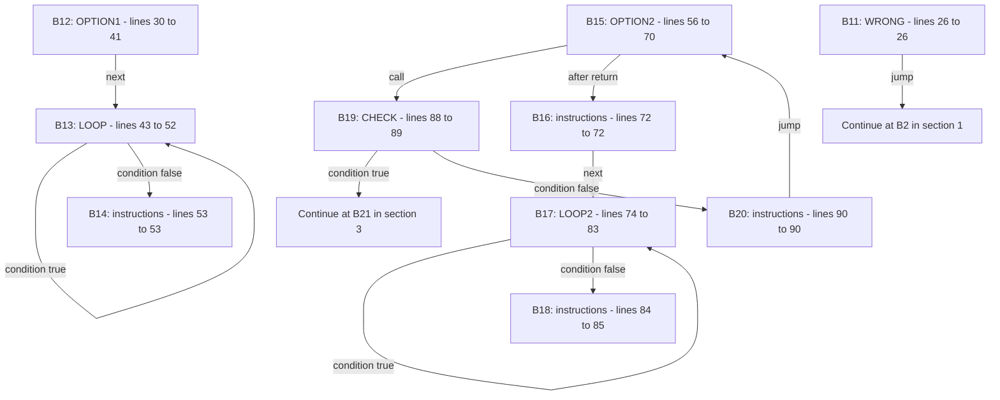
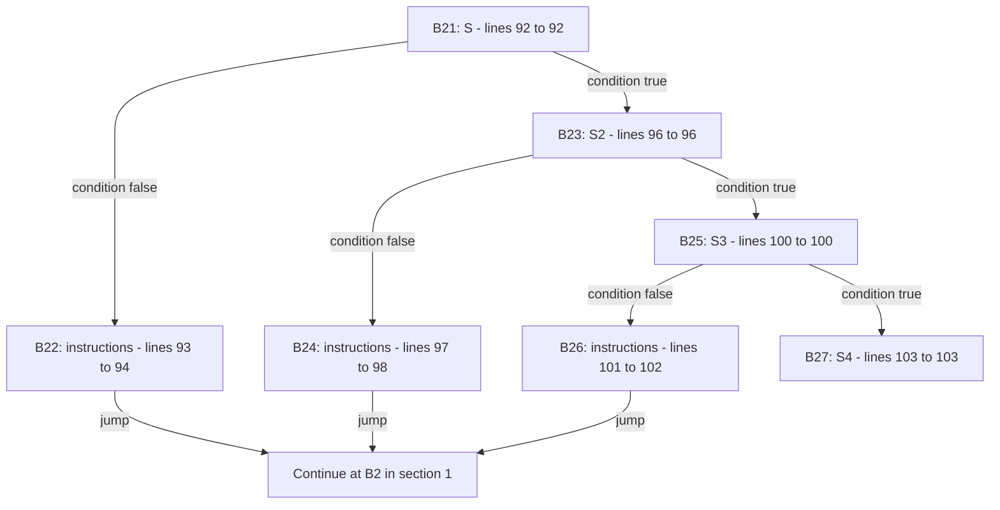

# Program Control Flow

[Back to project](README.md)

Control-flow blocks are indexed by source line. Calls resume at the instruction following the call if the subroutine returns normally.

## Entry locations

- `ORG 00H` begins at B1.

## Navigation

[Section 1](#section-1) · [Section 2](#section-2) · [Section 3](#section-3)

## Destinations requiring review

`FINISH`. A repeated label is also unresolved because it has more than one candidate target.

## Section 1



### B1

```asm
MOV R0,#20H
```

### B2

```asm
MOV 10H,#2
MOV A,10H
```

### B3

```asm
CJNE A,#1,FUNCTION2
```

### B4

```asm
ACALL OPTION1
```

### B5

```asm
SJMP MENU
```

### B6

```asm
CJNE A,#2,FUNCTION3
```

### B7

```asm
ACALL OPTION2
```

### B8

```asm
SJMP MENU
```

### B9

```asm
CJNE A,#3,WRONG
```

### B10

```asm
AJMP FINISH
```

## Section 2



### B11

```asm
SJMP MENU
```

### B12

```asm
MOV R7,#6
MOV A,#3
MOV @R0,A
INC R0
MOV A,#0
MOV @R0,A
INC R0
MOV A,#2
MOV @R0,A
MOV R0,#20H
```

### B13

```asm
MOV A,@R0
INC R0
MOV B,@R0
INC R0
INC R0
ADD A,B
MOV @R0,A
DEC R0
DEC R0
DJNZ R7,LOOP
```

### B14

Return to the instruction following the active call.

```asm
RET
```

### B15

```asm
MOV 30H,#1
MOV R1,#30H
MOV A,30H
SUBB A,#3
MOV R7,A
MOV A,#4
MOV @R0,A
INC R0
MOV A,#2
MOV @R0,A
INC R0
MOV A,#3
MOV @R0,A
ACALL CHECK
```

### B16

```asm
MOV R0,#20H
```

### B17

```asm
MOV A,@R0
INC R0
MOV B,@R0
INC R0
INC R0
ADD A,B
MOV @R0,A
DEC R0
DEC R0
DJNZ R7,LOOP2
```

### B18

Return to the instruction following the active call.

```asm
MOV @R1,A
RET
```

### B19

```asm
MOV A,30H
CJNE A,#0,S
```

### B20

```asm
AJMP OPTION2
```

## Section 3



### B21

```asm
CJNE A,#1,S2
```

### B22

```asm
MOV @R1,20H
AJMP MENU
```

### B23

```asm
CJNE A,#2,S3
```

### B24

```asm
MOV @R1,21H
AJMP MENU
```

### B25

```asm
CJNE A,#3,S4
```

### B26

```asm
MOV @R1,22H
AJMP MENU
```

### B27

Return to the instruction following the active call.

```asm
RET
```
