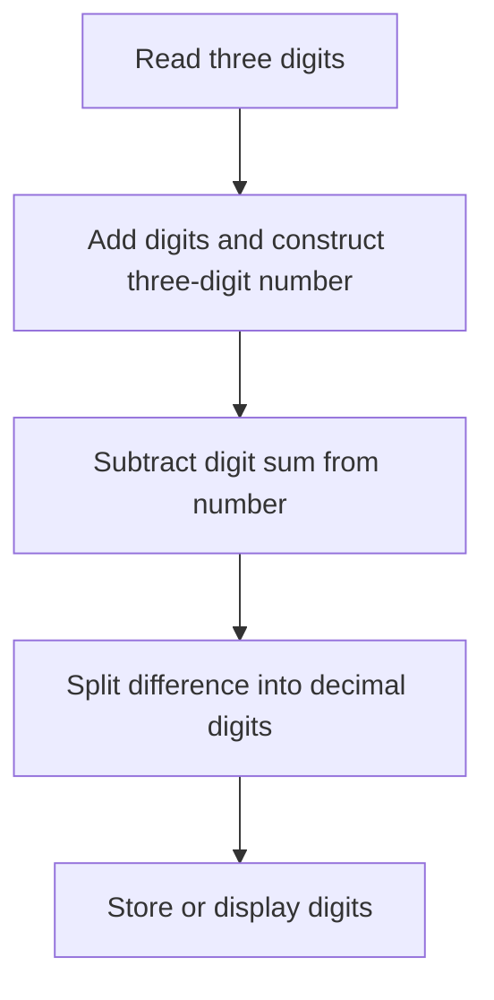
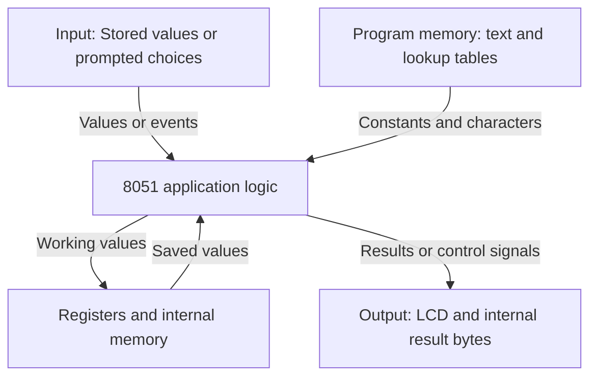

# Three Digit Arithmetic

[Group overview](../../README.md) · [Compare implementations](../README.md)

Build a three-digit number, add its digits, and subtract that digit sum from the number.

**Implementation:** LCD Digit Arithmetic Led Feedback

**Input:** stored values or prompted choices.  
**Output:** LCD and internal result bytes.

## Inputs and results

| Parameter | Description |
| --- | --- |
| Input | Three decimal digits |
| Output | The difference, split into decimal digits |

## Worked example

For digits 2, 3, and 6: the number is 236, the digit sum is 11, and the difference is 225.

### Calculation details

Use digits 2, 3 and 6. Their sum is 11 and their positional value is 236. The intended difference is 225. Two divisions by 10 split it into units 5, tens 2 and hundreds 2. Watch the order in which these digits are displayed. Several listings have a trailing comma on a MOV instruction and require a syntax correction before assembly.

## Program operation

1. Read three digits.
2. Add digits and construct three-digit number.
3. Subtract digit sum from number.
4. Split difference into decimal digits.
5. Store or display digits.

### Functional flowchart

[Detailed control flow](source-flow.md)

### Simplified block diagram

**Port registers:** `P1`, `P1.0`, `P1.2`, `P1.3`, `P1.4`, `P1.5`, `P1.6`, `P1.7`.

## Technical limitations

- Trailing comma in `MOV R4,A,`.
- Trailing comma in `MOV R2,A,`.

## Build and test

1. Open the [assembly source](source.asm) in an 8051 assembler or simulator.
2. Review the technical limitations and configure the peripherals required by this implementation.
3. Check the expected result using the example inputs.
