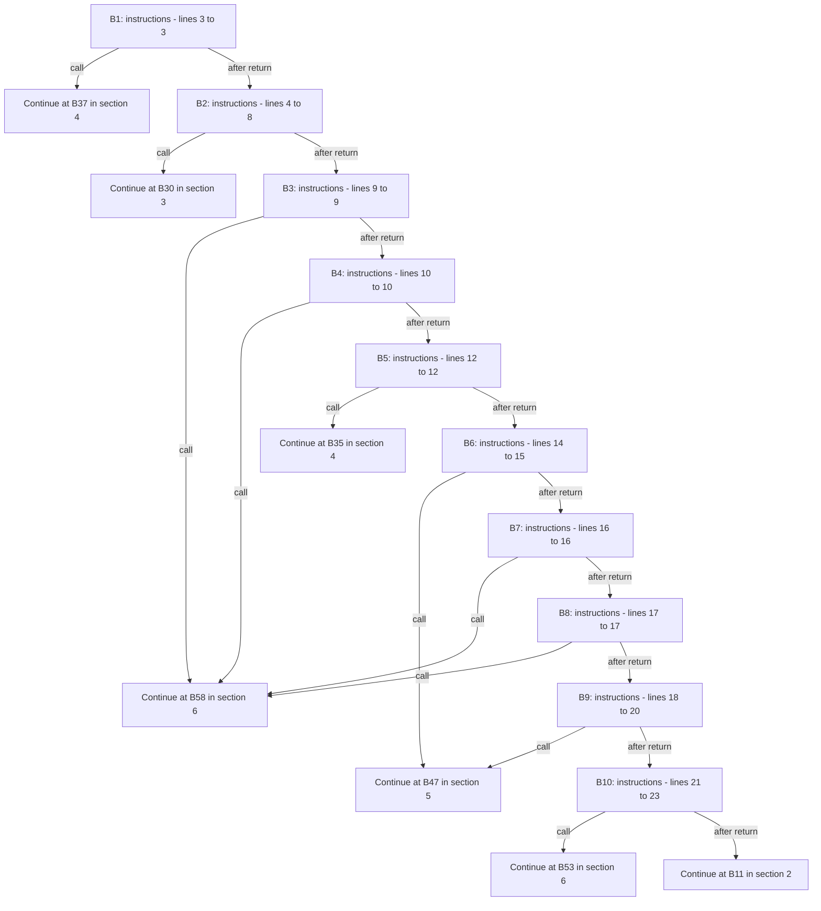
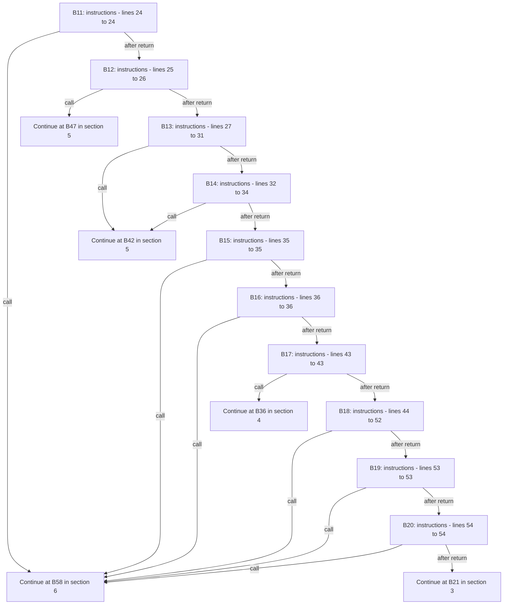
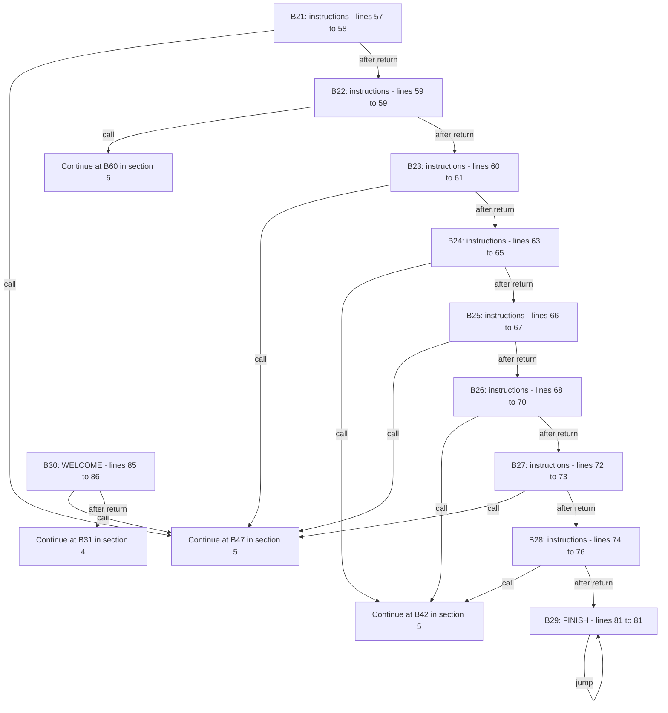
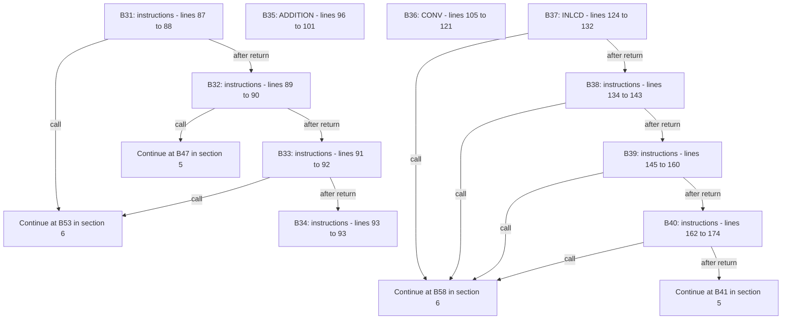
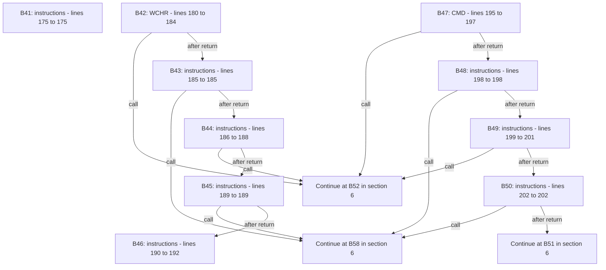
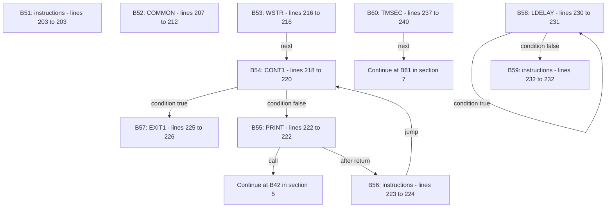
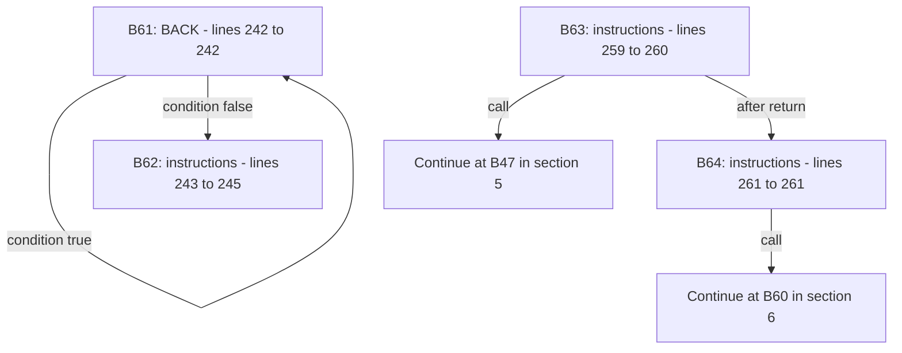

# Program Control Flow

[Back to project](README.md)

Control-flow blocks are indexed by source line. Calls resume at the instruction following the call if the subroutine returns normally.

## Entry locations

- `ORG 0H` begins at B1.

## Navigation

[Section 1](#section-1) · [Section 2](#section-2) · [Section 3](#section-3) · [Section 4](#section-4) · [Section 5](#section-5) · [Section 6](#section-6) · [Section 7](#section-7)

## Section 1



### B1

```asm
ACALL INLCD
```

### B2

```asm
MOV R7,#2
MOV R6,#3
MOV R5,#6
ACALL WELCOME
```

### B3

```asm
ACALL lDELAY
```

### B4

```asm
ACALL LDELAY
```

### B5

```asm
ACALL ADDITION
```

### B6

```asm
MOV A,#01H
ACALL CMD
```

### B7

```asm
ACALL LDELAY
```

### B8

```asm
ACALL LDELAY
```

### B9

```asm
CLR A
MOV A,#85H
ACALL CMD
```

### B10

```asm
CLR A
MOV DPTR,#STR3
ACALL WSTR
```

## Section 2



### B11

```asm
ACALL LDELAY
```

### B12

```asm
MOV A,#0C0H
ACALL CMD
```

### B13

```asm
MOV A,R3
MOV B,#10
DIV AB
ADD A,#30H
ACALL WCHR
```

### B14

```asm
MOV A,B
ADD A,#30H
ACALL WCHR
```

### B15

```asm
ACALL LDELAY
```

### B16

```asm
ACALL LDELAY
```

### B17

```asm
ACALL CONV
```

### B18

```asm
MOV A,R7
MOV B,#10
DIV AB
MOV 30H,B
MOV B,#10
DIV AB
MOV 31H, B
MOV 32H,A
ACALL LDELAY
```

### B19

```asm
ACALL LDELAY
```

### B20

```asm
ACALL LDELAY
```

## Section 3



### B21

```asm
MOV A,#1H
ACALL CMD
```

### B22

```asm
Acall TMSEC
```

### B23

```asm
MOV A,#0C0H
ACALL CMD
```

### B24

```asm
MOV A,30H
ADD A,#30H
ACALL WCHR
```

### B25

```asm
MOV A,#0C3H
ACALL CMD
```

### B26

```asm
MOV A,31H
ADD A,#30H
ACALL WCHR
```

### B27

```asm
MOV A,#0C5H
ACALL CMD
```

### B28

```asm
MOV A,32H
ADD A,#30H
ACALL WCHR
```

### B29

```asm
SJMP FINISH
```

### B30

```asm
MOV A,#80H
ACALL CMD
```

## Section 4



### B31

```asm
MOV DPTR,#STR1
ACALL WSTR
```

### B32

```asm
mov A,#0C0H
ACALL CMD
```

### B33

```asm
MOV DPTR,#STR2
ACALL WSTR
```

### B34

Return to the instruction following the active call.

```asm
RET
```

### B35

Return to the instruction following the active call.

```asm
MOV A,R7
ADD A,R6
ADD A,R5
MOV R3,A
RET
```

### B36

Return to the instruction following the active call.

```asm
MOV B,#100
MOV A,R7
MUL AB
MOV R4,A,
MOV B,#10
MOV A,R6
MUL AB
MOV R2,A,
MOV A,R5
ADD A,R2
ADD A,R4
SUBB A,R3
MOV R7,A
RET
```

### B37

```asm
CLR P1.3
CLR P1.7
CLR P1.6
SETB P1.5
CLR P1.4
SETB P1.2
CLR P1.2
ACALL LDELAY
```

### B38

```asm
SETB P1.2
CLR P1.2
SETB P1.7
CLR P1.6
CLR P1.5
CLR P1.4
SETB P1.2
CLR P1.2
ACALL LDELAY
```

### B39

```asm
CLR P1.7
CLR P1.6
CLR P1.5
CLR P1.4
SETB P1.2
CLR P1.2
SETB P1.7
SETB P1.6
SETB P1.5
SETB P1.4
SETB P1.2
CLR P1.2
ACALL LDELAY
```

### B40

```asm
CLR P1.7
CLR P1.6
CLR P1.5
CLR P1.4
SETB P1.2
CLR P1.2
SETB P1.6
SETB P1.5
SETB P1.2
CLR P1.2
ACALL LDELAY
```

## Section 5



### B41

Return to the instruction following the active call.

```asm
RET
```

### B42

```asm
PUSH ACC
PUSH B
SETB P1.3
MOV B,A
ACALL COMMON
```

### B43

```asm
ACALL LDELAY
```

### B44

```asm
MOV A,B
SWAP A
ACALL COMMON
```

### B45

```asm
ACALL LDELAY
```

### B46

Return to the instruction following the active call.

```asm
POP B
POP ACC
RET
```

### B47

```asm
CLR P1.3
MOV B,A
ACALL COMMON
```

### B48

```asm
ACALL LDELAY
```

### B49

```asm
MOV A,B
SWAP A
ACALL COMMON
```

### B50

```asm
ACALL LDELAY
```

## Section 6



### B51

Return to the instruction following the active call.

```asm
RET
```

### B52

Return to the instruction following the active call.

```asm
ANL a,#11110000B
ANL P1, #00001111B
ORL P1,A
SETB P1.2
CLR P1.2
RET
```

### B53

```asm
PUSH    ACC
```

### B54

```asm
CLR     A
MOVC    A,@A+DPTR
JZ Exit1
```

### B55

```asm
ACALL    WCHR
```

### B56

```asm
INC DPTR
AJMP    CONT1
```

### B57

Return to the instruction following the active call.

```asm
POP     ACC
RET
```

### B58

```asm
MOV R0, #50
DJNZ R0, $
```

### B59

Return to the instruction following the active call.

```asm
RET
```

### B60

```asm
MOV   TMOD,#21H
MOV   TL0,#0CAH
MOV   TH0,#27H
SETB  TR0
```

## Section 7



### B61

```asm
JNB   TF0,BACK
```

### B62

Return to the instruction following the active call.

```asm
CLR   TR0
CLR   TF0
RET
```

### B63

```asm
MOV A,#1H
ACALL CMD
```

### B64

```asm
Acall TMSEC
```
