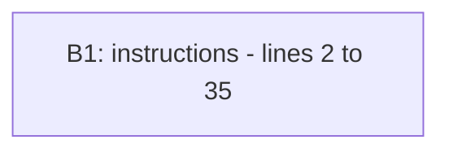

# Program Control Flow

[Back to project](README.md)

Control-flow blocks are indexed by source line. Calls resume at the instruction following the call if the subroutine returns normally.

## Entry locations

- `ORG 00H` begins at B1.

## Navigation

[Section 1](#section-1)

## Section 1



### B1

```asm
MOV R0,#2
MOV R1,#3
MOV R2,#6
MOV A,R2
ADD A,R1
ADD A,R0
MOV R3,A
MOV B,#100
MOV A,R0
MUL AB
MOV R4,A,
MOV B,#10
MOV A,R1
MUL AB
MOV R5,A,
MOV A,R2
ADD A, R5
ADD A,R4
SUBB A,R3
MOV R7,A
MOV B,#10
DIV AB
MOV 30H,B
MOV B,#10
DIV AB
MOV 31H, B
MOV 32H,A
```
