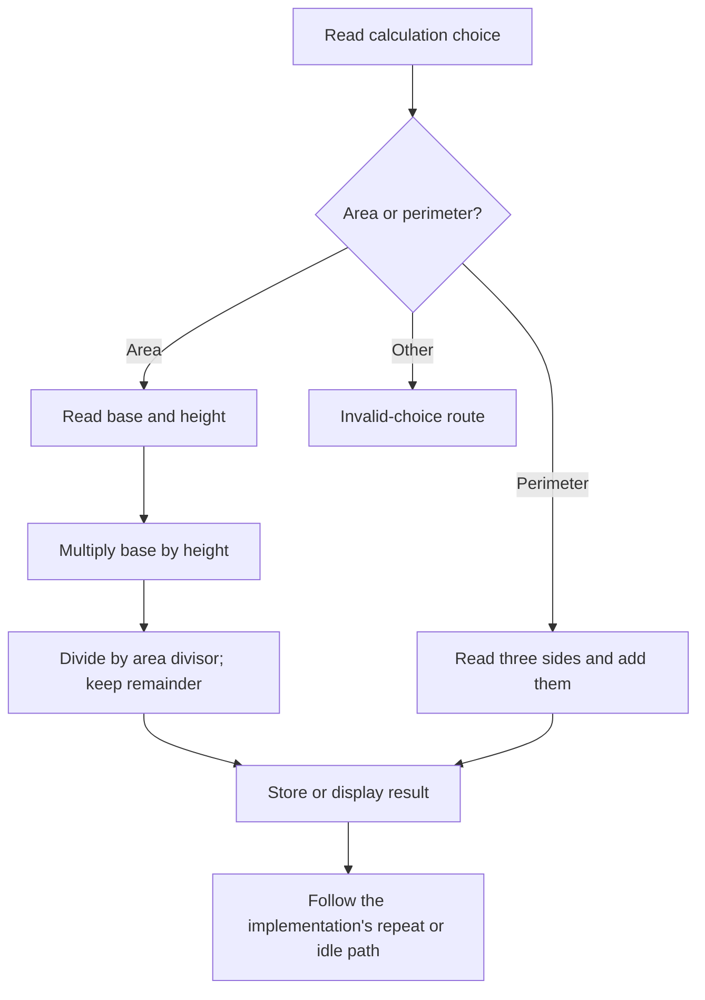
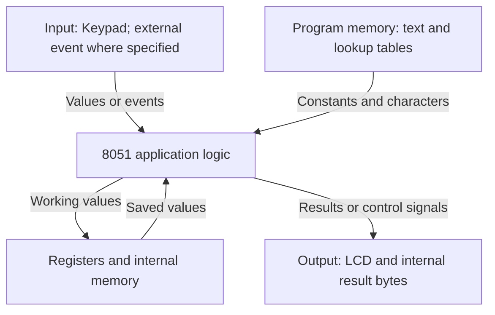

# Triangle Calculator

[Group overview](../../README.md) · [Compare implementations](../README.md)

Calculate a triangle’s area from its base and height, or its perimeter from three side lengths.

**Implementation:** Interrupt Triangle Dimensions

**Input:** keypad.  
**Output:** LCD and internal result bytes.

## Inputs and results

| Parameter | Description |
| --- | --- |
| Input | Area or perimeter selection, followed by the required dimensions |
| Output | Area and division remainder, or perimeter |

## Worked example

Base 5 and height 3 give area 7.5. Sides 2, 3, and 4 give perimeter 9. The source-specific check below identifies which calculation this version actually performs.

### Calculation details

At the area calculation, use base 5 and height 3. MUL AB produces 15. Dividing by 2 gives quotient 7 and remainder 1. The routine records 07H at 50H and 01H at 51H, representing an area of 7½ square units.

## Program operation

### Functional flowchart

[Detailed control flow](source-flow.md)

### Simplified block diagram

**Port registers:** `P0`, `P0.0`, `P0.1`, `P0.2`, `P1.0`, `P1.1`, `P1.3`, `P2`, `P2.0`, `P2.3`, `P2.4`, `P2.7`.

## Technical limitations

No additional defect was recorded in the earlier source review. This is not evidence of a successful build or hardware test.

## Build and test

1. Open the [assembly source](source.a51) in an 8051 assembler or simulator.
2. Review the technical limitations and configure the peripherals required by this implementation.
3. Check the expected result using the example inputs.
