# Program Control Flow

[Back to project](README.md)

Control-flow blocks are indexed by source line. Calls resume at the instruction following the call if the subroutine returns normally.

## Entry locations

- `ORG 0000H` begins at B1.
- `ORG 0003H` begins at B2.
- `ORG 0030H` begins at B3.

## Navigation

[Section 1](#section-1) · [Section 2](#section-2) · [Section 3](#section-3) · [Section 4](#section-4) · [Section 5](#section-5) · [Section 6](#section-6) · [Section 7](#section-7) · [Section 8](#section-8) · [Section 9](#section-9) · [Section 10](#section-10) · [Section 11](#section-11) · [Section 12](#section-12) · [Section 13](#section-13) · [Section 14](#section-14) · [Section 15](#section-15) · [Section 16](#section-16) · [Section 17](#section-17) · [Section 18](#section-18) · [Section 19](#section-19) · [Section 20](#section-20) · [Section 21](#section-21) · [Section 22](#section-22) · [Section 23](#section-23)

## Lines outside the instruction parser

These may be assembler directives, macros, or malformed source; inspect them before building.

```asm
341: /////////////////////////////////////////////////////////
```

## Section 1

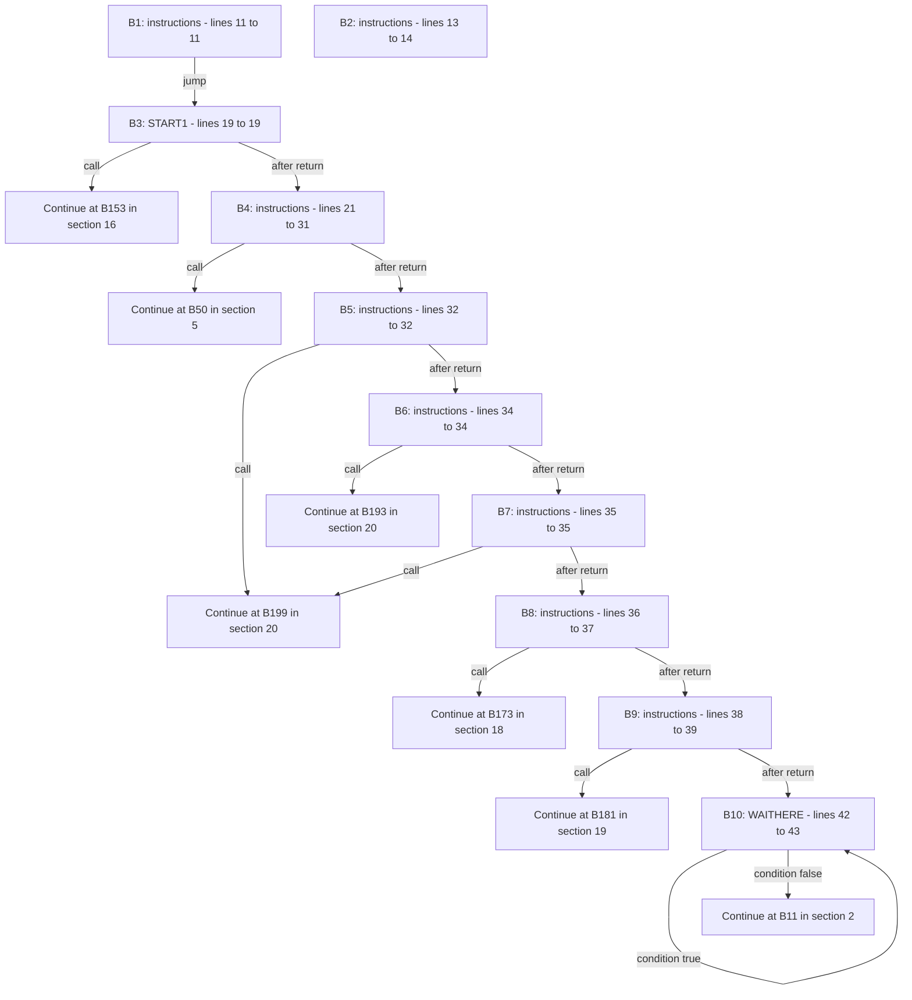

### B1

```asm
LJMP START1
```

### B2

Resume the interrupted program.

```asm
MOV 3AH,#1
RETI
```

### B3

```asm
ACALL INLCD
```

### B4

```asm
MOV IE,#10000001B
SETB IT0
MOV 30H, #8
MOV 40H, #3
MOV 41H, #4
MOV 42H, #2
MOV 43H, #3
MOV 44H, #4
MOV 50H, #0
MOV 51H, #0
ACALL WELCOME
```

### B5

```asm
ACALL DELAY
```

### B6

```asm
ACALL CLEAR
```

### B7

```asm
ACALL DELAY
```

### B8

```asm
mov a, #80H
acall cmd
```

### B9

```asm
mov dptr, #ISR
acall wstr
```

### B10

```asm
MOV A,3AH
CJNE A,#1,WAIThere
```

## Section 2

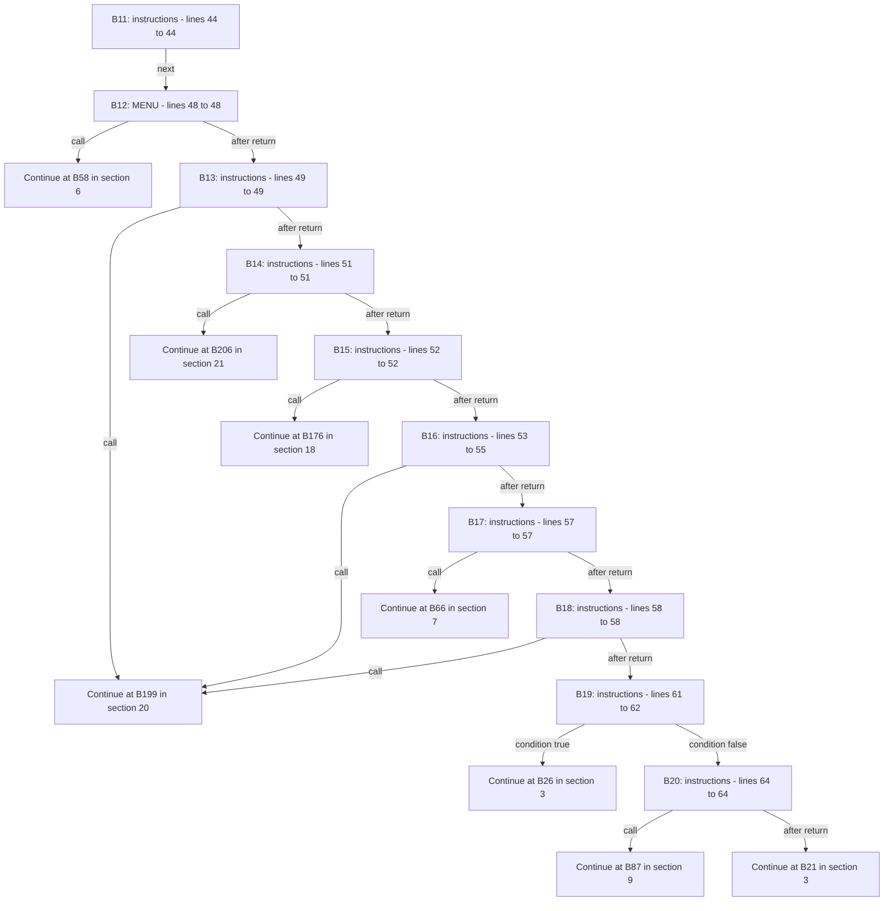

### B11

```asm
MOV 3AH,#0
```

### B12

```asm
ACALL Menuu
```

### B13

```asm
ACALL DELAY
```

### B14

```asm
ACALL KEYPAD
```

### B15

```asm
ACALL WCHR
```

### B16

```asm
SUBB A,#30H
MOV 30H,A
ACALL DELAY
```

### B17

```asm
ACALL SELECTT
```

### B18

```asm
ACALL DELAY
```

### B19

```asm
MOV A,30H
CJNE A,#1,OPERATION2
```

### B20

```asm
ACALL FLASHING
```

## Section 3

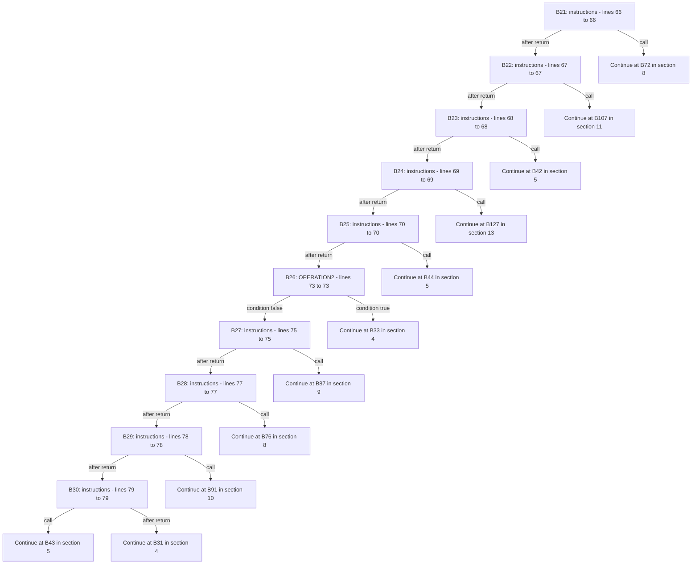

### B21

```asm
ACALL OPTIONN1
```

### B22

```asm
ACALL ENTER_DIM
```

### B23

```asm
ACALL AREAA
```

### B24

```asm
ACALL PRINT1
```

### B25

```asm
ACALL CONTINUE
```

### B26

```asm
CJNE A,#2,WRONG
```

### B27

```asm
ACALL FLASHING
```

### B28

```asm
ACALL OPTIONN2
```

### B29

```asm
ACALL ENTER_SIDES
```

### B30

```asm
ACALL PERIMETER
```

## Section 4

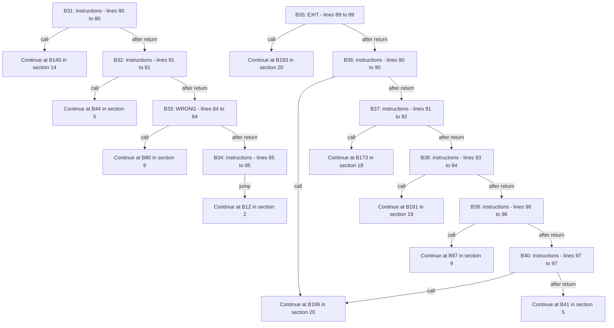

### B31

```asm
ACALL PRINT2
```

### B32

```asm
ACALL CONTINUE
```

### B33

```asm
ACALL WRONGG
```

### B34

```asm
SJMP MENU
```

### B35

```asm
ACALL CLEAR
```

### B36

```asm
ACALL DELAY
```

### B37

```asm
mov a, #80H
acall cmd
```

### B38

```asm
mov dptr, #THANKS
acall wstr
```

### B39

```asm
ACALL FLASHING
```

### B40

```asm
ACALL DELAY
```

## Section 5

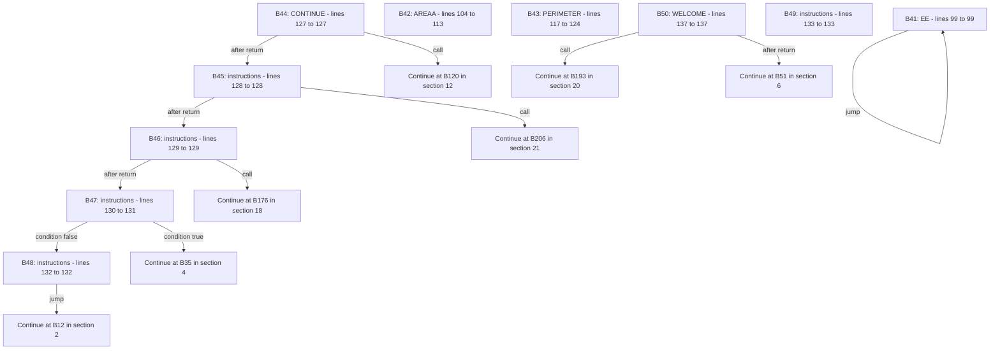

### B41

```asm
SJMP EE
```

### B42

Return to the instruction following the active call.

```asm
MOV A,40H
MOV B,41H
MUL AB
MOV B,#2
DIV AB
MOV 50H,A
MOV 51H,B
RET
```

### B43

Return to the instruction following the active call.

```asm
MOV A,42H
ADD A,43H
ADD A,44H
MOV 50H,A
RET
```

### B44

```asm
ACALL CON
```

### B45

```asm
ACALL KEYPAD
```

### B46

```asm
ACALL WCHR
```

### B47

```asm
SUBB A,#30H
CJNE A,#1,EXIT
```

### B48

```asm
SJMP MENU
```

### B49

Return to the instruction following the active call.

```asm
RET
```

### B50

```asm
ACALL CLEAR
```

## Section 6

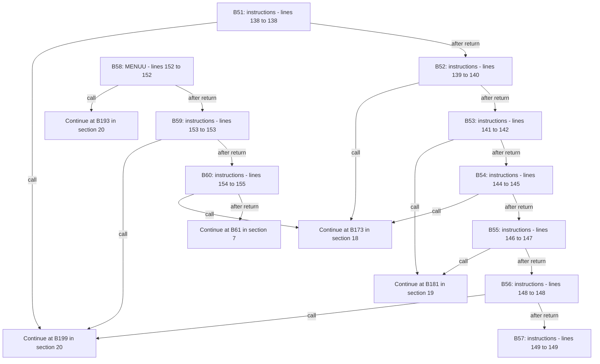

### B51

```asm
ACALL DELAY
```

### B52

```asm
mov a, #80H
acall cmd
```

### B53

```asm
mov dptr, #NAMEE
acall wstr
```

### B54

```asm
mov a,#0C0H
acall cmd
```

### B55

```asm
mov dptr, #PROJECT
acall wstr
```

### B56

```asm
acall delay
```

### B57

Return to the instruction following the active call.

```asm
ret
```

### B58

```asm
ACALL CLEAR
```

### B59

```asm
ACALL DELAY
```

### B60

```asm
mov a, #80H
acall cmd
```

## Section 7

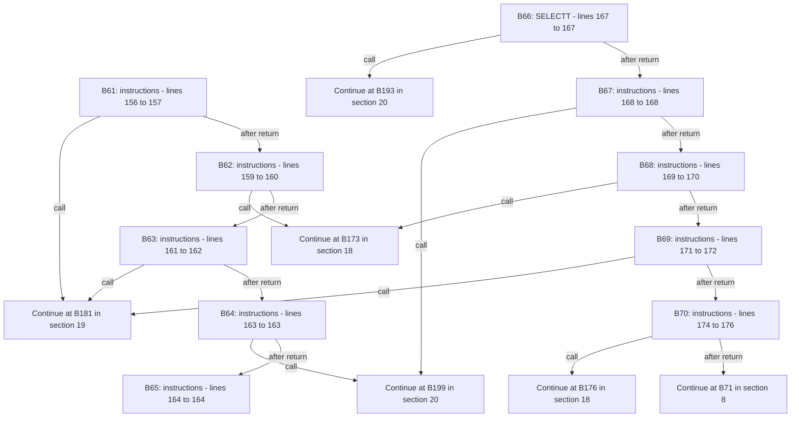

### B61

```asm
mov dptr, #OP1
acall wstr
```

### B62

```asm
mov a,#0C0H
acall cmd
```

### B63

```asm
mov dptr, #OP2
acall wstr
```

### B64

```asm
acall delay
```

### B65

Return to the instruction following the active call.

```asm
ret
```

### B66

```asm
ACALL CLEAR
```

### B67

```asm
ACALL DELAY
```

### B68

```asm
mov a, #80H
acall cmd
```

### B69

```asm
mov dptr, #MSG
acall wstr
```

### B70

```asm
MOV A,30H
ADD A,#30H
ACALL WCHR
```

## Section 8

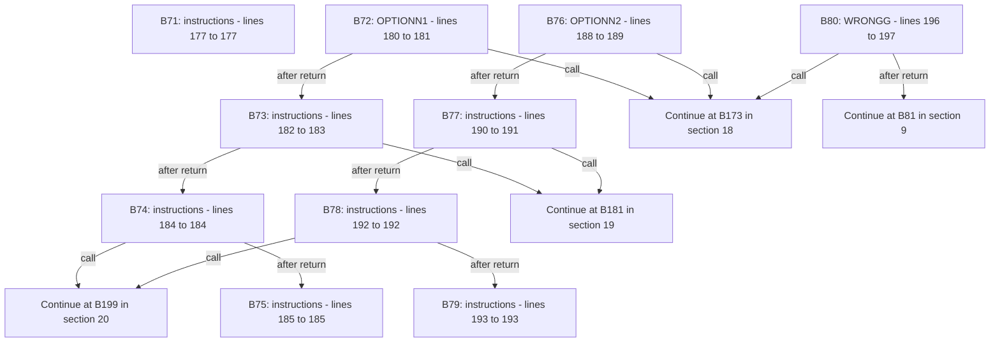

### B71

Return to the instruction following the active call.

```asm
RET
```

### B72

```asm
mov a,#0C0H
acall cmd
```

### B73

```asm
mov dptr, #MSG1
acall wstr
```

### B74

```asm
acall delay
```

### B75

Return to the instruction following the active call.

```asm
ret
```

### B76

```asm
mov a,#0C0H
acall cmd
```

### B77

```asm
mov dptr, #MSG2
acall wstr
```

### B78

```asm
acall delay
```

### B79

Return to the instruction following the active call.

```asm
ret
```

### B80

```asm
mov a,#0C0H
acall cmd
```

## Section 9

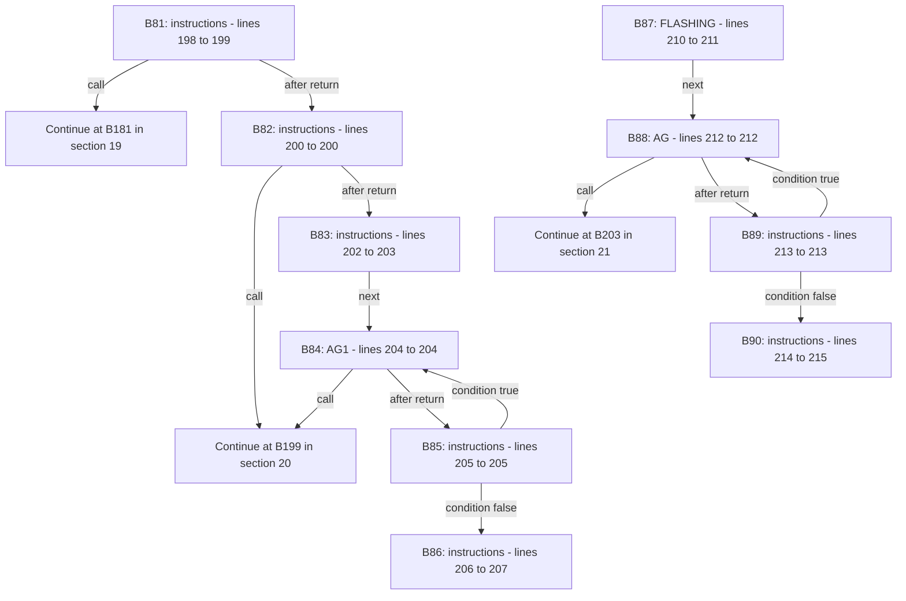

### B81

```asm
mov dptr, #WRONGGG
acall wstr
```

### B82

```asm
acall delay
```

### B83

```asm
MOV R4,#10
CLR R
```

### B84

```asm
ACALL DELAY
```

### B85

```asm
DJNZ R4,AG1
```

### B86

Return to the instruction following the active call.

```asm
SETB R
ret
```

### B87

```asm
MOV R4,#10
CLR G
```

### B88

```asm
ACALL DELAY1
```

### B89

```asm
DJNZ R4,AG
```

### B90

Return to the instruction following the active call.

```asm
SETB G
RET
```

## Section 10

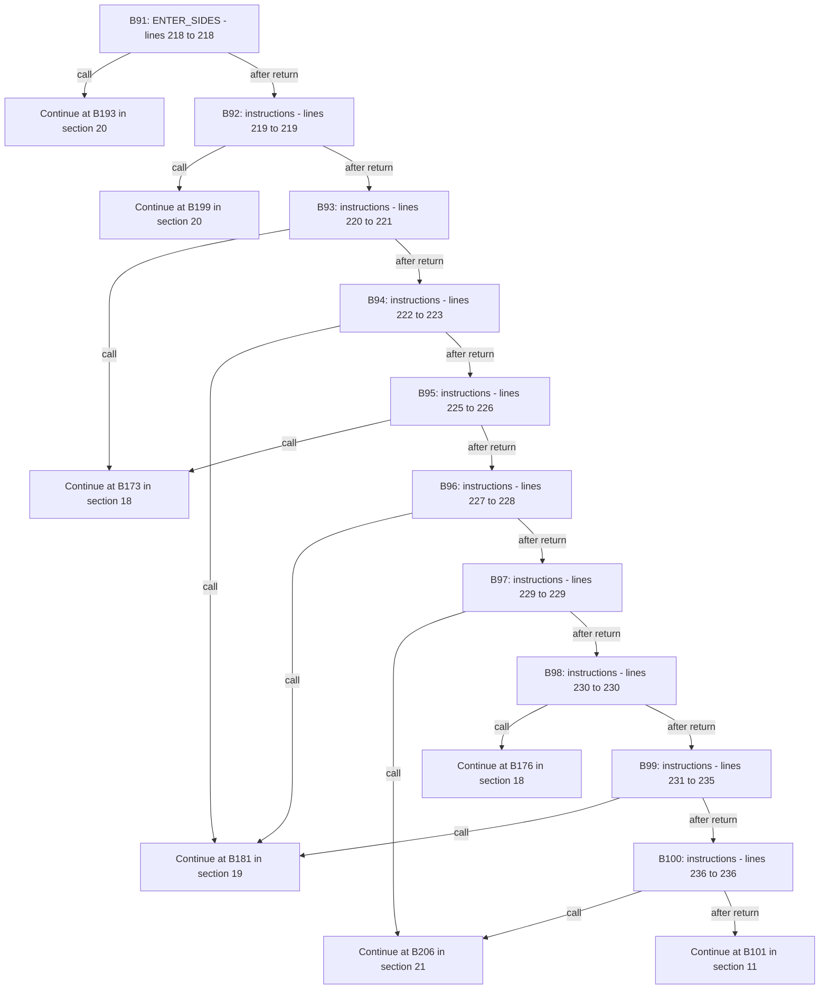

### B91

```asm
ACALL CLEAR
```

### B92

```asm
ACALL DELAY
```

### B93

```asm
mov a, #80H
acall cmd
```

### B94

```asm
mov dptr, #ENTERSIDES
acall wstr
```

### B95

```asm
mov a, #0C0H
acall cmd
```

### B96

```asm
mov dptr, #SIDEA
acall wstr
```

### B97

```asm
ACALL KEYPAD
```

### B98

```asm
ACALL WCHR
```

### B99

```asm
SUBB A,#30H
MOV 42H,A
mov dptr, #SIDEB
acall wstr
```

### B100

```asm
ACALL KEYPAD
```

## Section 11

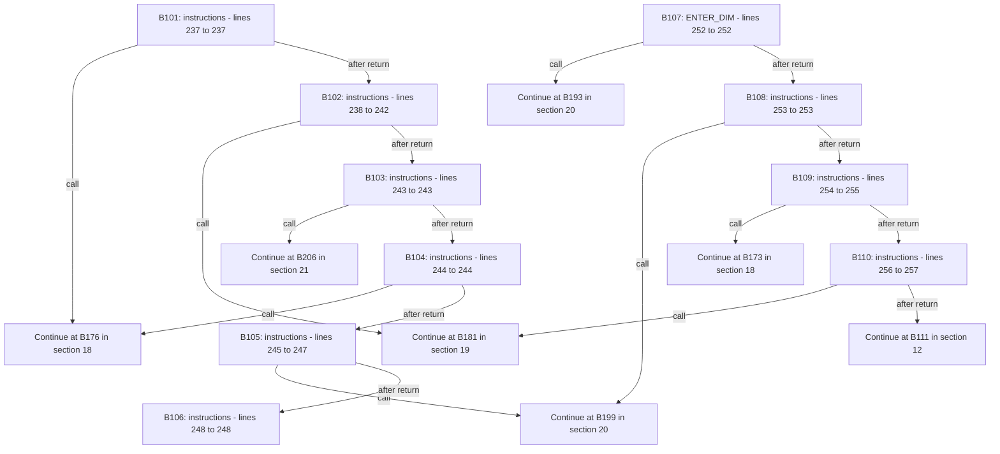

### B101

```asm
ACALL WCHR
```

### B102

```asm
SUBB A,#30H
MOV 43H,A
mov dptr, #SIDEC
acall wstr
```

### B103

```asm
ACALL KEYPAD
```

### B104

```asm
ACALL WCHR
```

### B105

```asm
SUBB A,#30H
MOV 44H,A
ACALL DELAY
```

### B106

Return to the instruction following the active call.

```asm
RET
```

### B107

```asm
ACALL CLEAR
```

### B108

```asm
ACALL DELAY
```

### B109

```asm
mov a, #80H
acall cmd
```

### B110

```asm
mov dptr, #ENTERSIDES
acall wstr
```

## Section 12

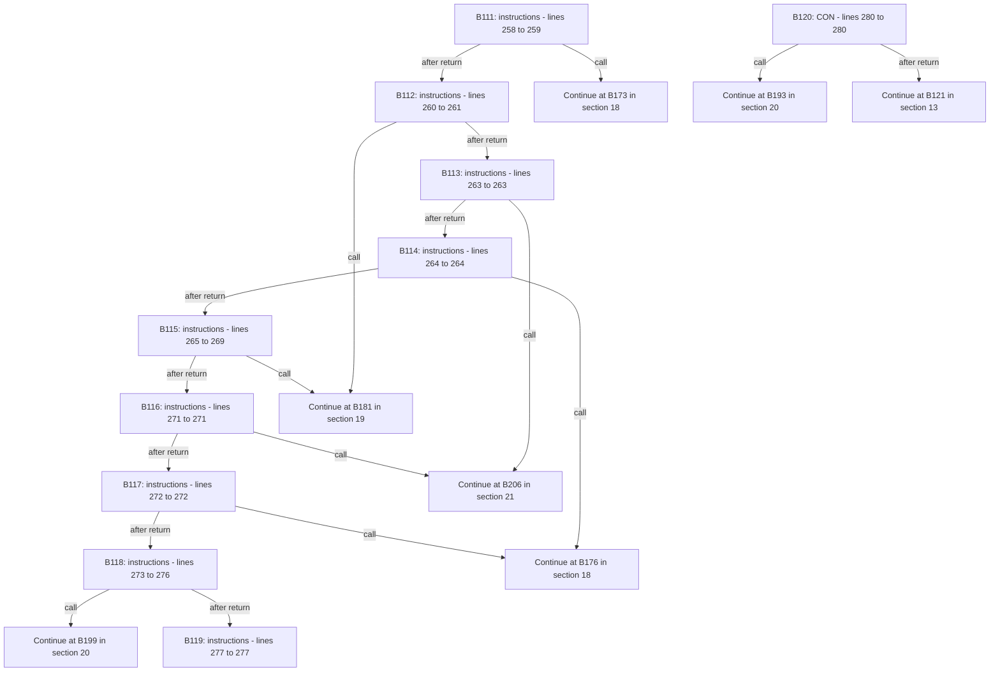

### B111

```asm
mov a, #0C0H
acall cmd
```

### B112

```asm
mov dptr, #SIDEB
acall wstr
```

### B113

```asm
ACALL KEYPAD
```

### B114

```asm
ACALL WCHR
```

### B115

```asm
SUBB A,#30H
MOV 40H,A
mov dptr, #HIGHT
acall wstr
```

### B116

```asm
ACALL KEYPAD
```

### B117

```asm
ACALL WCHR
```

### B118

```asm
SUBB A,#30H
MOV 41H,A
ACALL DELAY
```

### B119

Return to the instruction following the active call.

```asm
RET
```

### B120

```asm
ACALL CLEAR
```

## Section 13

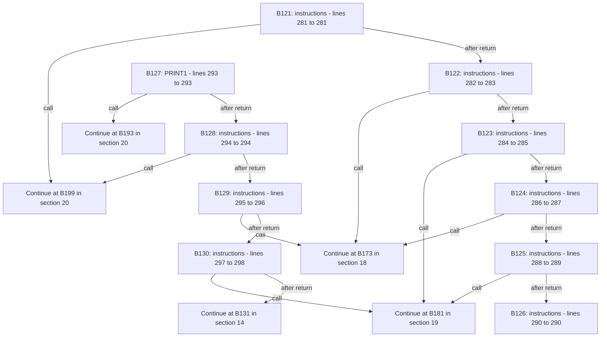

### B121

```asm
ACALL DELAY
```

### B122

```asm
mov a, #80H
acall cmd
```

### B123

```asm
mov dptr, #CONT11
acall wstr
```

### B124

```asm
mov a, #0C0H
acall cmd
```

### B125

```asm
mov dptr, #CONT22
acall wstr
```

### B126

Return to the instruction following the active call.

```asm
RET
```

### B127

```asm
ACALL CLEAR
```

### B128

```asm
ACALL DELAY
```

### B129

```asm
mov a, #80H
acall cmd
```

### B130

```asm
mov dptr, #AAREA
acall wstr
```

## Section 14

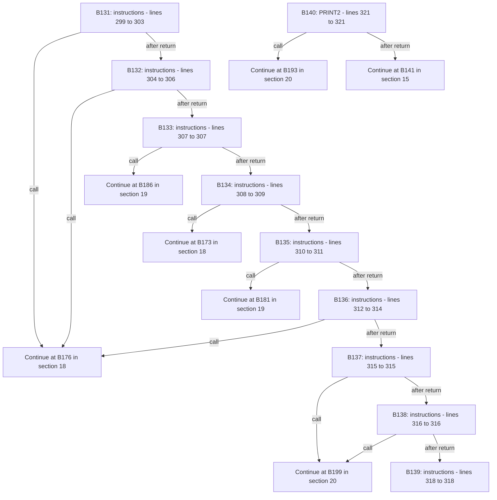

### B131

```asm
MOV A,50H
MOV B,#10
DIV AB
ADD A,#30H
ACALL WCHR
```

### B132

```asm
MOV A,B
ADD A,#30H
ACALL WCHR
```

### B133

```asm
ACALL LDELAY
```

### B134

```asm
mov a, #0C0H
acall cmd
```

### B135

```asm
mov dptr, #REMINDER
acall wstr
```

### B136

```asm
MOV A,51H
ADD A,#30H
ACALL WCHR
```

### B137

```asm
ACALL DELAY
```

### B138

```asm
ACALL DELAY
```

### B139

Return to the instruction following the active call.

```asm
RET
```

### B140

```asm
ACALL CLEAR
```

## Section 15

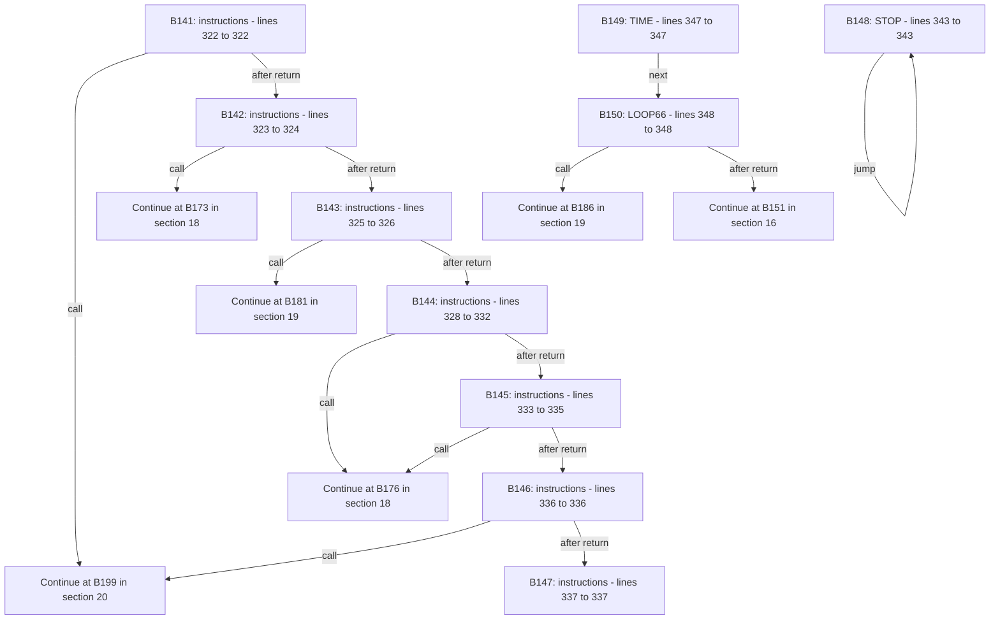

### B141

```asm
ACALL DELAY
```

### B142

```asm
mov a, #80H
acall cmd
```

### B143

```asm
mov dptr, #PPERIMETER
acall wstr
```

### B144

```asm
MOV A,50H
MOV B,#10
DIV AB
ADD A,#30H
ACALL WCHR
```

### B145

```asm
MOV A,B
ADD A,#30H
ACALL WCHR
```

### B146

```asm
ACALL DELAY
```

### B147

Return to the instruction following the active call.

```asm
RET
```

### B148

```asm
SJMP STOP
```

### B149

```asm
MOV R3,#50
```

### B150

```asm
ACALL LDELAY
```

## Section 16

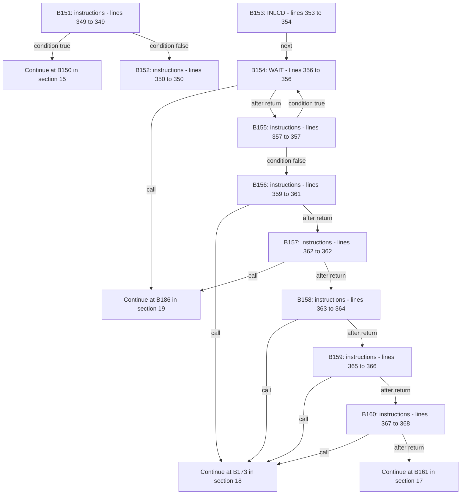

### B151

```asm
DJNZ R3,LOOP66
```

### B152

Return to the instruction following the active call.

```asm
RET
```

### B153

```asm
PUSH 7
MOV R7,#20
```

### B154

```asm
ACALL LDELAY
```

### B155

```asm
DJNZ R7,WAIT
```

### B156

```asm
MOV P0,#00000111B
MOV A,#0011B
ACALL CMD
```

### B157

```asm
ACALL LDELAY
```

### B158

```asm
MOV A,#0011B
ACALL CMD
```

### B159

```asm
MOV A,#0011B
ACALL CMD
```

### B160

```asm
MOV A,#0010B
ACALL CMD
```

## Section 17

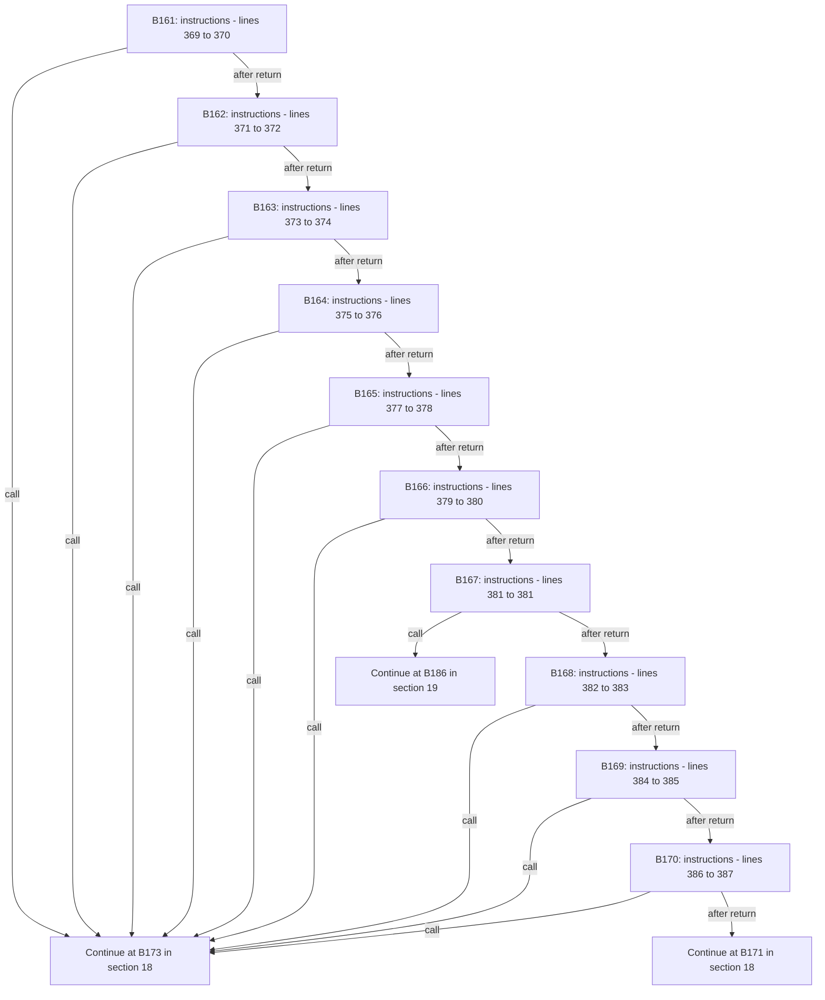

### B161

```asm
MOV A,#0010B
ACALL CMD
```

### B162

```asm
MOV A,#1000B
ACALL CMD
```

### B163

```asm
MOV A,#0000B
ACALL CMD
```

### B164

```asm
MOV A,#1000B
ACALL CMD
```

### B165

```asm
MOV A,#0
ACALL CMD
```

### B166

```asm
MOV A,#0001B
ACALL CMD
```

### B167

```asm
ACALL LDELAY
```

### B168

```asm
MOV A,#0000B
ACALL CMD
```

### B169

```asm
MOV A,#0110B
ACALL CMD
```

### B170

```asm
MOV A,#0000B
ACALL CMD
```

## Section 18

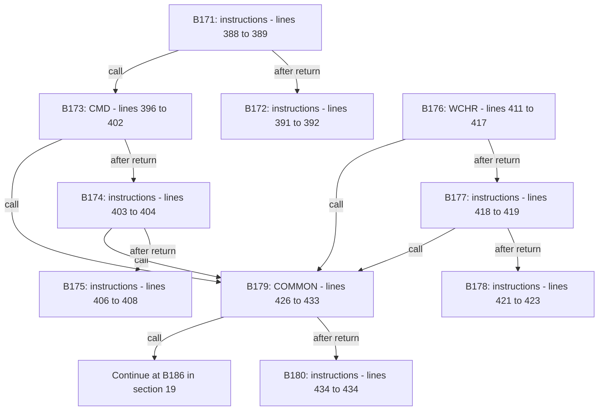

### B171

```asm
MOV A,#1111B
ACALL CMD
```

### B172

Return to the instruction following the active call.

```asm
POP 7
RET
```

### B173

```asm
PUSH ACC
PUSH B
CLR RS
MOV B,A
SWAP A
ACALL COMMON
```

### B174

```asm
MOV A,B
ACALL COMMON
```

### B175

Return to the instruction following the active call.

```asm
POP B
POP ACC
RET
```

### B176

```asm
PUSH ACC
PUSH B
SETB RS
MOV B,A
SWAP A
ACALL COMMON
```

### B177

```asm
MOV A,B
ACALL COMMON
```

### B178

Return to the instruction following the active call.

```asm
POP B
POP ACC
RET
```

### B179

```asm
CLR RW
SWAP A
ANL A,#11110000B
ANL P0,#00001111B
ORL P0,A
SETB EN
CLR EN
ACALL LDELAY
```

### B180

Return to the instruction following the active call.

```asm
RET
```

## Section 19

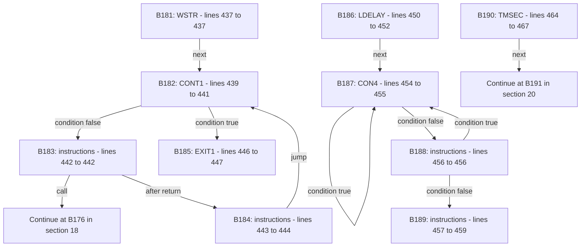

### B181

```asm
PUSH ACC
```

### B182

```asm
CLR A
MOVC A,@A+DPTR
JZ EXIT1
```

### B183

```asm
ACALL WCHR
```

### B184

```asm
INC DPTR
AJMP CONT1
```

### B185

Return to the instruction following the active call.

```asm
POP ACC
RET
```

### B186

```asm
PUSH 0
PUSH 1
MOV R1,#20
```

### B187

```asm
MOV R0,#250
DJNZ R0,$
```

### B188

```asm
DJNZ R1,CON4
```

### B189

Return to the instruction following the active call.

```asm
POP 1
POP 0
RET
```

### B190

```asm
MOV TMOD,#00000001B
MOV TL0,#0CAH
MOV TH0,#27H
SETB TR0
```

## Section 20

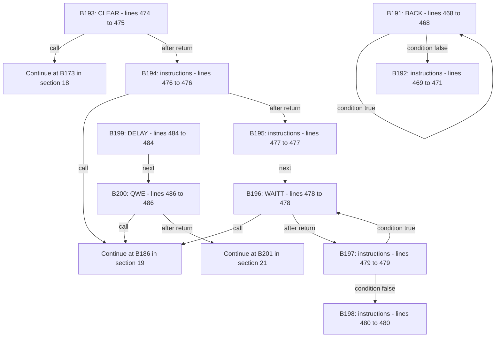

### B191

```asm
JNB TF0,BACK
```

### B192

Return to the instruction following the active call.

```asm
CLR TR0
CLR TF0
RET
```

### B193

```asm
MOV A,#1H
ACALL CMD
```

### B194

```asm
ACALL LDELAY
```

### B195

```asm
MOV R7,#14
```

### B196

```asm
ACALL LDELAY
```

### B197

```asm
DJNZ R7,WAITT
```

### B198

Return to the instruction following the active call.

```asm
RET
```

### B199

```asm
MOV R5,#50
```

### B200

```asm
ACALL LDELAY
```

## Section 21

```mermaid
flowchart TD
B200["B201: instructions - lines 487 to 487"]
B201["B202: instructions - lines 488 to 488"]
B202["B203: DELAY1 - lines 490 to 490"]
B203["B204: ABC - lines 492 to 492"]
B204["B205: instructions - lines 493 to 493"]
B205["B206: KEYPAD - lines 501 to 501"]
B206["B207: K1 - lines 502 to 505"]
B207["B208: K2 - lines 506 to 506"]
B208["B209: instructions - lines 507 to 509"]
B209["B210: instructions - lines 510 to 510"]
B200 -->|condition true| B199
B200 -->|condition false| B201
B202 -->|next| B203
B203 -->|condition true| B203
B203 -->|condition false| B204
B205 -->|next| B206
B206 -->|condition true| B206
B206 -->|condition false| B207
B207 -->|call| B189
B207 -->|after return| B208
B208 -->|condition true| B210
B208 -->|condition false| B209
B209 -->|jump| B207
B199["Continue at B200 in section 20"]
B189["Continue at B190 in section 19"]
B210["Continue at B211 in section 22"]
```

### B201

```asm
DJNZ R5,qwe
```

### B202

Return to the instruction following the active call.

```asm
RET
```

### B203

```asm
MOV R5,#60
```

### B204

```asm
DJNZ R5,abc
```

### B205

Return to the instruction following the active call.

```asm
RET
```

### B206

```asm
MOV P2,#11110000B
```

### B207

```asm
MOV P2,#11110000B
MOV A,P2
ANL A,#11110000B
CJNE A,#11110000B,K1
```

### B208

```asm
ACALL TMSEC
```

### B209

```asm
MOV A,P2
ANL A,#11110000B
CJNE A,#11110000B,OVER
```

### B210

```asm
SJMP K2
```

## Section 22

```mermaid
flowchart TD
B210["B211: OVER - lines 512 to 512"]
B211["B212: instructions - lines 513 to 515"]
B212["B213: instructions - lines 516 to 516"]
B213["B214: OVER1 - lines 518 to 521"]
B214["B215: instructions - lines 522 to 525"]
B215["B216: instructions - lines 526 to 529"]
B216["B217: instructions - lines 530 to 533"]
B217["B218: instructions - lines 534 to 534"]
B218["B219: ROW_0 - lines 535 to 536"]
B219["B220: ROW_1 - lines 537 to 538"]
B210 -->|call| B189
B210 -->|after return| B211
B211 -->|condition true| B213
B211 -->|condition false| B212
B212 -->|jump| B207
B213 -->|condition true| B218
B213 -->|condition false| B214
B214 -->|condition true| B219
B214 -->|condition false| B215
B215 -->|condition true| B220
B215 -->|condition false| B216
B216 -->|condition true| B221
B216 -->|condition false| B217
B217 -->|jump| B207
B218 -->|jump| B222
B219 -->|jump| B222
B189["Continue at B190 in section 19"]
B207["Continue at B208 in section 21"]
B220["Continue at B221 in section 23"]
B221["Continue at B222 in section 23"]
B222["Continue at B223 in section 23"]
```

### B211

```asm
ACALL TMSEC
```

### B212

```asm
MOV A,P2
ANL A,#11110000B
CJNE A,#11110000B,OVER1
```

### B213

```asm
SJMP K2
```

### B214

```asm
MOV P2,#11111110B
MOV A,P2
ANL A,#11110000B
CJNE A,#11110000B,ROW_0
```

### B215

```asm
MOV P2,#11111101B
MOV A,P2
ANL A,#11110000B
CJNE A,#11110000B,ROW_1
```

### B216

```asm
MOV P2,#11111011B
MOV A,P2
ANL A,#11110000B
CJNE A,#11110000B,ROW_2
```

### B217

```asm
MOV P2,#11110111B
MOV A,P2
ANL A,#11110000B
CJNE A,#11110000B,ROW_3
```

### B218

```asm
LJMP K2
```

### B219

```asm
MOV DPTR,#KCODE0
SJMP FIND
```

### B220

```asm
MOV DPTR,#KCODE1
SJMP FIND
```

## Section 23

```mermaid
flowchart TD
B220["B221: ROW_2 - lines 539 to 540"]
B221["B222: ROW_3 - lines 541 to 541"]
B222["B223: FIND - lines 543 to 543"]
B223["B224: FIND1 - lines 545 to 546"]
B224["B225: instructions - lines 547 to 548"]
B225["B226: MATCH - lines 550 to 552"]
B220 -->|jump| B222
B221 -->|next| B222
B222 -->|next| B223
B223 -->|condition true| B225
B223 -->|condition false| B224
B224 -->|jump| B223
```

### B221

```asm
MOV DPTR,#KCODE2
SJMP FIND
```

### B222

```asm
MOV DPTR,#KCODE3
```

### B223

```asm
SWAP A
```

### B224

```asm
RRC A
JNC MATCH
```

### B225

```asm
INC DPTR
SJMP FIND1
```

### B226

Return to the instruction following the active call.

```asm
CLR A
MOVC A,@A+DPTR
RET
```
