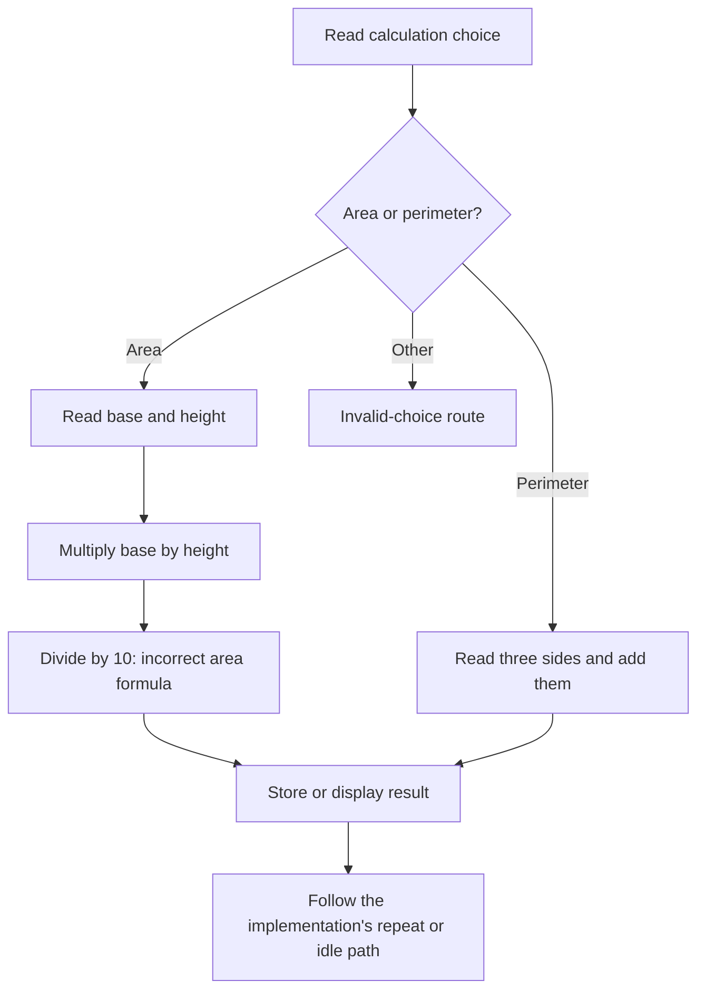
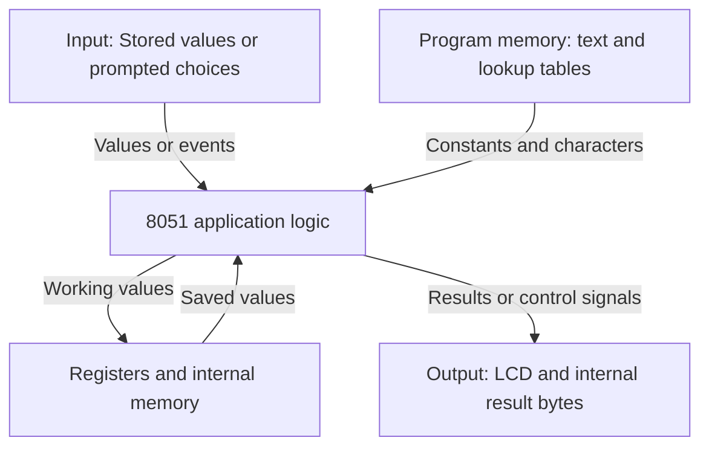

# Triangle Calculator

[Group overview](../../README.md) · [Compare implementations](../README.md)

Calculate a triangle’s area from its base and height, or its perimeter from three side lengths.

**Implementation:** LCD Area Divisor Ten

**Input:** stored values or prompted choices.  
**Output:** LCD and internal result bytes.

## Inputs and results

| Parameter | Description |
| --- | --- |
| Input | Area or perimeter selection, followed by the required dimensions |
| Output | Area and division remainder, or perimeter |

## Worked example

Base 5 and height 3 give area 7.5. Sides 2, 3, and 4 give perimeter 9. The source-specific check below identifies which calculation this version actually performs.

### Calculation details

Use base 5 and height 3 in 40H and 41H. AREAA multiplies them to get 15, then loads B with 10. DIV AB therefore leaves quotient 1 and remainder 5. The routine writes 01H to 50H and 05H to 51H. The mathematical area is 7½, so this revision gives the wrong area.

## Program operation

### Functional flowchart

[Detailed control flow](source-flow.md)

### Simplified block diagram

**Port registers:** `P0`, `P0.0`, `P0.1`, `P0.2`, `P1.0`, `P1.1`, `P1.3`.

## Technical limitations

No additional defect was recorded in the earlier source review. This is not evidence of a successful build or hardware test.

## Build and test

1. Open the [assembly source](source.a51) in an 8051 assembler or simulator.
2. Review the technical limitations and configure the peripherals required by this implementation.
3. Check the expected result using the example inputs.
