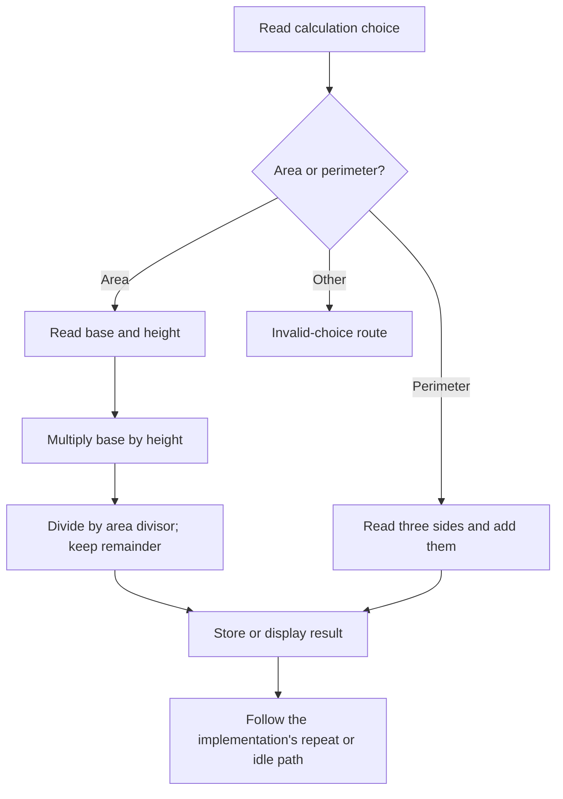
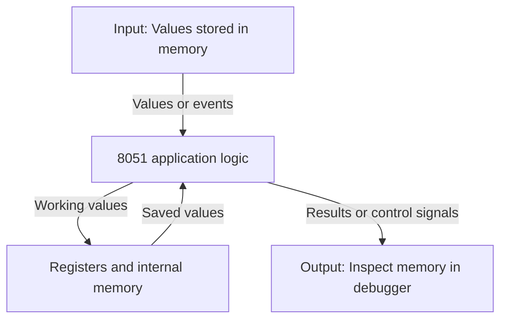

# Triangle Calculator

[Group overview](../../README.md) · [Compare implementations](../README.md)

Calculate a triangle’s area from its base and height, or its perimeter from three side lengths.

**Implementation:** Memory Perimeter Format Variant

**Input:** values stored in memory.  
**Output:** inspect memory in debugger.

## Inputs and results

| Parameter | Description |
| --- | --- |
| Input | Area or perimeter selection, followed by the required dimensions |
| Output | Area and division remainder, or perimeter |

## Worked example

Base 5 and height 3 give area 7.5. Sides 2, 3, and 4 give perimeter 9. The source-specific check below identifies which calculation this version actually performs.

### Calculation details

Reset with the supplied operation 2 and sides 2, 3, 4 in 42H–44H. The first comparison dispatches to OPERATION2. Two ADD instructions produce 2 + 3 + 4 = 9. Immediately before the final loop, RAM 50H contains 09H and RAM 51H contains 00H.

## Program operation

### Functional flowchart

[Detailed control flow](source-flow.md)

### Simplified block diagram

Results are available in memory without a display.

## Technical limitations

No additional defect was recorded in the earlier source review. This is not evidence of a successful build or hardware test.

## Build and test

1. Open the [assembly source](source.asm) in an 8051 assembler or simulator.
2. Review the technical limitations and configure the peripherals required by this implementation.
3. Check the expected result using the example inputs.
