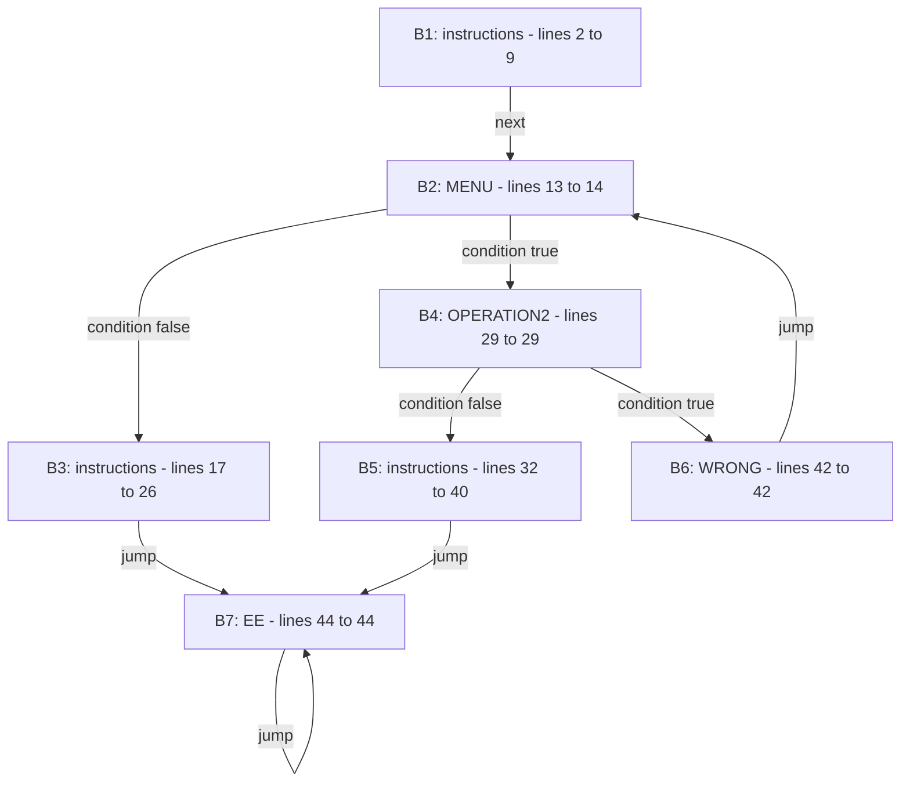

# Program Control Flow

[Back to project](README.md)

Control-flow blocks are indexed by source line. Calls resume at the instruction following the call if the subroutine returns normally.

## Entry locations

- `ORG 00H` begins at B1.

## Navigation

[Section 1](#section-1)

## Section 1



### B1

```asm
MOV 30H, #2
MOV 40H, #3
MOV 41H, #4
MOV 42H, #2
MOV 43H, #3
MOV 44H, #4
MOV 50H, #0
MOV 51H, #0
```

### B2

```asm
MOV A,30H
CJNE A,#1,OPERATION2
```

### B3

```asm
MOV A,40H
MOV B,41H
MUL AB
MOV B,#2
DIV AB
MOV 50H,A
MOV 51H,B
SJMP EE
```

### B4

```asm
CJNE A,#2,WRONG
```

### B5

```asm
MOV A,42H
ADD A,43H
ADD A,44H
MOV 50H,A
MOV 51H,#0
SJMP EE
```

### B6

```asm
SJMP MENU
```

### B7

```asm
SJMP EE
```
