# Program Control Flow

[Back to project](README.md)

Control-flow blocks are indexed by source line. Calls resume at the instruction following the call if the subroutine returns normally.

## Entry locations

- `ORG 00H` begins at B1.

## Navigation

[Section 1](#section-1) · [Section 2](#section-2) · [Section 3](#section-3) · [Section 4](#section-4) · [Section 5](#section-5) · [Section 6](#section-6) · [Section 7](#section-7) · [Section 8](#section-8) · [Section 9](#section-9) · [Section 10](#section-10) · [Section 11](#section-11) · [Section 12](#section-12) · [Section 13](#section-13) · [Section 14](#section-14) · [Section 15](#section-15) · [Section 16](#section-16) · [Section 17](#section-17) · [Section 18](#section-18) · [Section 19](#section-19) · [Section 20](#section-20) · [Section 21](#section-21) · [Section 22](#section-22) · [Section 23](#section-23) · [Section 24](#section-24) · [Section 25](#section-25) · [Section 26](#section-26)

## Section 1

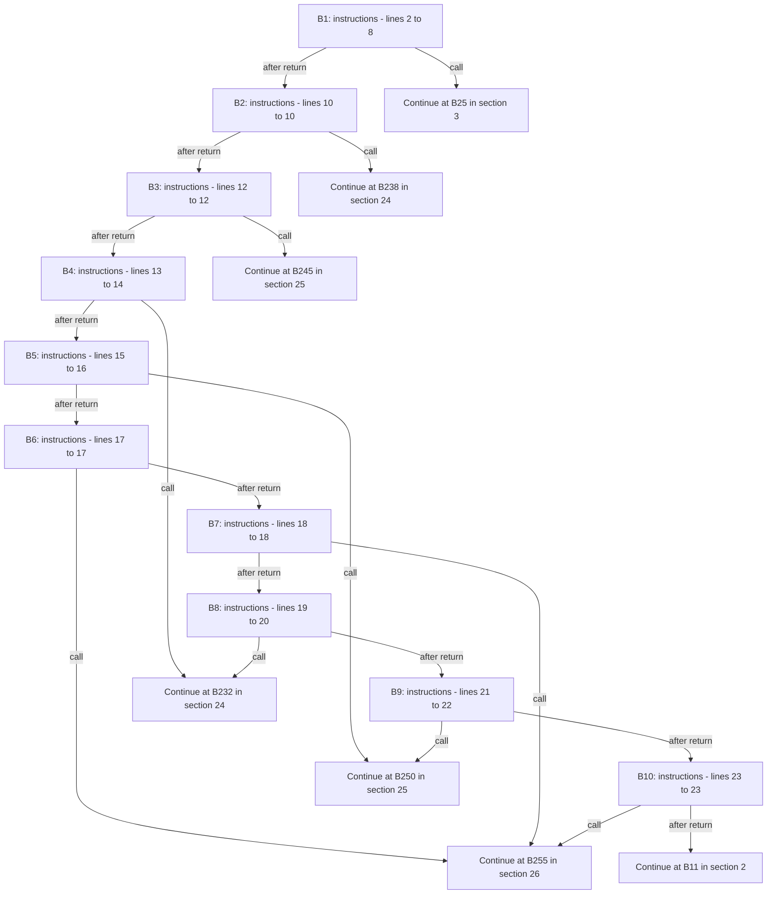

### B1

```asm
MOV 30H,#2
MOV 31H,#2
MOV 32H,#2
MOV 33H,#1
MOV 35H,#00
ACALL FLASHING
```

### B2

```asm
ACALL INLCD
```

### B3

```asm
ACALL CLEAR
```

### B4

```asm
mov a, #80H
acall cmd
```

### B5

```asm
mov dptr, #STR1
acall WSTR
```

### B6

```asm
ACALL DELAY
```

### B7

```asm
ACALL DELAY
```

### B8

```asm
mov a, #0C0H
acall cmd
```

### B9

```asm
mov dptr, #STR2
acall WSTR
```

### B10

```asm
ACALL DELAY
```

## Section 2

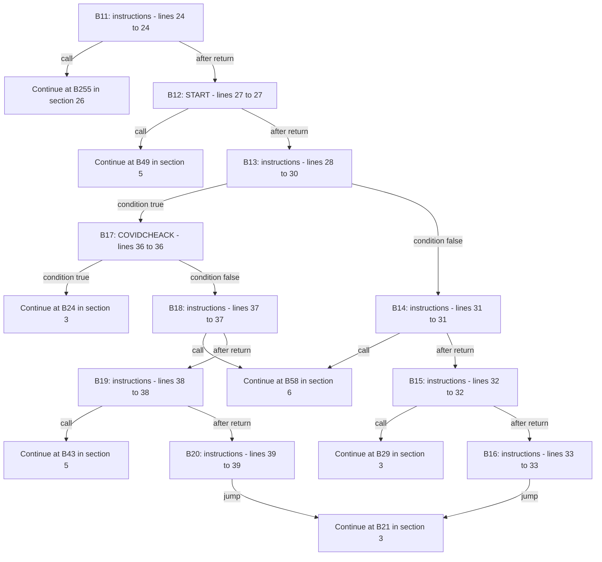

### B11

```asm
ACALL DELAY
```

### B12

```asm
ACALL MENU
```

### B13

```asm
MOV A,30H
CJNE A,#1,COVIDCHEACK
```

### B14

```asm
ACALL AGE
```

### B15

```asm
ACALL CECKUP
```

### B16

```asm
SJMP ASK
```

### B17

```asm
CJNE A,#2,EXIT
```

### B18

```asm
ACALL AGE
```

### B19

```asm
ACALL COVID
```

### B20

```asm
SJMP ASK
```

## Section 3

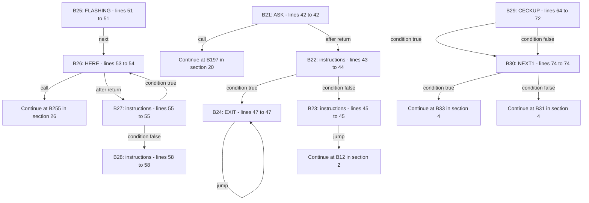

### B21

```asm
ACALL RETURN
```

### B22

```asm
MOV A,33H
CJNE A,#1,EXIT
```

### B23

```asm
AJMP START
```

### B24

```asm
SJMP EXIT
```

### B25

```asm
MOV R3,#6
```

### B26

```asm
CPL P1.0
ACALL DELAY
```

### B27

```asm
DJNZ R3,HERE
```

### B28

Return to the instruction following the active call.

```asm
RET
```

### B29

```asm
MOV A,31H
MOV B,#10
DIV AB
CJNE A,#2,NEXT1
```

### B30

```asm
JNC LEVEL2
```

## Section 4

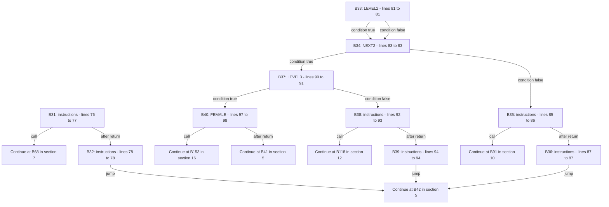

### B31

```asm
MOV 35H,#1
ACALL SHOW1
```

### B32

```asm
SJMP EE
```

### B33

```asm
CJNE A,#4,NEXT2
```

### B34

```asm
JNC LEVEL3
```

### B35

```asm
MOV 35H,#2
ACALL SHOW2
```

### B36

```asm
SJMP EE
```

### B37

```asm
MOV A,32H
CJNE A,#1,FEMALE
```

### B38

```asm
MOV 35H,#3
ACALL SHOW3
```

### B39

```asm
SJMP EE
```

### B40

```asm
MOV 35H,#4
ACALL SHOW4
```

## Section 5

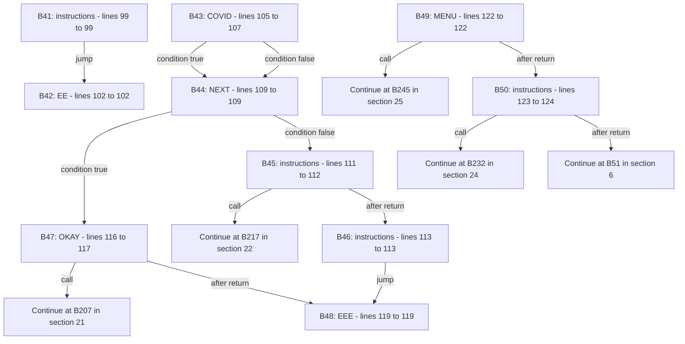

### B41

```asm
SJMP EE
```

### B42

Return to the instruction following the active call.

```asm
RET
```

### B43

```asm
MOV A,31H
CJNE A,#5,NEXT
```

### B44

```asm
JNC OKAY
```

### B45

```asm
MOV 35H,#5
ACALL SHOW6
```

### B46

```asm
SJMP EEE
```

### B47

```asm
MOV 35H,#6
ACALL SHOW5
```

### B48

Return to the instruction following the active call.

```asm
RET
```

### B49

```asm
ACALL CLEAR
```

### B50

```asm
mov a, #80H
acall cmd
```

## Section 6

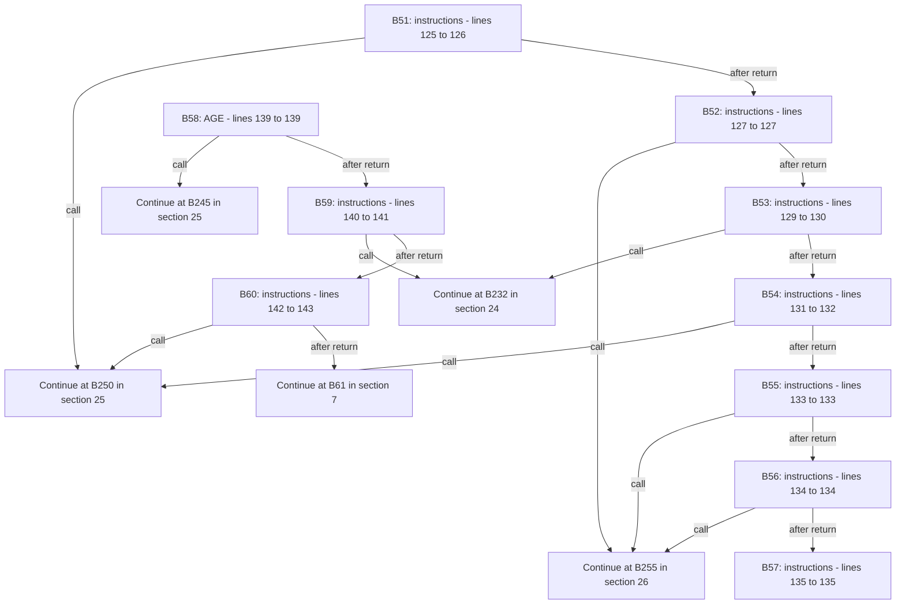

### B51

```asm
mov dptr, #STR3
acall WSTR
```

### B52

```asm
ACALL DELAY
```

### B53

```asm
mov a, #0c0H
acall cmd
```

### B54

```asm
mov dptr, #STR4
acall WSTR
```

### B55

```asm
ACALL DELAY
```

### B56

```asm
ACALL DELAY
```

### B57

Return to the instruction following the active call.

```asm
RET
```

### B58

```asm
ACALL CLEAR
```

### B59

```asm
mov a, #80H
acall cmd
```

### B60

```asm
mov dptr, #STR5
acall WSTR
```

## Section 7

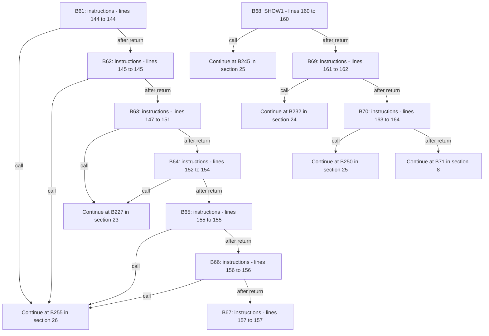

### B61

```asm
ACALL DELAY
```

### B62

```asm
ACALL DELAY
```

### B63

```asm
MOV A,31H
MOV B,#10
DIV AB
ADD A,#30H
acall WCHR
```

### B64

```asm
MOV A,B
ADD A,#30H
acall WCHR
```

### B65

```asm
ACALL DELAY
```

### B66

```asm
ACALL DELAY
```

### B67

Return to the instruction following the active call.

```asm
RET
```

### B68

```asm
ACALL CLEAR
```

### B69

```asm
mov a, #80H
acall cmd
```

### B70

```asm
mov dptr, #STR6
acall WSTR
```

## Section 8


### B71

```asm
ACALL DELAY
```

### B72

```asm
ACALL DELAY
```

### B73

```asm
ACALL CLEAR
```

### B74

```asm
mov a, #80H
acall cmd
```

### B75

```asm
ACALL CLEAR
```

### B76

```asm
mov dptr, #STR7
acall WSTR
```

### B77

```asm
ACALL DELAY
```

### B78

```asm
mov a, #0C0H
acall cmd
```

### B79

```asm
mov dptr, #STR8
acall WSTR
```

### B80

```asm
ACALL DELAY
```

## Section 9

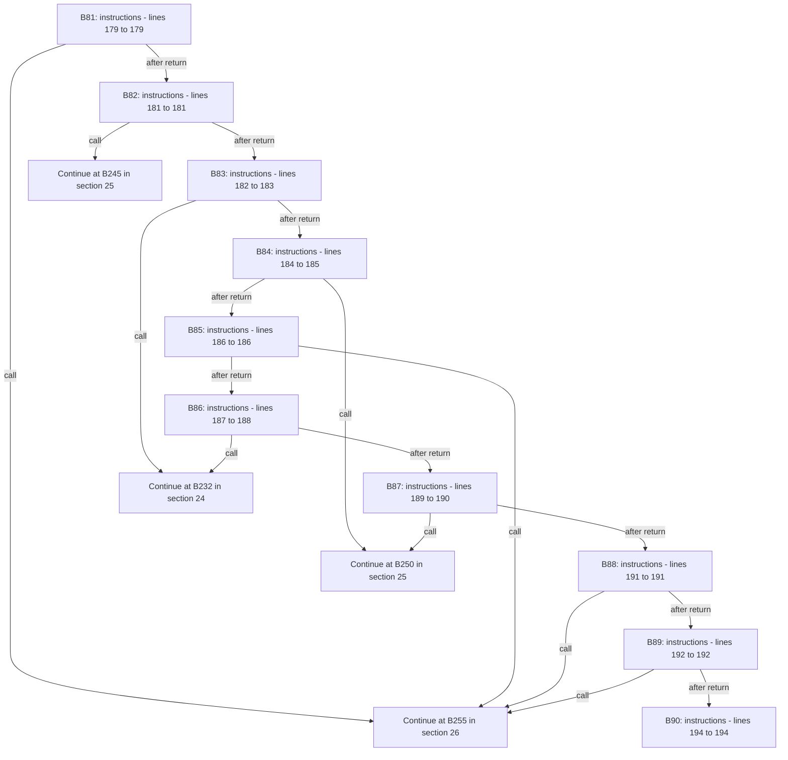

### B81

```asm
ACALL DELAY
```

### B82

```asm
ACALL CLEAR
```

### B83

```asm
mov a, #80H
acall cmd
```

### B84

```asm
mov dptr, #STR9
acall WSTR
```

### B85

```asm
ACALL DELAY
```

### B86

```asm
mov a, #0C0H
acall cmd
```

### B87

```asm
mov dptr, #STR10
acall WSTR
```

### B88

```asm
ACALL DELAY
```

### B89

```asm
ACALL DELAY
```

### B90

Return to the instruction following the active call.

```asm
RET
```

## Section 10

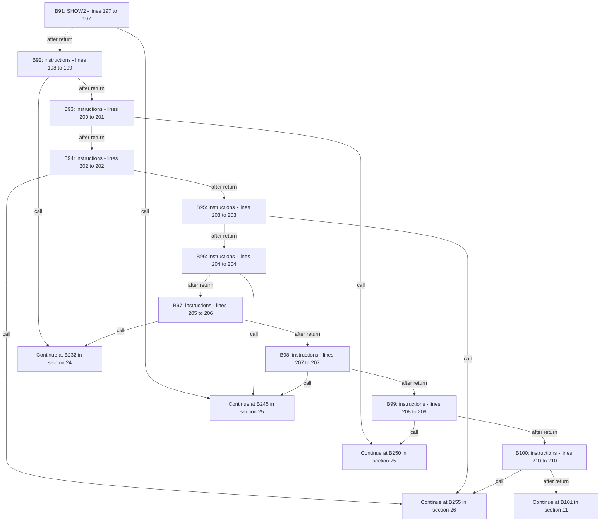

### B91

```asm
ACALL CLEAR
```

### B92

```asm
mov a, #80H
acall cmd
```

### B93

```asm
mov dptr, #STR6
acall WSTR
```

### B94

```asm
ACALL DELAY
```

### B95

```asm
ACALL DELAY
```

### B96

```asm
ACALL CLEAR
```

### B97

```asm
mov a, #80H
acall cmd
```

### B98

```asm
ACALL CLEAR
```

### B99

```asm
mov dptr, #STR7
acall WSTR
```

### B100

```asm
ACALL DELAY
```

## Section 11

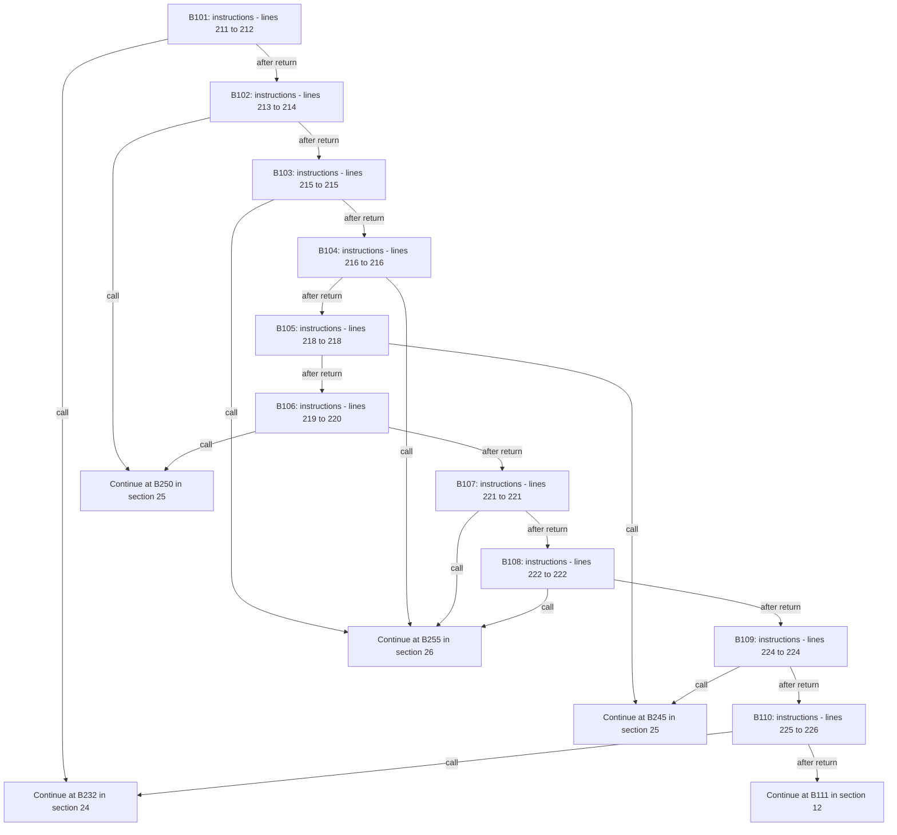

### B101

```asm
mov a, #0C0H
acall cmd
```

### B102

```asm
mov dptr, #STR10
acall WSTR
```

### B103

```asm
ACALL DELAY
```

### B104

```asm
ACALL DELAY
```

### B105

```asm
ACALL CLEAR
```

### B106

```asm
mov dptr, #STR11
acall WSTR
```

### B107

```asm
ACALL DELAY
```

### B108

```asm
ACALL DELAY
```

### B109

```asm
ACALL CLEAR
```

### B110

```asm
mov a, #80H
acall cmd
```

## Section 12

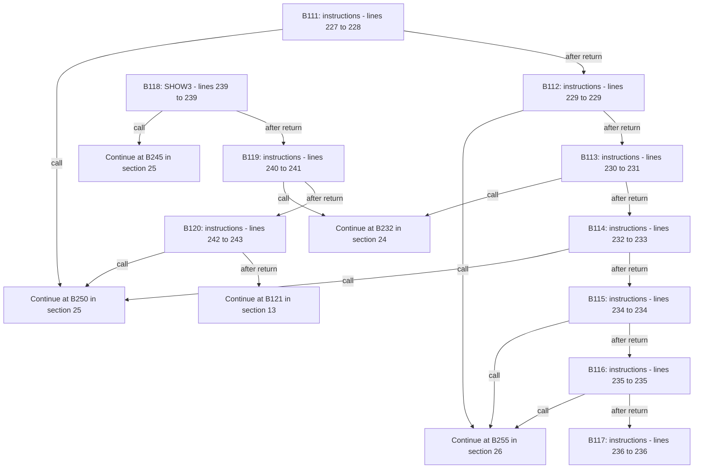

### B111

```asm
mov dptr, #STR9
acall WSTR
```

### B112

```asm
ACALL DELAY
```

### B113

```asm
mov a, #0C0H
acall cmd
```

### B114

```asm
mov dptr, #STR10
acall WSTR
```

### B115

```asm
ACALL DELAY
```

### B116

```asm
ACALL DELAY
```

### B117

Return to the instruction following the active call.

```asm
RET
```

### B118

```asm
ACALL CLEAR
```

### B119

```asm
mov a, #80H
acall cmd
```

### B120

```asm
mov dptr, #STR6
acall WSTR
```

## Section 13

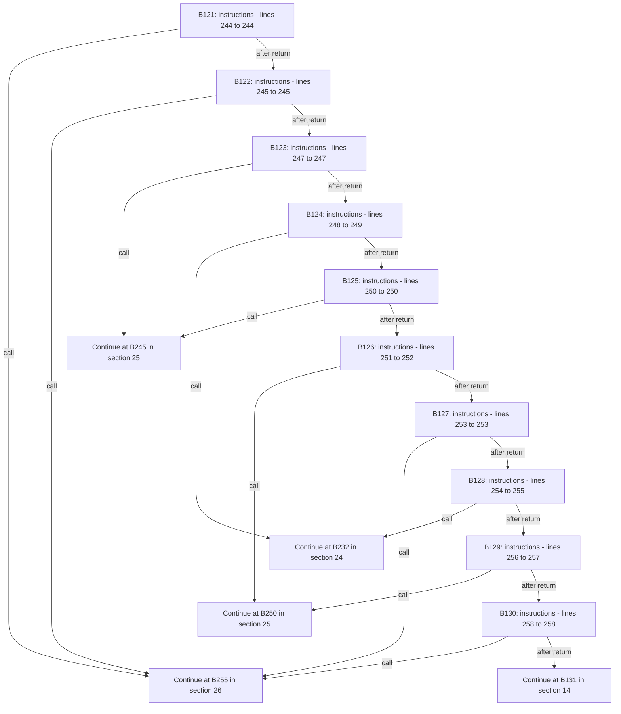

### B121

```asm
ACALL DELAY
```

### B122

```asm
ACALL DELAY
```

### B123

```asm
ACALL CLEAR
```

### B124

```asm
mov a, #80H
acall cmd
```

### B125

```asm
ACALL CLEAR
```

### B126

```asm
mov dptr, #STR7
acall WSTR
```

### B127

```asm
ACALL DELAY
```

### B128

```asm
mov a, #0C0H
acall cmd
```

### B129

```asm
mov dptr, #STR10
acall WSTR
```

### B130

```asm
ACALL DELAY
```

## Section 14

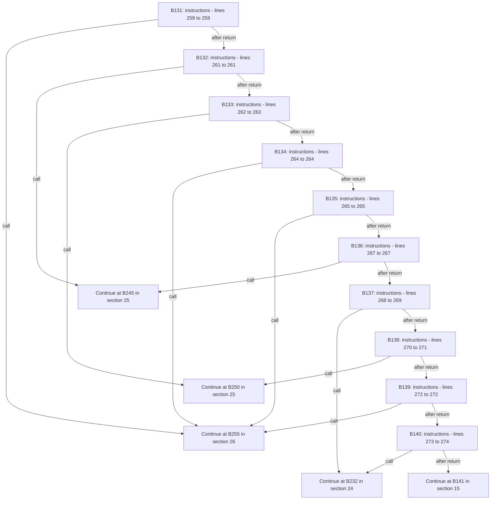

### B131

```asm
ACALL DELAY
```

### B132

```asm
ACALL CLEAR
```

### B133

```asm
mov dptr, #STR11
acall WSTR
```

### B134

```asm
ACALL DELAY
```

### B135

```asm
ACALL DELAY
```

### B136

```asm
ACALL CLEAR
```

### B137

```asm
mov a, #80H
acall cmd
```

### B138

```asm
mov dptr, #STR9
acall WSTR
```

### B139

```asm
ACALL DELAY
```

### B140

```asm
mov a, #0C0H
acall cmd
```

## Section 15

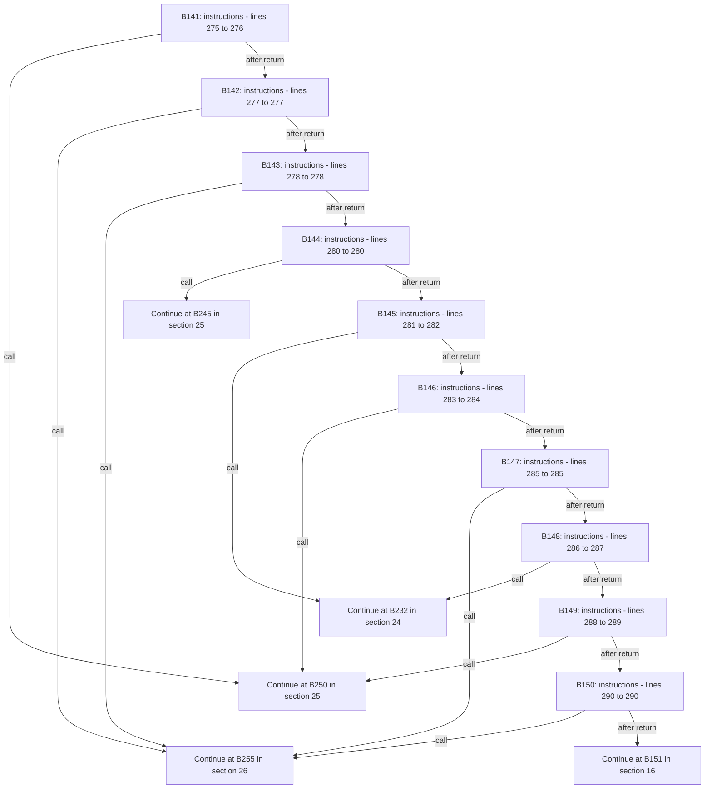

### B141

```asm
mov dptr, #STR10
acall WSTR
```

### B142

```asm
ACALL DELAY
```

### B143

```asm
ACALL DELAY
```

### B144

```asm
ACALL CLEAR
```

### B145

```asm
mov a, #80H
acall cmd
```

### B146

```asm
mov dptr, #STR12
acall WSTR
```

### B147

```asm
ACALL DELAY
```

### B148

```asm
mov a, #0C0H
acall cmd
```

### B149

```asm
mov dptr, #STR8
acall WSTR
```

### B150

```asm
ACALL DELAY
```

## Section 16

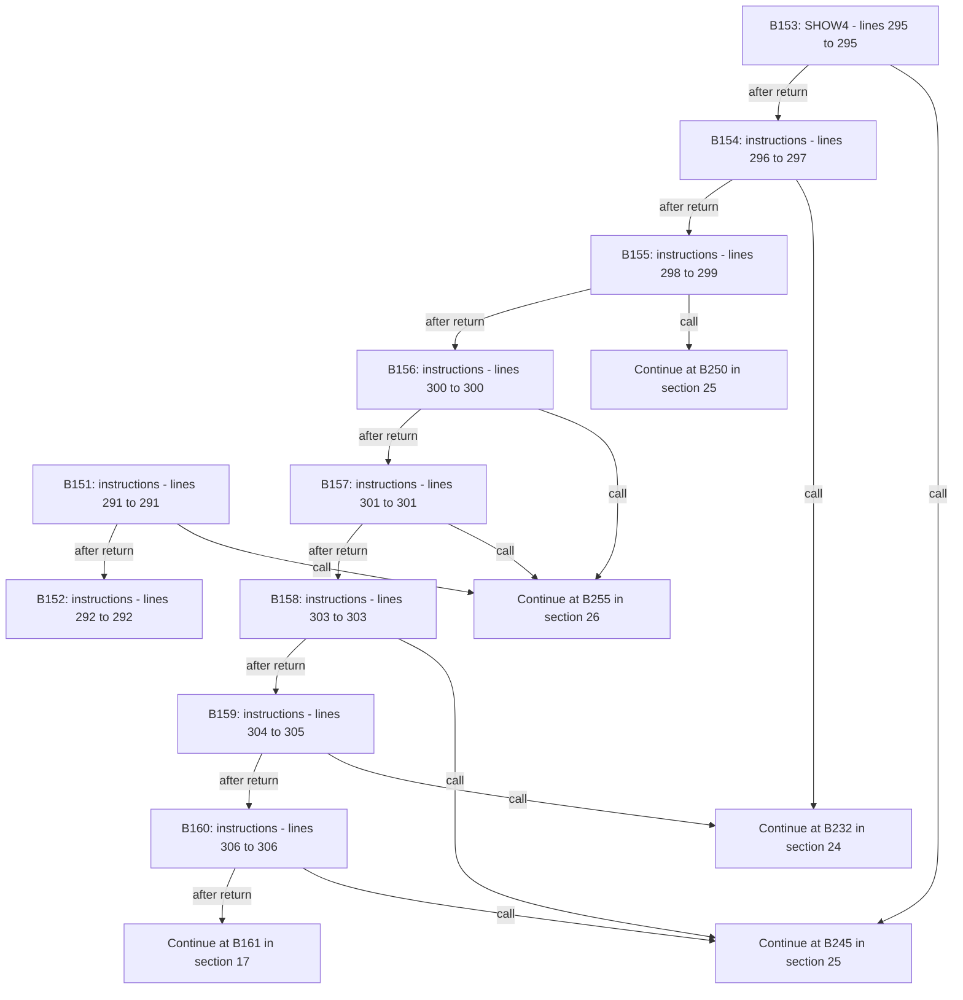

### B151

```asm
ACALL DELAY
```

### B152

Return to the instruction following the active call.

```asm
RET
```

### B153

```asm
ACALL CLEAR
```

### B154

```asm
mov a, #80H
acall cmd
```

### B155

```asm
mov dptr, #STR6
acall WSTR
```

### B156

```asm
ACALL DELAY
```

### B157

```asm
ACALL DELAY
```

### B158

```asm
ACALL CLEAR
```

### B159

```asm
mov a, #80H
acall cmd
```

### B160

```asm
ACALL CLEAR
```

## Section 17

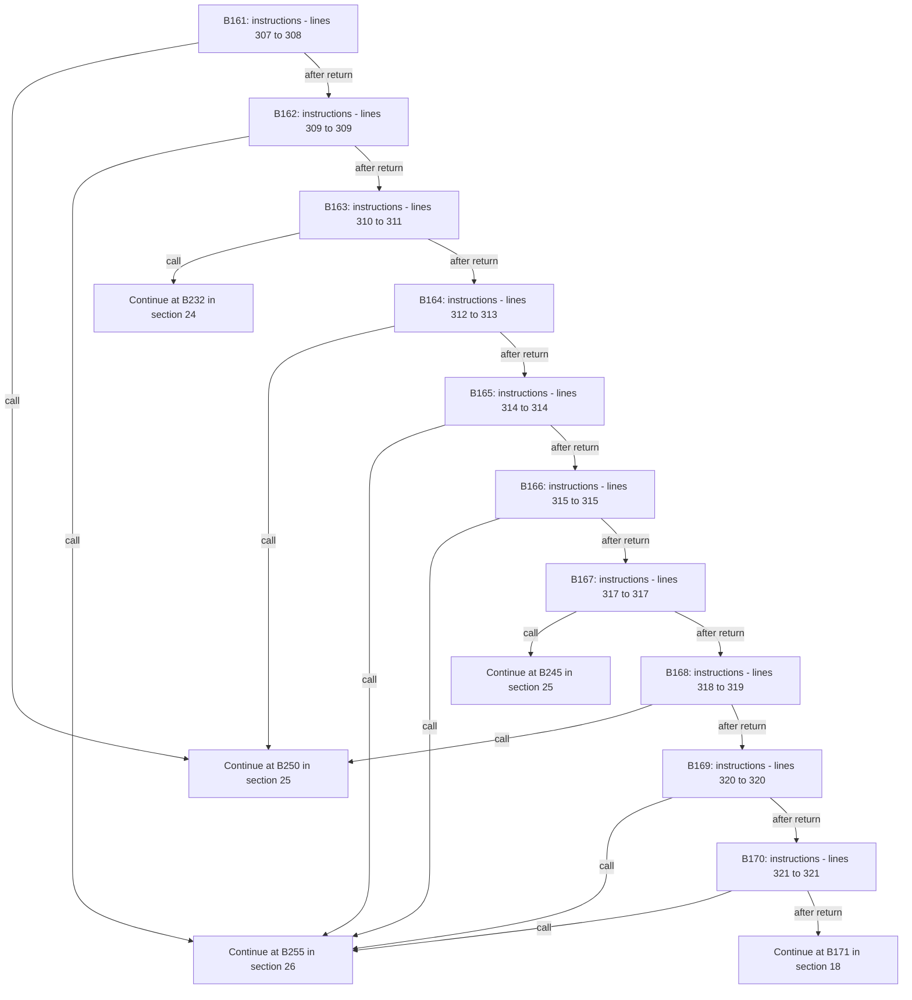

### B161

```asm
mov dptr, #STR7
acall WSTR
```

### B162

```asm
ACALL DELAY
```

### B163

```asm
mov a, #0C0H
acall cmd
```

### B164

```asm
mov dptr, #STR10
acall WSTR
```

### B165

```asm
ACALL DELAY
```

### B166

```asm
ACALL DELAY
```

### B167

```asm
ACALL CLEAR
```

### B168

```asm
mov dptr, #STR11
acall WSTR
```

### B169

```asm
ACALL DELAY
```

### B170

```asm
ACALL DELAY
```

## Section 18

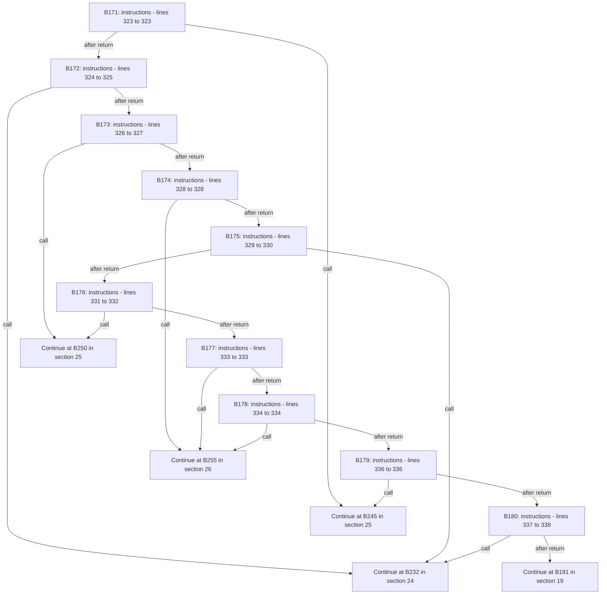

### B171

```asm
ACALL CLEAR
```

### B172

```asm
mov a, #80H
acall cmd
```

### B173

```asm
mov dptr, #STR9
acall WSTR
```

### B174

```asm
ACALL DELAY
```

### B175

```asm
mov a, #0C0H
acall cmd
```

### B176

```asm
mov dptr, #STR10
acall WSTR
```

### B177

```asm
ACALL DELAY
```

### B178

```asm
ACALL DELAY
```

### B179

```asm
ACALL CLEAR
```

### B180

```asm
mov a, #80H
acall cmd
```

## Section 19

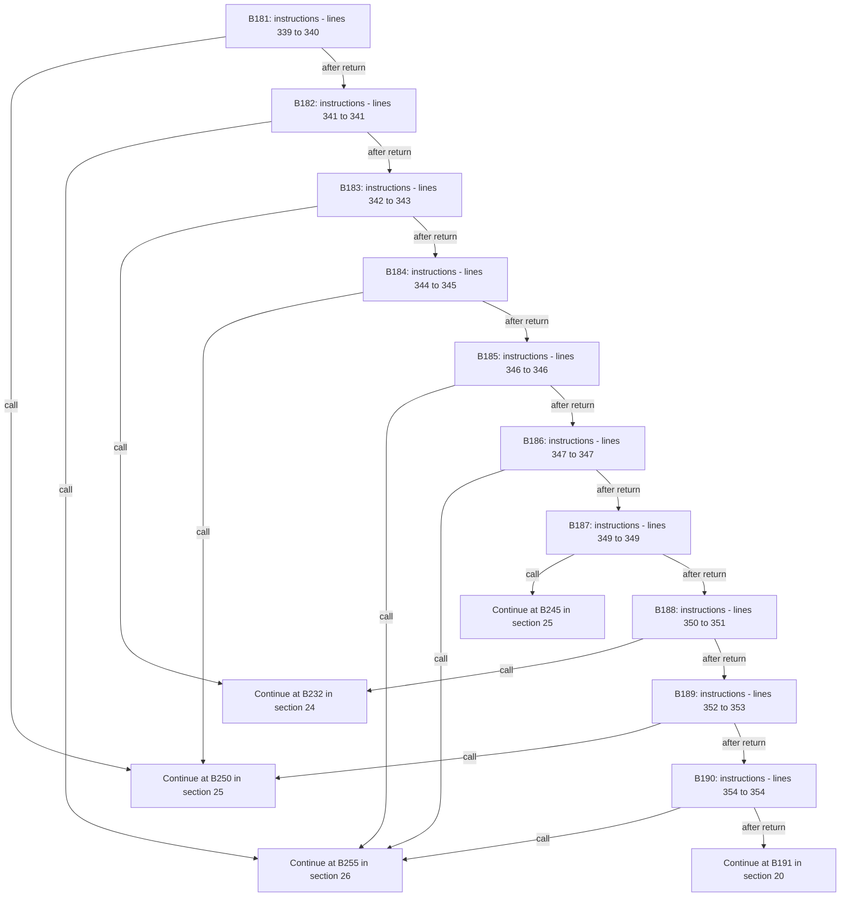

### B181

```asm
mov dptr, #STR13
acall WSTR
```

### B182

```asm
ACALL DELAY
```

### B183

```asm
mov a, #0C0H
acall cmd
```

### B184

```asm
mov dptr, #STR8
acall WSTR
```

### B185

```asm
ACALL DELAY
```

### B186

```asm
ACALL DELAY
```

### B187

```asm
ACALL CLEAR
```

### B188

```asm
mov a, #80H
acall cmd
```

### B189

```asm
mov dptr, #STR12
acall WSTR
```

### B190

```asm
ACALL DELAY
```

## Section 20

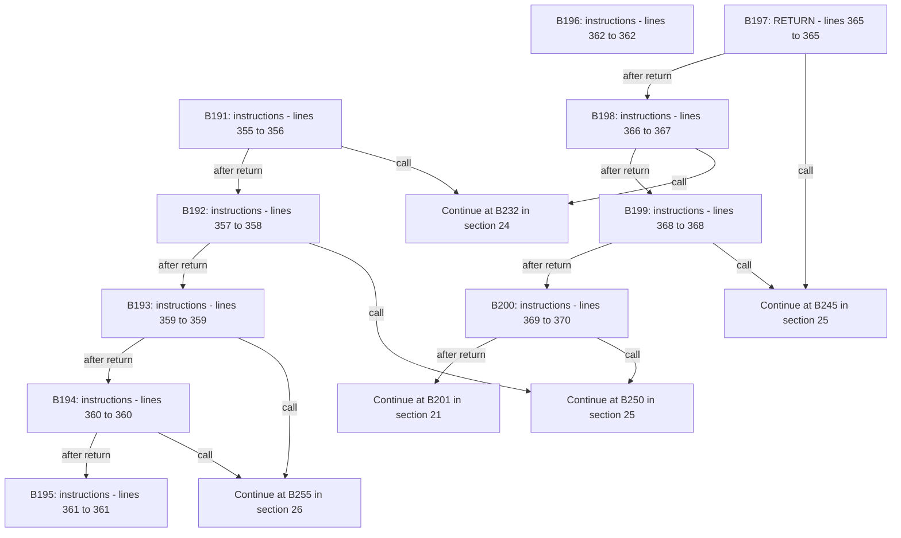

### B191

```asm
mov a, #0C0H
acall cmd
```

### B192

```asm
mov dptr, #STR8
acall WSTR
```

### B193

```asm
ACALL DELAY
```

### B194

```asm
ACALL DELAY
```

### B195

Return to the instruction following the active call.

```asm
RET
```

### B196

Return to the instruction following the active call.

```asm
RET
```

### B197

```asm
ACALL CLEAR
```

### B198

```asm
mov a, #80H
acall cmd
```

### B199

```asm
ACALL CLEAR
```

### B200

```asm
mov dptr, #STR14
acall WSTR
```

## Section 21

```mermaid
flowchart TD
B200["B201: instructions - lines 371 to 371"]
B201["B202: instructions - lines 372 to 373"]
B202["B203: instructions - lines 374 to 375"]
B203["B204: instructions - lines 376 to 376"]
B204["B205: instructions - lines 377 to 377"]
B205["B206: instructions - lines 378 to 378"]
B206["B207: SHOW5 - lines 383 to 383"]
B207["B208: instructions - lines 384 to 385"]
B208["B209: instructions - lines 386 to 386"]
B209["B210: instructions - lines 387 to 388"]
B200 -->|call| B254
B200 -->|after return| B201
B201 -->|call| B231
B201 -->|after return| B202
B202 -->|call| B249
B202 -->|after return| B203
B203 -->|call| B254
B203 -->|after return| B204
B204 -->|call| B254
B204 -->|after return| B205
B206 -->|call| B244
B206 -->|after return| B207
B207 -->|call| B231
B207 -->|after return| B208
B208 -->|call| B244
B208 -->|after return| B209
B209 -->|call| B249
B209 -->|after return| B210
B254["Continue at B255 in section 26"]
B231["Continue at B232 in section 24"]
B249["Continue at B250 in section 25"]
B244["Continue at B245 in section 25"]
B210["Continue at B211 in section 22"]
```

### B201

```asm
ACALL DELAY
```

### B202

```asm
mov a, #0C0H
acall cmd
```

### B203

```asm
mov dptr, #STR15
acall WSTR
```

### B204

```asm
ACALL DELAY
```

### B205

```asm
ACALL DELAY
```

### B206

Return to the instruction following the active call.

```asm
RET
```

### B207

```asm
ACALL CLEAR
```

### B208

```asm
mov a, #80H
acall cmd
```

### B209

```asm
ACALL CLEAR
```

### B210

```asm
mov dptr, #STR16
acall WSTR
```

## Section 22

```mermaid
flowchart TD
B210["B211: instructions - lines 389 to 389"]
B211["B212: instructions - lines 390 to 391"]
B212["B213: instructions - lines 392 to 393"]
B213["B214: instructions - lines 394 to 394"]
B214["B215: instructions - lines 395 to 395"]
B215["B216: instructions - lines 396 to 396"]
B216["B217: SHOW6 - lines 401 to 401"]
B217["B218: instructions - lines 402 to 403"]
B218["B219: instructions - lines 404 to 404"]
B219["B220: instructions - lines 405 to 406"]
B210 -->|call| B254
B210 -->|after return| B211
B211 -->|call| B231
B211 -->|after return| B212
B212 -->|call| B249
B212 -->|after return| B213
B213 -->|call| B254
B213 -->|after return| B214
B214 -->|call| B254
B214 -->|after return| B215
B216 -->|call| B244
B216 -->|after return| B217
B217 -->|call| B231
B217 -->|after return| B218
B218 -->|call| B244
B218 -->|after return| B219
B219 -->|call| B249
B219 -->|after return| B220
B254["Continue at B255 in section 26"]
B231["Continue at B232 in section 24"]
B249["Continue at B250 in section 25"]
B244["Continue at B245 in section 25"]
B220["Continue at B221 in section 23"]
```

### B211

```asm
ACALL DELAY
```

### B212

```asm
mov a, #0C0H
acall cmd
```

### B213

```asm
mov dptr, #STR18
acall WSTR
```

### B214

```asm
ACALL DELAY
```

### B215

```asm
ACALL DELAY
```

### B216

Return to the instruction following the active call.

```asm
RET
```

### B217

```asm
ACALL CLEAR
```

### B218

```asm
mov a, #80H
acall cmd
```

### B219

```asm
ACALL CLEAR
```

### B220

```asm
mov dptr, #STR17
acall WSTR
```

## Section 23

```mermaid
flowchart TD
B220["B221: instructions - lines 407 to 407"]
B221["B222: instructions - lines 408 to 409"]
B222["B223: instructions - lines 410 to 411"]
B223["B224: instructions - lines 412 to 412"]
B224["B225: instructions - lines 413 to 413"]
B225["B226: instructions - lines 414 to 414"]
B226["B227: WCHR - lines 420 to 424"]
B227["B228: instructions - lines 425 to 425"]
B228["B229: instructions - lines 426 to 428"]
B229["B230: instructions - lines 429 to 429"]
B220 -->|call| B254
B220 -->|after return| B221
B221 -->|call| B231
B221 -->|after return| B222
B222 -->|call| B249
B222 -->|after return| B223
B223 -->|call| B254
B223 -->|after return| B224
B224 -->|call| B254
B224 -->|after return| B225
B226 -->|call| B236
B226 -->|after return| B227
B227 -->|call| B242
B227 -->|after return| B228
B228 -->|call| B236
B228 -->|after return| B229
B229 -->|call| B242
B229 -->|after return| B230
B254["Continue at B255 in section 26"]
B231["Continue at B232 in section 24"]
B249["Continue at B250 in section 25"]
B236["Continue at B237 in section 24"]
B242["Continue at B243 in section 25"]
B230["Continue at B231 in section 24"]
```

### B221

```asm
ACALL DELAY
```

### B222

```asm
mov a, #0C0H
acall cmd
```

### B223

```asm
mov dptr, #STR18
acall WSTR
```

### B224

```asm
ACALL DELAY
```

### B225

```asm
ACALL DELAY
```

### B226

Return to the instruction following the active call.

```asm
RET
```

### B227

```asm
PUSH ACC
PUSH B
SETB P1.3
MOV B,A
ACALL COMMON
```

### B228

```asm
ACALL LDELAY
```

### B229

```asm
MOV A,B
SWAP A
ACALL COMMON
```

### B230

```asm
ACALL LDELAY
```

## Section 24

```mermaid
flowchart TD
B230["B231: instructions - lines 430 to 432"]
B231["B232: CMD - lines 435 to 437"]
B232["B233: instructions - lines 438 to 438"]
B233["B234: instructions - lines 439 to 441"]
B234["B235: instructions - lines 442 to 442"]
B235["B236: instructions - lines 443 to 443"]
B236["B237: COMMON - lines 446 to 451"]
B237["B238: INLCD - lines 454 to 461"]
B238["B239: instructions - lines 462 to 470"]
B239["B240: instructions - lines 471 to 483"]
B231 -->|call| B236
B231 -->|after return| B232
B232 -->|call| B242
B232 -->|after return| B233
B233 -->|call| B236
B233 -->|after return| B234
B234 -->|call| B242
B234 -->|after return| B235
B237 -->|call| B242
B237 -->|after return| B238
B238 -->|call| B242
B238 -->|after return| B239
B239 -->|call| B242
B239 -->|after return| B240
B242["Continue at B243 in section 25"]
B240["Continue at B241 in section 25"]
```

### B231

Return to the instruction following the active call.

```asm
POP B
POP ACC
RET
```

### B232

```asm
CLR P1.3
MOV B,A
ACALL COMMON
```

### B233

```asm
ACALL LDELAY
```

### B234

```asm
MOV A,B
SWAP A
ACALL COMMON
```

### B235

```asm
ACALL LDELAY
```

### B236

Return to the instruction following the active call.

```asm
RET
```

### B237

Return to the instruction following the active call.

```asm
ANL a,#11110000B
ANL P1, #00001111B
ORL P1,A
SETB P1.2
CLR P1.2
RET
```

### B238

```asm
CLR P1.3
CLR P1.7
CLR P1.6
SETB P1.5
CLR P1.4
SETB P1.2
CLR P1.2
ACALL LDELAY
```

### B239

```asm
SETB P1.2
CLR P1.2
SETB P1.7
CLR P1.6
CLR P1.5
CLR P1.4
SETB P1.2
CLR P1.2
ACALL LDELAY
```

### B240

```asm
CLR P1.7
CLR P1.6
CLR P1.5
CLR P1.4
SETB P1.2
CLR P1.2
SETB P1.7
SETB P1.6
SETB P1.5
SETB P1.4
SETB P1.2
CLR P1.2
ACALL LDELAY
```

## Section 25

```mermaid
flowchart TD
B240["B241: instructions - lines 484 to 494"]
B241["B242: instructions - lines 495 to 495"]
B242["B243: LDELAY - lines 498 to 499"]
B243["B244: instructions - lines 500 to 500"]
B244["B245: CLEAR - lines 503 to 504"]
B245["B246: instructions - lines 505 to 505"]
B246["B247: WAIT - lines 506 to 506"]
B247["B248: instructions - lines 507 to 507"]
B248["B249: instructions - lines 508 to 508"]
B249["B250: WSTR - lines 511 to 511"]
B240 -->|call| B242
B240 -->|after return| B241
B242 -->|condition true| B242
B242 -->|condition false| B243
B244 -->|call| B231
B244 -->|after return| B245
B245 -->|next| B246
B246 -->|call| B242
B246 -->|after return| B247
B247 -->|condition true| B246
B247 -->|condition false| B248
B249 -->|next| B250
B231["Continue at B232 in section 24"]
B250["Continue at B251 in section 26"]
```

### B241

```asm
CLR P1.7
CLR P1.6
CLR P1.5
CLR P1.4
SETB P1.2
CLR P1.2
SETB P1.6
SETB P1.5
SETB P1.2
CLR P1.2
ACALL LDELAY
```

### B242

Return to the instruction following the active call.

```asm
RET
```

### B243

```asm
MOV R0, #50
DJNZ R0, $
```

### B244

Return to the instruction following the active call.

```asm
RET
```

### B245

```asm
MOV A,#01H
ACALL CMD
```

### B246

```asm
MOV R7,#14
```

### B247

```asm
ACALL LDELAY
```

### B248

```asm
DJNZ R7,WAIT
```

### B249

Return to the instruction following the active call.

```asm
ret
```

### B250

```asm
PUSH    ACC
```

## Section 26

```mermaid
flowchart TD
B250["B251: CONT1 - lines 513 to 515"]
B251["B252: PRINT - lines 517 to 517"]
B252["B253: instructions - lines 518 to 519"]
B253["B254: EXIT1 - lines 520 to 521"]
B254["B255: DELAY - lines 524 to 524"]
B255["B256: AGAIN - lines 525 to 525"]
B256["B257: AGAIN2 - lines 526 to 526"]
B257["B258: instructions - lines 527 to 527"]
B258["B259: instructions - lines 528 to 528"]
B250 -->|condition true| B253
B250 -->|condition false| B251
B251 -->|call| B226
B251 -->|after return| B252
B252 -->|jump| B250
B254 -->|next| B255
B255 -->|next| B256
B256 -->|condition true| B256
B256 -->|condition false| B257
B257 -->|condition true| B255
B257 -->|condition false| B258
B226["Continue at B227 in section 23"]
```

### B251

```asm
CLR     A
MOVC    A,@A+DPTR
JZ Exit1
```

### B252

```asm
ACALL    WCHR
```

### B253

```asm
INC DPTR
AJMP    CONT1
```

### B254

Return to the instruction following the active call.

```asm
POP     ACC
RET
```

### B255

```asm
MOV R0,#20
```

### B256

```asm
MOV R1,#90
```

### B257

```asm
DJNZ R1,AGAIN2
```

### B258

```asm
DJNZ R0,AGAIN
```

### B259

Return to the instruction following the active call.

```asm
RET
```
