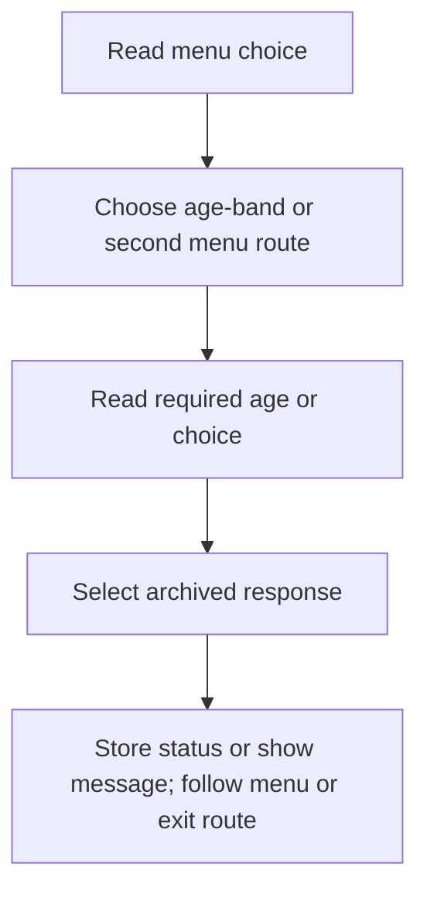
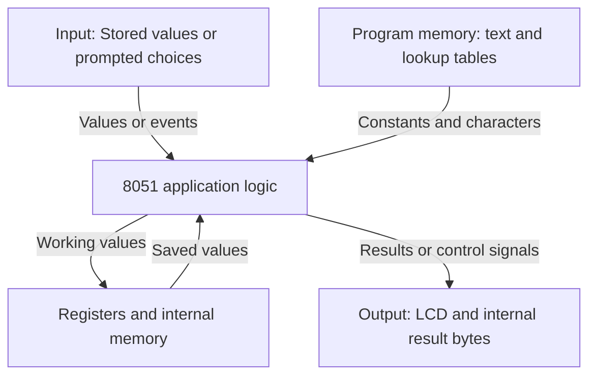

# Age-Based Menu Demonstration

[Group overview](../../README.md) · [Compare implementations](../README.md)

Demonstrate a menu that selects a stored response according to an age band or another menu choice.

**Implementation:** LCD Port 0 Interface

**Input:** stored values or prompted choices.  
**Output:** LCD and internal result bytes.

## Inputs and results

| Parameter | Description |
| --- | --- |
| Input | A menu choice and age |
| Output | A selected response code or stored message |

## Worked example

In the documented age-band calculation, age 21 selects response code 2. This is a classroom branch-selection example, not a medical recommendation.

### Calculation details

Exercise the checkup branch with the numeric age 21 in 31H. Integer division by 10 gives 2. That passes the first threshold and falls below 4, so the routine writes status 2 to 35H. This value is a program branch identifier.

## Program operation

1. Read menu choice.
2. Choose age-band or second menu route.
3. Read required age or choice.
4. Select archived response.
5. Store status or show message; follow menu or exit route.

### Functional flowchart

[Detailed control flow](source-flow.md)

### Simplified block diagram

**Port registers:** `P0`, `P0.0`, `P0.1`, `P0.2`, `P1.0`.

## Technical limitations

No additional defect was recorded in the earlier source review. This is not evidence of a successful build or hardware test.

## Build and test

1. Open the [assembly source](source.a51) in an 8051 assembler or simulator.
2. Review the technical limitations and configure the peripherals required by this implementation.
3. Check the expected result using the example inputs.
