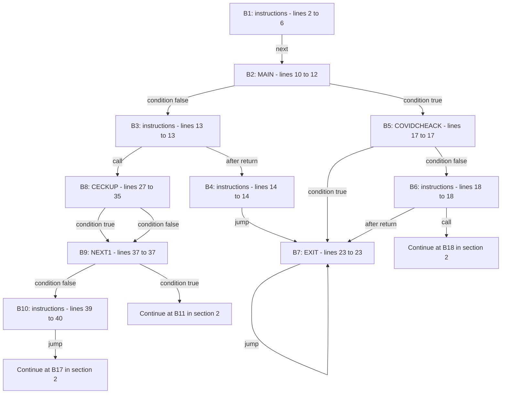
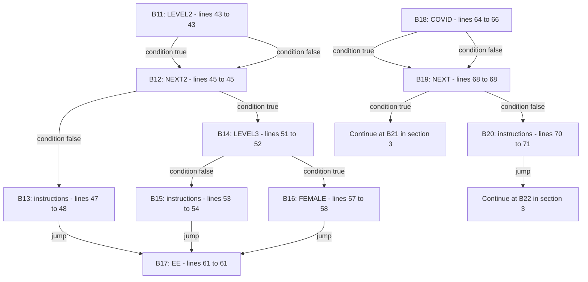
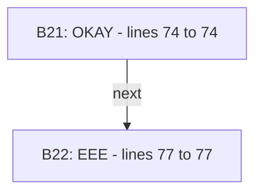

# Program Control Flow

[Back to project](README.md)

Control-flow blocks are indexed by source line. Calls resume at the instruction following the call if the subroutine returns normally.

## Entry locations

- `ORG 00H` begins at B1.

## Navigation

[Section 1](#section-1) · [Section 2](#section-2) · [Section 3](#section-3)

## Section 1



### B1

```asm
MOV 30H,#1
MOV 31H,#21
MOV 32H,#1
MOV 35H,#00
```

### B2

```asm
MOV A,30H
CJNE A,#1,COVIDCHEACK
```

### B3

```asm
ACALL CECKUP
```

### B4

```asm
SJMP EXIT
```

### B5

```asm
CJNE A,#2,EXIT
```

### B6

```asm
ACALL COVID
```

### B7

```asm
SJMP EXIT
```

### B8

```asm
MOV A,31H
MOV B,#10
DIV AB
CJNE A,#2,NEXT1
```

### B9

```asm
JNC LEVEL2
```

### B10

```asm
MOV 35H,#1
SJMP EE
```

## Section 2



### B11

```asm
CJNE A,#4,NEXT2
```

### B12

```asm
JNC LEVEL3
```

### B13

```asm
MOV 35H,#2
SJMP EE
```

### B14

```asm
MOV A,32H
CJNE A,#1,FEMALE
```

### B15

```asm
MOV 35H,#3
SJMP EE
```

### B16

```asm
MOV 35H,#4
SJMP EE
```

### B17

Return to the instruction following the active call.

```asm
RET
```

### B18

```asm
MOV A,31H
CJNE A,#5,NEXT
```

### B19

```asm
JNC OKAY
```

### B20

```asm
MOV 35H,#5
SJMP EEE
```

## Section 3



### B21

```asm
MOV 35H,#6
```

### B22

Return to the instruction following the active call.

```asm
RET
```
