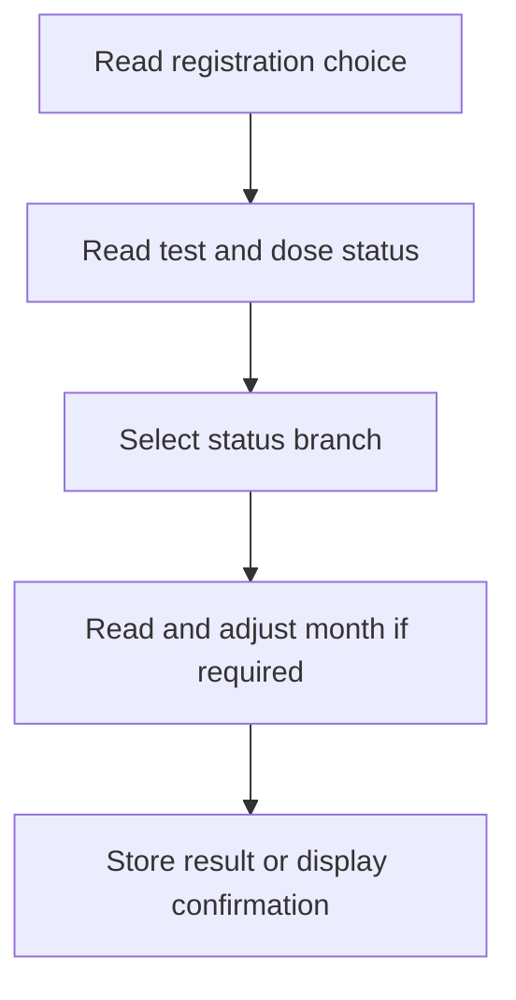
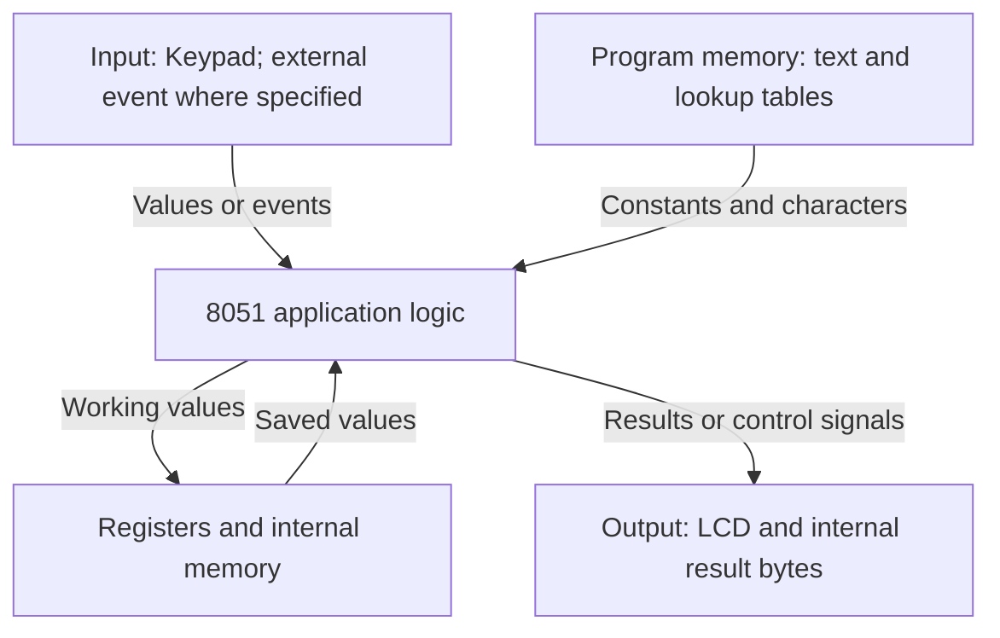

# Appointment Registration Demonstration

[Group overview](../../README.md) · [Compare implementations](../README.md)

Demonstrate a registration menu that uses status answers and a month to select a stored appointment response.

**Implementation:** Interrupt Registration Validation

**Input:** keypad.  
**Output:** LCD and internal result bytes.

## Inputs and results

| Parameter | Description |
| --- | --- |
| Input | Status choices, dose information, and a month where requested |
| Output | A month, confirmation message, or status code |

## Worked example

A month calculation that adds 2 to November produces 13, then wraps to month 1: January. These archived classroom rules are not clinical scheduling guidance.

### Calculation details

Test the month rollover helper with A = 13, as produced by adding 2 to month 11 in the second-dose branch. Comparing 13 with 12 leaves carry clear, and SUBB A,#12 produces 1. The returned month byte is 01H.

## Program operation

1. Read registration choice.
2. Read test and dose status.
3. Select status branch.
4. Read and adjust month if required.
5. Store result or display confirmation.

### Functional flowchart

[Detailed control flow](source-flow.md)

### Simplified block diagram

**Port registers:** `P0`, `P0.4`, `P0.6`, `P1`, `P1.2`, `P1.3`, `P1.4`, `P1.5`, `P1.6`, `P1.7`.

## Technical limitations

No additional defect was recorded in the earlier source review. This is not evidence of a successful build or hardware test.

## Build and test

1. Open the [assembly source](source.asm) in an 8051 assembler or simulator.
2. Review the technical limitations and configure the peripherals required by this implementation.
3. Check the expected result using the example inputs.
