# Program Control Flow

[Back to project](README.md)

Control-flow blocks are indexed by source line. Calls resume at the instruction following the call if the subroutine returns normally.

## Entry locations

- `ORG 00H` begins at B1.

## Navigation

[Section 1](#section-1) · [Section 2](#section-2) · [Section 3](#section-3) · [Section 4](#section-4) · [Section 5](#section-5) · [Section 6](#section-6) · [Section 7](#section-7) · [Section 8](#section-8) · [Section 9](#section-9) · [Section 10](#section-10) · [Section 11](#section-11) · [Section 12](#section-12) · [Section 13](#section-13) · [Section 14](#section-14) · [Section 15](#section-15) · [Section 16](#section-16) · [Section 17](#section-17) · [Section 18](#section-18) · [Section 19](#section-19) · [Section 20](#section-20) · [Section 21](#section-21) · [Section 22](#section-22) · [Section 23](#section-23) · [Section 24](#section-24) · [Section 25](#section-25) · [Section 26](#section-26) · [Section 27](#section-27) · [Section 28](#section-28) · [Section 29](#section-29)

## Section 1

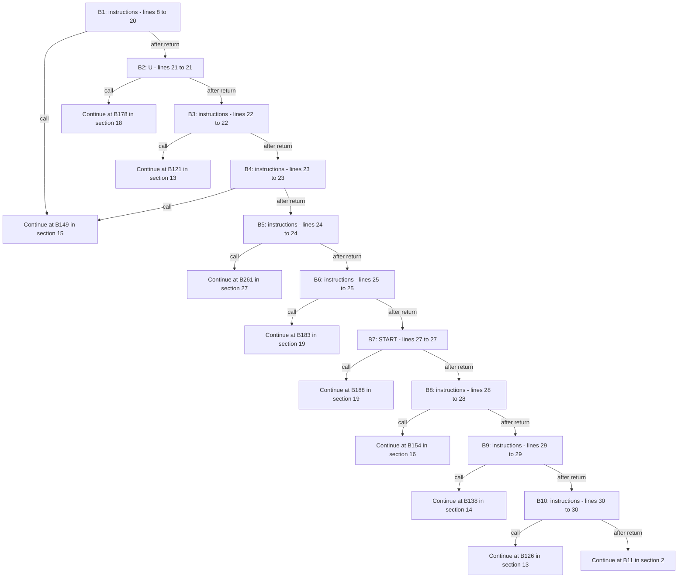

### B1

```asm
MOV 51H,#4
MOV 52H,#1
MOV 53H,#3
MOV 54H,#1
MOV 55H,#100
MOV 56H,#1
MOV 57H,#1
ACALL INLCD
```

### B2

```asm
ACALL WELCOMEMSG
```

### B3

```asm
ACALL FLASH
```

### B4

```asm
ACALL INLCD
```

### B5

```asm
acall press
```

### B6

```asm
acall name
```

### B7

```asm
ACALL MENUMSG
```

### B8

```asm
aCALL KEYPAD
```

### B9

```asm
ACALL WCHR
```

### B10

```asm
ACALL DELAY
```

## Section 2

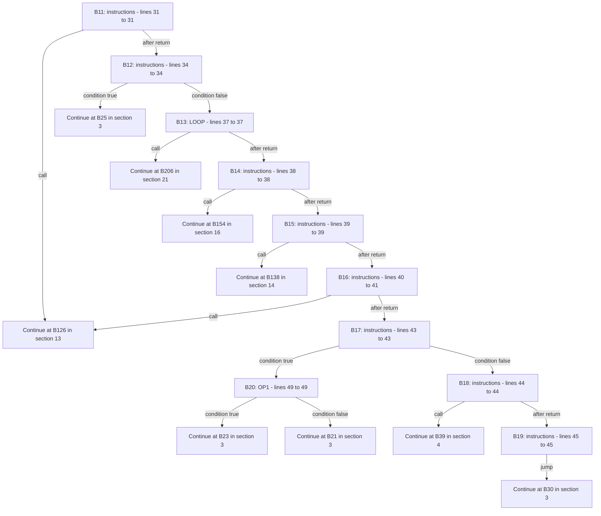

### B11

```asm
ACALL DELAY
```

### B12

```asm
CJNE A,#'1', EXIT
```

### B13

```asm
ACALL MES1
```

### B14

```asm
ACALL KEYPAD
```

### B15

```asm
ACALL WCHR
```

### B16

```asm
SUBB A,#30H
ACALL DELAY
```

### B17

```asm
CJNE A,#0,op1
```

### B18

```asm
ACALL op2
```

### B19

```asm
SJMP AGAINN
```

### B20

```asm
CJNE A,#1,ERROR
```

## Section 3

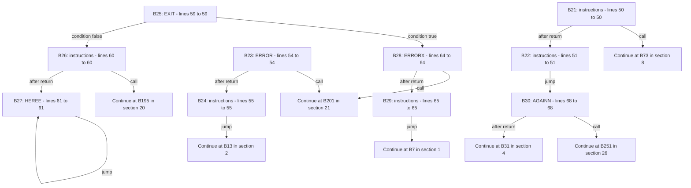

### B21

```asm
ACALL POS
```

### B22

```asm
SJMP AGAINN
```

### B23

```asm
ACALL ERROR1MSG
```

### B24

```asm
SJMP loop
```

### B25

```asm
CJNE A,#'2',ERRORx
```

### B26

```asm
ACALL EXITMSG
```

### B27

```asm
SJMP HEREE
```

### B28

```asm
ACALL ERROR1MSG
```

### B29

```asm
SJMP START
```

### B30

```asm
ACALL MES5
```

## Section 4

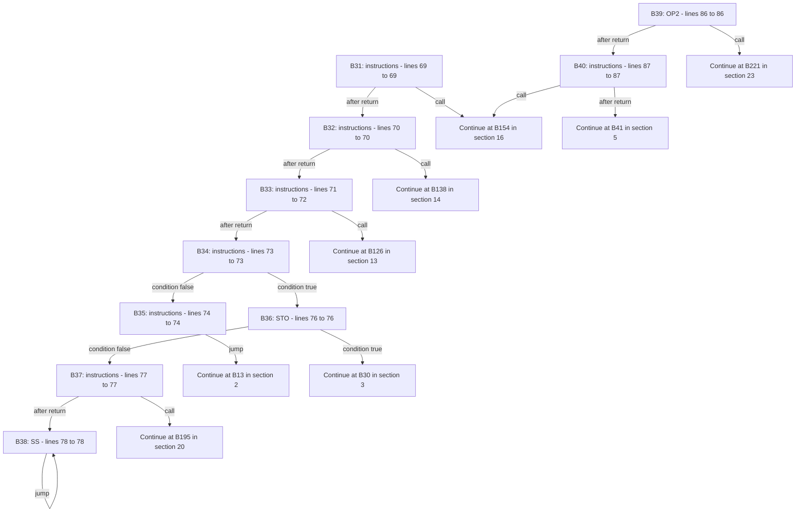

### B31

```asm
ACALL KEYPAD
```

### B32

```asm
ACALL WCHR
```

### B33

```asm
SUBB A,#30H
ACALL DELAY
```

### B34

```asm
CJNE A,#1,STO
```

### B35

```asm
SJMP LOOP
```

### B36

```asm
CJNE A,#0,AGAINN
```

### B37

```asm
ACALL EXITMSG
```

### B38

```asm
SJMP SS
```

### B39

```asm
ACALL MES22
```

### B40

```asm
ACALL KEYPAD
```

## Section 5

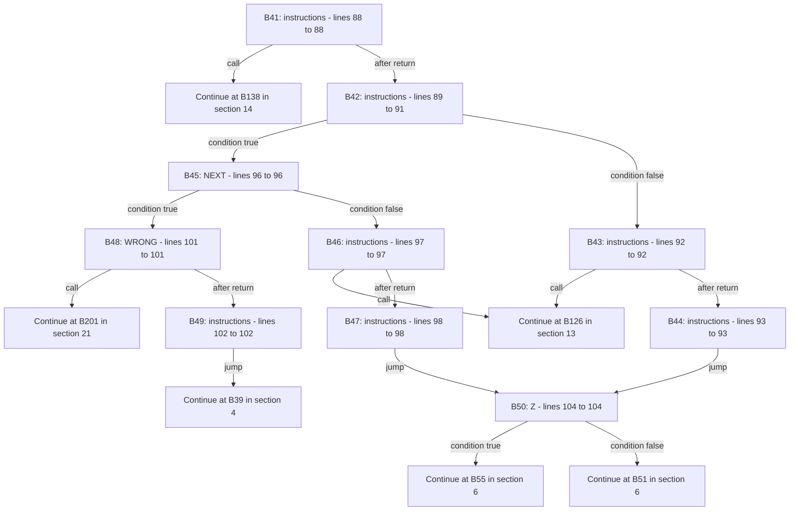

### B41

```asm
ACALL WCHR
```

### B42

```asm
SUBB A,#30H
cjne a,#0h,next
```

### B43

```asm
ACALL DELAY
```

### B44

```asm
sjmp z
```

### B45

```asm
cjne a,#01,wrong
```

### B46

```asm
acall delay
```

### B47

```asm
sjmp z
```

### B48

```asm
acall ERROR1MSG
```

### B49

```asm
sjmp op2
```

### B50

```asm
CJNE A,#0,SecondDozee
```

## Section 6

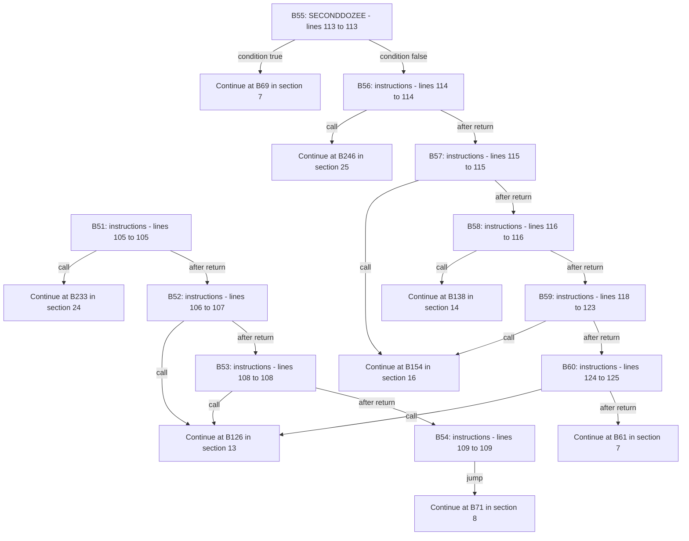

### B51

```asm
ACALL MES33
```

### B52

```asm
MOV 54H,#0
ACALL DELAY
```

### B53

```asm
ACALL DELAY
```

### B54

```asm
SJMP BACK3
```

### B55

```asm
CJNE A,#1,ERROR3
```

### B56

```asm
ACALL MES44
```

### B57

```asm
ACALL KEYPAD
```

### B58

```asm
ACALL WCHR
```

### B59

```asm
subb a,#30h
mov b,10
mul ab
mov 30h,a
acall keypad
```

### B60

```asm
add a,30h
acall delay
```

## Section 7

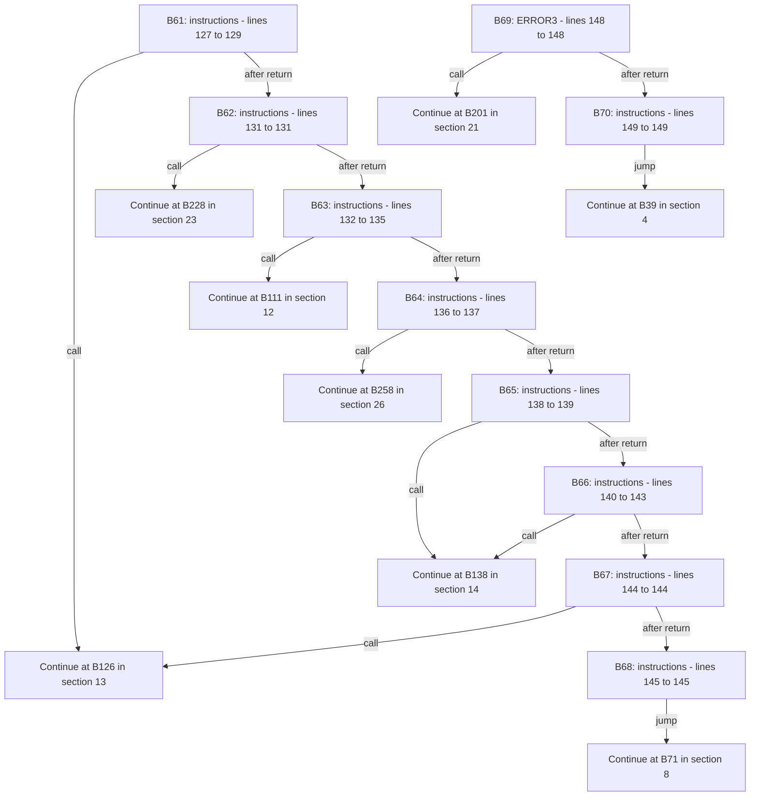

### B61

```asm
SUBB A,#30H
MOV 53H,A
ACALL DELAY
```

### B62

```asm
ACALL MES3
```

### B63

```asm
MOV R7,53H
MOV A,R7
ADD A,#2
ACALL CHEACK
```

### B64

```asm
MOV 54H,A
acall convert
```

### B65

```asm
MOV A,#'/'
ACALL WCHR
```

### B66

```asm
MOV 55H,#4
MOV A,55H
ADD A,#30H
ACALL WCHR
```

### B67

```asm
ACALL DELAY
```

### B68

```asm
SJMP BACK3
```

### B69

```asm
ACALL ERROR1MSG
```

### B70

```asm
SJMP OP2
```

## Section 8

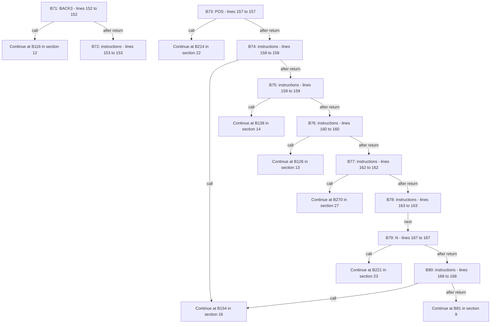

### B71

```asm
ACALL CONFIRM
```

### B72

Return to the instruction following the active call.

```asm
RET
```

### B73

```asm
ACALL MES2
```

### B74

```asm
ACALL KEYPAD
```

### B75

```asm
ACALL WCHR
```

### B76

```asm
acall delay
```

### B77

```asm
acall wrongm
```

### B78

```asm
MOV R7,A
```

### B79

```asm
ACALL MES22
```

### B80

```asm
ACALL KEYPAD
```

## Section 9

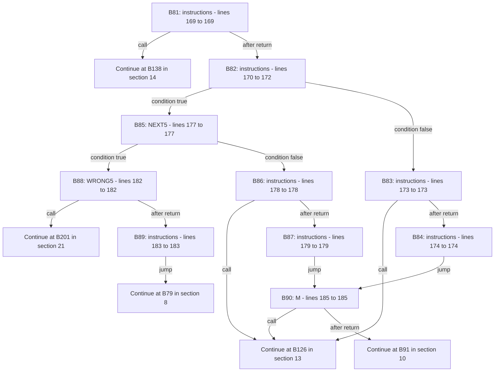

### B81

```asm
ACALL WCHR
```

### B82

```asm
SUBB A,#30H
cjne a,#0h,next5
```

### B83

```asm
ACALL DELAY
```

### B84

```asm
sjmp m
```

### B85

```asm
cjne a,#01,wrong5
```

### B86

```asm
acall delay
```

### B87

```asm
sjmp m
```

### B88

```asm
acall ERROR1MSG
```

### B89

```asm
sjmp n
```

### B90

```asm
ACALL DELAY
```

## Section 10

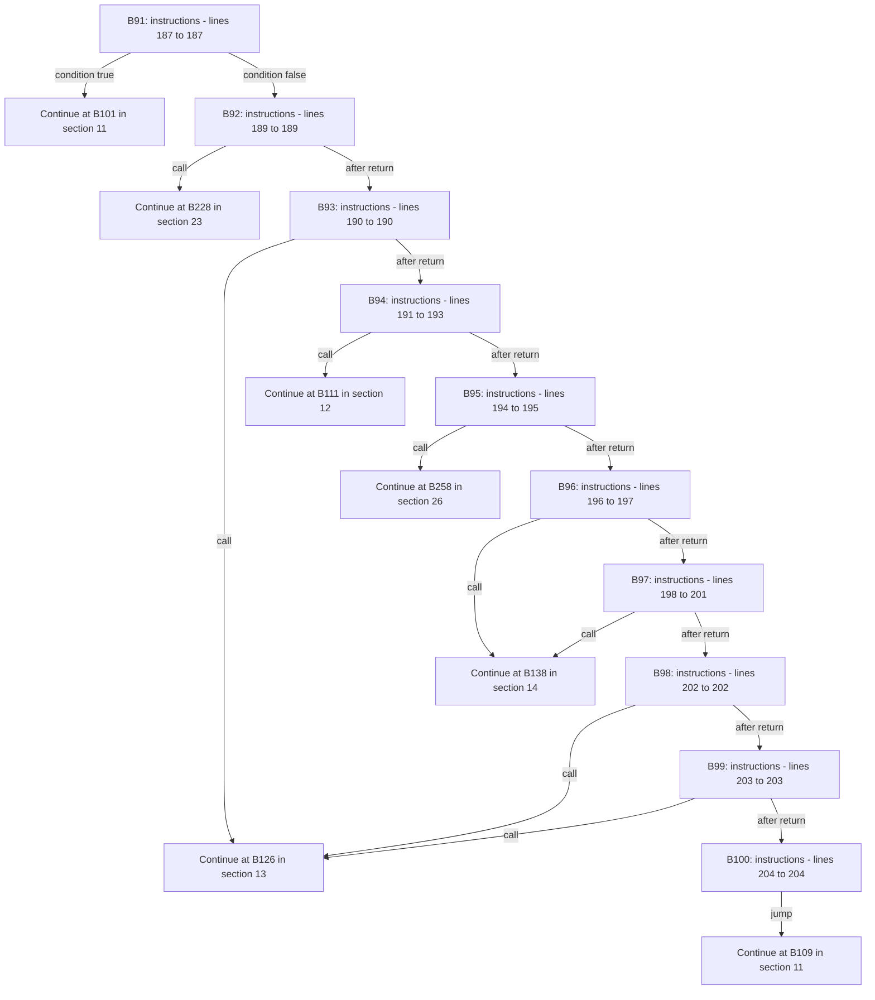

### B91

```asm
CJNE A,#0,SecondDoze
```

### B92

```asm
ACALL MES3
```

### B93

```asm
ACALL DELAY
```

### B94

```asm
MOV A,R7
ADD A,#3
ACALL CHEACK
```

### B95

```asm
MOV 54H,A
acall convert
```

### B96

```asm
MOV A,#'/'
ACALL WCHR
```

### B97

```asm
MOV 55H,#1
MOV A,55H
ADD A,#30H
ACALL WCHR
```

### B98

```asm
ACALL DELAY
```

### B99

```asm
ACALL DELAY
```

### B100

```asm
SJMP BACK1
```

## Section 11

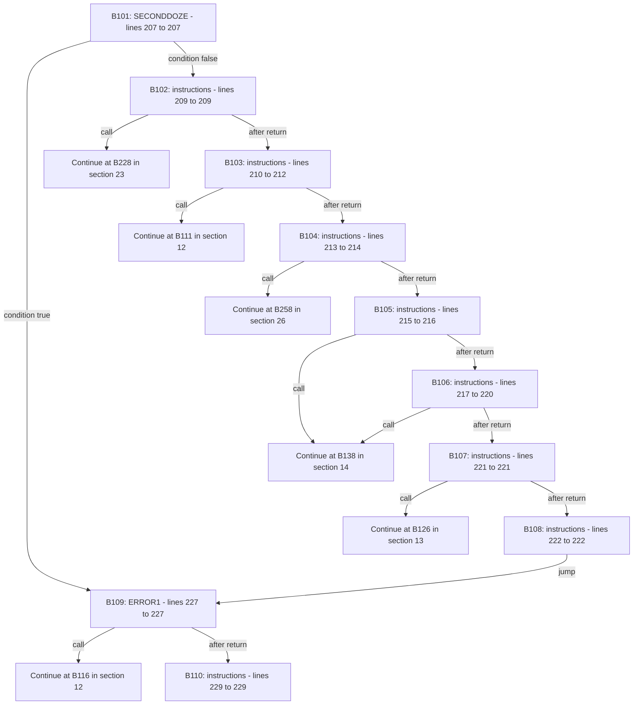

### B101

```asm
CJNE A,#1,ERROR1
```

### B102

```asm
ACALL MES3
```

### B103

```asm
MOV A,R7
ADD A,#4
ACALL CHEACK
```

### B104

```asm
MOV 54H,A
acall convert
```

### B105

```asm
MOV A,#'/'
ACALL WCHR
```

### B106

```asm
MOV 55H,#2
MOV A,55H
ADD A,#30H
ACALL WCHR
```

### B107

```asm
ACALL DELAY
```

### B108

```asm
SJMP BACK1
```

### B109

```asm
ACALL CONFIRM
```

### B110

Return to the instruction following the active call.

```asm
RET
```

## Section 12

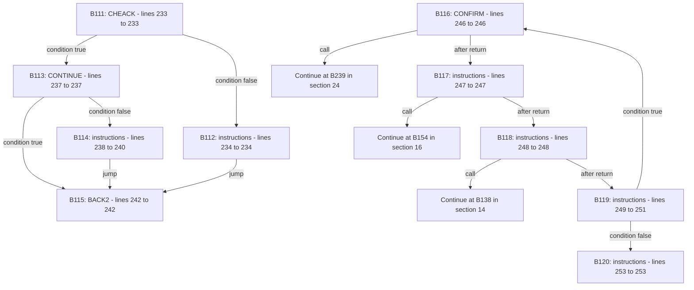

### B111

```asm
CJNE A,#12,CONTINUE
```

### B112

```asm
SJMP BACK2
```

### B113

```asm
JC BACK2
```

### B114

```asm
SUBB A,#12
sjmp back2
```

### B115

Return to the instruction following the active call.

```asm
RET
```

### B116

```asm
ACALL MES4
```

### B117

```asm
ACALL KEYPAD
```

### B118

```asm
ACALL WCHR
```

### B119

```asm
SUBB A,#30H
CJNE A,#1,CONFIRM
```

### B120

Return to the instruction following the active call.

```asm
RET
```

## Section 13

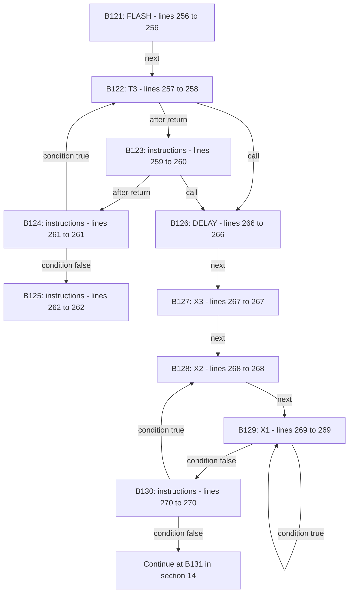

### B121

```asm
MOV R6,#3
```

### B122

```asm
MOV P1,#0H
ACALL DELAY
```

### B123

```asm
MOV P1,#0fFH
ACALL DELAY
```

### B124

```asm
DJNZ R6,T3
```

### B125

Return to the instruction following the active call.

```asm
RET
```

### B126

```asm
MOV R5,#2
```

### B127

```asm
MOV R4,#20
```

### B128

```asm
MOV R3,#200
```

### B129

```asm
DJNZ R3,X1
```

### B130

```asm
DJNZ R4,X2
```

## Section 14

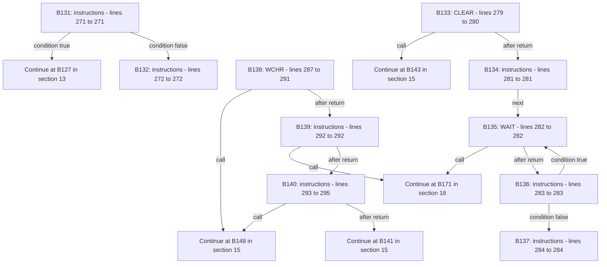

### B131

```asm
DJNZ R5,X3
```

### B132

Return to the instruction following the active call.

```asm
RET
```

### B133

```asm
MOV A,#01H
ACALL CMD
```

### B134

```asm
MOV R5,#14
```

### B135

```asm
ACALL LDELAY
```

### B136

```asm
DJNZ R5,WAIT
```

### B137

Return to the instruction following the active call.

```asm
RET
```

### B138

```asm
PUSH ACC
PUSH B
SETB P1.3
MOV B,A
ACALL COMMON
```

### B139

```asm
ACALL LDELAY
```

### B140

```asm
MOV A,B
SWAP A
ACALL COMMON
```

## Section 15

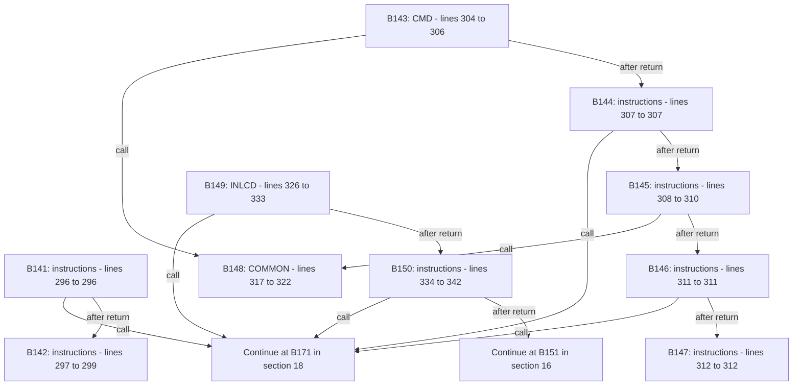

### B141

```asm
ACALL LDELAY
```

### B142

Return to the instruction following the active call.

```asm
POP B
POP ACC
RET
```

### B143

```asm
CLR P1.3
MOV B,A
ACALL COMMON
```

### B144

```asm
ACALL LDELAY
```

### B145

```asm
MOV A,B
SWAP A
ACALL COMMON
```

### B146

```asm
ACALL LDELAY
```

### B147

Return to the instruction following the active call.

```asm
RET
```

### B148

Return to the instruction following the active call.

```asm
ANL a,#11110000B
ANL P1, #00001111B
ORL P1,A
SETB P1.2
CLR P1.2
RET
```

### B149

```asm
CLR P1.3
CLR P1.7
CLR P1.6
SETB P1.5
CLR P1.4
SETB P1.2
CLR P1.2
ACALL LDELAY
```

### B150

```asm
SETB P1.2
CLR P1.2
SETB P1.7
CLR P1.6
CLR P1.5
CLR P1.4
SETB P1.2
CLR P1.2
ACALL LDELAY
```

## Section 16

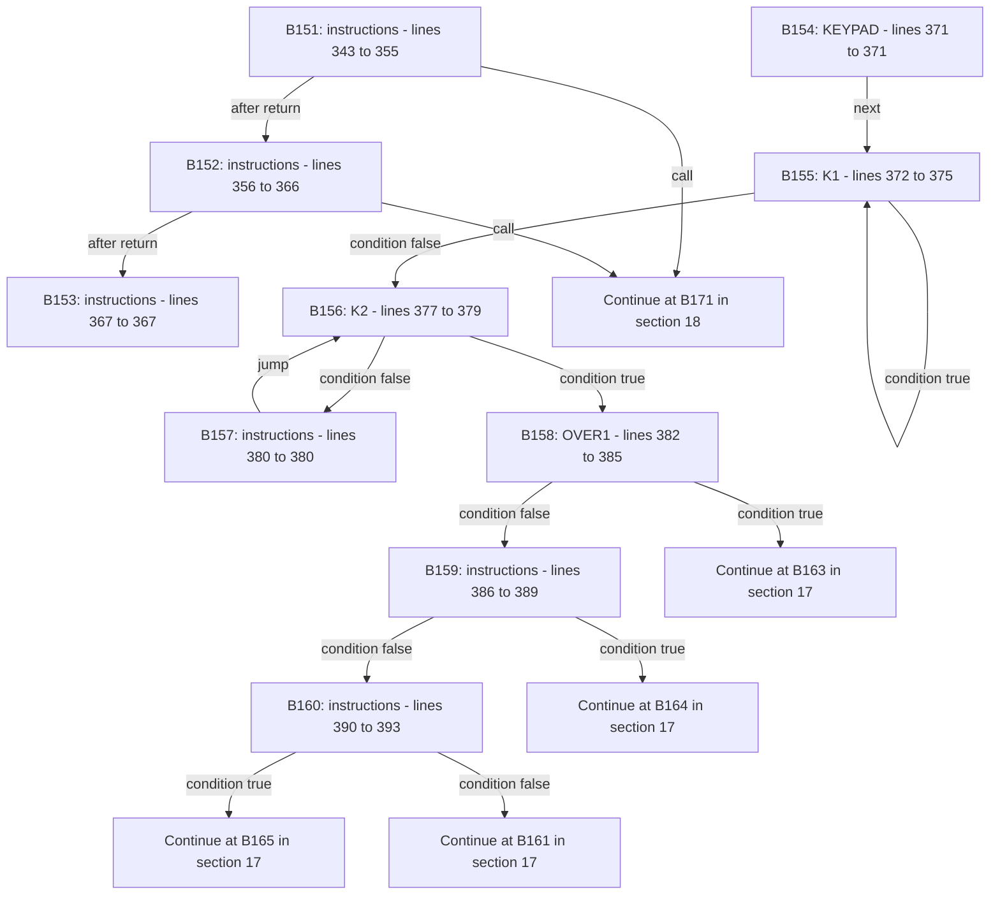

### B151

```asm
CLR P1.7
CLR P1.6
CLR P1.5
CLR P1.4
SETB P1.2
CLR P1.2
SETB P1.7
SETB P1.6
SETB P1.5
SETB P1.4
SETB P1.2
CLR P1.2
ACALL LDELAY
```

### B152

```asm
CLR P1.7
CLR P1.6
CLR P1.5
CLR P1.4
SETB P1.2
CLR P1.2
SETB P1.6
SETB P1.5
SETB P1.2
CLR P1.2
ACALL LDELAY
```

### B153

Return to the instruction following the active call.

```asm
RET
```

### B154

```asm
MOV P0,#01110000B
```

### B155

```asm
MOV P0,#01110000B
MOV A,P0
ANL A,#01110000B
CJNE A,#01110000B,K1
```

### B156

```asm
MOV A,P0
ANL A,#01110000B
CJNE A,#01110000B,OVER1
```

### B157

```asm
SJMP K2
```

### B158

```asm
MOV P0,#01111110B
MOV A,P0
ANL A,#01110000B
CJNE A,#01110000B,ROW_0
```

### B159

```asm
MOV P0,#01111101B
MOV A,P0
ANL A,#01110000B
CJNE A,#01110000B,ROW_1
```

### B160

```asm
MOV P0,#01111011B
MOV A,P0
ANL A,#01110000B
CJNE A,#01110000B,ROW_2
```

## Section 17

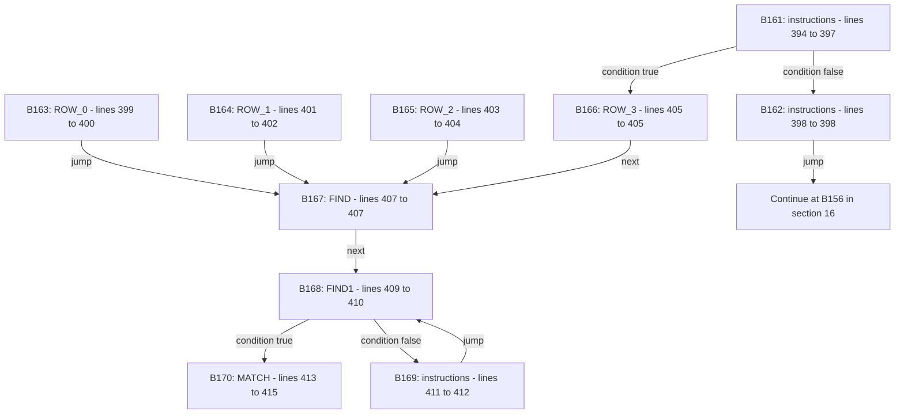

### B161

```asm
MOV P0,#01110111B
MOV A,P0
ANL A,#01110000B
CJNE A,#01110000B,ROW_3
```

### B162

```asm
LJMP K2
```

### B163

```asm
MOV DPTR,#KCODE0
SJMP FIND
```

### B164

```asm
MOV DPTR,#KCODE1
SJMP FIND
```

### B165

```asm
MOV DPTR,#KCODE2
SJMP FIND
```

### B166

```asm
MOV DPTR,#KCODE3
```

### B167

```asm
RLC A
```

### B168

```asm
RLC A
JNC MATCH
```

### B169

```asm
INC DPTR
SJMP FIND1
```

### B170

Return to the instruction following the active call.

```asm
CLR A
MOVC A,@A+DPTR
RET
```

## Section 18

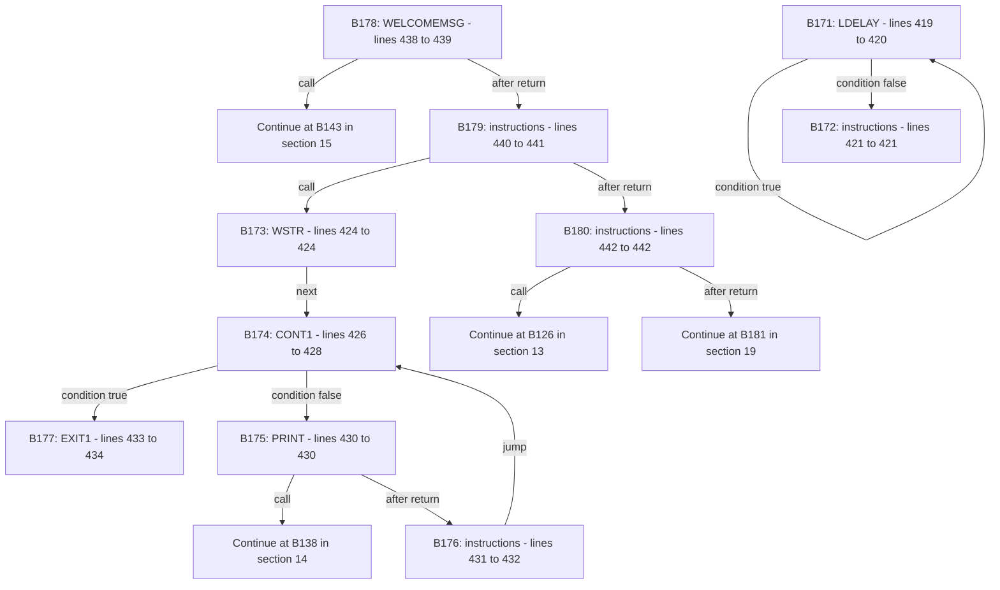

### B171

```asm
MOV R0, #50
DJNZ R0, $
```

### B172

Return to the instruction following the active call.

```asm
RET
```

### B173

```asm
PUSH ACC
```

### B174

```asm
CLR A
MOVC A,@A+DPTR
JZ Exit1
```

### B175

```asm
ACALL WCHR
```

### B176

```asm
INC DPTR
AJMP CONT1
```

### B177

Return to the instruction following the active call.

```asm
POP ACC
RET
```

### B178

```asm
MOV A,#80H
ACALL CMD
```

### B179

```asm
MOV DPTR,#ro1
ACALL WSTR
```

### B180

```asm
ACALL DELAY
```

## Section 19

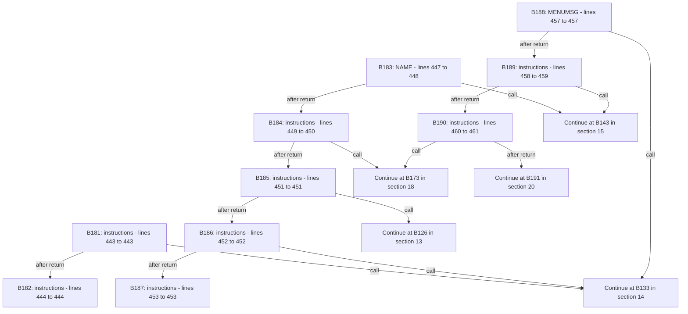

### B181

```asm
acall clear
```

### B182

Return to the instruction following the active call.

```asm
ret
```

### B183

```asm
MOV A,#80H
ACALL CMD
```

### B184

```asm
MOV DPTR,#ro2
ACALL WSTR
```

### B185

```asm
ACALL DELAY
```

### B186

```asm
acall clear
```

### B187

Return to the instruction following the active call.

```asm
RET
```

### B188

```asm
ACALL CLEAR
```

### B189

```asm
MOV A,#80H
ACALL CMD
```

### B190

```asm
MOV DPTR,#ro3
ACALL WSTR
```

## Section 20

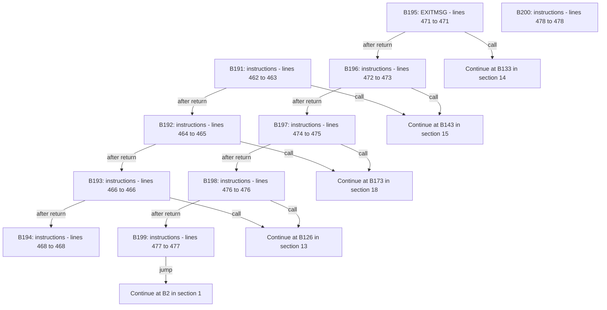

### B191

```asm
MOV A,#0C0H
ACALL CMD
```

### B192

```asm
MOV DPTR,#ro4
ACALL WSTR
```

### B193

```asm
ACALL DELAY
```

### B194

Return to the instruction following the active call.

```asm
RET
```

### B195

```asm
ACALL CLEAR
```

### B196

```asm
MOV A,#80H
ACALL CMD
```

### B197

```asm
MOV DPTR,#ro6
acall wstr
```

### B198

```asm
ACALL DELAY
```

### B199

```asm
ljmp u
```

### B200

Return to the instruction following the active call.

```asm
RET
```

## Section 21

```mermaid
flowchart TD
B200["B201: ERROR1MSG - lines 482 to 482"]
B201["B202: instructions - lines 483 to 484"]
B202["B203: instructions - lines 485 to 486"]
B203["B204: instructions - lines 487 to 487"]
B204["B205: instructions - lines 488 to 488"]
B205["B206: MES1 - lines 491 to 491"]
B206["B207: instructions - lines 492 to 493"]
B207["B208: instructions - lines 494 to 495"]
B208["B209: instructions - lines 496 to 496"]
B209["B210: instructions - lines 497 to 498"]
B200 -->|call| B132
B200 -->|after return| B201
B201 -->|call| B142
B201 -->|after return| B202
B202 -->|call| B172
B202 -->|after return| B203
B203 -->|call| B125
B203 -->|after return| B204
B205 -->|call| B132
B205 -->|after return| B206
B206 -->|call| B142
B206 -->|after return| B207
B207 -->|call| B172
B207 -->|after return| B208
B208 -->|call| B125
B208 -->|after return| B209
B209 -->|call| B142
B209 -->|after return| B210
B132["Continue at B133 in section 14"]
B142["Continue at B143 in section 15"]
B172["Continue at B173 in section 18"]
B125["Continue at B126 in section 13"]
B210["Continue at B211 in section 22"]
```

### B201

```asm
ACALL CLEAR
```

### B202

```asm
MOV A,#80H
ACALL CMD
```

### B203

```asm
MOV DPTR,#ro5
ACALL WSTR
```

### B204

```asm
ACALL DELAY
```

### B205

Return to the instruction following the active call.

```asm
RET
```

### B206

```asm
ACALL CLEAR
```

### B207

```asm
MOV A,#80H
ACALL CMD
```

### B208

```asm
MOV DPTR,#ro7
ACALL WSTR
```

### B209

```asm
ACALL DELAY
```

### B210

```asm
MOV A,#0C0H
ACALL CMD
```

## Section 22

```mermaid
flowchart TD
B210["B211: instructions - lines 499 to 500"]
B211["B212: instructions - lines 501 to 501"]
B212["B213: instructions - lines 502 to 502"]
B213["B214: MES2 - lines 505 to 505"]
B214["B215: instructions - lines 506 to 507"]
B215["B216: instructions - lines 508 to 509"]
B216["B217: instructions - lines 510 to 511"]
B217["B218: instructions - lines 512 to 513"]
B218["B219: instructions - lines 514 to 514"]
B219["B220: instructions - lines 515 to 515"]
B210 -->|call| B172
B210 -->|after return| B211
B211 -->|call| B125
B211 -->|after return| B212
B213 -->|call| B132
B213 -->|after return| B214
B214 -->|call| B142
B214 -->|after return| B215
B215 -->|call| B172
B215 -->|after return| B216
B216 -->|call| B142
B216 -->|after return| B217
B217 -->|call| B172
B217 -->|after return| B218
B218 -->|call| B125
B218 -->|after return| B219
B172["Continue at B173 in section 18"]
B125["Continue at B126 in section 13"]
B132["Continue at B133 in section 14"]
B142["Continue at B143 in section 15"]
```

### B211

```asm
MOV DPTR,#ro11
ACALL WSTR
```

### B212

```asm
ACALL DELAY
```

### B213

Return to the instruction following the active call.

```asm
RET
```

### B214

```asm
ACALL CLEAR
```

### B215

```asm
MOV A,#80H
ACALL CMD
```

### B216

```asm
MOV DPTR,#ro8
ACALL WSTR
```

### B217

```asm
MOV A,#0C0H
ACALL CMD
```

### B218

```asm
MOV DPTR,#ro9
ACALL WSTR
```

### B219

```asm
ACALL DELAY
```

### B220

Return to the instruction following the active call.

```asm
RET
```

## Section 23

```mermaid
flowchart TD
B220["B221: MES22 - lines 518 to 518"]
B221["B222: instructions - lines 519 to 520"]
B222["B223: instructions - lines 521 to 522"]
B223["B224: instructions - lines 523 to 524"]
B224["B225: instructions - lines 525 to 526"]
B225["B226: instructions - lines 527 to 527"]
B226["B227: instructions - lines 528 to 528"]
B227["B228: MES3 - lines 533 to 533"]
B228["B229: instructions - lines 534 to 535"]
B229["B230: instructions - lines 536 to 537"]
B220 -->|call| B132
B220 -->|after return| B221
B221 -->|call| B142
B221 -->|after return| B222
B222 -->|call| B172
B222 -->|after return| B223
B223 -->|call| B142
B223 -->|after return| B224
B224 -->|call| B172
B224 -->|after return| B225
B225 -->|call| B125
B225 -->|after return| B226
B227 -->|call| B132
B227 -->|after return| B228
B228 -->|call| B142
B228 -->|after return| B229
B229 -->|call| B172
B229 -->|after return| B230
B132["Continue at B133 in section 14"]
B142["Continue at B143 in section 15"]
B172["Continue at B173 in section 18"]
B125["Continue at B126 in section 13"]
B230["Continue at B231 in section 24"]
```

### B221

```asm
ACALL CLEAR
```

### B222

```asm
MOV A,#80H
ACALL CMD
```

### B223

```asm
MOV DPTR,#ro10
ACALL WSTR
```

### B224

```asm
MOV A,#0C0H
ACALL CMD
```

### B225

```asm
MOV DPTR,#ro11
ACALL WSTR
```

### B226

```asm
ACALL DELAY
```

### B227

Return to the instruction following the active call.

```asm
RET
```

### B228

```asm
ACALL CLEAR
```

### B229

```asm
MOV A,#80H
ACALL CMD
```

### B230

```asm
MOV DPTR,#ro12
ACALL WSTR
```

## Section 24

```mermaid
flowchart TD
B230["B231: instructions - lines 538 to 539"]
B231["B232: instructions - lines 541 to 541"]
B232["B233: MES33 - lines 544 to 544"]
B233["B234: instructions - lines 545 to 546"]
B234["B235: instructions - lines 547 to 548"]
B235["B236: instructions - lines 549 to 550"]
B236["B237: instructions - lines 551 to 552"]
B237["B238: instructions - lines 553 to 553"]
B238["B239: MES4 - lines 556 to 556"]
B239["B240: instructions - lines 557 to 558"]
B230 -->|call| B142
B230 -->|after return| B231
B232 -->|call| B132
B232 -->|after return| B233
B233 -->|call| B142
B233 -->|after return| B234
B234 -->|call| B172
B234 -->|after return| B235
B235 -->|call| B142
B235 -->|after return| B236
B236 -->|call| B172
B236 -->|after return| B237
B238 -->|call| B132
B238 -->|after return| B239
B239 -->|call| B142
B239 -->|after return| B240
B142["Continue at B143 in section 15"]
B132["Continue at B133 in section 14"]
B172["Continue at B173 in section 18"]
B240["Continue at B241 in section 25"]
```

### B231

```asm
MOV A,#0C0H
ACALL CMD
```

### B232

Return to the instruction following the active call.

```asm
RET
```

### B233

```asm
ACALL CLEAR
```

### B234

```asm
MOV A,#80H
ACALL CMD
```

### B235

```asm
MOV DPTR,#ro12
ACALL WSTR
```

### B236

```asm
MOV A,#0C0H
ACALL CMD
```

### B237

```asm
MOV DPTR,#ro14
ACALL WSTR
```

### B238

Return to the instruction following the active call.

```asm
RET
```

### B239

```asm
ACALL CLEAR
```

### B240

```asm
MOV A,#80H
ACALL CMD
```

## Section 25

```mermaid
flowchart TD
B240["B241: instructions - lines 559 to 560"]
B241["B242: instructions - lines 561 to 562"]
B242["B243: instructions - lines 563 to 564"]
B243["B244: instructions - lines 565 to 565"]
B244["B245: instructions - lines 566 to 566"]
B245["B246: MES44 - lines 569 to 569"]
B246["B247: instructions - lines 570 to 571"]
B247["B248: instructions - lines 572 to 573"]
B248["B249: instructions - lines 574 to 575"]
B249["B250: instructions - lines 576 to 576"]
B240 -->|call| B172
B240 -->|after return| B241
B241 -->|call| B142
B241 -->|after return| B242
B242 -->|call| B172
B242 -->|after return| B243
B243 -->|call| B125
B243 -->|after return| B244
B245 -->|call| B132
B245 -->|after return| B246
B246 -->|call| B142
B246 -->|after return| B247
B247 -->|call| B172
B247 -->|after return| B248
B248 -->|call| B142
B248 -->|after return| B249
B172["Continue at B173 in section 18"]
B142["Continue at B143 in section 15"]
B125["Continue at B126 in section 13"]
B132["Continue at B133 in section 14"]
```

### B241

```asm
MOV DPTR,#ro13
ACALL WSTR
```

### B242

```asm
MOV A,#0C0H
ACALL CMD
```

### B243

```asm
MOV DPTR,#ro11
ACALL WSTR
```

### B244

```asm
ACALL DELAY
```

### B245

Return to the instruction following the active call.

```asm
RET
```

### B246

```asm
ACALL CLEAR
```

### B247

```asm
MOV A,#80H
ACALL CMD
```

### B248

```asm
MOV DPTR,#ro111
ACALL WSTR
```

### B249

```asm
MOV A,#0C0H
ACALL CMD
```

### B250

Return to the instruction following the active call.

```asm
RET
```

## Section 26

```mermaid
flowchart TD
B250["B251: MES5 - lines 579 to 579"]
B251["B252: instructions - lines 580 to 581"]
B252["B253: instructions - lines 582 to 583"]
B253["B254: instructions - lines 584 to 585"]
B254["B255: instructions - lines 586 to 587"]
B255["B256: instructions - lines 588 to 588"]
B256["B257: instructions - lines 589 to 589"]
B257["B258: CONVERT - lines 593 to 596"]
B258["B259: instructions - lines 597 to 599"]
B259["B260: instructions - lines 600 to 600"]
B250 -->|call| B132
B250 -->|after return| B251
B251 -->|call| B142
B251 -->|after return| B252
B252 -->|call| B172
B252 -->|after return| B253
B253 -->|call| B142
B253 -->|after return| B254
B254 -->|call| B172
B254 -->|after return| B255
B255 -->|call| B125
B255 -->|after return| B256
B257 -->|call| B137
B257 -->|after return| B258
B258 -->|call| B137
B258 -->|after return| B259
B132["Continue at B133 in section 14"]
B142["Continue at B143 in section 15"]
B172["Continue at B173 in section 18"]
B125["Continue at B126 in section 13"]
B137["Continue at B138 in section 14"]
```

### B251

```asm
ACALL CLEAR
```

### B252

```asm
MOV A,#80H
ACALL CMD
```

### B253

```asm
MOV DPTR,#ro15
ACALL WSTR
```

### B254

```asm
MOV A,#0C0H
ACALL CMD
```

### B255

```asm
MOV DPTR,#ro11
ACALL WSTR
```

### B256

```asm
ACALL DELAY
```

### B257

Return to the instruction following the active call.

```asm
RET
```

### B258

```asm
Mov b,#10
Div ab
Add A,#30H
Acall wchr
```

### B259

```asm
Mov a,b
Add a,#30h
Acall wchr
```

### B260

Return to the instruction following the active call.

```asm
ret
```

## Section 27

```mermaid
flowchart TD
B260["B261: PRESS - lines 603 to 604"]
B261["B262: instructions - lines 605 to 606"]
B262["B263: instructions - lines 607 to 608"]
B263["B264: instructions - lines 609 to 610"]
B264["B265: C1 - lines 612 to 612"]
B265["B266: instructions - lines 613 to 613"]
B266["B267: instructions - lines 614 to 615"]
B267["B268: instructions - lines 616 to 616"]
B268["B269: instructions - lines 617 to 617"]
B269["B270: WRONGM - lines 621 to 621"]
B260 -->|call| B142
B260 -->|after return| B261
B261 -->|call| B172
B261 -->|after return| B262
B262 -->|call| B142
B262 -->|after return| B263
B263 -->|call| B172
B263 -->|after return| B264
B264 -->|call| B153
B264 -->|after return| B265
B265 -->|condition true| B264
B265 -->|condition false| B266
B266 -->|call| B172
B266 -->|after return| B267
B267 -->|call| B132
B267 -->|after return| B268
B269 -->|condition true| B273
B269 -->|condition false| B270
B142["Continue at B143 in section 15"]
B172["Continue at B173 in section 18"]
B153["Continue at B154 in section 16"]
B132["Continue at B133 in section 14"]
B273["Continue at B274 in section 28"]
B270["Continue at B271 in section 28"]
```

### B261

```asm
mov a,#80h
acall cmd
```

### B262

```asm
mov dptr ,#t1
acall wstr
```

### B263

```asm
mov a,#0c0h
acall cmd
```

### B264

```asm
mov dptr ,#t2
acall wstr
```

### B265

```asm
acall keypad
```

### B266

```asm
cjne a,#30h,c1
```

### B267

```asm
mov dptr ,#t1
acall wstr
```

### B268

```asm
acall clear
```

### B269

Return to the instruction following the active call.

```asm
ret
```

### B270

```asm
cjne a,#'#',false1
```

## Section 28

```mermaid
flowchart TD
B270["B271: instructions - lines 622 to 622"]
B271["B272: instructions - lines 623 to 623"]
B272["B273: instructions - lines 624 to 624"]
B273["B274: FALSE1 - lines 627 to 627"]
B274["B275: instructions - lines 628 to 628"]
B275["B276: instructions - lines 629 to 629"]
B276["B277: instructions - lines 630 to 630"]
B277["B278: FALSE2 - lines 634 to 639"]
B278["B279: instructions - lines 640 to 642"]
B279["B280: instructions - lines 643 to 643"]
B270 -->|call| B200
B270 -->|after return| B271
B271 -->|call| B125
B271 -->|after return| B272
B272 -->|jump| B72
B273 -->|condition true| B277
B273 -->|condition false| B274
B274 -->|call| B200
B274 -->|after return| B275
B275 -->|call| B125
B275 -->|after return| B276
B276 -->|jump| B72
B277 -->|call| B153
B277 -->|after return| B278
B278 -->|call| B125
B278 -->|after return| B279
B200["Continue at B201 in section 21"]
B125["Continue at B126 in section 13"]
B72["Continue at B73 in section 8"]
B153["Continue at B154 in section 16"]
```

### B271

```asm
acall ERROR1MSG
```

### B272

```asm
ACALL DELAY
```

### B273

```asm
ljmp c
```

### B274

```asm
cjne a,#'*',false2
```

### B275

```asm
acall ERROR1MSG
```

### B276

```asm
ACALL DELAY
```

### B277

```asm
ljmp c
```

### B278

```asm
subb a,#30h
mov b,10
mul ab
mov a,#30h
acall keypad
```

### B279

```asm
subb a,#30h
add a,30h
acall delay
```

### B280

Return to the instruction following the active call.

```asm
ret
```

## Section 29

```mermaid
flowchart TD
B280["B281: STOP - lines 700 to 700"]
B280 -->|jump| B280
```

### B281

```asm
sjmp stop
```
