# Program Control Flow

[Back to project](README.md)

Control-flow blocks are indexed by source line. Calls resume at the instruction following the call if the subroutine returns normally.

## Entry locations

- `ORG 00H` begins at B1.

## Navigation

[Section 1](#section-1) · [Section 2](#section-2) · [Section 3](#section-3) · [Section 4](#section-4) · [Section 5](#section-5) · [Section 6](#section-6) · [Section 7](#section-7) · [Section 8](#section-8) · [Section 9](#section-9) · [Section 10](#section-10) · [Section 11](#section-11) · [Section 12](#section-12) · [Section 13](#section-13) · [Section 14](#section-14) · [Section 15](#section-15) · [Section 16](#section-16) · [Section 17](#section-17) · [Section 18](#section-18) · [Section 19](#section-19) · [Section 20](#section-20) · [Section 21](#section-21) · [Section 22](#section-22) · [Section 23](#section-23) · [Section 24](#section-24)

## Section 1

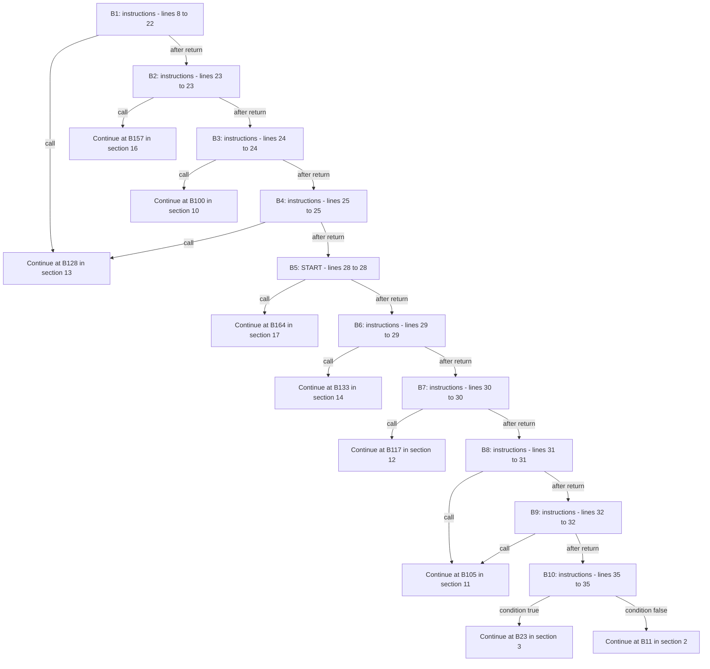

### B1

```asm
MOV 50H,#0
MOV 51H,#4
MOV 52H,#1
MOV 53H,#3
MOV 54H,#1
MOV 55H,#100
MOV 56H,#1
MOV 57H,#1
MOV 58H,#1
ACALL INLCD
```

### B2

```asm
ACALL WELCOMEMSG
```

### B3

```asm
ACALL FLASH
```

### B4

```asm
ACALL INLCD
```

### B5

```asm
ACALL MENUMSG
```

### B6

```asm
ACALL KEYPAD
```

### B7

```asm
ACALL WCHR
```

### B8

```asm
ACALL DELAY
```

### B9

```asm
ACALL DELAY
```

### B10

```asm
CJNE A,#'1', EXIT
```

## Section 2

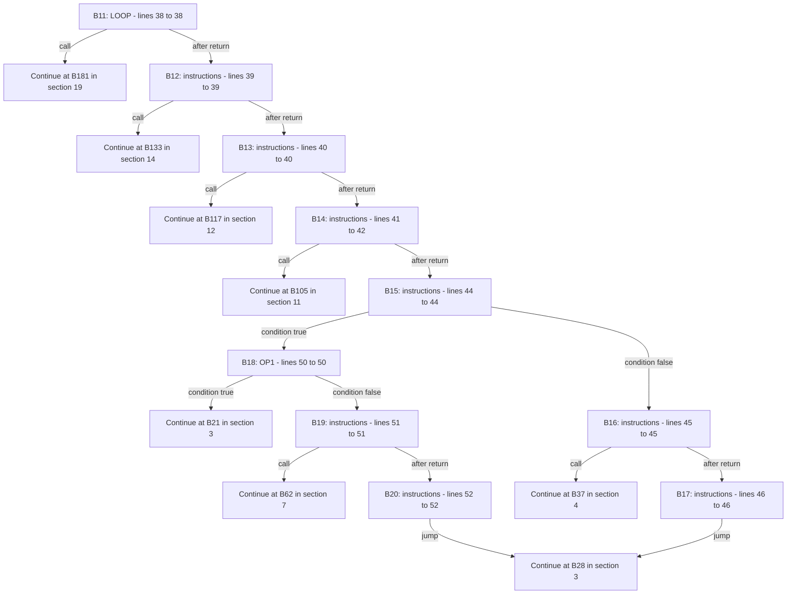

### B11

```asm
ACALL MES1
```

### B12

```asm
ACALL KEYPAD
```

### B13

```asm
ACALL WCHR
```

### B14

```asm
SUBB A,#30H
ACALL DELAY
```

### B15

```asm
CJNE A,#0,op1
```

### B16

```asm
ACALL op2
```

### B17

```asm
SJMP AGAINN
```

### B18

```asm
CJNE A,#1,ERROR
```

### B19

```asm
ACALL POS
```

### B20

```asm
SJMP AGAINN
```

## Section 3

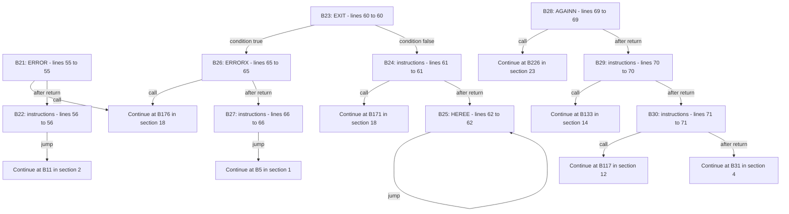

### B21

```asm
ACALL ERROR1MSG
```

### B22

```asm
SJMP loop
```

### B23

```asm
CJNE A,#'2',ERRORx
```

### B24

```asm
ACALL EXITMSG
```

### B25

```asm
SJMP HEREE
```

### B26

```asm
ACALL ERROR1MSG
```

### B27

```asm
SJMP START
```

### B28

```asm
ACALL MES5
```

### B29

```asm
ACALL KEYPAD
```

### B30

```asm
ACALL WCHR
```

## Section 4

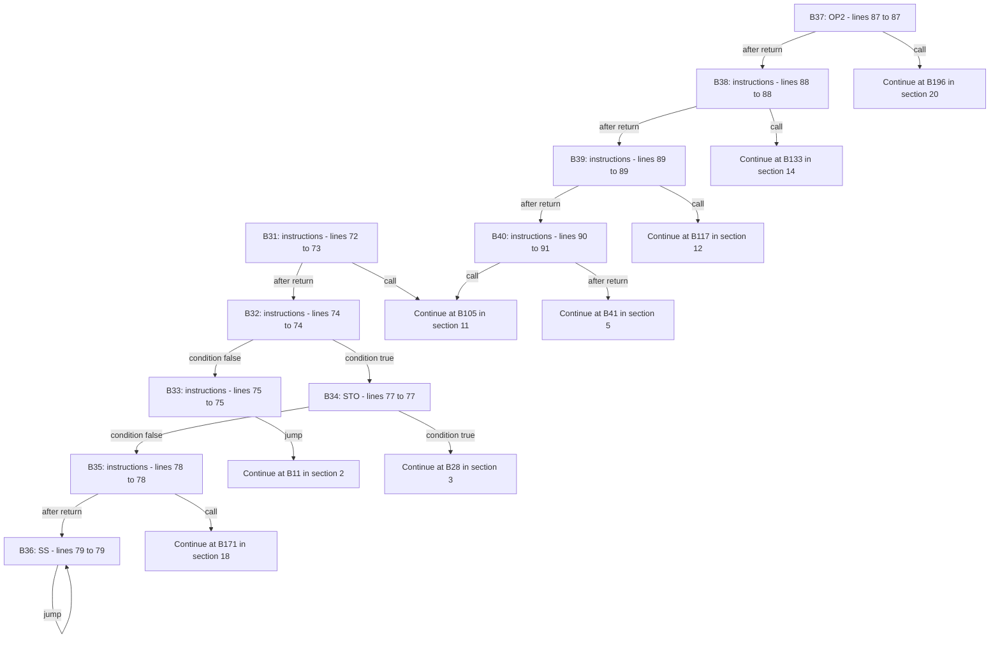

### B31

```asm
SUBB A,#30H
ACALL DELAY
```

### B32

```asm
CJNE A,#1,STO
```

### B33

```asm
SJMP LOOP
```

### B34

```asm
CJNE A,#0,AGAINN
```

### B35

```asm
ACALL EXITMSG
```

### B36

```asm
SJMP SS
```

### B37

```asm
ACALL MES22
```

### B38

```asm
ACALL KEYPAD
```

### B39

```asm
ACALL WCHR
```

### B40

```asm
SUBB A,#30H
ACALL DELAY
```

## Section 5

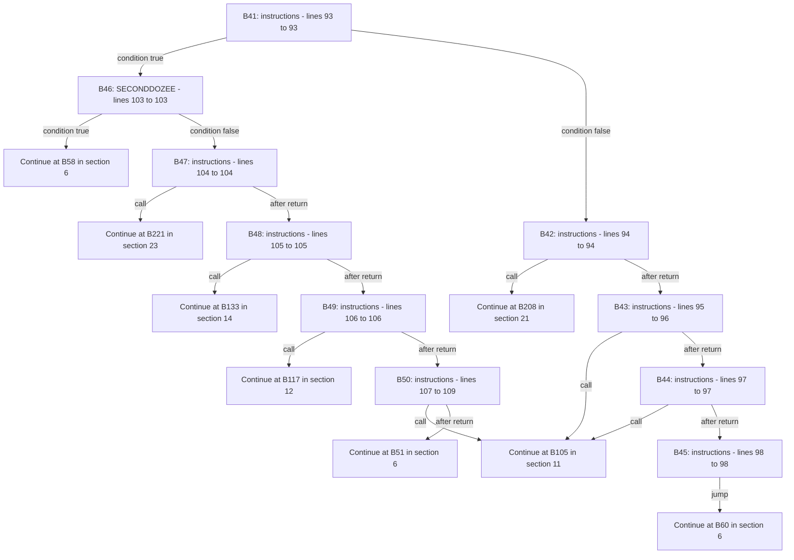

### B41

```asm
CJNE A,#0,SecondDozee
```

### B42

```asm
ACALL MES33
```

### B43

```asm
MOV 54H,#0
ACALL DELAY
```

### B44

```asm
ACALL DELAY
```

### B45

```asm
SJMP BACK3
```

### B46

```asm
CJNE A,#1,ERROR3
```

### B47

```asm
ACALL MES44
```

### B48

```asm
ACALL KEYPAD
```

### B49

```asm
ACALL WCHR
```

### B50

```asm
SUBB A,#30H
MOV 53H,A
ACALL DELAY
```

## Section 6

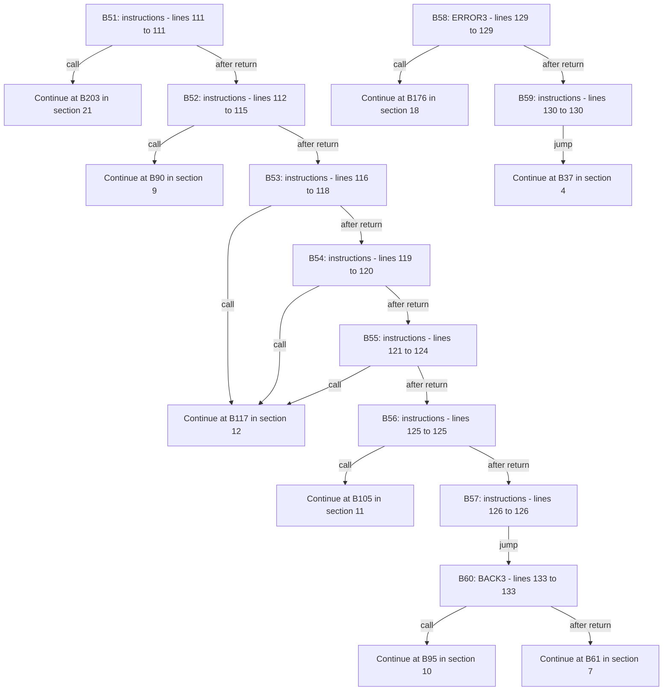

### B51

```asm
ACALL MES3
```

### B52

```asm
MOV R7,53H
MOV A,R7
ADD A,#2
ACALL CHEACK
```

### B53

```asm
MOV 54H,A
ADD A,#30H
ACALL WCHR
```

### B54

```asm
MOV A,#'/'
ACALL WCHR
```

### B55

```asm
MOV 55H,#4
MOV A,55H
ADD A,#30H
ACALL WCHR
```

### B56

```asm
ACALL DELAY
```

### B57

```asm
SJMP BACK3
```

### B58

```asm
ACALL ERROR1MSG
```

### B59

```asm
SJMP OP2
```

### B60

```asm
ACALL CONFIRM
```

## Section 7

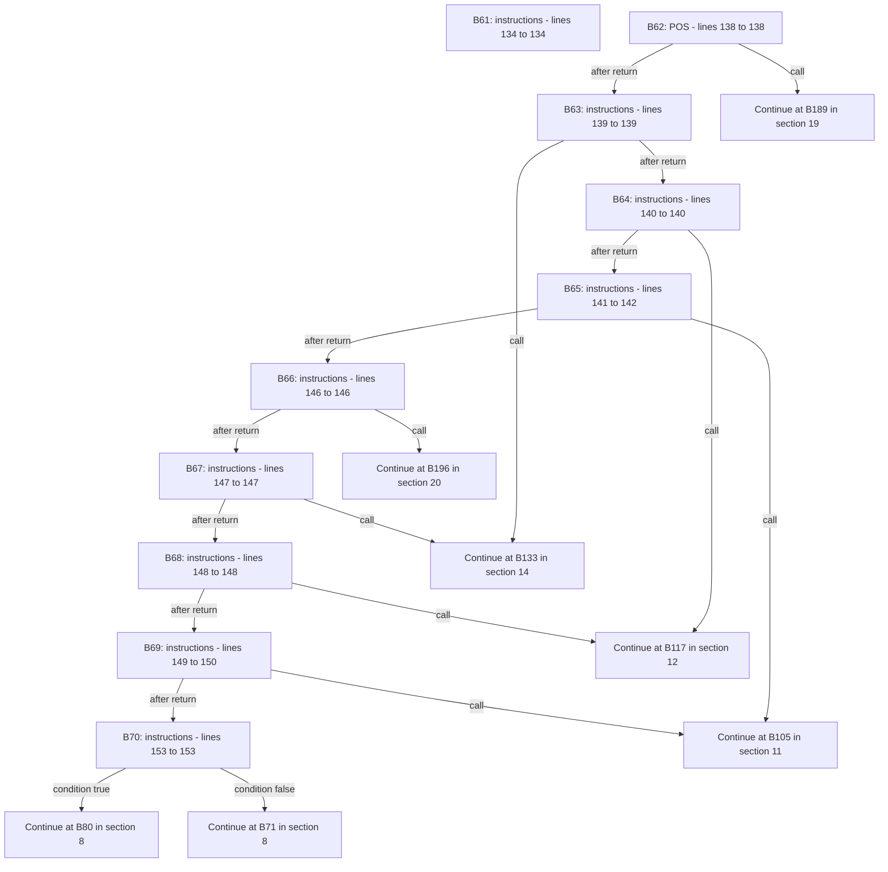

### B61

Return to the instruction following the active call.

```asm
RET
```

### B62

```asm
ACALL MES2
```

### B63

```asm
ACALL KEYPAD
```

### B64

```asm
ACALL WCHR
```

### B65

```asm
SUBB A,#30H
ACALL DELAY
```

### B66

```asm
ACALL MES22
```

### B67

```asm
ACALL KEYPAD
```

### B68

```asm
ACALL WCHR
```

### B69

```asm
SUBB A,#30H
ACALL DELAY
```

### B70

```asm
CJNE A,#0,SecondDoze
```

## Section 8

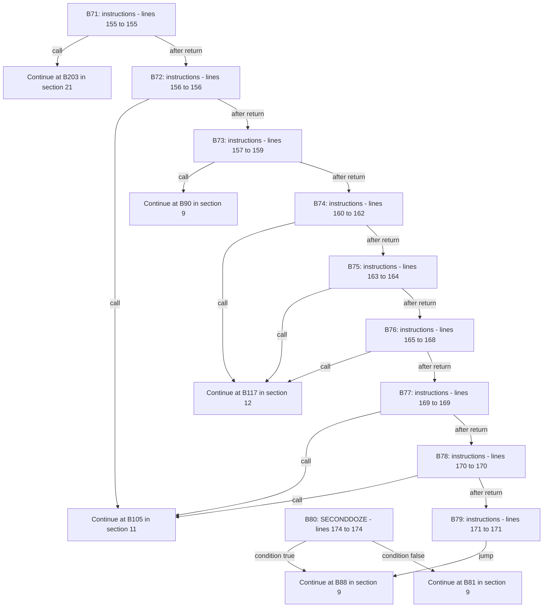

### B71

```asm
ACALL MES3
```

### B72

```asm
ACALL DELAY
```

### B73

```asm
MOV A,R7
ADD A,#3
ACALL CHEACK
```

### B74

```asm
MOV 54H,A
ADD A,#30H
ACALL WCHR
```

### B75

```asm
MOV A,#'/'
ACALL WCHR
```

### B76

```asm
MOV 55H,#1
MOV A,55H
ADD A,#30H
ACALL WCHR
```

### B77

```asm
ACALL DELAY
```

### B78

```asm
ACALL DELAY
```

### B79

```asm
SJMP BACK1
```

### B80

```asm
CJNE A,#1,ERROR1
```

## Section 9

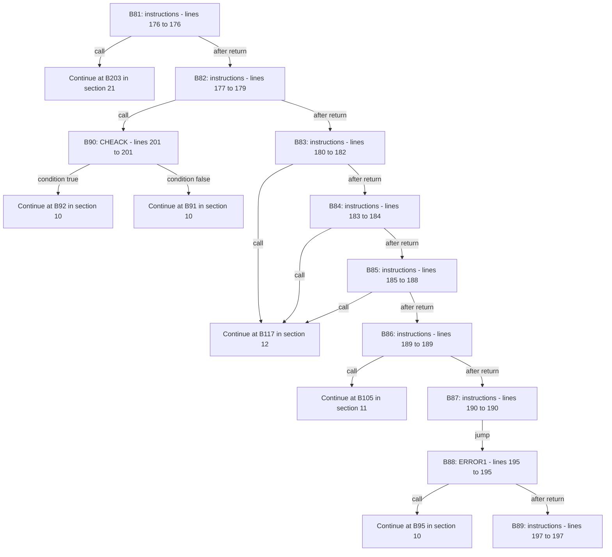

### B81

```asm
ACALL MES3
```

### B82

```asm
MOV A,R7
ADD A,#4
ACALL CHEACK
```

### B83

```asm
MOV 54H,A
ADD A,#30H
ACALL WCHR
```

### B84

```asm
MOV A,#'/'
ACALL WCHR
```

### B85

```asm
MOV 55H,#2
MOV A,55H
ADD A,#30H
ACALL WCHR
```

### B86

```asm
ACALL DELAY
```

### B87

```asm
SJMP BACK1
```

### B88

```asm
ACALL CONFIRM
```

### B89

Return to the instruction following the active call.

```asm
RET
```

### B90

```asm
CJNE A,#12,CONTINUE
```

## Section 10

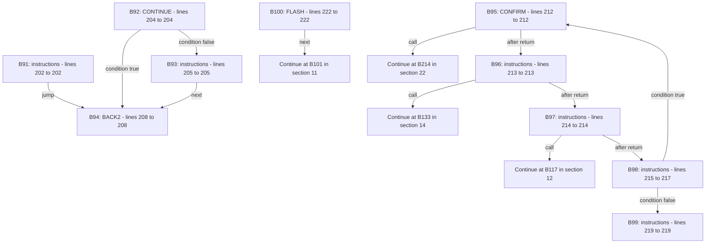

### B91

```asm
SJMP BACK2
```

### B92

```asm
JC BACK2
```

### B93

```asm
SUBB A,#12
```

### B94

Return to the instruction following the active call.

```asm
RET
```

### B95

```asm
ACALL MES4
```

### B96

```asm
ACALL KEYPAD
```

### B97

```asm
ACALL WCHR
```

### B98

```asm
SUBB A,#30H
CJNE A,#1,CONFIRM
```

### B99

Return to the instruction following the active call.

```asm
RET
```

### B100

```asm
MOV R6,#3
```

## Section 11

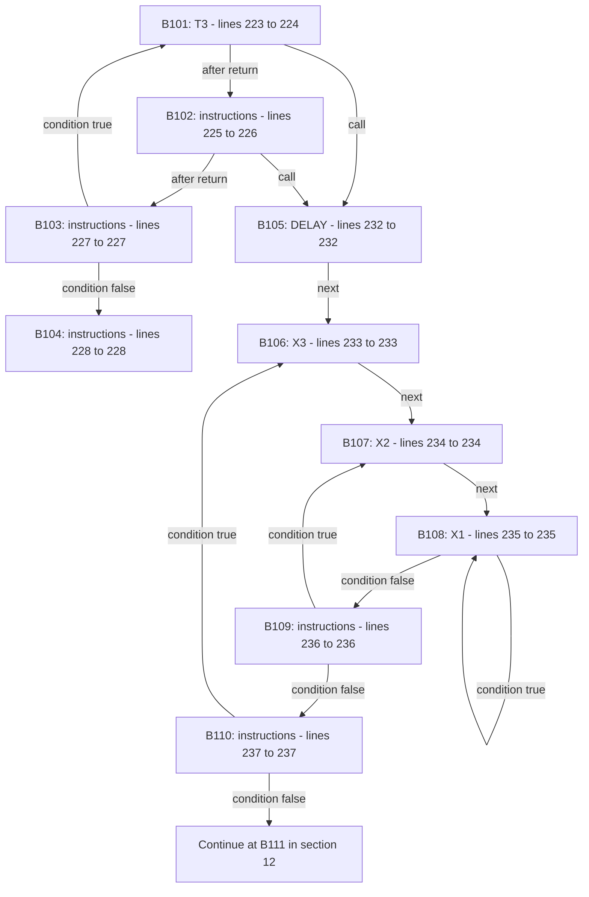

### B101

```asm
MOV P1,#0H
ACALL DELAY
```

### B102

```asm
MOV P1,#0fFH
ACALL DELAY
```

### B103

```asm
DJNZ R6,T3
```

### B104

Return to the instruction following the active call.

```asm
RET
```

### B105

```asm
MOV R5,#2
```

### B106

```asm
MOV R4,#20
```

### B107

```asm
MOV R3,#200
```

### B108

```asm
DJNZ R3,X1
```

### B109

```asm
DJNZ R4,X2
```

### B110

```asm
DJNZ R5,X3
```

## Section 12

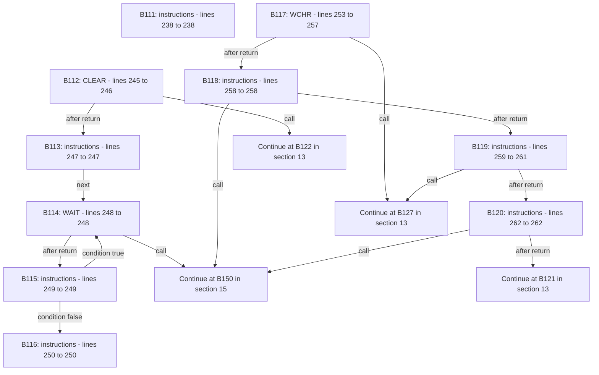

### B111

Return to the instruction following the active call.

```asm
RET
```

### B112

```asm
MOV A,#01H
ACALL CMD
```

### B113

```asm
MOV R5,#14
```

### B114

```asm
ACALL LDELAY
```

### B115

```asm
DJNZ R5,WAIT
```

### B116

Return to the instruction following the active call.

```asm
RET
```

### B117

```asm
PUSH ACC
PUSH B
SETB P1.3
MOV B,A
ACALL COMMON
```

### B118

```asm
ACALL LDELAY
```

### B119

```asm
MOV A,B
SWAP A
ACALL COMMON
```

### B120

```asm
ACALL LDELAY
```

## Section 13

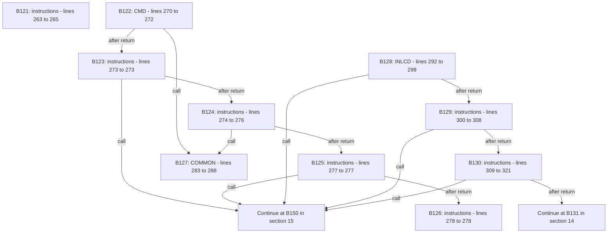

### B121

Return to the instruction following the active call.

```asm
POP B
POP ACC
RET
```

### B122

```asm
CLR P1.3
MOV B,A
ACALL COMMON
```

### B123

```asm
ACALL LDELAY
```

### B124

```asm
MOV A,B
SWAP A
ACALL COMMON
```

### B125

```asm
ACALL LDELAY
```

### B126

Return to the instruction following the active call.

```asm
RET
```

### B127

Return to the instruction following the active call.

```asm
ANL a,#11110000B
ANL P1, #00001111B
ORL P1,A
SETB P1.2
CLR P1.2
RET
```

### B128

```asm
CLR P1.3
CLR P1.7
CLR P1.6
SETB P1.5
CLR P1.4
SETB P1.2
CLR P1.2
ACALL LDELAY
```

### B129

```asm
SETB P1.2
CLR P1.2
SETB P1.7
CLR P1.6
CLR P1.5
CLR P1.4
SETB P1.2
CLR P1.2
ACALL LDELAY
```

### B130

```asm
CLR P1.7
CLR P1.6
CLR P1.5
CLR P1.4
SETB P1.2
CLR P1.2
SETB P1.7
SETB P1.6
SETB P1.5
SETB P1.4
SETB P1.2
CLR P1.2
ACALL LDELAY
```

## Section 14

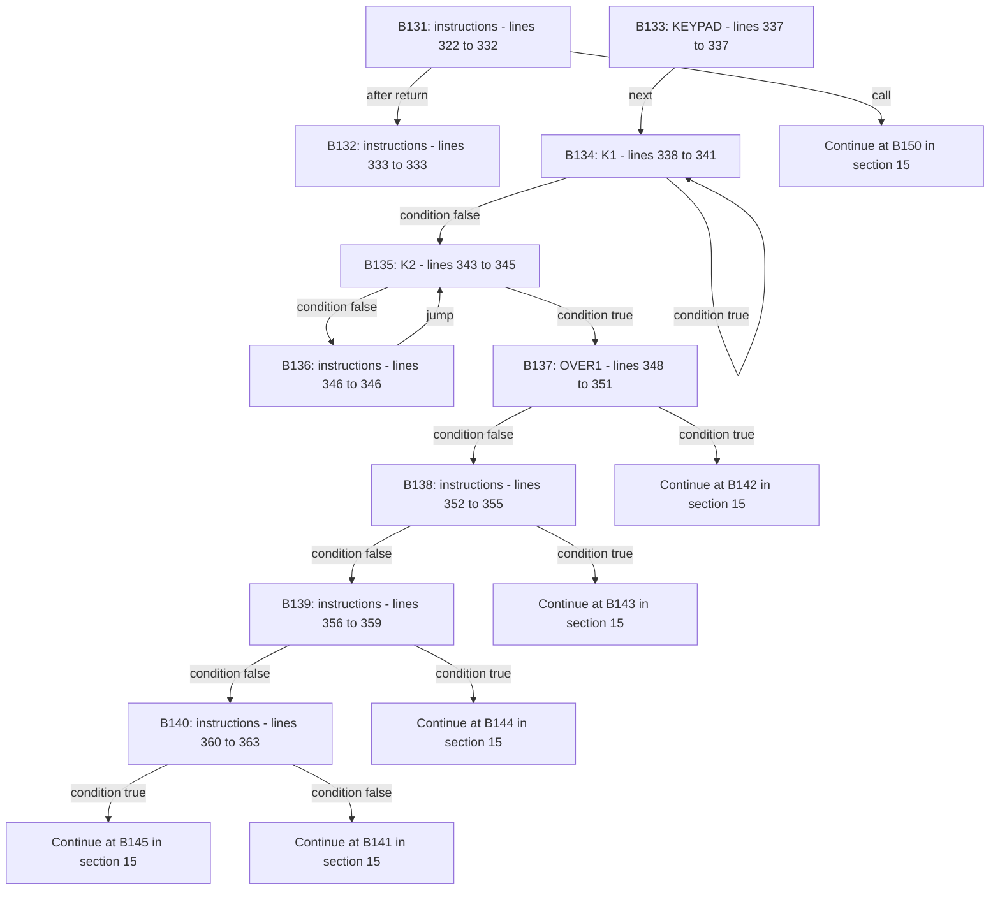

### B131

```asm
CLR P1.7
CLR P1.6
CLR P1.5
CLR P1.4
SETB P1.2
CLR P1.2
SETB P1.6
SETB P1.5
SETB P1.2
CLR P1.2
ACALL LDELAY
```

### B132

Return to the instruction following the active call.

```asm
RET
```

### B133

```asm
MOV P0,#01110000B
```

### B134

```asm
MOV P0,#01110000B
MOV A,P0
ANL A,#01110000B
CJNE A,#01110000B,K1
```

### B135

```asm
MOV A,P0
ANL A,#01110000B
CJNE A,#01110000B,OVER1
```

### B136

```asm
SJMP K2
```

### B137

```asm
MOV P0,#01111110B
MOV A,P0
ANL A,#01110000B
CJNE A,#01110000B,ROW_0
```

### B138

```asm
MOV P0,#01111101B
MOV A,P0
ANL A,#01110000B
CJNE A,#01110000B,ROW_1
```

### B139

```asm
MOV P0,#01111011B
MOV A,P0
ANL A,#01110000B
CJNE A,#01110000B,ROW_2
```

### B140

```asm
MOV P0,#01110111B
MOV A,P0
ANL A,#01110000B
CJNE A,#01110000B,ROW_3
```

## Section 15

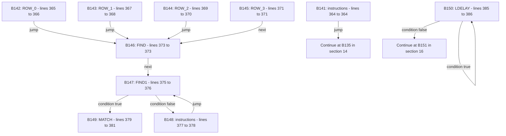

### B141

```asm
LJMP K2
```

### B142

```asm
MOV DPTR,#KCODE0
SJMP FIND
```

### B143

```asm
MOV DPTR,#KCODE1
SJMP FIND
```

### B144

```asm
MOV DPTR,#KCODE2
SJMP FIND
```

### B145

```asm
MOV DPTR,#KCODE3
```

### B146

```asm
RLC A
```

### B147

```asm
RLC A
JNC MATCH
```

### B148

```asm
INC DPTR
SJMP FIND1
```

### B149

Return to the instruction following the active call.

```asm
CLR A
MOVC A,@A+DPTR
RET
```

### B150

```asm
MOV R0, #50
DJNZ R0, $
```

## Section 16

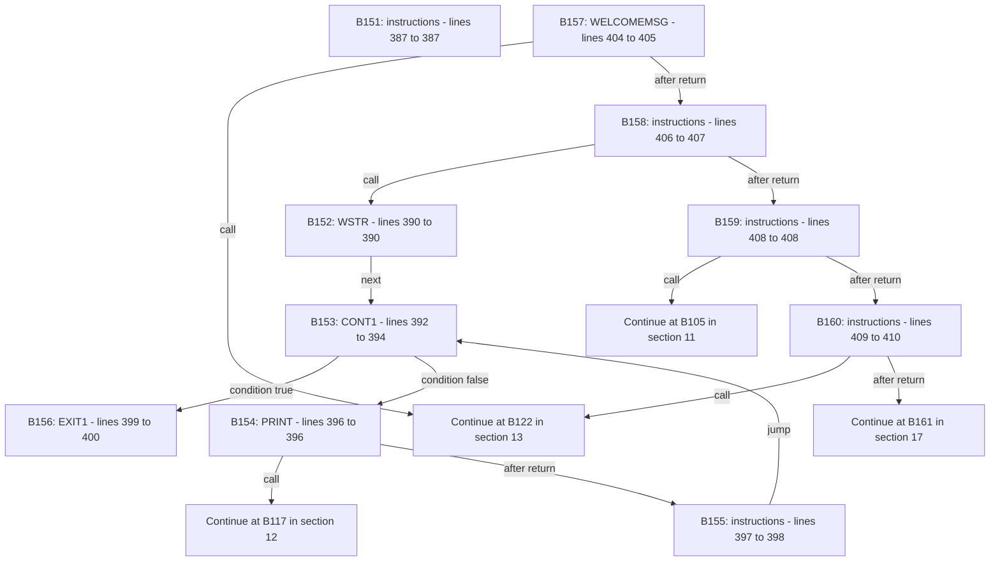

### B151

Return to the instruction following the active call.

```asm
RET
```

### B152

```asm
PUSH ACC
```

### B153

```asm
CLR A
MOVC A,@A+DPTR
JZ Exit1
```

### B154

```asm
ACALL WCHR
```

### B155

```asm
INC DPTR
AJMP CONT1
```

### B156

Return to the instruction following the active call.

```asm
POP ACC
RET
```

### B157

```asm
MOV A,#80H
ACALL CMD
```

### B158

```asm
MOV DPTR,#ro1
ACALL WSTR
```

### B159

```asm
ACALL DELAY
```

### B160

```asm
MOV A,#0c0H
ACALL CMD
```

## Section 17

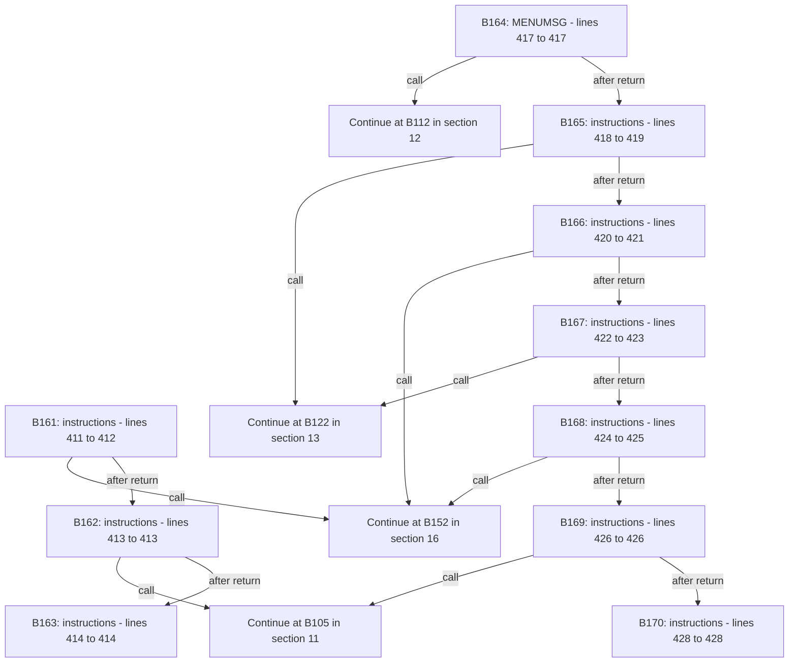

### B161

```asm
MOV DPTR,#ro2
ACALL WSTR
```

### B162

```asm
ACALL DELAY
```

### B163

Return to the instruction following the active call.

```asm
RET
```

### B164

```asm
ACALL CLEAR
```

### B165

```asm
MOV A,#80H
ACALL CMD
```

### B166

```asm
MOV DPTR,#ro3
ACALL WSTR
```

### B167

```asm
MOV A,#0C0H
ACALL CMD
```

### B168

```asm
MOV DPTR,#ro4
ACALL WSTR
```

### B169

```asm
ACALL DELAY
```

### B170

Return to the instruction following the active call.

```asm
RET
```

## Section 18

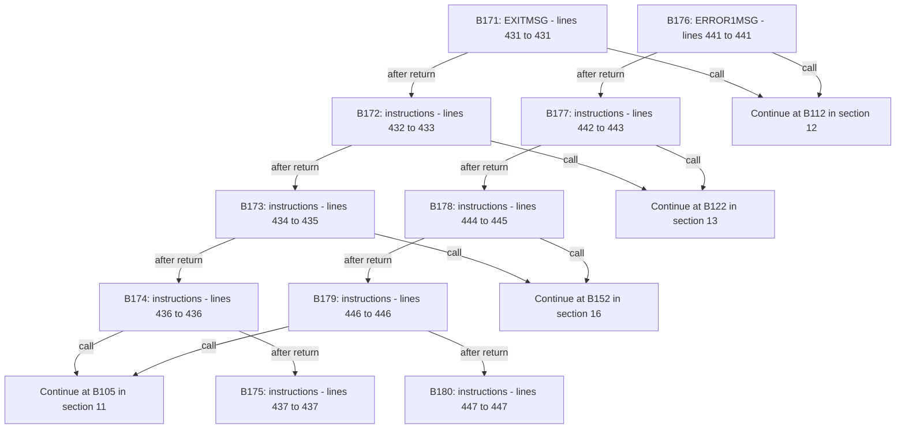

### B171

```asm
ACALL CLEAR
```

### B172

```asm
MOV A,#80H
ACALL CMD
```

### B173

```asm
MOV DPTR,#ro6
acall wstr
```

### B174

```asm
ACALL DELAY
```

### B175

Return to the instruction following the active call.

```asm
RET
```

### B176

```asm
ACALL CLEAR
```

### B177

```asm
MOV A,#80H
ACALL CMD
```

### B178

```asm
MOV DPTR,#ro5
ACALL WSTR
```

### B179

```asm
ACALL DELAY
```

### B180

Return to the instruction following the active call.

```asm
RET
```

## Section 19

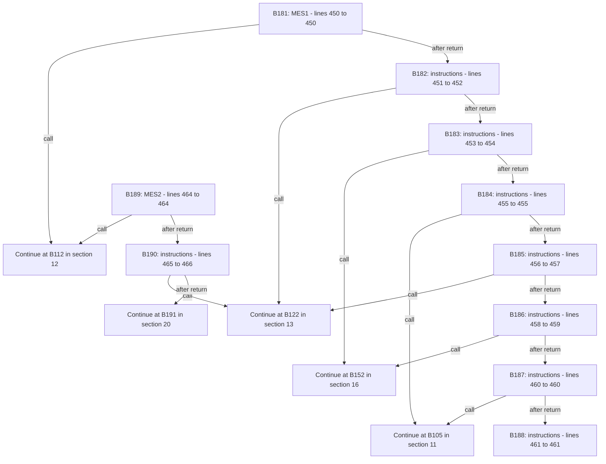

### B181

```asm
ACALL CLEAR
```

### B182

```asm
MOV A,#80H
ACALL CMD
```

### B183

```asm
MOV DPTR,#ro7
ACALL WSTR
```

### B184

```asm
ACALL DELAY
```

### B185

```asm
MOV A,#0C0H
ACALL CMD
```

### B186

```asm
MOV DPTR,#ro11
ACALL WSTR
```

### B187

```asm
ACALL DELAY
```

### B188

Return to the instruction following the active call.

```asm
RET
```

### B189

```asm
ACALL CLEAR
```

### B190

```asm
MOV A,#80H
ACALL CMD
```

## Section 20

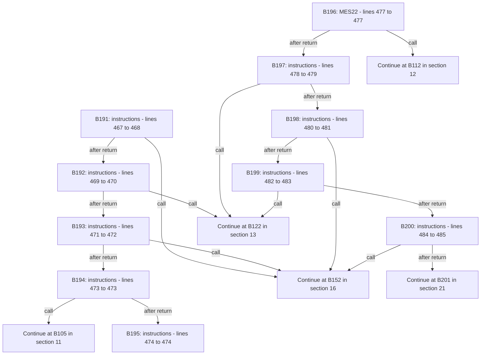

### B191

```asm
MOV DPTR,#ro8
ACALL WSTR
```

### B192

```asm
MOV A,#0C0H
ACALL CMD
```

### B193

```asm
MOV DPTR,#ro9
ACALL WSTR
```

### B194

```asm
ACALL DELAY
```

### B195

Return to the instruction following the active call.

```asm
RET
```

### B196

```asm
ACALL CLEAR
```

### B197

```asm
MOV A,#80H
ACALL CMD
```

### B198

```asm
MOV DPTR,#ro10
ACALL WSTR
```

### B199

```asm
MOV A,#0C0H
ACALL CMD
```

### B200

```asm
MOV DPTR,#ro11
ACALL WSTR
```

## Section 21

```mermaid
flowchart TD
B200["B201: instructions - lines 486 to 486"]
B201["B202: instructions - lines 487 to 487"]
B202["B203: MES3 - lines 492 to 492"]
B203["B204: instructions - lines 493 to 494"]
B204["B205: instructions - lines 495 to 496"]
B205["B206: instructions - lines 497 to 498"]
B206["B207: instructions - lines 500 to 500"]
B207["B208: MES33 - lines 503 to 503"]
B208["B209: instructions - lines 504 to 505"]
B209["B210: instructions - lines 506 to 507"]
B200 -->|call| B104
B200 -->|after return| B201
B202 -->|call| B111
B202 -->|after return| B203
B203 -->|call| B121
B203 -->|after return| B204
B204 -->|call| B151
B204 -->|after return| B205
B205 -->|call| B121
B205 -->|after return| B206
B207 -->|call| B111
B207 -->|after return| B208
B208 -->|call| B121
B208 -->|after return| B209
B209 -->|call| B151
B209 -->|after return| B210
B104["Continue at B105 in section 11"]
B111["Continue at B112 in section 12"]
B121["Continue at B122 in section 13"]
B151["Continue at B152 in section 16"]
B210["Continue at B211 in section 22"]
```

### B201

```asm
ACALL DELAY
```

### B202

Return to the instruction following the active call.

```asm
RET
```

### B203

```asm
ACALL CLEAR
```

### B204

```asm
MOV A,#80H
ACALL CMD
```

### B205

```asm
MOV DPTR,#ro12
ACALL WSTR
```

### B206

```asm
MOV A,#0C0H
ACALL CMD
```

### B207

Return to the instruction following the active call.

```asm
RET
```

### B208

```asm
ACALL CLEAR
```

### B209

```asm
MOV A,#80H
ACALL CMD
```

### B210

```asm
MOV DPTR,#ro12
ACALL WSTR
```

## Section 22

```mermaid
flowchart TD
B210["B211: instructions - lines 508 to 509"]
B211["B212: instructions - lines 510 to 511"]
B212["B213: instructions - lines 512 to 512"]
B213["B214: MES4 - lines 515 to 515"]
B214["B215: instructions - lines 516 to 517"]
B215["B216: instructions - lines 518 to 519"]
B216["B217: instructions - lines 520 to 521"]
B217["B218: instructions - lines 522 to 523"]
B218["B219: instructions - lines 524 to 524"]
B219["B220: instructions - lines 525 to 525"]
B210 -->|call| B121
B210 -->|after return| B211
B211 -->|call| B151
B211 -->|after return| B212
B213 -->|call| B111
B213 -->|after return| B214
B214 -->|call| B121
B214 -->|after return| B215
B215 -->|call| B151
B215 -->|after return| B216
B216 -->|call| B121
B216 -->|after return| B217
B217 -->|call| B151
B217 -->|after return| B218
B218 -->|call| B104
B218 -->|after return| B219
B121["Continue at B122 in section 13"]
B151["Continue at B152 in section 16"]
B111["Continue at B112 in section 12"]
B104["Continue at B105 in section 11"]
```

### B211

```asm
MOV A,#0C0H
ACALL CMD
```

### B212

```asm
MOV DPTR,#ro14
ACALL WSTR
```

### B213

Return to the instruction following the active call.

```asm
RET
```

### B214

```asm
ACALL CLEAR
```

### B215

```asm
MOV A,#80H
ACALL CMD
```

### B216

```asm
MOV DPTR,#ro13
ACALL WSTR
```

### B217

```asm
MOV A,#0C0H
ACALL CMD
```

### B218

```asm
MOV DPTR,#ro11
ACALL WSTR
```

### B219

```asm
ACALL DELAY
```

### B220

Return to the instruction following the active call.

```asm
RET
```

## Section 23

```mermaid
flowchart TD
B220["B221: MES44 - lines 528 to 528"]
B221["B222: instructions - lines 529 to 530"]
B222["B223: instructions - lines 531 to 532"]
B223["B224: instructions - lines 533 to 534"]
B224["B225: instructions - lines 535 to 535"]
B225["B226: MES5 - lines 538 to 538"]
B226["B227: instructions - lines 539 to 540"]
B227["B228: instructions - lines 541 to 542"]
B228["B229: instructions - lines 543 to 544"]
B229["B230: instructions - lines 545 to 546"]
B220 -->|call| B111
B220 -->|after return| B221
B221 -->|call| B121
B221 -->|after return| B222
B222 -->|call| B151
B222 -->|after return| B223
B223 -->|call| B121
B223 -->|after return| B224
B225 -->|call| B111
B225 -->|after return| B226
B226 -->|call| B121
B226 -->|after return| B227
B227 -->|call| B151
B227 -->|after return| B228
B228 -->|call| B121
B228 -->|after return| B229
B229 -->|call| B151
B229 -->|after return| B230
B111["Continue at B112 in section 12"]
B121["Continue at B122 in section 13"]
B151["Continue at B152 in section 16"]
B230["Continue at B231 in section 24"]
```

### B221

```asm
ACALL CLEAR
```

### B222

```asm
MOV A,#80H
ACALL CMD
```

### B223

```asm
MOV DPTR,#ro111
ACALL WSTR
```

### B224

```asm
MOV A,#0C0H
ACALL CMD
```

### B225

Return to the instruction following the active call.

```asm
RET
```

### B226

```asm
ACALL CLEAR
```

### B227

```asm
MOV A,#80H
ACALL CMD
```

### B228

```asm
MOV DPTR,#ro15
ACALL WSTR
```

### B229

```asm
MOV A,#0C0H
ACALL CMD
```

### B230

```asm
MOV DPTR,#ro11
ACALL WSTR
```

## Section 24

```mermaid
flowchart TD
B230["B231: instructions - lines 547 to 547"]
B231["B232: instructions - lines 548 to 548"]
B230 -->|call| B104
B230 -->|after return| B231
B104["Continue at B105 in section 11"]
```

### B231

```asm
ACALL DELAY
```

### B232

Return to the instruction following the active call.

```asm
RET
```
