# Program Control Flow

[Back to project](README.md)

Control-flow blocks are indexed by source line. Calls resume at the instruction following the call if the subroutine returns normally.

## Entry locations

- `ORG 00H` begins at B1.

## Navigation

[Section 1](#section-1) · [Section 2](#section-2) · [Section 3](#section-3) · [Section 4](#section-4) · [Section 5](#section-5) · [Section 6](#section-6) · [Section 7](#section-7) · [Section 8](#section-8) · [Section 9](#section-9) · [Section 10](#section-10) · [Section 11](#section-11) · [Section 12](#section-12) · [Section 13](#section-13) · [Section 14](#section-14) · [Section 15](#section-15) · [Section 16](#section-16) · [Section 17](#section-17) · [Section 18](#section-18) · [Section 19](#section-19) · [Section 20](#section-20) · [Section 21](#section-21) · [Section 22](#section-22)

## Section 1

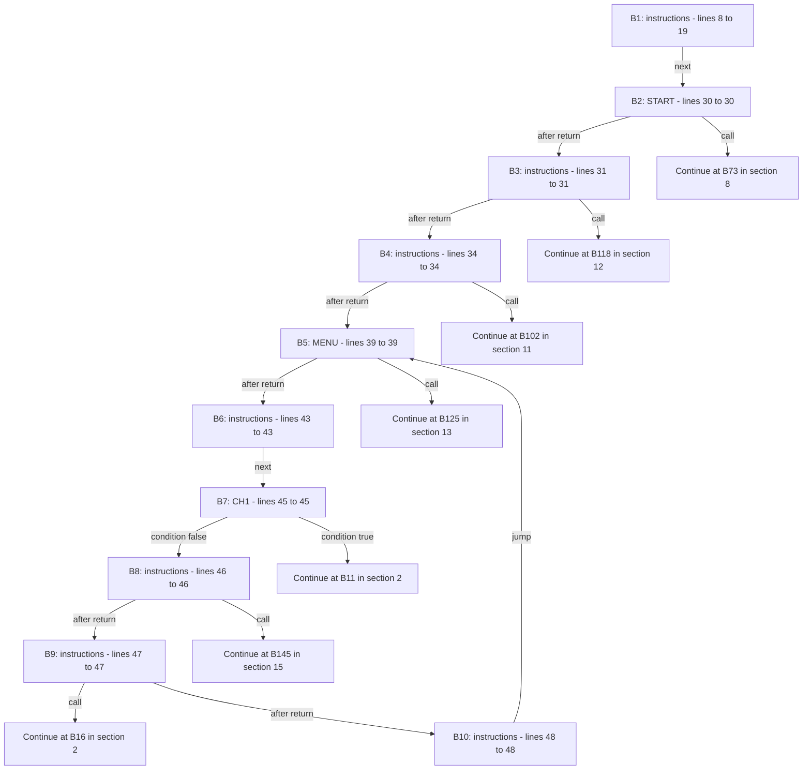

### B1

```asm
mov 68,#0
mov 67,#0
mov 66,#1
MOV 50H,#1
MOV 51H,#4
MOV 54H,#1
```

### B2

```asm
acall INLCD
```

### B3

```asm
ACALL WELCOMEMSG
```

### B4

```asm
acall flash
```

### B5

```asm
acall MENUMSG
```

### B6

```asm
mov a,54h
```

### B7

```asm
CJNE A,#1,CH2
```

### B8

```asm
acall vaccreg
```

### B9

```asm
ACALL loop
```

### B10

```asm
sjmp menu
```

## Section 2

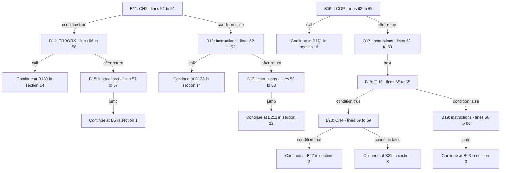

### B11

```asm
CJNE A,#2,ERRORx
```

### B12

```asm
ACALL EXITMSG
```

### B13

```asm
aJMP stop
```

### B14

```asm
ACALL ERROR1MSG
```

### B15

```asm
SJMP MENU
```

### B16

```asm
acall mes1
```

### B17

```asm
mov a,50h
```

### B18

```asm
CJNE A,#1,CH4
```

### B19

```asm
sjmp op1
```

### B20

```asm
cjne a,#0h,error
```

## Section 3

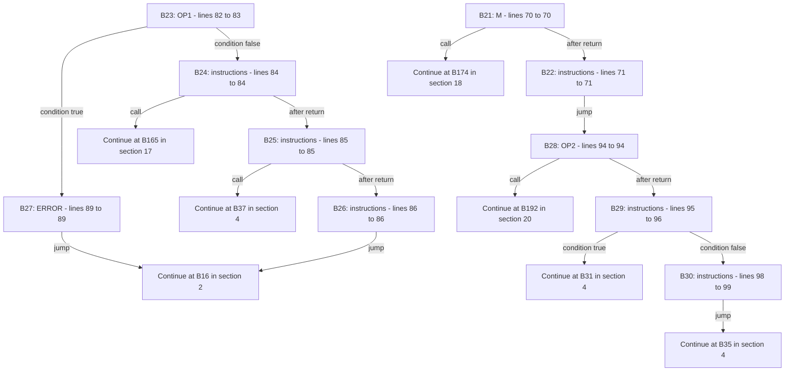

### B21

```asm
acall no
```

### B22

```asm
sjmp op2
```

### B23

```asm
mov a,66
CJNE A,#1,ERROR
```

### B24

```asm
acall yes
```

### B25

```asm
ACALL POS
```

### B26

```asm
SJMP loop
```

### B27

```asm
SJMP loop
```

### B28

```asm
acall fdoze
```

### B29

```asm
MOV A,52H
CJNE A,#0,SecondDozee
```

### B30

```asm
MOV 60H,#0
SJMP BACK3
```

## Section 4

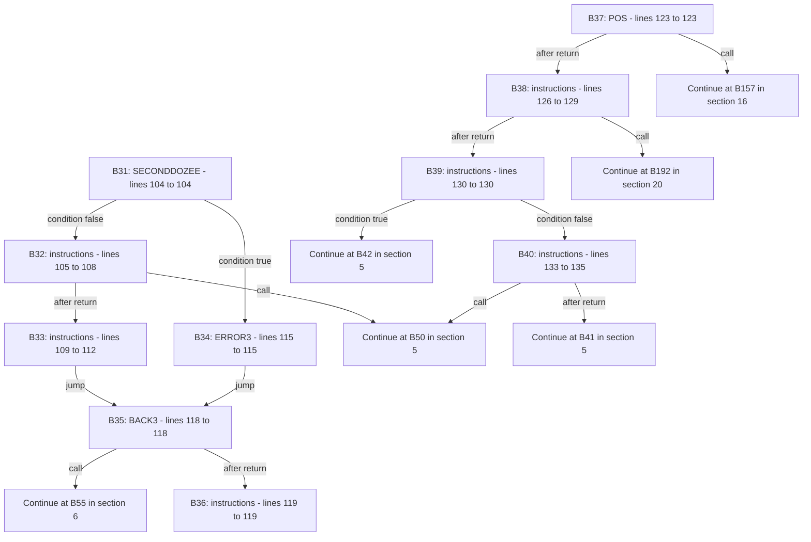

### B31

```asm
CJNE A,#1,ERROR3
```

### B32

```asm
MOV R7,53H
MOV A,R7
ADD A,#2
ACALL CHEACK
```

### B33

```asm
MOV 60H,A
MOV 61H,#4
SJMP BACK3
```

### B34

```asm
SJMP BACK3
```

### B35

```asm
ACALL CONFIRM
```

### B36

Return to the instruction following the active call.

```asm
RET
```

### B37

```asm
acall  mes4
```

### B38

```asm
MOV R7,51H
MOV A,67h
acall fdoze
```

### B39

```asm
CJNE A,#0,SecondDoze
```

### B40

```asm
MOV A,R7
ADD A,#3
ACALL CHEACK
```

## Section 5

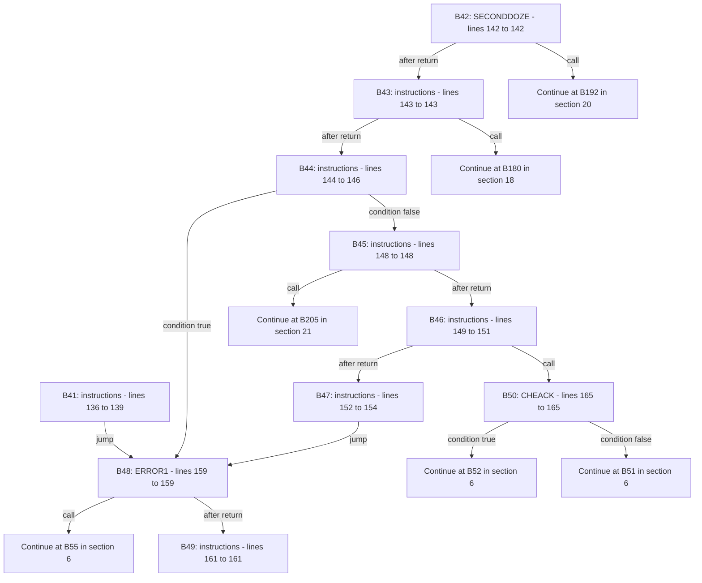

### B41

```asm
MOV 60H,A
MOV 61H,#1
SJMP BACK1
```

### B42

```asm
acall fdoze
```

### B43

```asm
acall yes1
```

### B44

```asm
mov a,68h
CJNE A,#1,ERROR1
```

### B45

```asm
acall sedoze
```

### B46

```asm
MOV A,R7
ADD A,#4
ACALL CHEACK
```

### B47

```asm
MOV 60H,A
MOV 61H,#2
SJMP BACK1
```

### B48

```asm
ACALL CONFIRM
```

### B49

Return to the instruction following the active call.

```asm
RET
```

### B50

```asm
CJNE A,#12,CONTINUE
```

## Section 6

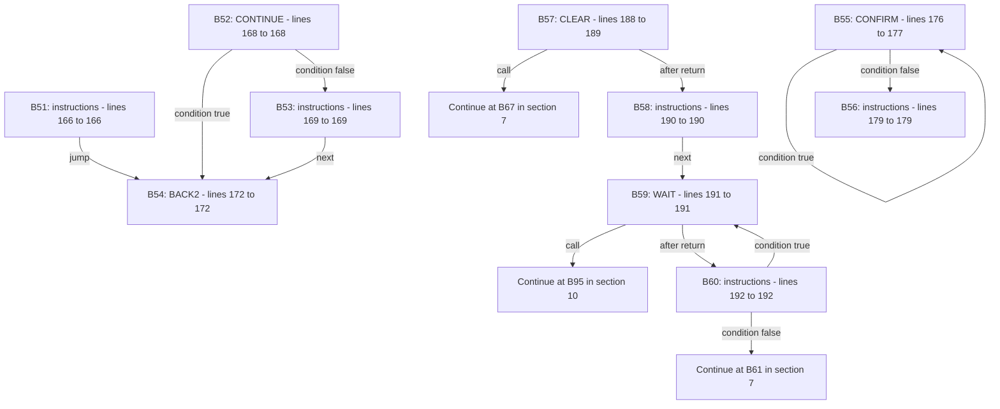

### B51

```asm
SJMP BACK2
```

### B52

```asm
JC BACK2
```

### B53

```asm
SUBB A,#12
```

### B54

Return to the instruction following the active call.

```asm
RET
```

### B55

```asm
MOV A,62H
CJNE A,#1,CONFIRM
```

### B56

Return to the instruction following the active call.

```asm
RET
```

### B57

```asm
MOV A,#01H
ACALL CMD
```

### B58

```asm
MOV R5,#14
```

### B59

```asm
ACALL LDELAY
```

### B60

```asm
DJNZ R5,WAIT
```

## Section 7

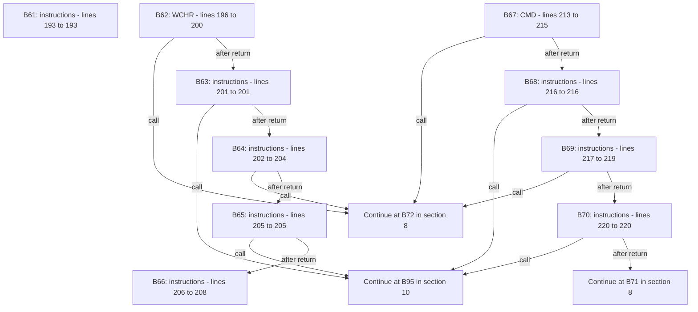

### B61

Return to the instruction following the active call.

```asm
RET
```

### B62

```asm
PUSH ACC
PUSH B
SETB P1.3
MOV B,A
ACALL COMMON
```

### B63

```asm
ACALL LDELAY
```

### B64

```asm
MOV A,B
SWAP A
ACALL COMMON
```

### B65

```asm
ACALL LDELAY
```

### B66

Return to the instruction following the active call.

```asm
POP B
POP ACC
RET
```

### B67

```asm
CLR P1.3
MOV B,A
ACALL COMMON
```

### B68

```asm
ACALL LDELAY
```

### B69

```asm
MOV A,B
SWAP A
ACALL COMMON
```

### B70

```asm
ACALL LDELAY
```

## Section 8

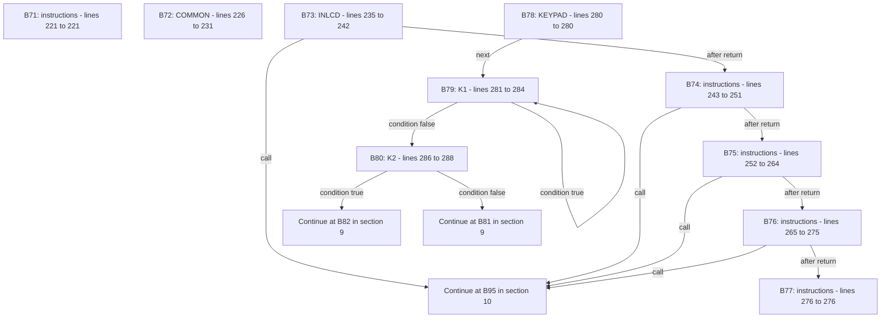

### B71

Return to the instruction following the active call.

```asm
RET
```

### B72

Return to the instruction following the active call.

```asm
ANL a,#11110000B
ANL P1, #00001111B
ORL P1,A
SETB P1.2
CLR P1.2
RET
```

### B73

```asm
CLR P1.3
CLR P1.7
CLR P1.6
SETB P1.5
CLR P1.4
SETB P1.2
CLR P1.2
ACALL LDELAY
```

### B74

```asm
SETB P1.2
CLR P1.2
SETB P1.7
CLR P1.6
CLR P1.5
CLR P1.4
SETB P1.2
CLR P1.2
ACALL LDELAY
```

### B75

```asm
CLR P1.7
CLR P1.6
CLR P1.5
CLR P1.4
SETB P1.2
CLR P1.2
SETB P1.7
SETB P1.6
SETB P1.5
SETB P1.4
SETB P1.2
CLR P1.2
ACALL LDELAY
```

### B76

```asm
CLR P1.7
CLR P1.6
CLR P1.5
CLR P1.4
SETB P1.2
CLR P1.2
SETB P1.6
SETB P1.5
SETB P1.2
CLR P1.2
ACALL LDELAY
```

### B77

Return to the instruction following the active call.

```asm
RET
```

### B78

```asm
MOV P0,#01110000B
```

### B79

```asm
MOV P0,#01110000B
MOV A,P0
ANL A,#01110000B
CJNE A,#01110000B,K1
```

### B80

```asm
MOV A,P0
ANL A,#01110000B
CJNE A,#01110000B,OVER1
```

## Section 9

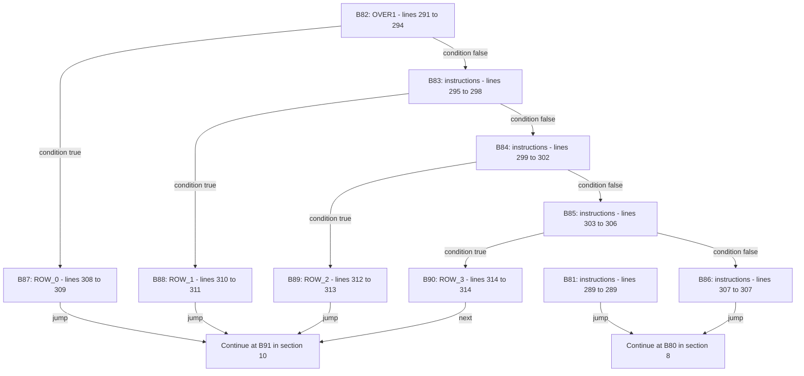

### B81

```asm
SJMP K2
```

### B82

```asm
MOV P0,#01111110B
MOV A,P0
ANL A,#01110000B
CJNE A,#01110000B,ROW_0
```

### B83

```asm
MOV P0,#01111101B
MOV A,P0
ANL A,#01110000B
CJNE A,#01110000B,ROW_1
```

### B84

```asm
MOV P0,#01111011B
MOV A,P0
ANL A,#01110000B
CJNE A,#01110000B,ROW_2
```

### B85

```asm
MOV P0,#01110111B
MOV A,P0
ANL A,#01110000B
CJNE A,#01110000B,ROW_3
```

### B86

```asm
LJMP K2
```

### B87

```asm
MOV DPTR,#KCODE0
SJMP FIND
```

### B88

```asm
MOV DPTR,#KCODE1
SJMP FIND
```

### B89

```asm
MOV DPTR,#KCODE2
SJMP FIND
```

### B90

```asm
MOV DPTR,#KCODE3
```

## Section 10

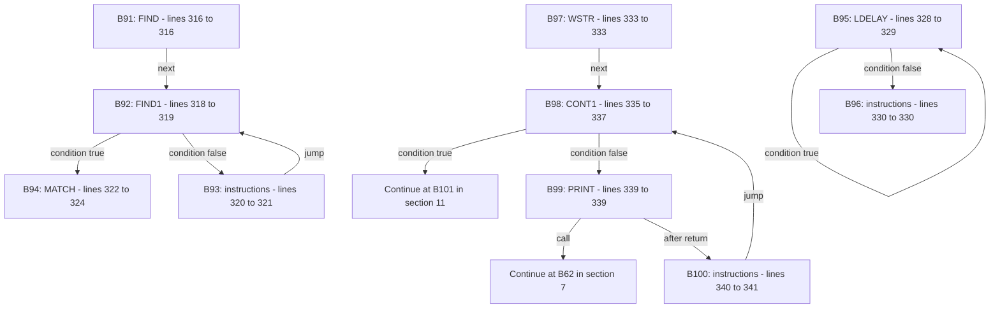

### B91

```asm
RLC A
```

### B92

```asm
RLC A
JNC MATCH
```

### B93

```asm
INC DPTR
SJMP FIND1
```

### B94

Return to the instruction following the active call.

```asm
CLR A
MOVC A,@A+DPTR
RET
```

### B95

```asm
MOV R0, #50
DJNZ R0, $
```

### B96

Return to the instruction following the active call.

```asm
RET
```

### B97

```asm
PUSH ACC
```

### B98

```asm
CLR A
MOVC A,@A+DPTR
JZ Exit1
```

### B99

```asm
ACALL WCHR
```

### B100

```asm
INC DPTR
AJMP CONT1
```

## Section 11

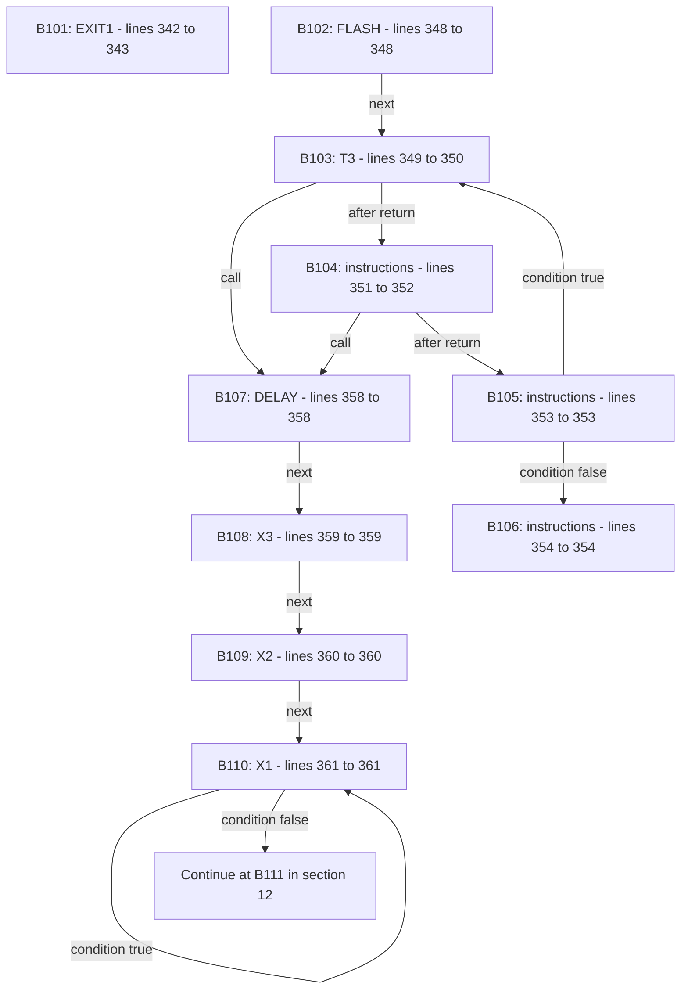

### B101

Return to the instruction following the active call.

```asm
POP ACC
RET
```

### B102

```asm
MOV R6,#3
```

### B103

```asm
MOV P1,#0H
ACALL DELAY
```

### B104

```asm
MOV P1,#0fFH
ACALL DELAY
```

### B105

```asm
DJNZ R6,T3
```

### B106

Return to the instruction following the active call.

```asm
RET
```

### B107

```asm
MOV R5,#2
```

### B108

```asm
MOV R4,#20
```

### B109

```asm
MOV R3,#200
```

### B110

```asm
DJNZ R3,X1
```

## Section 12

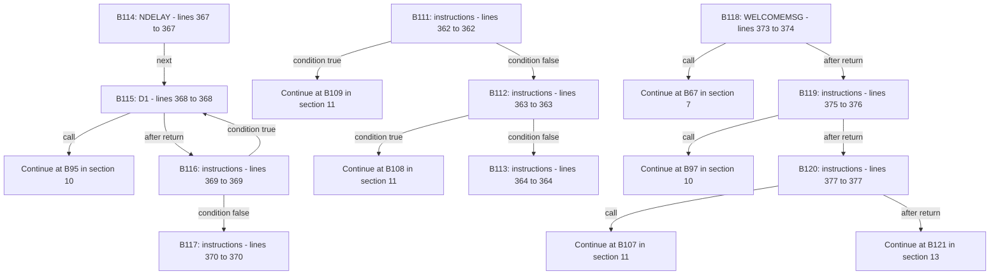

### B111

```asm
DJNZ R4,X2
```

### B112

```asm
DJNZ R5,X3
```

### B113

Return to the instruction following the active call.

```asm
RET
```

### B114

```asm
MOV R5,#250
```

### B115

```asm
ACALL LDELAY
```

### B116

```asm
DJNZ R5,d1
```

### B117

Return to the instruction following the active call.

```asm
ret
```

### B118

```asm
MOV A,#80H
ACALL CMD
```

### B119

```asm
MOV DPTR,#ro1
ACALL WSTR
```

### B120

```asm
ACALL DELAY
```

## Section 13

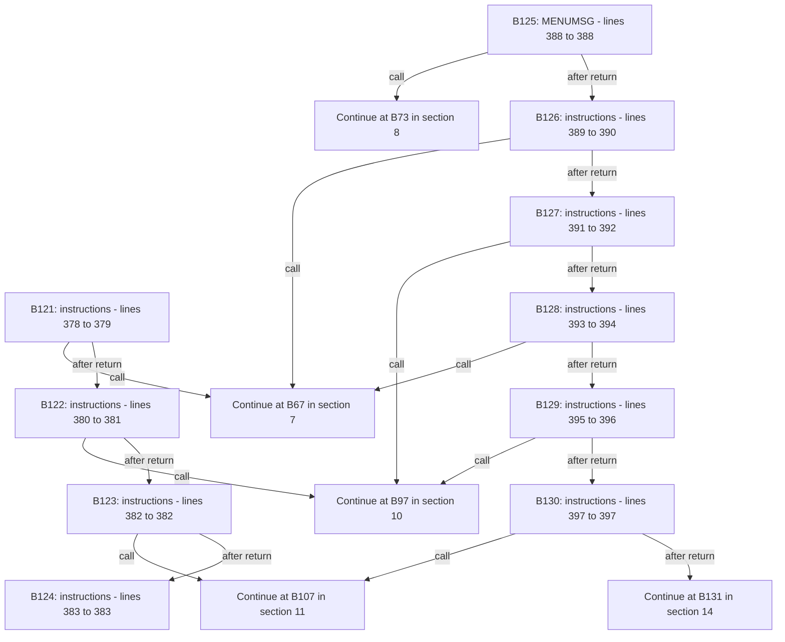

### B121

```asm
MOV A,#0c0H
ACALL CMD
```

### B122

```asm
MOV DPTR,#ro2
ACALL WSTR
```

### B123

```asm
ACALL DELAY
```

### B124

Return to the instruction following the active call.

```asm
RET
```

### B125

```asm
ACALL INLCD
```

### B126

```asm
MOV A,#80H
ACALL CMD
```

### B127

```asm
MOV DPTR,#ro3
ACALL WSTR
```

### B128

```asm
MOV A,#0C0H
ACALL CMD
```

### B129

```asm
MOV DPTR,#ro4
ACALL WSTR
```

### B130

```asm
ACALL DELAY
```

## Section 14

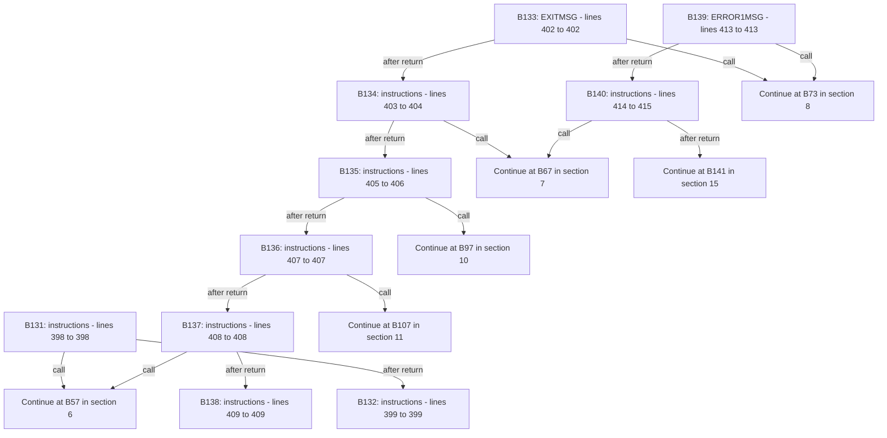

### B131

```asm
ACALL clear
```

### B132

Return to the instruction following the active call.

```asm
RET
```

### B133

```asm
ACALL INLCD
```

### B134

```asm
MOV A,#80H
ACALL CMD
```

### B135

```asm
MOV DPTR,#ro6
acall wstr
```

### B136

```asm
ACALL DELAY
```

### B137

```asm
ACALL clear
```

### B138

Return to the instruction following the active call.

```asm
RET
```

### B139

```asm
ACALL INLCD
```

### B140

```asm
MOV A,#80H
ACALL CMD
```

## Section 15

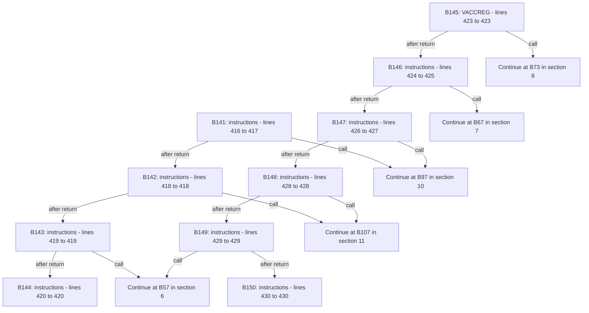

### B141

```asm
MOV DPTR,#ro5
ACALL WSTR
```

### B142

```asm
ACALL DELAY
```

### B143

```asm
ACALL clear
```

### B144

Return to the instruction following the active call.

```asm
RET
```

### B145

```asm
ACALL INLCD
```

### B146

```asm
MOV A,#80H
ACALL CMD
```

### B147

```asm
MOV DPTR,#ro7
acall wstr
```

### B148

```asm
ACALL DELAY
```

### B149

```asm
ACALL clear
```

### B150

Return to the instruction following the active call.

```asm
RET
```

## Section 16

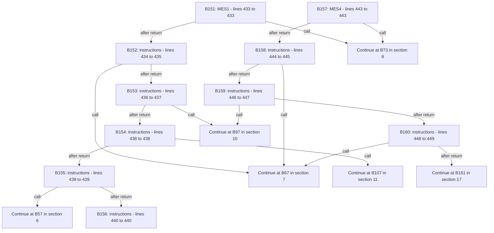

### B151

```asm
ACALL INLCD
```

### B152

```asm
MOV A,#80H
ACALL CMD
```

### B153

```asm
MOV DPTR,#ro8
ACALL WSTR
```

### B154

```asm
ACALL DELAY
```

### B155

```asm
acall clear
```

### B156

Return to the instruction following the active call.

```asm
RET
```

### B157

```asm
ACALL INLCD
```

### B158

```asm
MOV A,#80H
ACALL CMD
```

### B159

```asm
MOV DPTR,#ro14
ACALL WSTR
```

### B160

```asm
MOV A,#0C0H
ACALL CMD
```

## Section 17

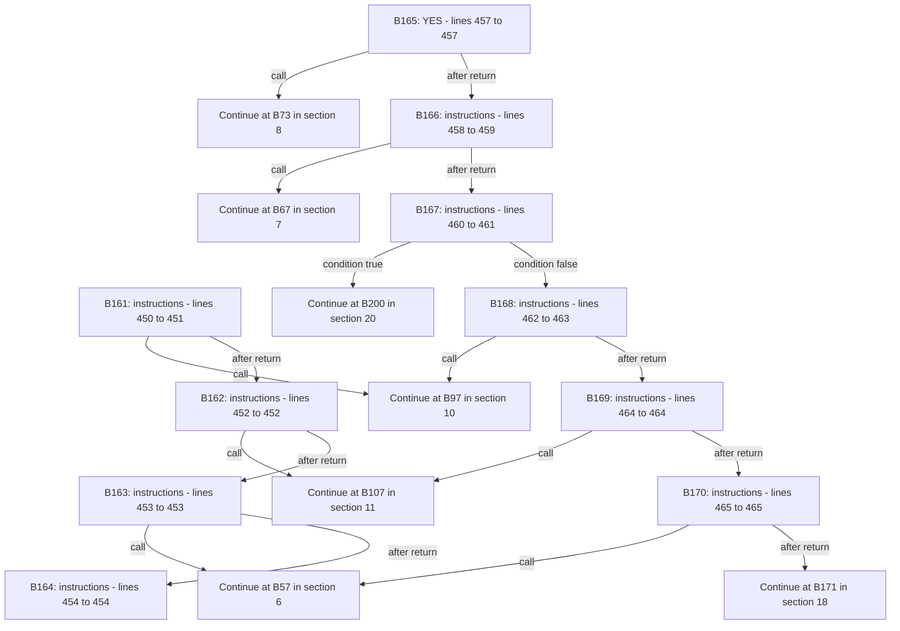

### B161

```asm
MOV DPTR,#ro15
ACALL WSTR
```

### B162

```asm
ACALL DELAY
```

### B163

```asm
ACALL clear
```

### B164

Return to the instruction following the active call.

```asm
RET
```

### B165

```asm
ACALL INLCD
```

### B166

```asm
MOV A,#80H
ACALL CMD
```

### B167

```asm
mov a,66
cjne a,#01,next
```

### B168

```asm
MOV DPTR,#ro9
ACALL WSTR
```

### B169

```asm
ACALL DELAY
```

### B170

```asm
acall clear
```

## Section 18

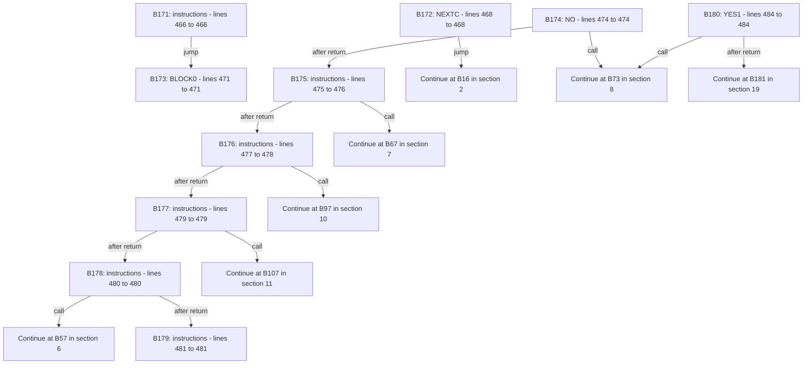

### B171

```asm
sjmp block0
```

### B172

```asm
Ljmp loop
```

### B173

Return to the instruction following the active call.

```asm
RET
```

### B174

```asm
ACALL INLCD
```

### B175

```asm
MOV A,#80H
ACALL CMD
```

### B176

```asm
MOV DPTR,#ro10
ACALL WSTR
```

### B177

```asm
ACALL DELAY
```

### B178

```asm
ACALL clear
```

### B179

Return to the instruction following the active call.

```asm
RET
```

### B180

```asm
ACALL INLCD
```

## Section 19

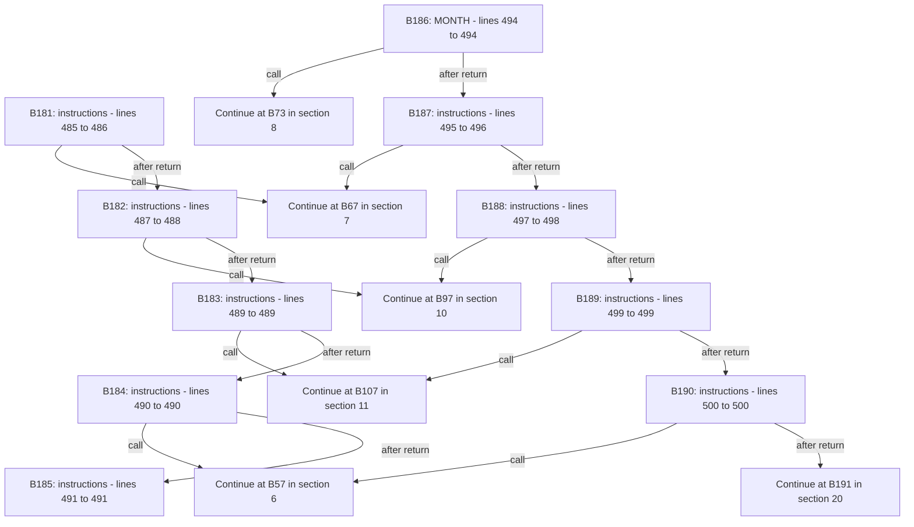

### B181

```asm
MOV A,#80H
ACALL CMD
```

### B182

```asm
MOV DPTR,#ro17
ACALL WSTR
```

### B183

```asm
ACALL DELAY
```

### B184

```asm
ACALL clear
```

### B185

Return to the instruction following the active call.

```asm
RET
```

### B186

```asm
ACALL INLCD
```

### B187

```asm
MOV A,#80H
ACALL CMD
```

### B188

```asm
MOV DPTR,#ro10
ACALL WSTR
```

### B189

```asm
ACALL DELAY
```

### B190

```asm
ACALL clear
```

## Section 20

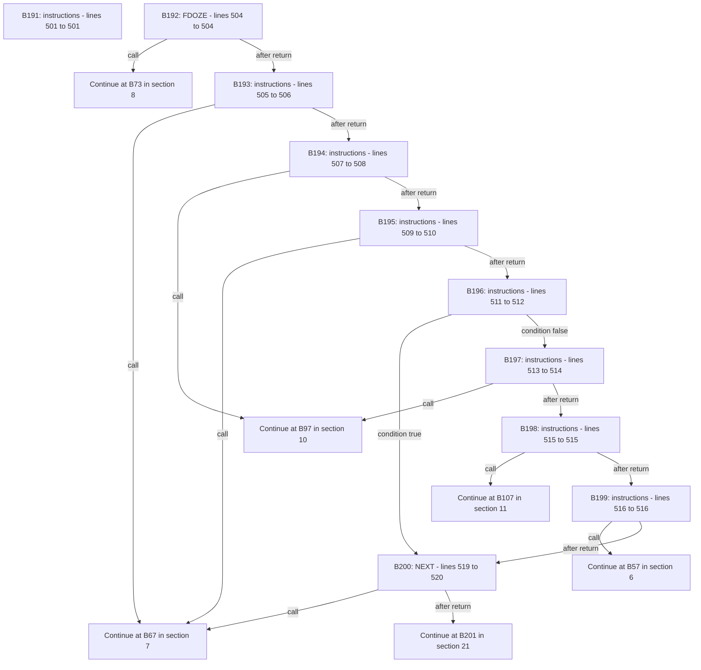

### B191

Return to the instruction following the active call.

```asm
RET
```

### B192

```asm
ACALL INLCD
```

### B193

```asm
MOV A,#80H
ACALL CMD
```

### B194

```asm
MOV DPTR,#ro16
ACALL WSTR
```

### B195

```asm
MOV A,#0C0H
ACALL CMD
```

### B196

```asm
mov a,67
cjne a,#01,next
```

### B197

```asm
MOV DPTR,#ro17
ACALL WSTR
```

### B198

```asm
ACALL DELAY
```

### B199

```asm
acall clear
```

### B200

```asm
MOV A,#0C0H
ACALL CMD
```

## Section 21

```mermaid
flowchart TD
B200["B201: instructions - lines 521 to 522"]
B201["B202: instructions - lines 523 to 523"]
B202["B203: instructions - lines 524 to 524"]
B203["B204: instructions - lines 525 to 525"]
B204["B205: SEDOZE - lines 528 to 528"]
B205["B206: instructions - lines 529 to 530"]
B206["B207: instructions - lines 531 to 532"]
B207["B208: instructions - lines 533 to 533"]
B208["B209: instructions - lines 534 to 534"]
B209["B210: instructions - lines 535 to 535"]
B200 -->|call| B96
B200 -->|after return| B201
B201 -->|call| B106
B201 -->|after return| B202
B202 -->|call| B56
B202 -->|after return| B203
B204 -->|call| B72
B204 -->|after return| B205
B205 -->|call| B66
B205 -->|after return| B206
B206 -->|call| B96
B206 -->|after return| B207
B207 -->|call| B106
B207 -->|after return| B208
B208 -->|call| B56
B208 -->|after return| B209
B96["Continue at B97 in section 10"]
B106["Continue at B107 in section 11"]
B56["Continue at B57 in section 6"]
B72["Continue at B73 in section 8"]
B66["Continue at B67 in section 7"]
```

### B201

```asm
MOV DPTR,#ro10
ACALL WSTR
```

### B202

```asm
ACALL DELAY
```

### B203

```asm
acall clear
```

### B204

Return to the instruction following the active call.

```asm
RET
```

### B205

```asm
ACALL INLCD
```

### B206

```asm
MOV A,#80H
ACALL CMD
```

### B207

```asm
MOV DPTR,#ro18
ACALL WSTR
```

### B208

```asm
ACALL DELAY
```

### B209

```asm
acall clear
```

### B210

Return to the instruction following the active call.

```asm
RET
```

## Section 22

```mermaid
flowchart TD
B210["B211: STOP - lines 600 to 600"]
B210 -->|jump| B210
```

### B211

```asm
sjmp stop
```
