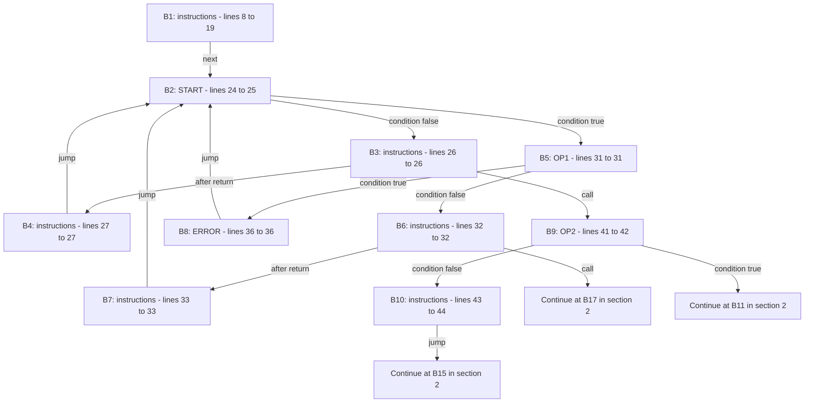
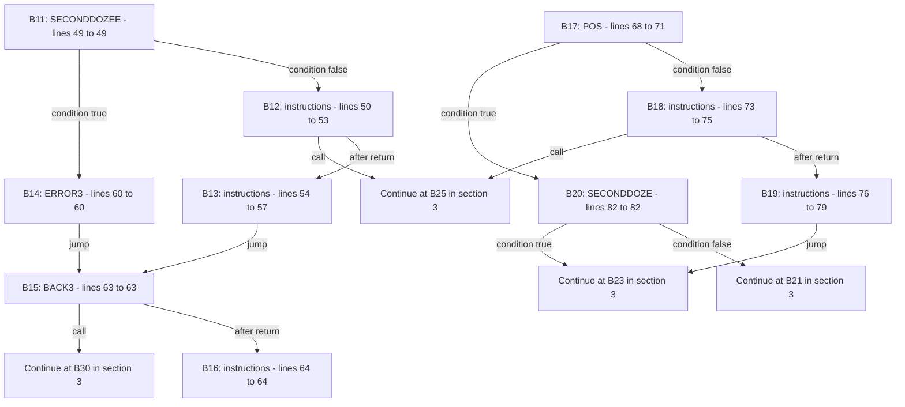
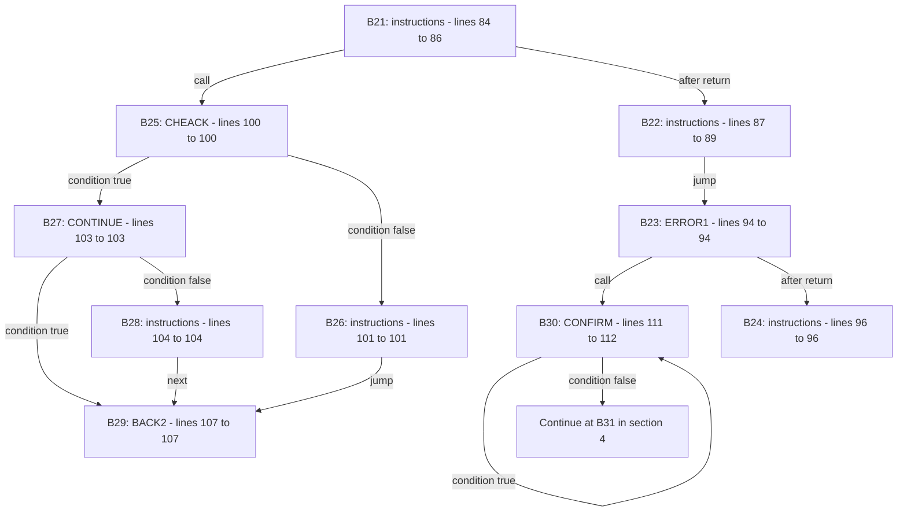
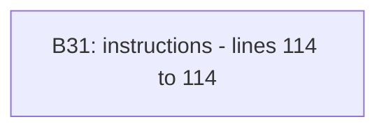

# Program Control Flow

[Back to project](README.md)

Control-flow blocks are indexed by source line. Calls resume at the instruction following the call if the subroutine returns normally.

## Entry locations

- `ORG 00H` begins at B1.

## Navigation

[Section 1](#section-1) · [Section 2](#section-2) · [Section 3](#section-3) · [Section 4](#section-4)

## Section 1



### B1

```asm
MOV 10H,#0
MOV 11H,#4
MOV 12H,#1
MOV 13H,#11
MOV 14H,#1
MOV 15H,#100
MOV 16H,#1
```

### B2

```asm
MOV A,10H
CJNE A,#0,op1
```

### B3

```asm
ACALL op2
```

### B4

```asm
SJMP loop
```

### B5

```asm
CJNE A,#1,ERROR
```

### B6

```asm
ACALL POS
```

### B7

```asm
SJMP loop
```

### B8

```asm
SJMP loop
```

### B9

```asm
MOV A,12H
CJNE A,#0,SecondDozee
```

### B10

```asm
MOV 14H,#0
SJMP BACK3
```

## Section 2



### B11

```asm
CJNE A,#1,ERROR3
```

### B12

```asm
MOV R7,13H
MOV A,R7
ADD A,#2
ACALL CHEACK
```

### B13

```asm
MOV 14H,A
MOV 15H,#4
SJMP BACK3
```

### B14

```asm
SJMP BACK3
```

### B15

```asm
ACALL CONFIRM
```

### B16

Return to the instruction following the active call.

```asm
RET
```

### B17

```asm
MOV R7,11H
MOV A,12H
CJNE A,#0,SecondDoze
```

### B18

```asm
MOV A,R7
ADD A,#3
ACALL CHEACK
```

### B19

```asm
MOV 14H,A
MOV 15H,#1
SJMP BACK1
```

### B20

```asm
CJNE A,#1,ERROR1
```

## Section 3



### B21

```asm
MOV A,R7
ADD A,#4
ACALL CHEACK
```

### B22

```asm
MOV 14H,A
MOV 15H,#2
SJMP BACK1
```

### B23

```asm
ACALL CONFIRM
```

### B24

Return to the instruction following the active call.

```asm
RET
```

### B25

```asm
CJNE A,#12,CONTINUE
```

### B26

```asm
SJMP BACK2
```

### B27

```asm
JC BACK2
```

### B28

```asm
SUBB A,#12
```

### B29

Return to the instruction following the active call.

```asm
RET
```

### B30

```asm
MOV A,16H
CJNE A,#1,CONFIRM
```

## Section 4



### B31

Return to the instruction following the active call.

```asm
RET
```
