# Program Control Flow

[Back to project](README.md)

Control-flow blocks are indexed by source line. Calls resume at the instruction following the call if the subroutine returns normally.

## Entry locations

- `org 0h` begins at B1.
- `ORG 0003H` begins at B2.
- `org 0030h` begins at B6.

## Navigation

[Section 1](#section-1) · [Section 2](#section-2) · [Section 3](#section-3) · [Section 4](#section-4) · [Section 5](#section-5) · [Section 6](#section-6) · [Section 7](#section-7) · [Section 8](#section-8) · [Section 9](#section-9) · [Section 10](#section-10) · [Section 11](#section-11) · [Section 12](#section-12) · [Section 13](#section-13) · [Section 14](#section-14) · [Section 15](#section-15) · [Section 16](#section-16) · [Section 17](#section-17) · [Section 18](#section-18) · [Section 19](#section-19) · [Section 20](#section-20) · [Section 21](#section-21)

## Section 1

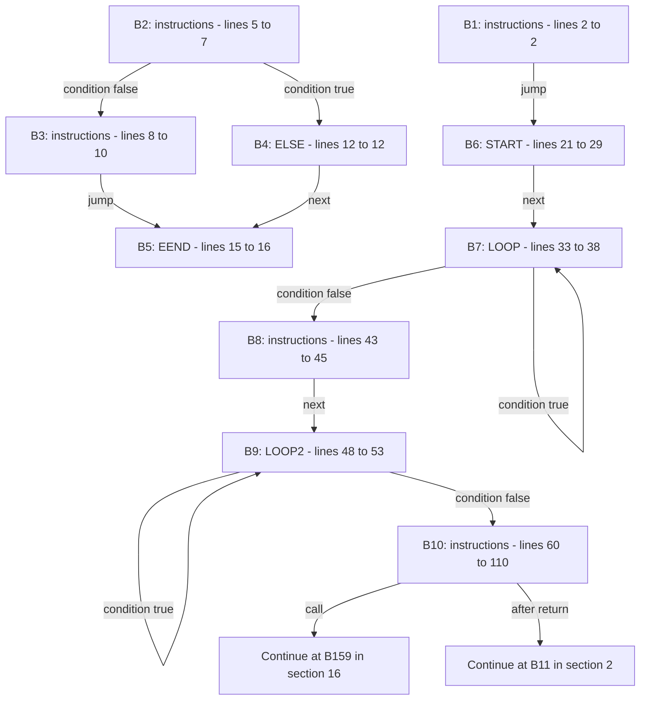

### B1

```asm
ljmp start
```

### B2

```asm
mov 62h,A
MOV A,61H
CJNE A,#0H, ELSE
```

### B3

```asm
MOV A,#1
MOV 61H,A
SJMP EEND
```

### B4

```asm
MOV 61H,#0
```

### B5

Resume the interrupted program.

```asm
MOV A,62H
retI
```

### B6

```asm
MOV R3,#1
SETB IT0
MOV IE,#10000001B
mov 61h,#0h
mov r5,#4h
mov r0,#10h
mov dptr,#list2
```

### B7

```asm
clr a
movc a,@a+dptr
mov @r0,a
inc dptr
inc r0
djnz r5,loop
```

### B8

```asm
mov r5,#5h
mov r1,#14h
mov dptr,#list3
```

### B9

```asm
clr a
movc a,@a+dptr
mov @r1,a
inc dptr
inc r1
djnz r5,loop2
```

### B10

```asm
mov r0,#10h
mov a,@r0
mov r6,a
mov r1,#14h
mov a,@r1
add a,r6
mov 18h,a
inc r0
inc r1
mov a,@r1
mov r6,a
mov a,@r0
subb a,r6
mov 19h,a
inc r0
inc r1
mov a,@r0
mov r6,a
mov a,@r1
mov b,a
mov a,r6
mul ab
mov 20h,a
inc r0
inc r1
mov a,@r0
mov r6,a
mov a,@r1
mov b,a
mov a,r6
div ab
mov 21h,a
mov 35h,#0h
mov 36h,#0h
ACALL INLCD
```

## Section 2

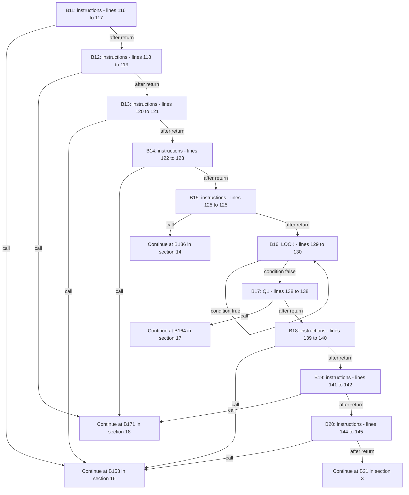

### B11

```asm
mov A,#80H
acall CMD
```

### B12

```asm
mov   dptr, #welcome_line1
acall wstr
```

### B13

```asm
mov A,#0C0H
acall CMD
```

### B14

```asm
mov   dptr, #welcome_line2
acall wstr
```

### B15

```asm
acall ShortDelay100m
```

### B16

```asm
MOV A,61H
CJNE A,#1,LOCK
```

### B17

```asm
acall ClearLCD
```

### B18

```asm
mov A,#80H
acall CMD
```

### B19

```asm
mov   dptr, #LCDQ1
acall wstr
```

### B20

```asm
mov A,#0C0H
acall CMD
```

## Section 3

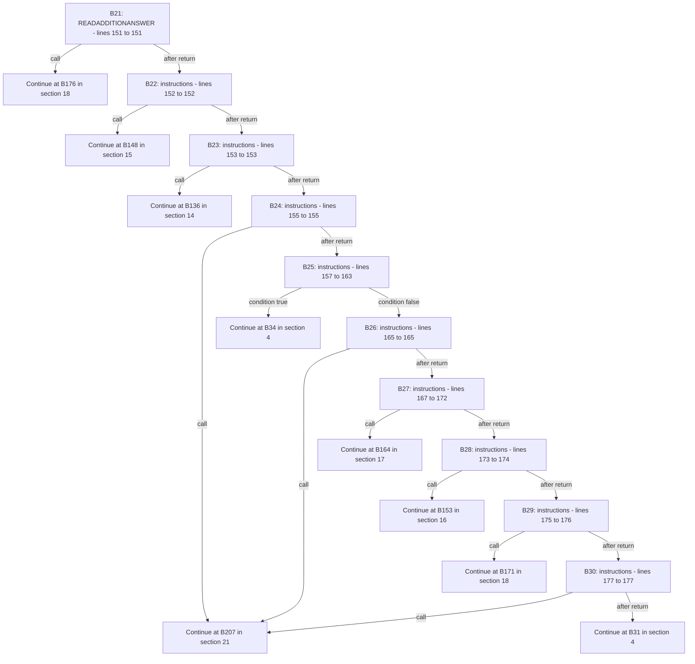

### B21

```asm
acall keypad
```

### B22

```asm
acall wchr
```

### B23

```asm
acall ShortDelay100m
```

### B24

```asm
ACALL CHECK_INT
```

### B25

```asm
subb a,#30h
mov 30h, a
mov a,30h
cjne a,18h, NotCorrectAddition
```

### B26

```asm
ACALL CHECK_INT
```

### B27

```asm
mov a,36h
add a,#1
mov 36h,a
acall ClearLCD
```

### B28

```asm
mov A,#80H
acall CMD
```

### B29

```asm
mov   dptr, #ScoreMSG
acall wstr
```

### B30

```asm
ACALL CHECK_INT
```

## Section 4

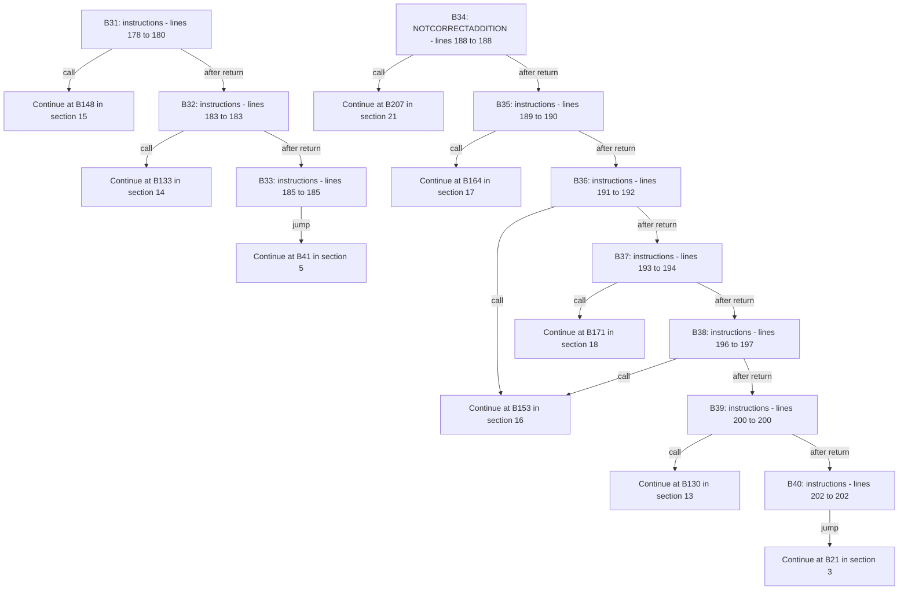

### B31

```asm
mov a,36h
add a,#30h
acall WCHR
```

### B32

```asm
acall GreenLEDFlash
```

### B33

```asm
sjmp Q2
```

### B34

```asm
ACALL CHECK_INT
```

### B35

```asm
inc 35h
acall ClearLCD
```

### B36

```asm
mov A,#80H
acall CMD
```

### B37

```asm
mov   dptr, #WrongAnswerMSG
acall wstr
```

### B38

```asm
mov A,#0C0H
acall CMD
```

### B39

```asm
acall RedLEDFlash
```

### B40

```asm
jmp ReadAdditionAnswer
```

## Section 5

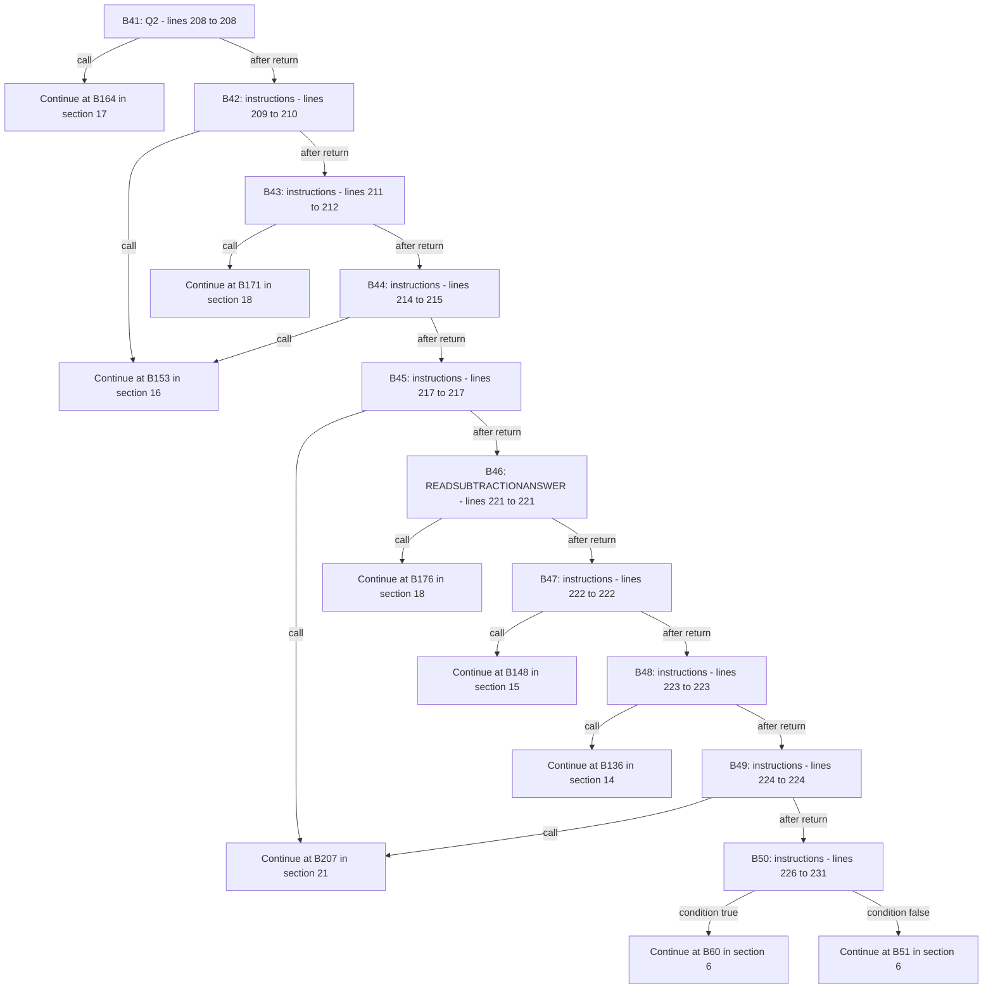

### B41

```asm
acall ClearLCD
```

### B42

```asm
mov A,#80H
acall CMD
```

### B43

```asm
mov   dptr, #LCDQ2
acall wstr
```

### B44

```asm
mov A,#0C0H
acall CMD
```

### B45

```asm
ACALL CHECK_INT
```

### B46

```asm
acall keypad
```

### B47

```asm
acall wchr
```

### B48

```asm
acall ShortDelay100m
```

### B49

```asm
ACALL CHECK_INT
```

### B50

```asm
subb a,#30h
mov 31h, a
mov a,31h
cjne a,19h,NotCorrectSubt
```

## Section 6

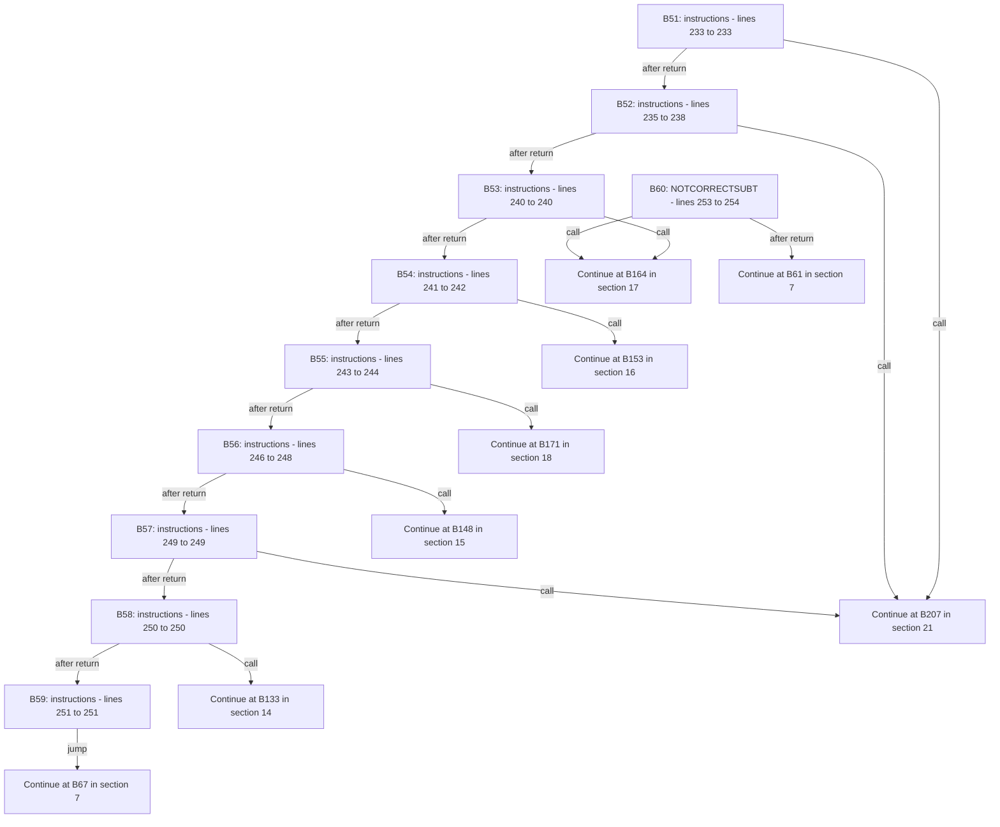

### B51

```asm
ACALL CHECK_INT
```

### B52

```asm
mov a,36h
add a,#2
mov 36h,a
ACALL CHECK_INT
```

### B53

```asm
acall ClearLCD
```

### B54

```asm
mov A,#80H
acall CMD
```

### B55

```asm
mov   dptr, #ScoreMSG
acall wstr
```

### B56

```asm
mov a,36h
add a,#30h
acall WCHR
```

### B57

```asm
ACALL CHECK_INT
```

### B58

```asm
acall GreenLEDFlash
```

### B59

```asm
sjmp Q3
```

### B60

```asm
inc 35h
acall ClearLCD
```

## Section 7

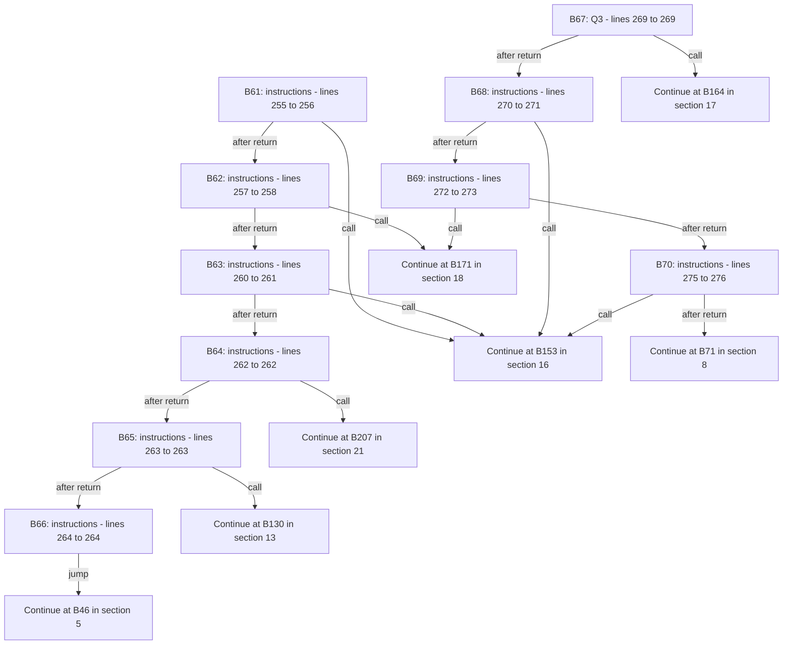

### B61

```asm
mov A,#80H
acall CMD
```

### B62

```asm
mov   dptr, #WrongAnswerMSG
acall wstr
```

### B63

```asm
mov A,#0C0H
acall CMD
```

### B64

```asm
ACALL CHECK_INT
```

### B65

```asm
acall RedLEDFlash
```

### B66

```asm
sjmp ReadSubtractionAnswer
```

### B67

```asm
acall ClearLCD
```

### B68

```asm
mov A,#80H
acall CMD
```

### B69

```asm
mov   dptr, #LCDQ3
acall wstr
```

### B70

```asm
mov A,#0C0H
acall CMD
```

## Section 8

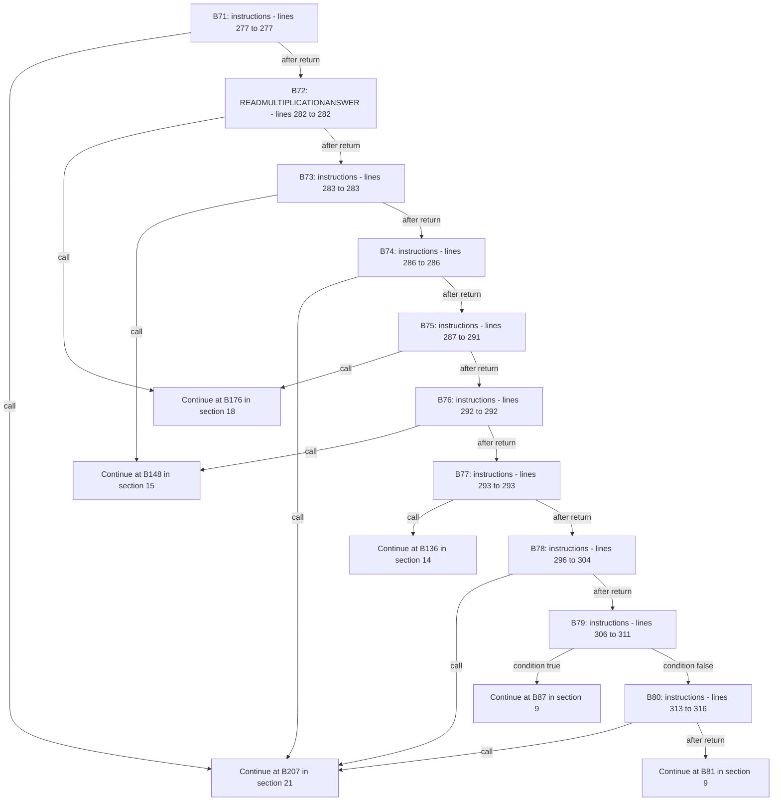

### B71

```asm
ACALL CHECK_INT
```

### B72

```asm
acall keypad
```

### B73

```asm
acall wchr
```

### B74

```asm
ACALL CHECK_INT
```

### B75

```asm
subb a,#30h
mov r6, a
acall keypad
```

### B76

```asm
acall wchr
```

### B77

```asm
acall ShortDelay100m
```

### B78

```asm
subb a,#30h
mov r7, a
mov a, r6
mov b, #10
mul AB
add A,r7
ACALL CHECK_INT
```

### B79

```asm
mov 32h,a
mov a, 32h
cjne a,20h,NotCorrectMult
```

### B80

```asm
mov a,36h
add a,#3
mov 36h,a
ACALL CHECK_INT
```

## Section 9

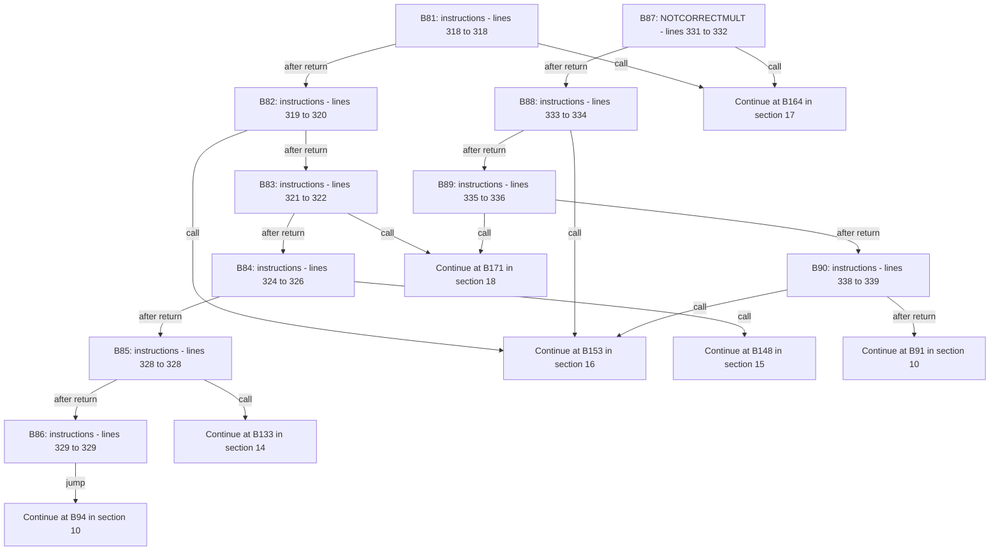

### B81

```asm
acall ClearLCD
```

### B82

```asm
mov A,#80H
acall CMD
```

### B83

```asm
mov   dptr, #ScoreMSG
acall wstr
```

### B84

```asm
mov a,36h
add a,#30h
acall WCHR
```

### B85

```asm
acall GreenLEDFlash
```

### B86

```asm
sjmp Q4
```

### B87

```asm
inc 35h
acall ClearLCD
```

### B88

```asm
mov A,#80H
acall CMD
```

### B89

```asm
mov   dptr, #WrongAnswerMSG
acall wstr
```

### B90

```asm
mov A,#0C0H
acall CMD
```

## Section 10

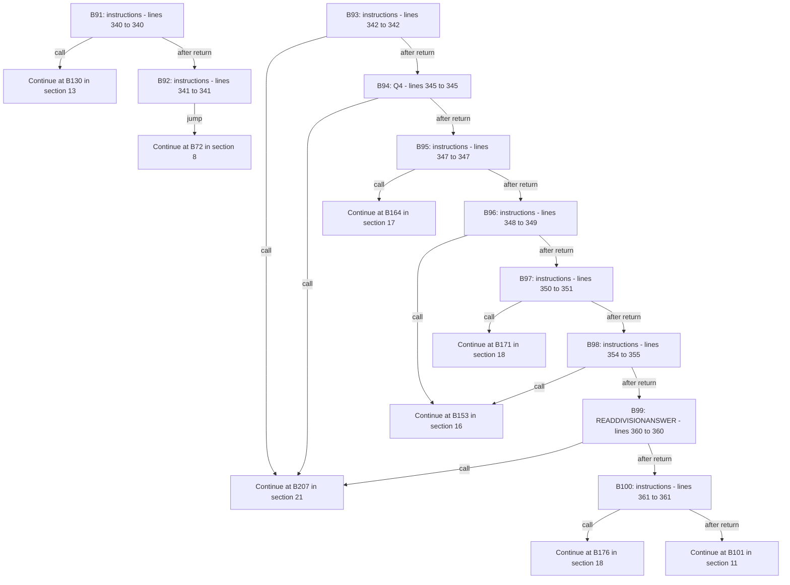

### B91

```asm
acall RedLEDFlash
```

### B92

```asm
sjmp ReadMultiplicationAnswer
```

### B93

```asm
ACALL CHECK_INT
```

### B94

```asm
ACALL CHECK_INT
```

### B95

```asm
acall ClearLCD
```

### B96

```asm
mov A,#80H
acall CMD
```

### B97

```asm
mov   dptr, #LCDQ4
acall wstr
```

### B98

```asm
mov A,#0C0H
acall CMD
```

### B99

```asm
ACALL CHECK_INT
```

### B100

```asm
acall keypad
```

## Section 11

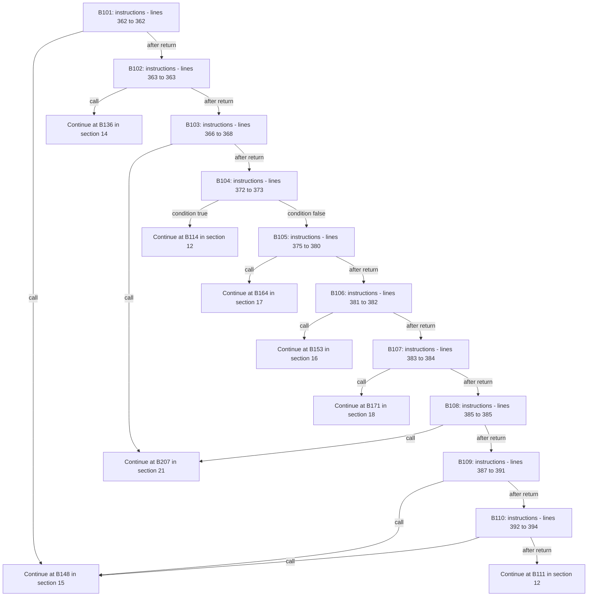

### B101

```asm
acall wchr
```

### B102

```asm
acall ShortDelay100m
```

### B103

```asm
subb a,#30h
mov 33h, a
ACALL CHECK_INT
```

### B104

```asm
mov a,33h
cjne a,21h,NotCorrectDiv
```

### B105

```asm
mov a,36h
add a,#4
mov 36h,a
acall ClearLCD
```

### B106

```asm
mov A,#80H
acall CMD
```

### B107

```asm
mov   dptr, #ScoreMSG
acall wstr
```

### B108

```asm
ACALL CHECK_INT
```

### B109

```asm
mov a,36h
mov b ,#10
div ab
add a,#30h
acall WCHR
```

### B110

```asm
mov a,b
add a,#30h
acall WCHR
```

## Section 12

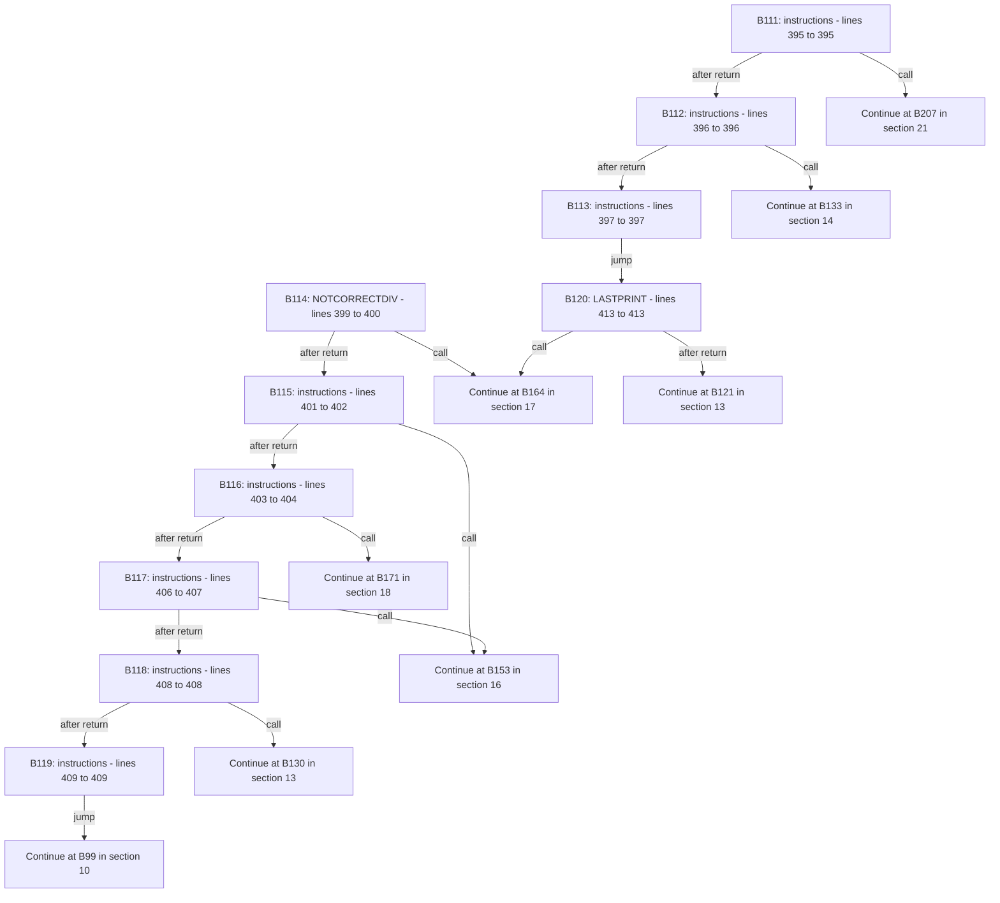

### B111

```asm
ACALL CHECK_INT
```

### B112

```asm
acall GreenLEDFlash
```

### B113

```asm
sjmp LastPrint
```

### B114

```asm
inc 35h
acall ClearLCD
```

### B115

```asm
mov A,#80H
acall CMD
```

### B116

```asm
mov   dptr, #WrongAnswerMSG
acall wstr
```

### B117

```asm
mov A,#0C0H
acall CMD
```

### B118

```asm
acall RedLEDFlash
```

### B119

```asm
sjmp ReadDivisionAnswer
```

### B120

```asm
acall ClearLCD
```

## Section 13

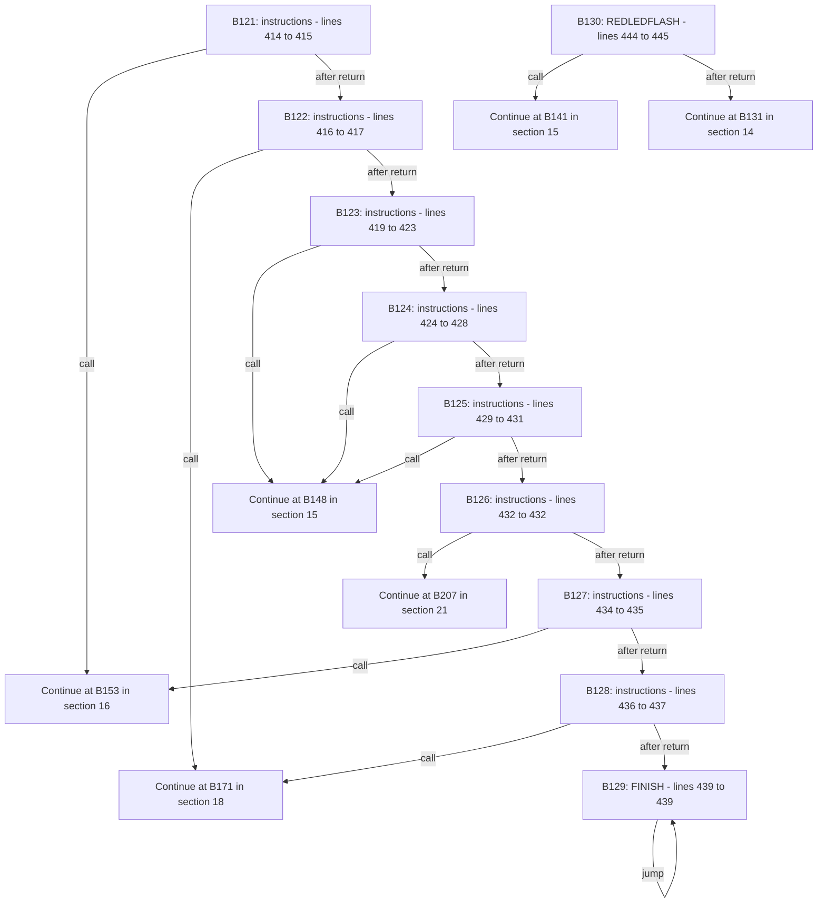

### B121

```asm
mov A,#80H
acall CMD
```

### B122

```asm
mov   dptr, #MistakesMSG
acall wstr
```

### B123

```asm
mov a, 35h
mov b, #100
div ab
add a, #30H
acall WCHR
```

### B124

```asm
mov a, b
mov b, #10
div ab
add a, #30H
acall WCHR
```

### B125

```asm
mov a,b
add a, #30H
acall WCHR
```

### B126

```asm
ACALL CHECK_INT
```

### B127

```asm
mov A,#0C0H
acall CMD
```

### B128

```asm
mov   dptr, #GameOverMSG
acall wstr
```

### B129

```asm
sjmp Finish
```

### B130

```asm
clr p1.0
acall DelayOf2Sec
```

## Section 14

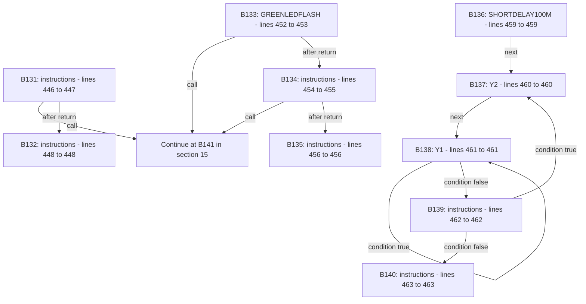

### B131

```asm
setb p1.0
acall DelayOf2Sec
```

### B132

Return to the instruction following the active call.

```asm
ret
```

### B133

```asm
clr p1.2
acall DelayOf2Sec
```

### B134

```asm
setb p1.2
acall DelayOf2Sec
```

### B135

Return to the instruction following the active call.

```asm
ret
```

### B136

```asm
mov r4,#20
```

### B137

```asm
mov r5,#250
```

### B138

```asm
djnz r5,y1
```

### B139

```asm
djnz r4,y2
```

### B140

Return to the instruction following the active call.

```asm
ret
```

## Section 15

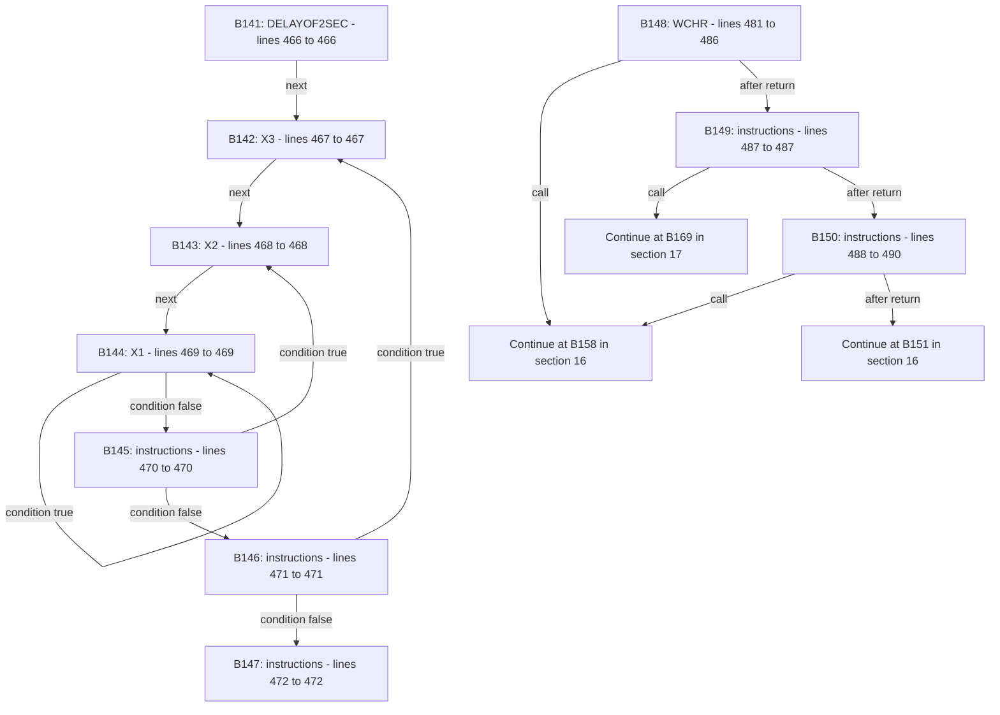

### B141

```asm
mov r3,#20
```

### B142

```asm
mov r4,#20
```

### B143

```asm
mov r5,#250
```

### B144

```asm
djnz r5,x1
```

### B145

```asm
djnz r4,x2
```

### B146

```asm
djnz r3,x3
```

### B147

Return to the instruction following the active call.

```asm
ret
```

### B148

```asm
PUSH ACC
PUSH B
SETB P1.3
MOV B,A
ACALL COMMON
```

### B149

```asm
ACALL LDELAY
```

### B150

```asm
MOV A,B
SWAP A
ACALL COMMON
```

## Section 16

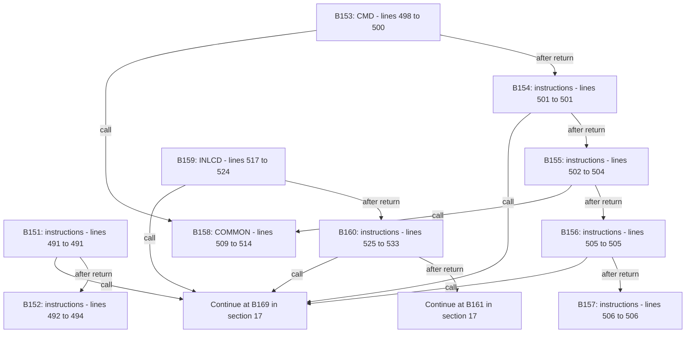

### B151

```asm
ACALL LDELAY
```

### B152

Return to the instruction following the active call.

```asm
POP B
POP ACC
RET
```

### B153

```asm
CLR P1.3
MOV B,A
ACALL COMMON
```

### B154

```asm
ACALL LDELAY
```

### B155

```asm
MOV A,B
SWAP A
ACALL COMMON
```

### B156

```asm
ACALL LDELAY
```

### B157

Return to the instruction following the active call.

```asm
RET
```

### B158

Return to the instruction following the active call.

```asm
ANL a,#11110000B
ANL P1, #00001111B
ORL P1,A
SETB P1.2
CLR P1.2
RET
```

### B159

```asm
CLR P1.3
CLR P1.7
CLR P1.6
SETB P1.5
CLR P1.4
SETB P1.2
CLR P1.2
ACALL LDELAY
```

### B160

```asm
SETB P1.2
CLR P1.2
SETB P1.7
CLR P1.6
CLR P1.5
CLR P1.4
SETB P1.2
CLR P1.2
ACALL LDELAY
```

## Section 17

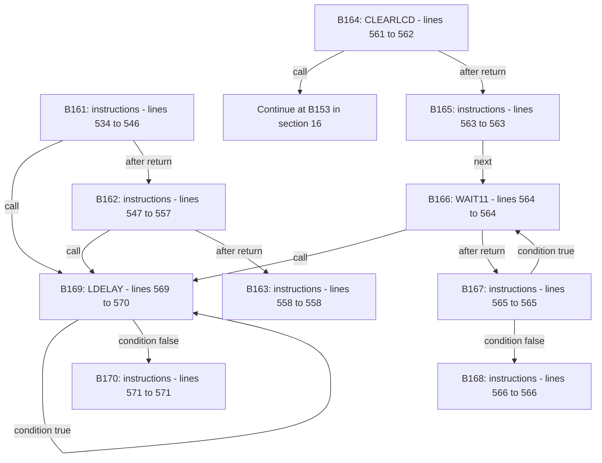

### B161

```asm
CLR P1.7
CLR P1.6
CLR P1.5
CLR P1.4
SETB P1.2
CLR P1.2
SETB P1.7
SETB P1.6
SETB P1.5
SETB P1.4
SETB P1.2
CLR P1.2
ACALL LDELAY
```

### B162

```asm
CLR P1.7
CLR P1.6
CLR P1.5
CLR P1.4
SETB P1.2
CLR P1.2
SETB P1.6
SETB P1.5
SETB P1.2
CLR P1.2
ACALL LDELAY
```

### B163

Return to the instruction following the active call.

```asm
RET
```

### B164

```asm
MOV A,#01H
ACALL CMD
```

### B165

```asm
MOV R7,#14
```

### B166

```asm
ACALL LDELAY
```

### B167

```asm
DJNZ R7,WAIT11
```

### B168

Return to the instruction following the active call.

```asm
RET
```

### B169

```asm
MOV R0, #50
DJNZ R0, $
```

### B170

Return to the instruction following the active call.

```asm
RET
```

## Section 18

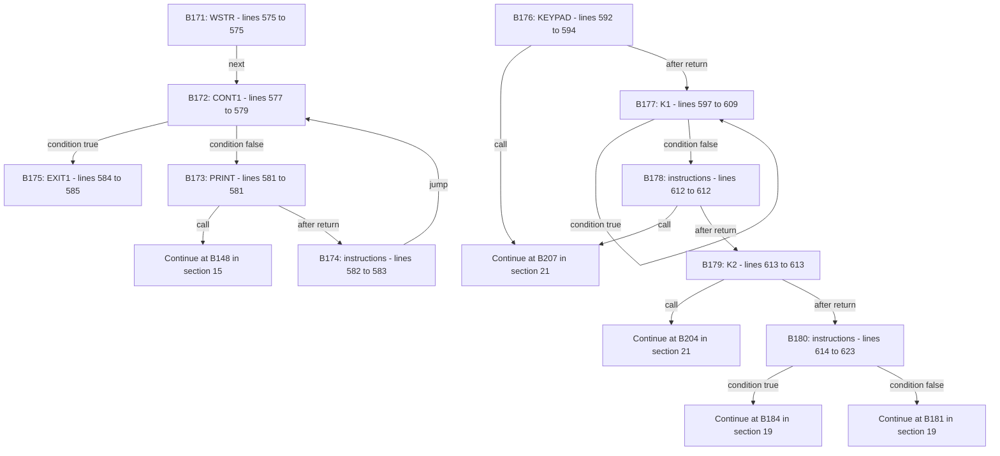

### B171

```asm
push acc
```

### B172

```asm
clr a
movc a,@a+dptr
JZ exit1
```

### B173

```asm
acall wchr
```

### B174

```asm
inc dptr
ajmp cont1
```

### B175

Return to the instruction following the active call.

```asm
pop acc
ret
```

### B176

```asm
MOV P0,#11110000B
ACALL CHECK_INT
```

### B177

```asm
MOV P0,#11110000B
MOV A,P0
ANL A,#11110000B
CJNE A,#11110000B,K1
```

### B178

```asm
ACALL CHECK_INT
```

### B179

```asm
ACALL DELAY
```

### B180

```asm
MOV A,P0
ANL A,#11110000B
CJNE A,#11110000B,OVER
```

## Section 19

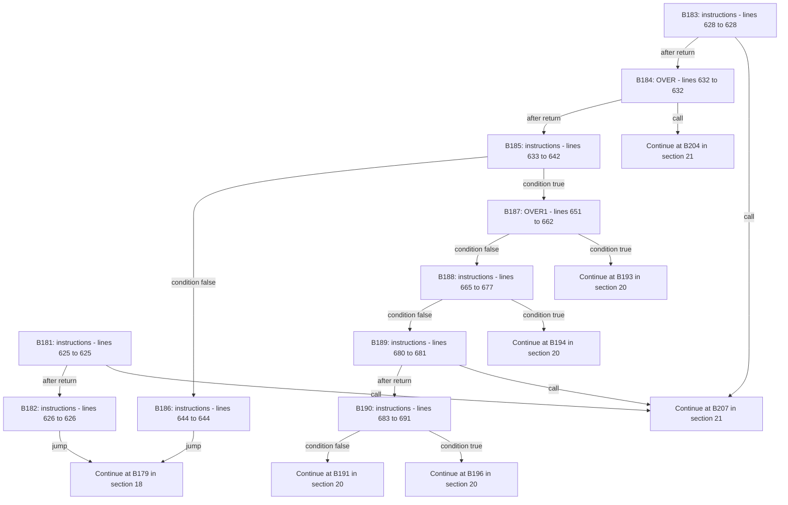

### B181

```asm
ACALL CHECK_INT
```

### B182

```asm
SJMP K2
```

### B183

```asm
ACALL CHECK_INT
```

### B184

```asm
ACALL DELAY
```

### B185

```asm
MOV A,P0
ANL A,#11110000B
CJNE A,#11110000B,OVER1
```

### B186

```asm
SJMP K2
```

### B187

```asm
MOV P0,#11111110B
MOV A,P0
ANL A,#11110000B
CJNE A,#11110000B,ROW_0
```

### B188

```asm
MOV P0,#11111101B
MOV A,P0
ANL A,#11110000B
CJNE A,#11110000B,ROW_1
```

### B189

```asm
MOV P0,#11111011B
ACALL CHECK_INT
```

### B190

```asm
MOV A,P0
ANL A,#11110000B
CJNE A,#11110000B,ROW_2
```

## Section 20

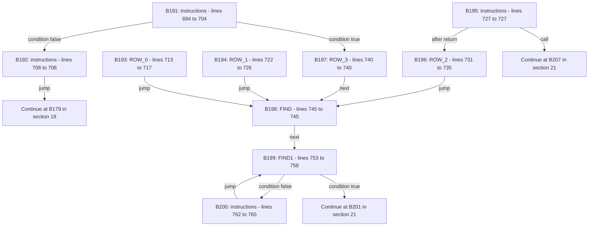

### B191

```asm
MOV P0,#11110111B
MOV A,P0
ANL A,#11110000B
CJNE A,#11110000B,ROW_3
```

### B192

```asm
LJMP K2
```

### B193

```asm
MOV DPTR,#KCODE0
SJMP FIND
```

### B194

```asm
MOV DPTR,#KCODE1
SJMP FIND
```

### B195

```asm
ACALL CHECK_INT
```

### B196

```asm
MOV DPTR,#KCODE2
SJMP FIND
```

### B197

```asm
MOV DPTR,#KCODE3
```

### B198

```asm
SWAP A
```

### B199

```asm
RRC A
JNC MATCH
```

### B200

```asm
INC DPTR
SJMP FIND1
```

## Section 21

```mermaid
flowchart TD
B200["B201: MATCH - lines 770 to 770"]
B201["B202: instructions - lines 771 to 776"]
B202["B203: instructions - lines 777 to 777"]
B203["B204: DELAY - lines 783 to 788"]
B204["B205: BACK - lines 791 to 791"]
B205["B206: instructions - lines 792 to 796"]
B206["B207: CHECK_INT - lines 799 to 801"]
B207["B208: instructions - lines 802 to 802"]
B208["B209: E - lines 804 to 805"]
B200 -->|call| B206
B200 -->|after return| B201
B201 -->|call| B206
B201 -->|after return| B202
B203 -->|next| B204
B204 -->|condition true| B204
B204 -->|condition false| B205
B206 -->|condition true| B208
B206 -->|condition false| B207
B207 -->|jump| B5
B5["Continue at B6 in section 1"]
```

### B201

```asm
ACALL CHECK_INT
```

### B202

```asm
CLR A
MOVC A,@A+DPTR
ACALL CHECK_INT
```

### B203

Return to the instruction following the active call.

```asm
RET
```

### B204

```asm
MOV   TMOD,#00000001B
MOV   TL0,#0CAH
MOV   TH0,#27H
SETB  TR0
```

### B205

```asm
JNB    TF0,BACK
```

### B206

Return to the instruction following the active call.

```asm
CLR    TR0
CLR    TF0
RET
```

### B207

```asm
MOV 63H,A
MOV A,61H
CJNE A,#0,E
```

### B208

```asm
LJMP START
```

### B209

Return to the instruction following the active call.

```asm
MOV A,63H
RET
```
