# Program Control Flow

[Back to project](README.md)

Control-flow blocks are indexed by source line. Calls resume at the instruction following the call if the subroutine returns normally.

## Entry locations

- `ORG 0` begins at B1.
- `ORG 0003H` begins at B2.
- `ORG 30H` begins at B3.

## Navigation

[Section 1](#section-1) · [Section 2](#section-2) · [Section 3](#section-3) · [Section 4](#section-4) · [Section 5](#section-5) · [Section 6](#section-6) · [Section 7](#section-7) · [Section 8](#section-8) · [Section 9](#section-9) · [Section 10](#section-10) · [Section 11](#section-11) · [Section 12](#section-12) · [Section 13](#section-13) · [Section 14](#section-14) · [Section 15](#section-15) · [Section 16](#section-16) · [Section 17](#section-17) · [Section 18](#section-18) · [Section 19](#section-19) · [Section 20](#section-20)

## Section 1

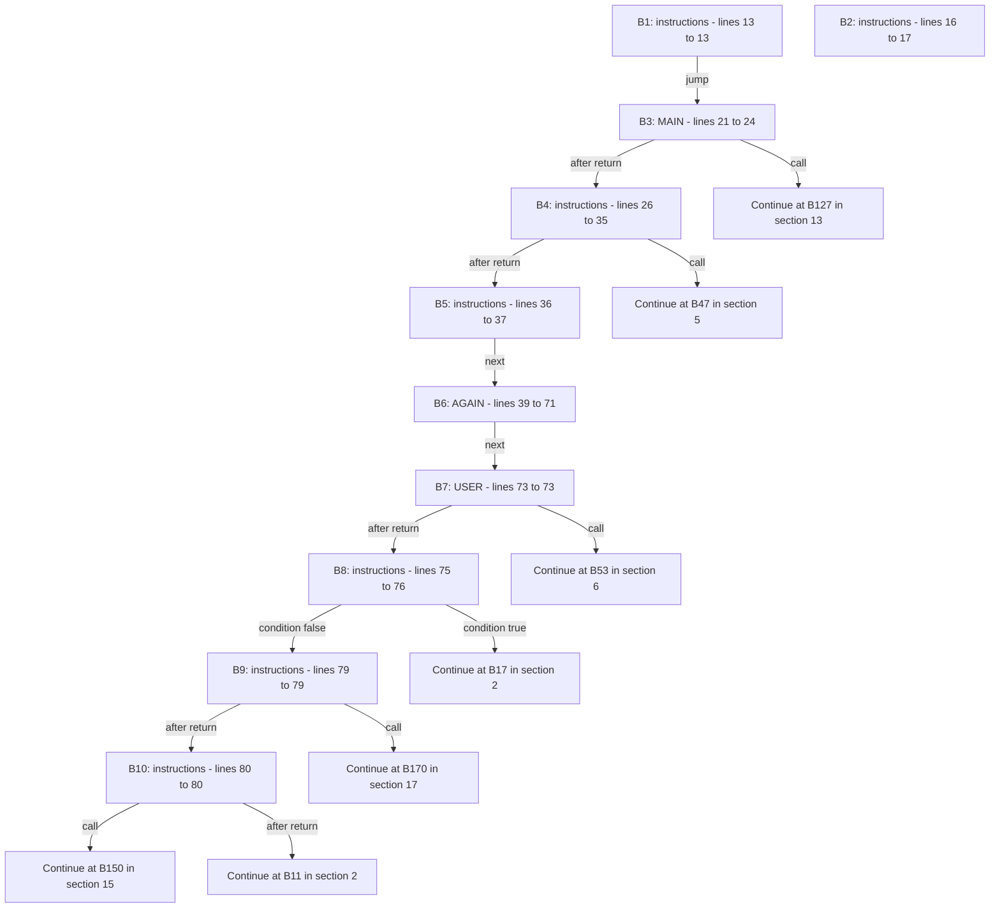

### B1

```asm
LJMP MAIN
```

### B2

Resume the interrupted program.

```asm
MOV 98H,#1
RETI
```

### B3

```asm
MOV 98H,#0
MOV IE,#10000001B
SETB IT0
ACALL INLCD
```

### B4

```asm
MOV	34H,#1
MOV	35H,#0
MOV	36H,#0
MOV 30H,#7
MOV 31H,#4
MOV 32H,#12
MOV 33H,#6
ACALL WELCOME
```

### B5

```asm
MOV	DPTR,#QS
MOV R2,#0
```

### B6

```asm
MOV	DPTR,#QS
CLR	A
ADD A,R2
MOVC A,@A+DPTR
MOV	R1,A
INC	DPTR
CLR	A
ADD A,R2
MOVC A,@A+DPTR
MOV	R3,A
INC	DPTR
CLR	A
ADD A,R2
MOVC A,@A+DPTR
MOV	R4,A
INC	DPTR
CLR	A
ADD A,R2
MOVC A,@A+DPTR
MOV	R5,A
INC	DPTR
CLR	A
ADD A,R2
MOVC A,@A+DPTR
INC	DPTR
MOV	R6,A
MOV A,R2
ADD A,#5
MOV R2,A
MOV 77H,R1
```

### B7

```asm
ACALL QUESTION
```

### B8

```asm
MOV R1,77H
CJNE R1,#'+',NPL
```

### B9

```asm
ACALL KEYPAD
```

### B10

```asm
ACALL WCHR
```

## Section 2

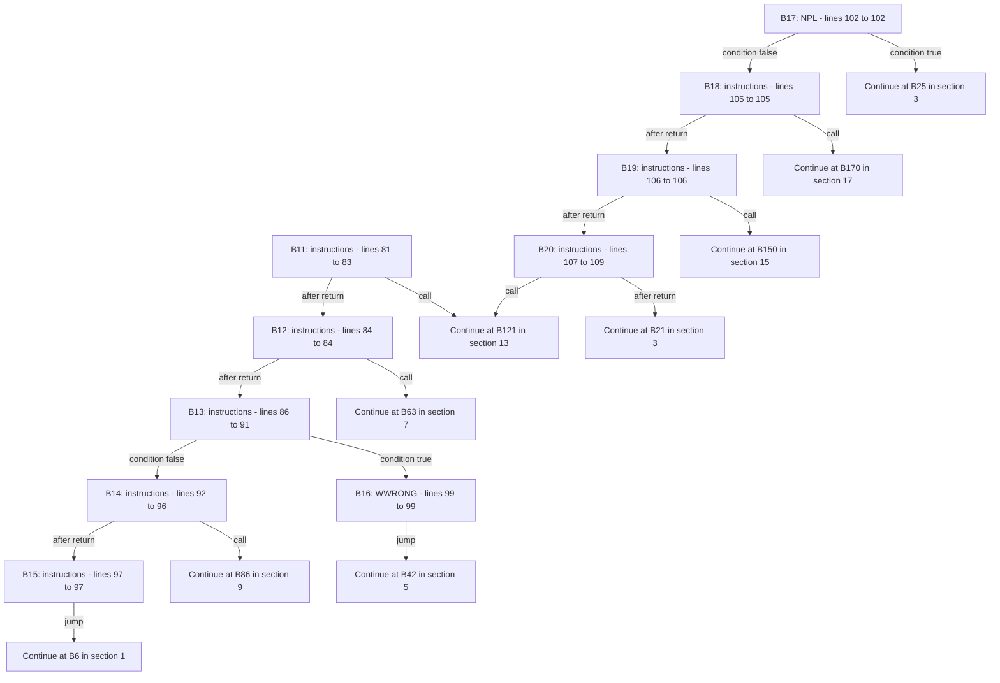

### B11

```asm
SUBB A,#30H
MOV 37H,A
ACALL DELAY
```

### B12

```asm
ACALL ANS
```

### B13

```asm
MOV A,R3
ADD A,R4
MOV 30H,A
MOV	B,37H
CJNE A,B,WWRONG
```

### B14

```asm
MOV	A,35H
ADD	A,R6
MOV	35H,A
INC	34H
ACALL RIGHT
```

### B15

```asm
SJMP AGAIN
```

### B16

```asm
AJMP WRONG
```

### B17

```asm
CJNE R1,#'-',NMS
```

### B18

```asm
ACALL KEYPAD
```

### B19

```asm
ACALL WCHR
```

### B20

```asm
SUBB A,#30H
MOV 37H,A
ACALL DELAY
```

## Section 3

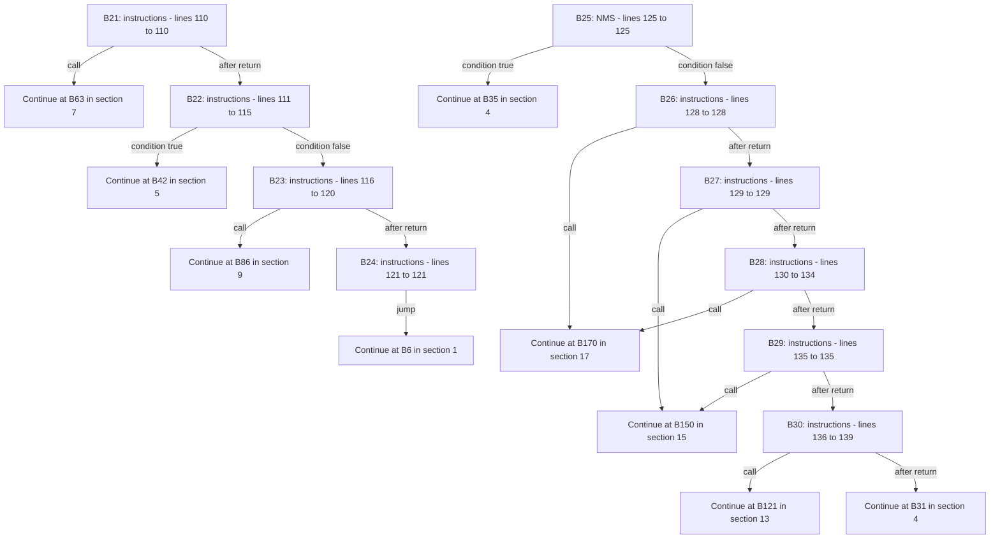

### B21

```asm
ACALL ANS
```

### B22

```asm
MOV A,R3
SUBB A,R4
MOV 31H,A
MOV	B,37H
CJNE A,B,WRONG
```

### B23

```asm
MOV	A,35H
ADD	A,R6
MOV	35H,A
INC	34H
ACALL RIGHT
```

### B24

```asm
SJMP AGAIN
```

### B25

```asm
CJNE R1,#'*',DVS
```

### B26

```asm
ACALL KEYPAD
```

### B27

```asm
ACALL WCHR
```

### B28

```asm
SUBB A,#30H
MOV B,#10
MUL AB
MOV 37H,A
ACALL KEYPAD
```

### B29

```asm
ACALL WCHR
```

### B30

```asm
SUBB A,#30H
ADD A,37H
MOV 37H,A
ACALL DELAY
```

## Section 4

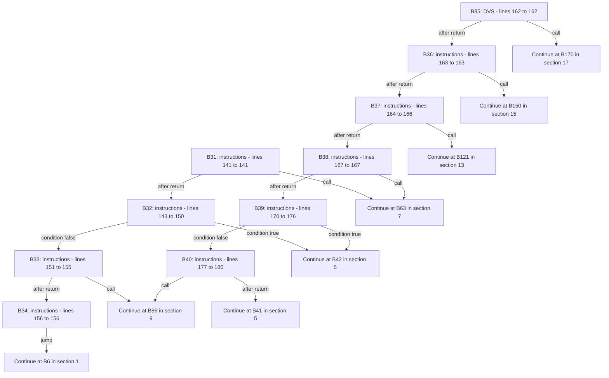

### B31

```asm
ACALL ANS
```

### B32

```asm
MOV A,R3
MOV B,R4
MUL AB
MOV 32H,A
MOV	B,37H
CJNE A,B,WRONG
```

### B33

```asm
MOV	A,35H
ADD	A,R6
MOV	35H,A
INC	34H
ACALL RIGHT
```

### B34

```asm
AJMP AGAIN
```

### B35

```asm
ACALL KEYPAD
```

### B36

```asm
ACALL WCHR
```

### B37

```asm
SUBB A,#30H
MOV 37H,A
ACALL DELAY
```

### B38

```asm
ACALL ANS
```

### B39

```asm
MOV A,R3
MOV B,R4
DIV AB
MOV 33H,A
MOV	B,37H
CJNE A,B,WRONG
```

### B40

```asm
MOV	A,35H
ADD	A,R6
MOV	35H,A
ACALL RIGHT
```

## Section 5

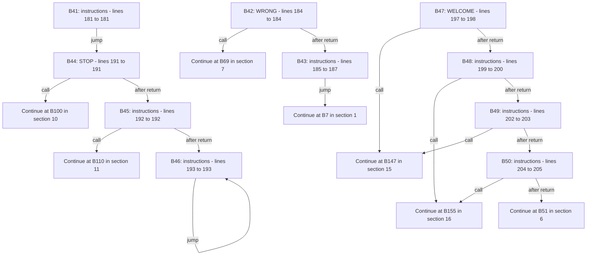

### B41

```asm
SJMP STOP
```

### B42

```asm
ACALL WRONGG
```

### B43

```asm
INC	36H
DEC	35H
AJMP USER
```

### B44

```asm
ACALL SCORE
```

### B45

```asm
ACALL BYE
```

### B46

```asm
SJMP $
```

### B47

```asm
MOV A, #80H
ACALL CMD
```

### B48

```asm
MOV DPTR, #STR1
ACALL WSTR
```

### B49

```asm
MOV A,#0c0H
ACALL CMD
```

### B50

```asm
MOV DPTR, #STR2
ACALL WSTR
```

## Section 6

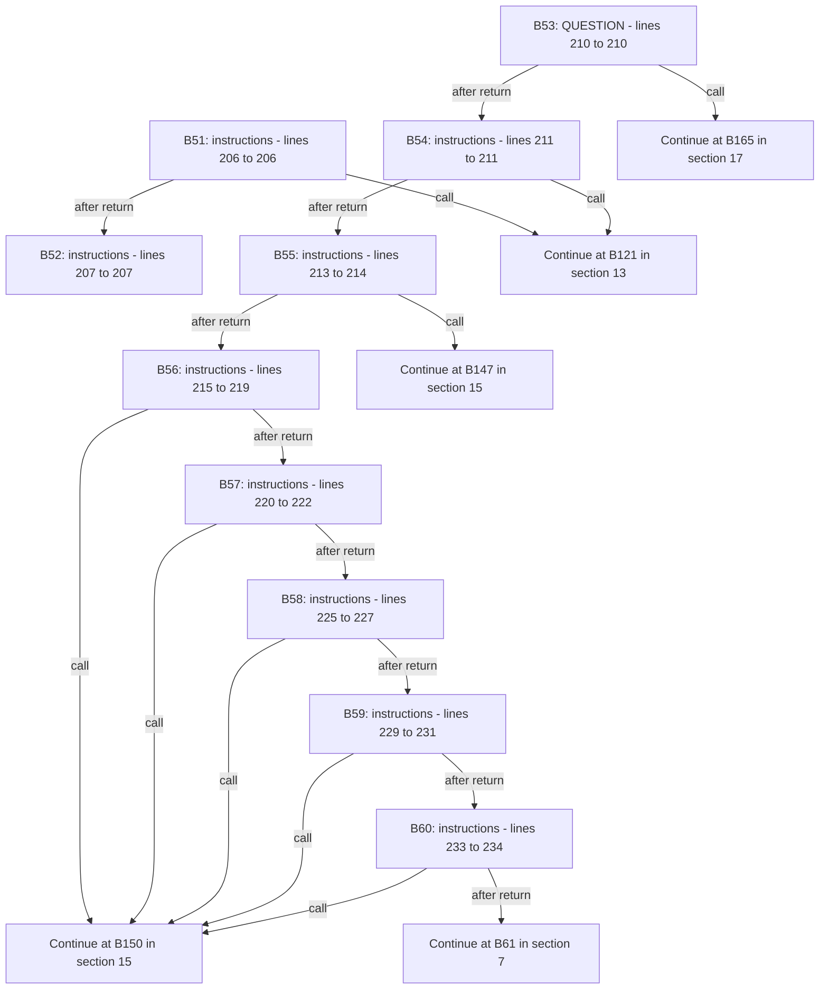

### B51

```asm
ACALL DELAY
```

### B52

Return to the instruction following the active call.

```asm
RET
```

### B53

```asm
ACALL CLEAR
```

### B54

```asm
ACALL DELAY
```

### B55

```asm
MOV A, #80H
ACALL CMD
```

### B56

```asm
MOV A,R3
MOV B,#10
DIV AB
ADD A,#30H
ACALL WCHR
```

### B57

```asm
MOV A,B
ADD A,#30H
ACALL WCHR
```

### B58

```asm
MOV R1,77H
MOV A,R1
ACALL WCHR
```

### B59

```asm
MOV A,R4
ADD A,#30H
ACALL WCHR
```

### B60

```asm
MOV A,#'='
ACALL WCHR
```

## Section 7

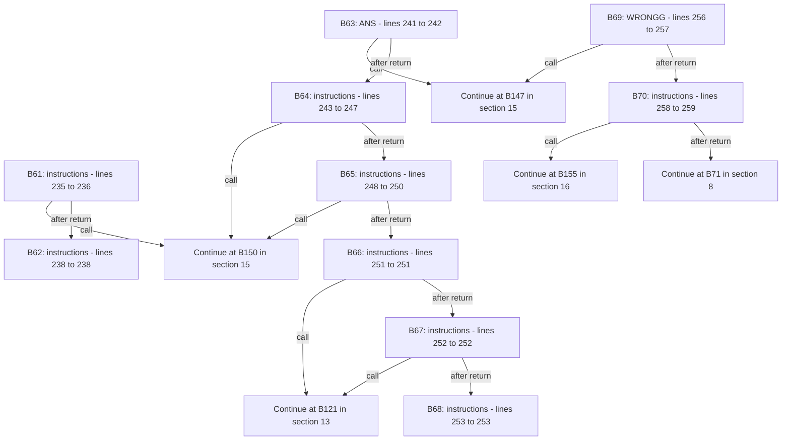

### B61

```asm
MOV A,#' '
ACALL WCHR
```

### B62

Return to the instruction following the active call.

```asm
RET
```

### B63

```asm
MOV A,#0c0H
ACALL CMD
```

### B64

```asm
MOV A,37H
MOV B,#10
DIV AB
ADD A,#30H
ACALL WCHR
```

### B65

```asm
MOV A,B
ADD A,#30H
ACALL WCHR
```

### B66

```asm
ACALL DELAY
```

### B67

```asm
ACALL DELAY
```

### B68

Return to the instruction following the active call.

```asm
RET
```

### B69

```asm
MOV A,#0c0H
ACALL CMD
```

### B70

```asm
MOV DPTR, #WRONG1
ACALL WSTR
```

## Section 8

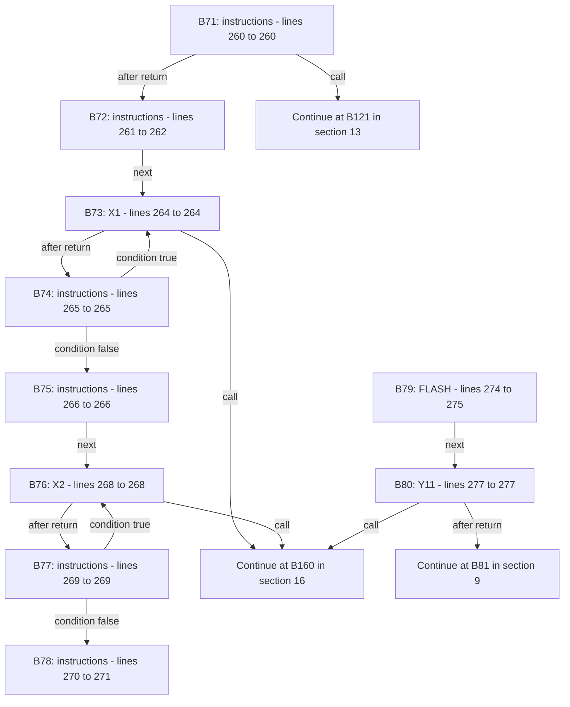

### B71

```asm
ACALL DELAY
```

### B72

```asm
CLR R
MOV R7,#185
```

### B73

```asm
ACALL LDELAY
```

### B74

```asm
DJNZ R7,X1
```

### B75

```asm
MOV R7,#185
```

### B76

```asm
ACALL LDELAY
```

### B77

```asm
DJNZ R7,X2
```

### B78

Return to the instruction following the active call.

```asm
SETB R
RET
```

### B79

```asm
CLR G
MOV R7,#185
```

### B80

```asm
ACALL LDELAY
```

## Section 9

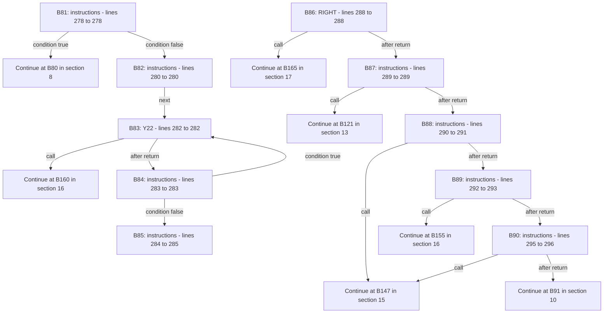

### B81

```asm
DJNZ R7,Y11
```

### B82

```asm
MOV R7,#185
```

### B83

```asm
ACALL LDELAY
```

### B84

```asm
DJNZ R7,Y22
```

### B85

Return to the instruction following the active call.

```asm
SETB G
RET
```

### B86

```asm
ACALL CLEAR
```

### B87

```asm
ACALL DELAY
```

### B88

```asm
MOV A, #80H
ACALL CMD
```

### B89

```asm
MOV DPTR, #CORRECTT
ACALL WSTR
```

### B90

```asm
MOV A,#0c0H
ACALL CMD
```

## Section 10

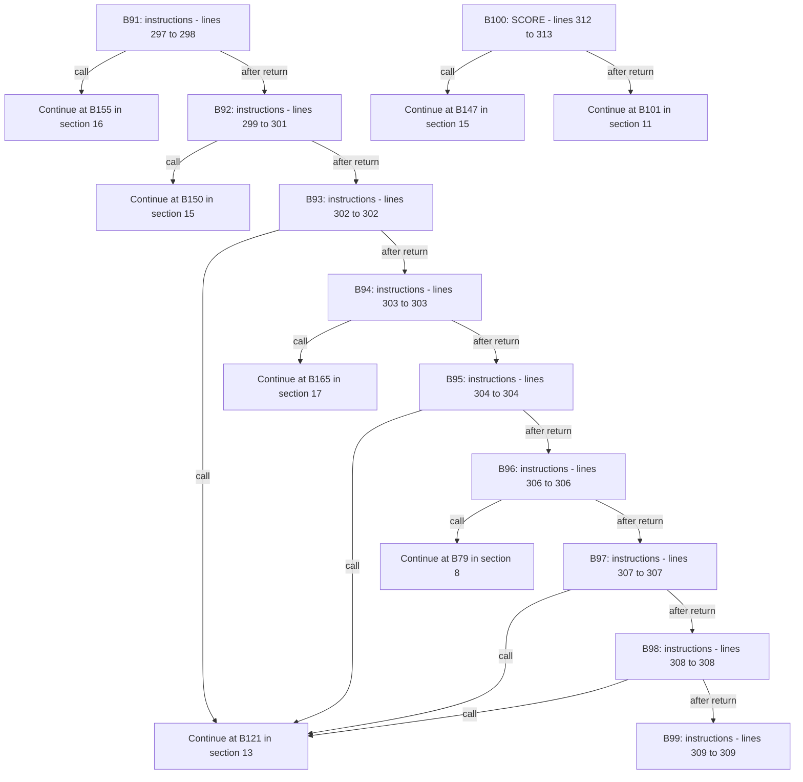

### B91

```asm
MOV DPTR, #SCOREE
ACALL WSTR
```

### B92

```asm
MOV A,35H
ADD A,#30H
ACALL WCHR
```

### B93

```asm
ACALL DELAY
```

### B94

```asm
ACALL CLEAR
```

### B95

```asm
ACALL DELAY
```

### B96

```asm
ACALL FLASH
```

### B97

```asm
ACALL DELAY
```

### B98

```asm
ACALL DELAY
```

### B99

Return to the instruction following the active call.

```asm
RET
```

### B100

```asm
MOV A, #80H
ACALL CMD
```

## Section 11

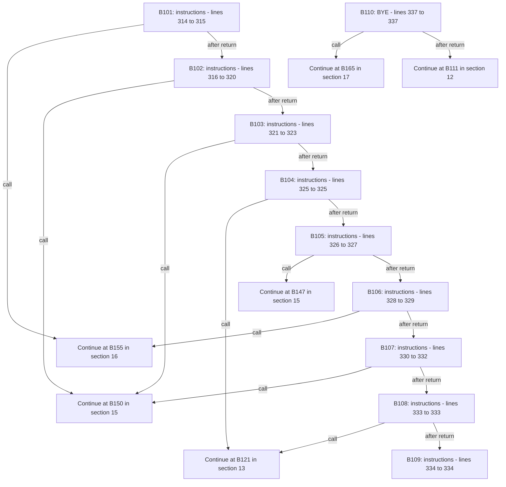

### B101

```asm
MOV DPTR, #SCOREE
ACALL WSTR
```

### B102

```asm
MOV A,35H
MOV B,#10
DIV AB
ADD A,#30H
ACALL WCHR
```

### B103

```asm
MOV A,B
ADD A,#30H
ACALL WCHR
```

### B104

```asm
ACALL DELAY
```

### B105

```asm
MOV A,#0c0H
ACALL CMD
```

### B106

```asm
MOV DPTR, #FAIL
ACALL WSTR
```

### B107

```asm
MOV A,36H
ADD A,#30H
ACALL WCHR
```

### B108

```asm
ACALL DELAY
```

### B109

Return to the instruction following the active call.

```asm
RET
```

### B110

```asm
ACALL CLEAR
```

## Section 12

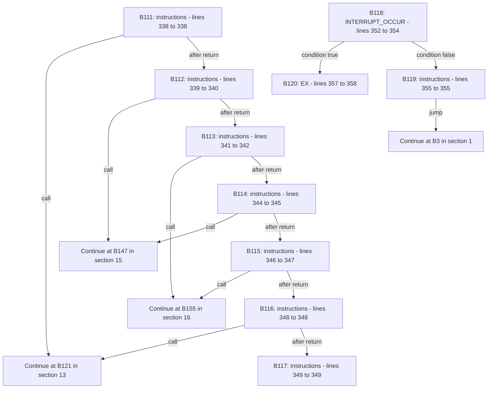

### B111

```asm
ACALL DELAY
```

### B112

```asm
MOV A, #80H
ACALL CMD
```

### B113

```asm
MOV DPTR, #OVERR
ACALL WSTR
```

### B114

```asm
MOV A,#0c0H
ACALL CMD
```

### B115

```asm
MOV DPTR, #THANKS
ACALL WSTR
```

### B116

```asm
ACALL DELAY
```

### B117

Return to the instruction following the active call.

```asm
RET
```

### B118

```asm
MOV 99H,A
MOV A,98H
CJNE A,#1,EX
```

### B119

```asm
LJMP MAIN
```

### B120

Return to the instruction following the active call.

```asm
MOV A,99H
RET
```

## Section 13

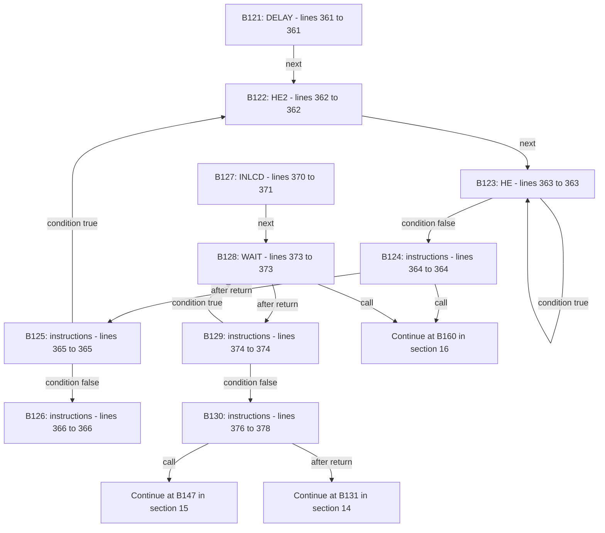

### B121

```asm
MOV R1,#250
```

### B122

```asm
MOV R0,#100
```

### B123

```asm
DJNZ R0,HE
```

### B124

```asm
acall ldelay
```

### B125

```asm
DJNZ R1,HE2
```

### B126

Return to the instruction following the active call.

```asm
RET
```

### B127

```asm
PUSH 7
MOV R7,#20
```

### B128

```asm
ACALL LDELAY
```

### B129

```asm
DJNZ R7,WAIT
```

### B130

```asm
MOV P0,#00000111B
MOV A,#0011B
ACALL CMD
```

## Section 14

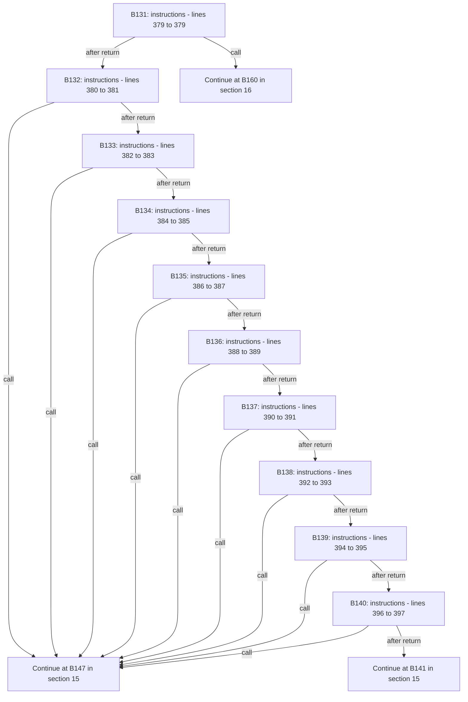

### B131

```asm
ACALL LDELAY
```

### B132

```asm
MOV A,#0011B
ACALL CMD
```

### B133

```asm
MOV A,#0011B
ACALL CMD
```

### B134

```asm
MOV A,#0010B
ACALL CMD
```

### B135

```asm
MOV A,#0010B
ACALL CMD
```

### B136

```asm
MOV A,#1000B
ACALL CMD
```

### B137

```asm
MOV A,#0000B
ACALL CMD
```

### B138

```asm
MOV A,#1000B
ACALL CMD
```

### B139

```asm
MOV A,#0
ACALL CMD
```

### B140

```asm
MOV A,#0001B
ACALL CMD
```

## Section 15

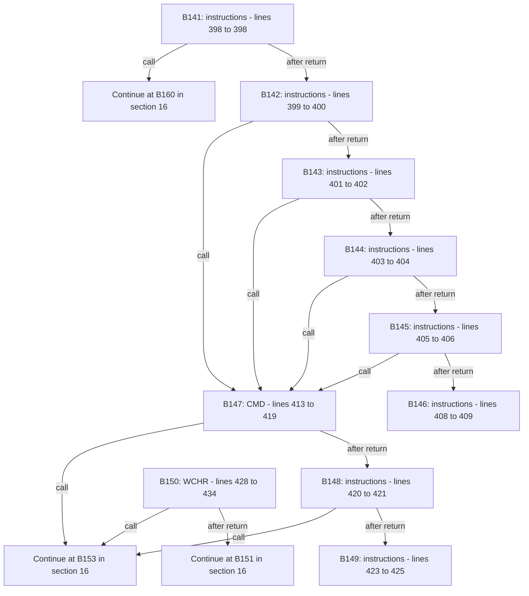

### B141

```asm
ACALL LDELAY
```

### B142

```asm
MOV A,#0000B
ACALL CMD
```

### B143

```asm
MOV A,#0110B
ACALL CMD
```

### B144

```asm
MOV A,#0000B
ACALL CMD
```

### B145

```asm
MOV A,#1111B
ACALL CMD
```

### B146

Return to the instruction following the active call.

```asm
POP 7
RET
```

### B147

```asm
PUSH ACC
PUSH B
CLR RS
MOV B,A
SWAP A
ACALL COMMON
```

### B148

```asm
MOV A,B
ACALL COMMON
```

### B149

Return to the instruction following the active call.

```asm
POP B
POP ACC
RET
```

### B150

```asm
PUSH ACC
PUSH B
SETB RS
MOV B,A
SWAP A
ACALL COMMON
```

## Section 16

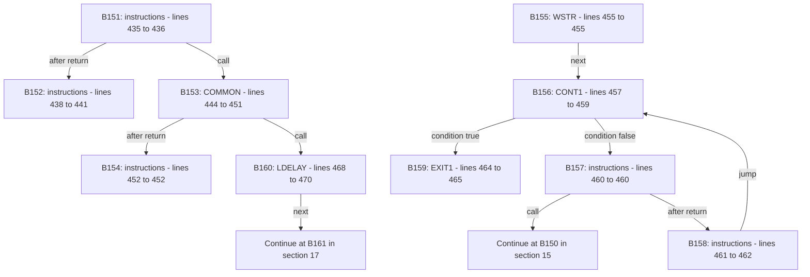

### B151

```asm
MOV A,B
ACALL COMMON
```

### B152

Return to the instruction following the active call.

```asm
POP B
POP ACC
RET
```

### B153

```asm
CLR RW
SWAP A
ANL A,#11110000B
ANL P0,#00000111B
ORL P0,A
SETB EN
CLR EN
ACALL LDELAY
```

### B154

Return to the instruction following the active call.

```asm
RET
```

### B155

```asm
PUSH ACC
```

### B156

```asm
CLR A
MOVC A,@A+DPTR
JZ EXIT1
```

### B157

```asm
ACALL WCHR
```

### B158

```asm
INC DPTR
AJMP CONT1
```

### B159

Return to the instruction following the active call.

```asm
POP ACC
RET
```

### B160

```asm
PUSH 0
PUSH 1
MOV R1,#20
```

## Section 17

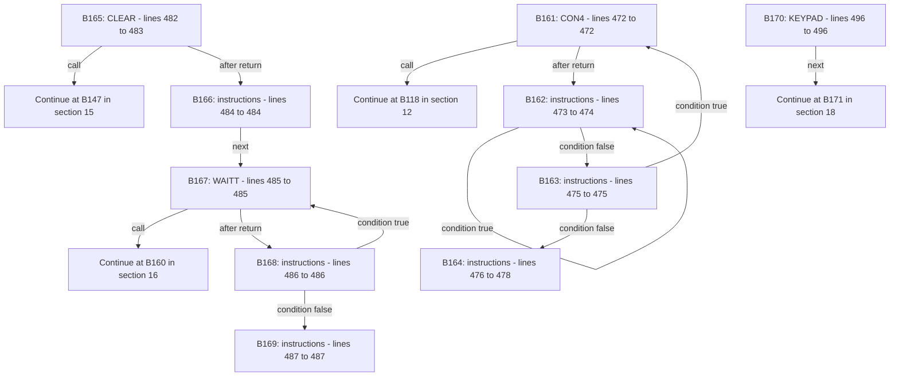

### B161

```asm
ACALL INTERRUPT_OCCUR
```

### B162

```asm
MOV R0,#250
DJNZ R0,$
```

### B163

```asm
DJNZ R1,CON4
```

### B164

Return to the instruction following the active call.

```asm
POP 1
POP 0
RET
```

### B165

```asm
MOV A,#01H
ACALL CMD
```

### B166

```asm
MOV R7,#17
```

### B167

```asm
ACALL LDELAY
```

### B168

```asm
DJNZ R7,WAITT
```

### B169

Return to the instruction following the active call.

```asm
RET
```

### B170

```asm
MOV P2,#11110000B
```

## Section 18

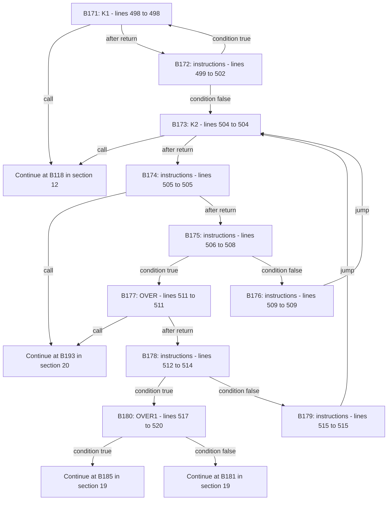

### B171

```asm
ACALL INTERRUPT_OCCUR
```

### B172

```asm
MOV P2,#11110000B
MOV A,P2
ANL A,#11110000B
CJNE A,#11110000B,K1
```

### B173

```asm
ACALL INTERRUPT_OCCUR
```

### B174

```asm
ACALL TMSEC
```

### B175

```asm
MOV A,P2
ANL A,#11110000B
CJNE A,#11110000B,OVER
```

### B176

```asm
SJMP K2
```

### B177

```asm
ACALL TMSEC
```

### B178

```asm
MOV A,P2
ANL A,#11110000B
CJNE A,#11110000B,OVER1
```

### B179

```asm
SJMP K2
```

### B180

```asm
MOV P2,#11111110B
MOV A,P2
ANL A,#11110000B
CJNE A,#11110000B,ROW_0
```

## Section 19

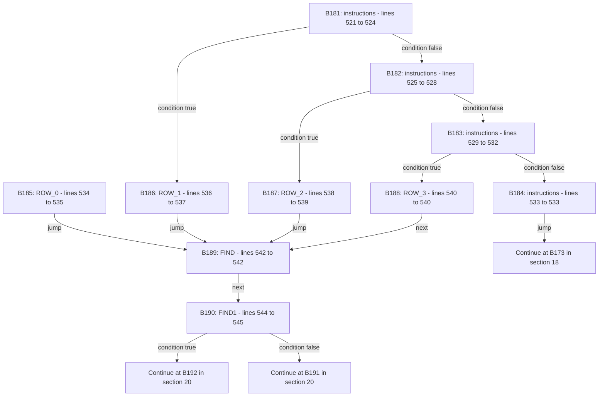

### B181

```asm
MOV P2,#11111101B
MOV A,P2
ANL A,#11110000B
CJNE A,#11110000B,ROW_1
```

### B182

```asm
MOV P2,#11111011B
MOV A,P2
ANL A,#11110000B
CJNE A,#11110000B,ROW_2
```

### B183

```asm
MOV P2,#11110111B
MOV A,P2
ANL A,#11110000B
CJNE A,#11110000B,ROW_3
```

### B184

```asm
LJMP K2
```

### B185

```asm
MOV DPTR,#KCODE0
SJMP FIND
```

### B186

```asm
MOV DPTR,#KCODE1
SJMP FIND
```

### B187

```asm
MOV DPTR,#KCODE2
SJMP FIND
```

### B188

```asm
MOV DPTR,#KCODE3
```

### B189

```asm
SWAP A
```

### B190

```asm
RRC A
JNC MATCH
```

## Section 20

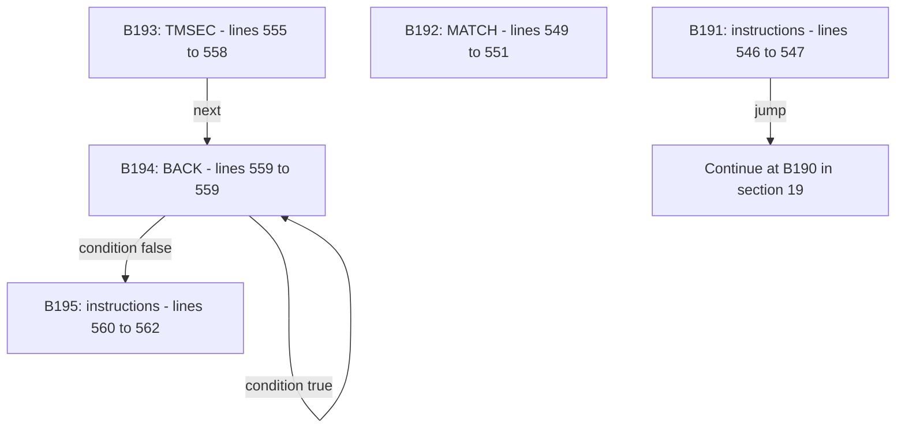

### B191

```asm
INC DPTR
SJMP FIND1
```

### B192

Return to the instruction following the active call.

```asm
CLR A
MOVC A,@A+DPTR
RET
```

### B193

```asm
MOV TMOD,#00000001B
MOV TL0,#0CAH
MOV TH0,#27H
SETB TR0
```

### B194

```asm
JNB TF0,BACK
```

### B195

Return to the instruction following the active call.

```asm
CLR TR0
CLR TF0
RET
```
