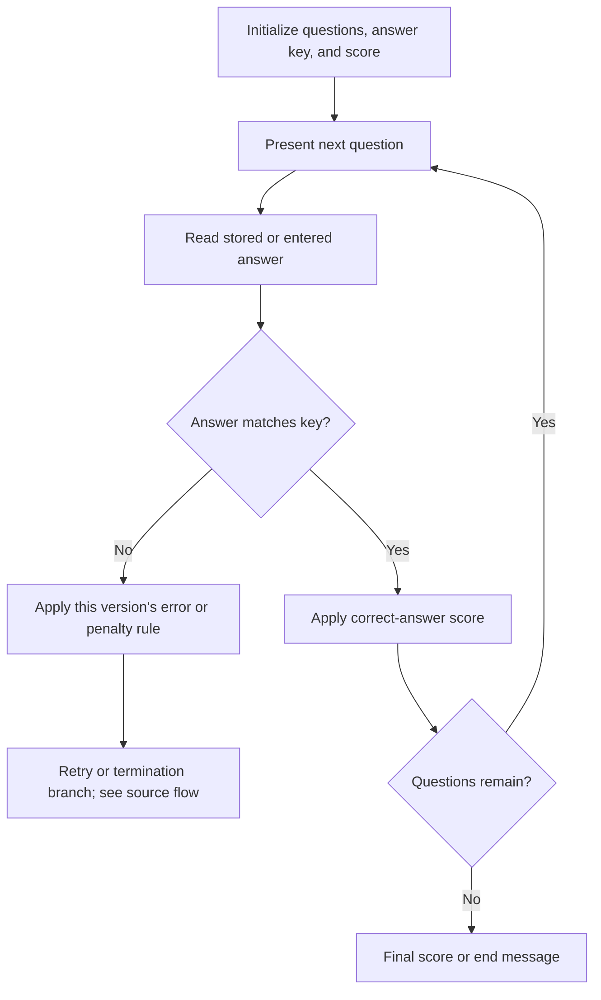
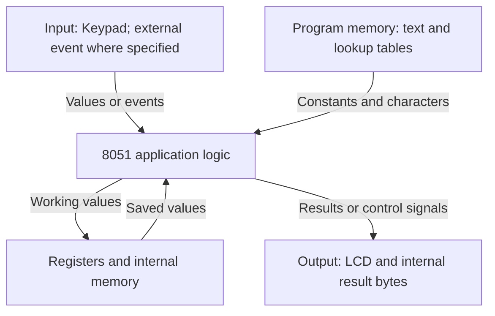

# Math Practice and Scoring

[Group overview](../../README.md) · [Compare implementations](../README.md)

Present arithmetic questions, compare the answers with the program’s answer key, and update a score.

**Implementation:** Keypad Table Driven Scoring

**Input:** keypad.  
**Output:** LCD and internal result bytes.

## Inputs and results

| Parameter | Description |
| --- | --- |
| Input | An answer for each question |
| Output | Correct-answer feedback, retry feedback, and score |

## Worked example

For the question 5 + 2, enter 7. The answer matches and the score increases according to that question’s weight.

### Calculation details

The first five bytes of QS encode “+”, 5, 2, expected answer 7 and weight 1. With the score initially 0, supply or select the answer 7. The equality check succeeds, the score increases to 1 and the table cursor advances to the next five-byte record.

## Program operation

### Functional flowchart

[Detailed control flow](source-flow.md)

### Simplified block diagram

**Port registers:** `P0`, `P0.0`, `P0.1`, `P0.2`, `P1.0`, `P1.3`, `P2`, `P2.0`, `P2.3`, `P2.4`, `P2.7`.

## Technical limitations

No additional defect was recorded in the earlier source review. This is not evidence of a successful build or hardware test.

## Build and test

1. Open the [assembly source](source.a51) in an 8051 assembler or simulator.
2. Review the technical limitations and configure the peripherals required by this implementation.
3. Check the expected result using the example inputs.
