# Program Control Flow

[Back to project](README.md)

Control-flow blocks are indexed by source line. Calls resume at the instruction following the call if the subroutine returns normally.

## Entry locations

- `ORG 0` begins at B1.

## Navigation

[Section 1](#section-1) · [Section 2](#section-2) · [Section 3](#section-3) · [Section 4](#section-4) · [Section 5](#section-5) · [Section 6](#section-6) · [Section 7](#section-7) · [Section 8](#section-8) · [Section 9](#section-9) · [Section 10](#section-10) · [Section 11](#section-11) · [Section 12](#section-12)

## Section 1

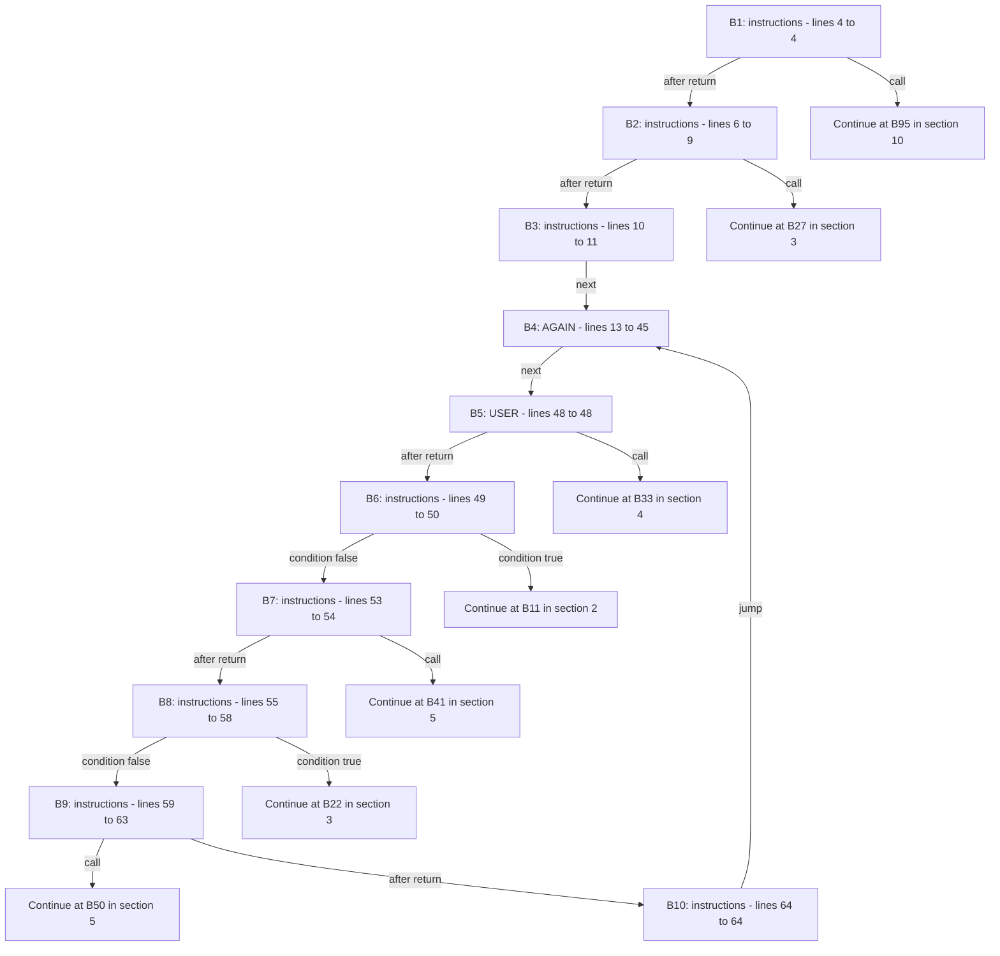

### B1

```asm
acall inlcd
```

### B2

```asm
MOV	34H,#1
MOV	35H,#0
MOV	36H,#0
ACALL WELCOME
```

### B3

```asm
MOV	DPTR,#QS
MOV R2,#0
```

### B4

```asm
MOV	DPTR,#QS
CLR	A
ADD A,R2
MOVC A,@A+DPTR
MOV	R1,A
INC	DPTR
CLR	A
ADD A,R2
MOVC A,@A+DPTR
MOV	R3,A
INC	DPTR
CLR	A
ADD A,R2
MOVC A,@A+DPTR
MOV	R4,A
INC	DPTR
CLR	A
ADD A,R2
MOVC A,@A+DPTR
MOV	R5,A
INC	DPTR
CLR	A
ADD A,R2
MOVC A,@A+DPTR
INC	DPTR
MOV	R6,A
MOV A,R2
ADD A,#5
MOV R2,A
MOV 77H,R1
```

### B5

```asm
ACALL QUESTION
```

### B6

```asm
MOV R1,77H
CJNE R1,#'+',NPL
```

### B7

```asm
MOV	37H,#7
ACALL ANS
```

### B8

```asm
MOV	30H,R5
MOV	A,30H
MOV	B,37H
CJNE A,B,WRONG
```

### B9

```asm
MOV	A,35H
ADD	A,R6
MOV	35H,A
INC	34H
ACALL RIGHT
```

### B10

```asm
SJMP AGAIN
```

## Section 2

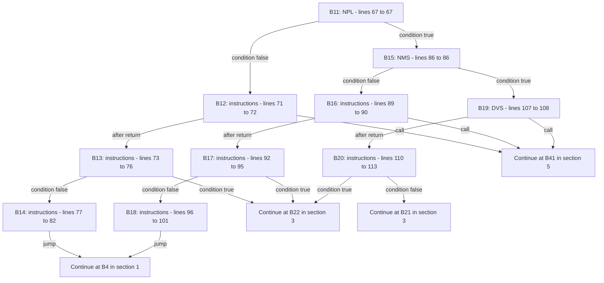

### B11

```asm
CJNE R1,#'-',NMS
```

### B12

```asm
MOV	37H,#4
ACALL ANS
```

### B13

```asm
MOV	31H,R5
MOV	A,31H
MOV	B,37H
CJNE A,B,WRONG
```

### B14

```asm
MOV	A,35H
ADD	A,R6
MOV	35H,A
INC	34H
SJMP AGAIN
```

### B15

```asm
CJNE R1,#'*',DVS
```

### B16

```asm
MOV	37H,#12
ACALL ANS
```

### B17

```asm
MOV	32H,R5
MOV	A,32H
MOV	B,37H
CJNE A,B,WRONG
```

### B18

```asm
MOV	A,35H
ADD	A,R6
MOV	35H,A
INC	34H
SJMP AGAIN
```

### B19

```asm
MOV	37H,#6
ACALL ANS
```

### B20

```asm
MOV	33H,R5
MOV	A,33H
MOV	B,37H
CJNE A,B,WRONG
```

## Section 3

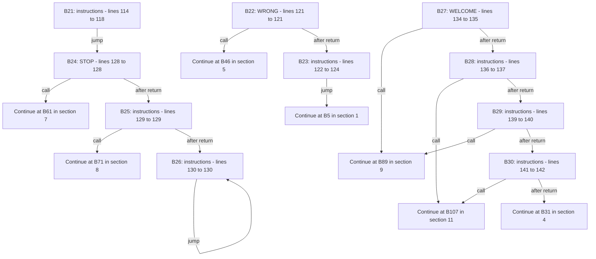

### B21

```asm
MOV	A,35H
ADD	A,R6
MOV	35H,A
SJMP STOP
```

### B22

```asm
ACALL WRONGG
```

### B23

```asm
INC	36H
DEC	35H
SJMP USER
```

### B24

```asm
ACALL SCORE
```

### B25

```asm
ACALL BYE
```

### B26

```asm
SJMP $
```

### B27

```asm
mov a, #80H
acall cmd
```

### B28

```asm
mov dptr, #str1
acall wstr
```

### B29

```asm
mov a,#0c0h
acall cmd
```

### B30

```asm
mov dptr, #str2
acall wstr
```

## Section 4

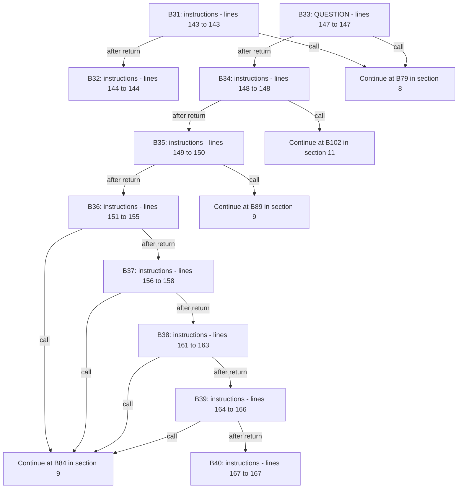

### B31

```asm
acall delay
```

### B32

Return to the instruction following the active call.

```asm
ret
```

### B33

```asm
ACALL DELAY
```

### B34

```asm
ACALL CLEAR
```

### B35

```asm
mov a, #80H
acall cmd
```

### B36

```asm
mov A,R3
MOV B,#10
DIV AB
ADD A,#30H
Acall WCHR
```

### B37

```asm
MOV A,B
ADD A,#30H
Acall WCHR
```

### B38

```asm
MOV R1,77H
mov A,R1
Acall WCHR
```

### B39

```asm
mov A,R4
ADD A,#30H
Acall WCHR
```

### B40

Return to the instruction following the active call.

```asm
ret
```

## Section 5

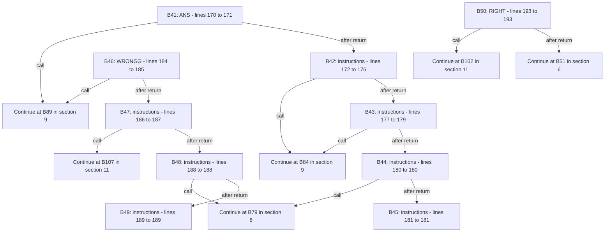

### B41

```asm
mov a,#0c0h
ACALL CMD
```

### B42

```asm
mov A,37H
MOV B,#10
DIV AB
ADD A,#30H
Acall WCHR
```

### B43

```asm
MOV A,B
ADD A,#30H
Acall WCHR
```

### B44

```asm
acall delay
```

### B45

Return to the instruction following the active call.

```asm
RET
```

### B46

```asm
mov a,#0C0h
acall cmd
```

### B47

```asm
mov dptr, #WRONGGG
acall wstr
```

### B48

```asm
acall delay
```

### B49

Return to the instruction following the active call.

```asm
ret
```

### B50

```asm
ACALL CLEAR
```

## Section 6

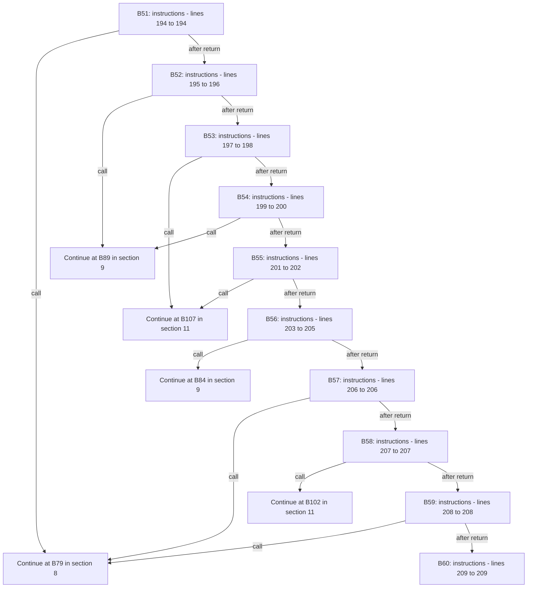

### B51

```asm
ACALL DELAY
```

### B52

```asm
mov a, #80H
acall cmd
```

### B53

```asm
mov dptr, #correctt
acall wstr
```

### B54

```asm
mov a,#0c0h
acall cmd
```

### B55

```asm
mov dptr, #scoree
acall wstr
```

### B56

```asm
mov A,35H
ADD A,#30H
Acall WCHR
```

### B57

```asm
ACALL DELAY
```

### B58

```asm
ACALL CLEAR
```

### B59

```asm
ACALL DELAY
```

### B60

Return to the instruction following the active call.

```asm
ret
```

## Section 7

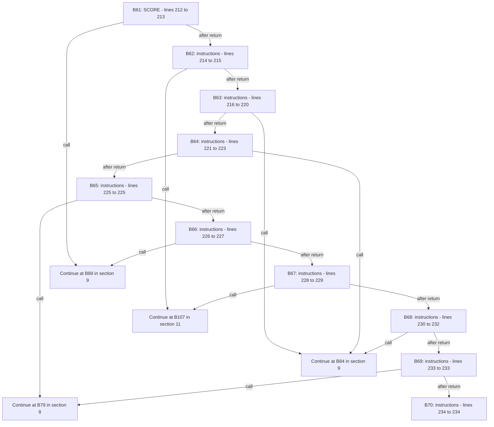

### B61

```asm
mov a, #80H
acall cmd
```

### B62

```asm
mov dptr, #SCOREE
acall wstr
```

### B63

```asm
mov A,35H
MOV B,#10
DIV AB
ADD A,#30H
Acall WCHR
```

### B64

```asm
MOV A,B
ADD A,#30H
Acall WCHR
```

### B65

```asm
acall delay
```

### B66

```asm
mov a,#0c0h
acall cmd
```

### B67

```asm
mov dptr, #FAIL
acall wstr
```

### B68

```asm
mov A,36H
ADD A,#30H
Acall WCHR
```

### B69

```asm
ACALL DELAY
```

### B70

Return to the instruction following the active call.

```asm
ret
```

## Section 8

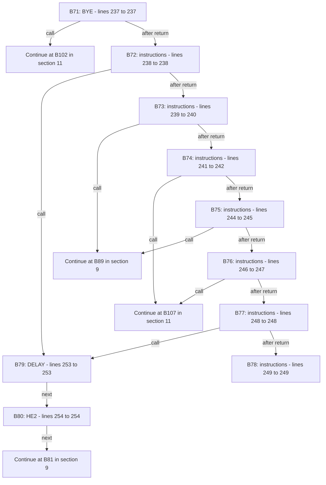

### B71

```asm
ACALL CLEAR
```

### B72

```asm
ACALL DELAY
```

### B73

```asm
mov a, #80H
acall cmd
```

### B74

```asm
mov dptr, #OVERR
acall wstr
```

### B75

```asm
mov a,#0c0h
acall cmd
```

### B76

```asm
mov dptr, #THANKS
acall wstr
```

### B77

```asm
acall delay
```

### B78

Return to the instruction following the active call.

```asm
RET
```

### B79

```asm
MOV R1,#100
```

### B80

```asm
MOV R0,#10
```

## Section 9

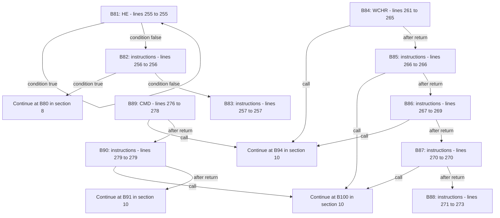

### B81

```asm
DJNZ R0,he
```

### B82

```asm
djnz r1,he2
```

### B83

Return to the instruction following the active call.

```asm
RET
```

### B84

```asm
PUSH ACC
PUSH B
SETB P1.3
MOV B,A
ACALL COMMON
```

### B85

```asm
ACALL LDELAY
```

### B86

```asm
MOV A,B
SWAP A
ACALL COMMON
```

### B87

```asm
ACALL LDELAY
```

### B88

Return to the instruction following the active call.

```asm
POP B
POP ACC
RET
```

### B89

```asm
CLR P1.3
MOV B,A
ACALL COMMON
```

### B90

```asm
ACALL LDELAY
```

## Section 10

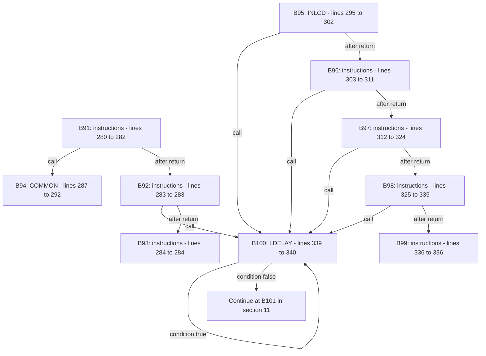

### B91

```asm
MOV A,B
SWAP A
ACALL COMMON
```

### B92

```asm
ACALL LDELAY
```

### B93

Return to the instruction following the active call.

```asm
RET
```

### B94

Return to the instruction following the active call.

```asm
ANL a,#11110000B
ANL P1, #00001111B
ORL P1,A
SETB P1.2
CLR P1.2
RET
```

### B95

```asm
CLR P1.3
CLR P1.7
CLR P1.6
SETB P1.5
CLR P1.4
SETB P1.2
CLR P1.2
ACALL LDELAY
```

### B96

```asm
SETB P1.2
CLR P1.2
SETB P1.7
CLR P1.6
CLR P1.5
CLR P1.4
SETB P1.2
CLR P1.2
ACALL LDELAY
```

### B97

```asm
CLR P1.7
CLR P1.6
CLR P1.5
CLR P1.4
SETB P1.2
CLR P1.2
SETB P1.7
SETB P1.6
SETB P1.5
SETB P1.4
SETB P1.2
CLR P1.2
ACALL LDELAY
```

### B98

```asm
CLR P1.7
CLR P1.6
CLR P1.5
CLR P1.4
SETB P1.2
CLR P1.2
SETB P1.6
SETB P1.5
SETB P1.2
CLR P1.2
ACALL LDELAY
```

### B99

Return to the instruction following the active call.

```asm
RET
```

### B100

```asm
MOV R0, #50
DJNZ R0, $
```

## Section 11

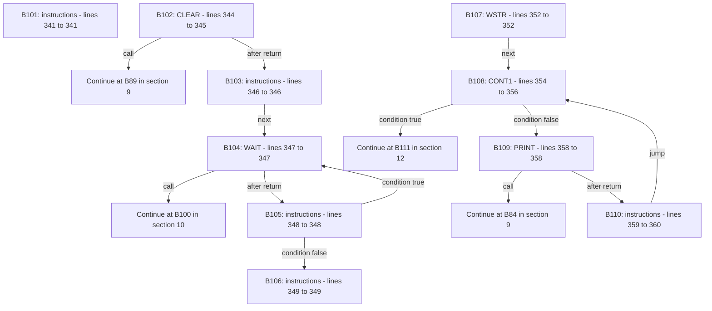

### B101

Return to the instruction following the active call.

```asm
RET
```

### B102

```asm
MOV A,#01H
ACALL CMD
```

### B103

```asm
MOV R7,#14
```

### B104

```asm
ACALL LDELAY
```

### B105

```asm
DJNZ R7,WAIT
```

### B106

Return to the instruction following the active call.

```asm
ret
```

### B107

```asm
PUSH    ACC
```

### B108

```asm
CLR     A
MOVC    A,@A+DPTR
JZ Exit1
```

### B109

```asm
ACALL    WCHR
```

### B110

```asm
INC DPTR
AJMP    CONT1
```

## Section 12

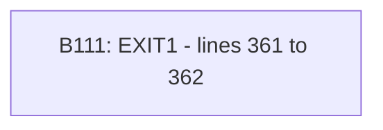

### B111

Return to the instruction following the active call.

```asm
POP     ACC
RET
```
