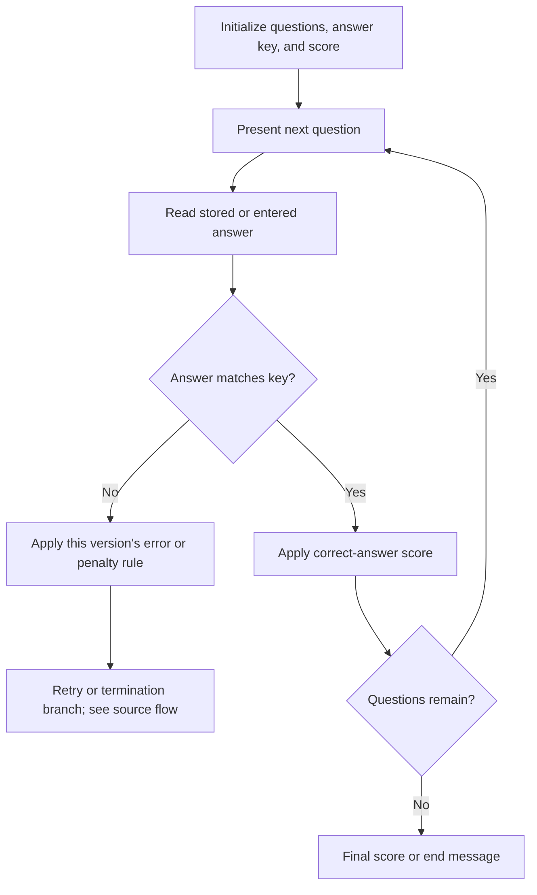
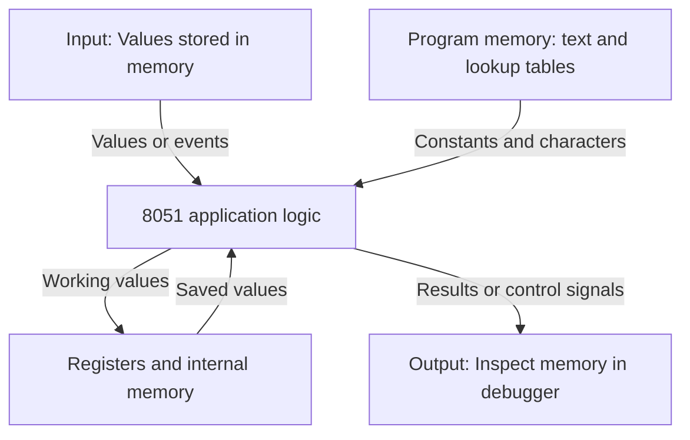

# Math Practice and Scoring

[Group overview](../../README.md) · [Compare implementations](../README.md)

Present arithmetic questions, compare the answers with the program’s answer key, and update a score.

**Implementation:** Fixed Input Answers Weighted Score

**Input:** values stored in memory.  
**Output:** inspect memory in debugger.

## Inputs and results

| Parameter | Description |
| --- | --- |
| Input | An answer for each question |
| Output | Correct-answer feedback, retry feedback, and score |

## Worked example

For the question 5 + 2, enter 7. The answer matches and the score increases according to that question’s weight.

### Calculation details

Use the provided answers in RAM. Question 1 reads 7 and awards one point. Question 2 reads 0 but expects 4, so the score falls to 0 and the question repeats. The next retry decrements the byte to FFH. Change 31H to 4 before retrying to advance.

## Program operation

### Functional flowchart

[Detailed control flow](source-flow.md)

### Simplified block diagram

Results are available in memory without a display.

## Technical limitations

- The Q3 and Q4 text strings disagree with the answers tested by CJNE. The constants in the comparison control scoring.

## Build and test

1. Open the [assembly source](source.asm) in an 8051 assembler or simulator.
2. Review the technical limitations and configure the peripherals required by this implementation.
3. Check the expected result using the example inputs.
