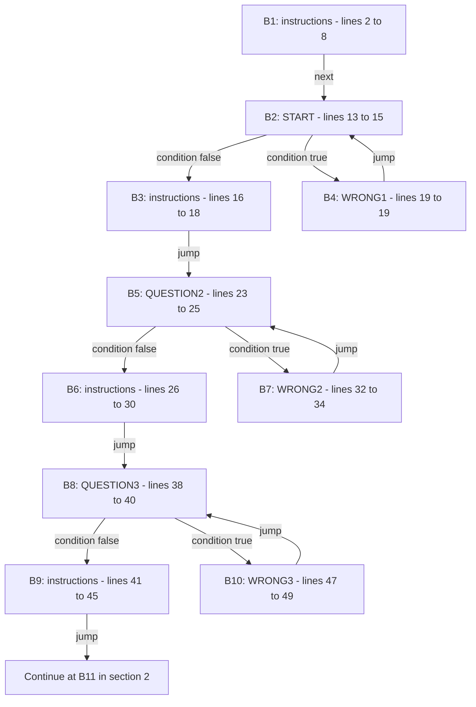
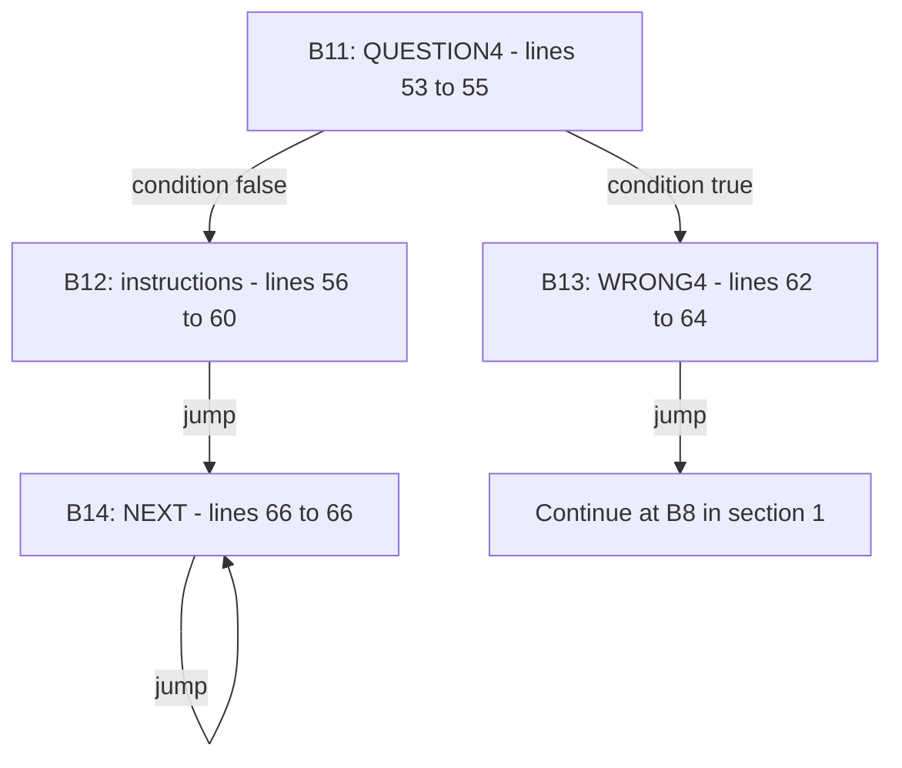

# Program Control Flow

[Back to project](README.md)

Control-flow blocks are indexed by source line. Calls resume at the instruction following the call if the subroutine returns normally.

## Entry locations

- `ORG 00H` begins at B1.

## Navigation

[Section 1](#section-1) · [Section 2](#section-2)

## Section 1



### B1

```asm
MOV 30H,#7
MOV 31H,#00
MOV 32H,#00
MOV 33H,#6
MOV 34H,#00
MOV 35H,#00
MOV R3,#0H
```

### B2

```asm
MOV DPTR,#Q1
MOV A,30H
CJNE A,#7, WRONG1
```

### B3

```asm
INC R3
MOV 35H,R3
SJMP QUESTION2
```

### B4

```asm
SJMP START
```

### B5

```asm
MOV DPTR,#Q2
MOV A,31H
CJNE A,#4, WRONG2
```

### B6

```asm
MOV A,#2
ADD A,R3
MOV R3,A
MOV 35H,R3
SJMP QUESTION3
```

### B7

```asm
DEC R3
MOV 35H,R3
SJMP QUESTION2
```

### B8

```asm
MOV DPTR,#Q3
MOV A,32H
CJNE A,#12, WRONG3
```

### B9

```asm
MOV A,#3
ADD A,R3
MOV R3,A
MOV 35H,R3
SJMP QUESTION4
```

### B10

```asm
DEC R3
MOV 35H,R3
SJMP QUESTION3
```

## Section 2



### B11

```asm
MOV DPTR,#Q4
MOV A,33H
CJNE A,#6, WRONG4
```

### B12

```asm
MOV A,#4
ADD A,R3
MOV R3,A
MOV 35H,R3
SJMP NEXT
```

### B13

```asm
DEC R3
MOV 35H,R3
SJMP QUESTION3
```

### B14

```asm
SJMP NEXT
```
