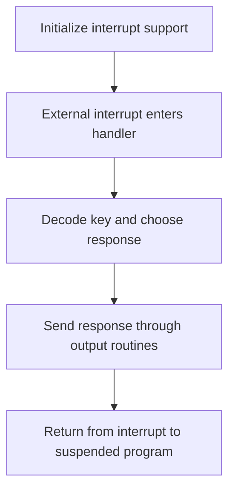
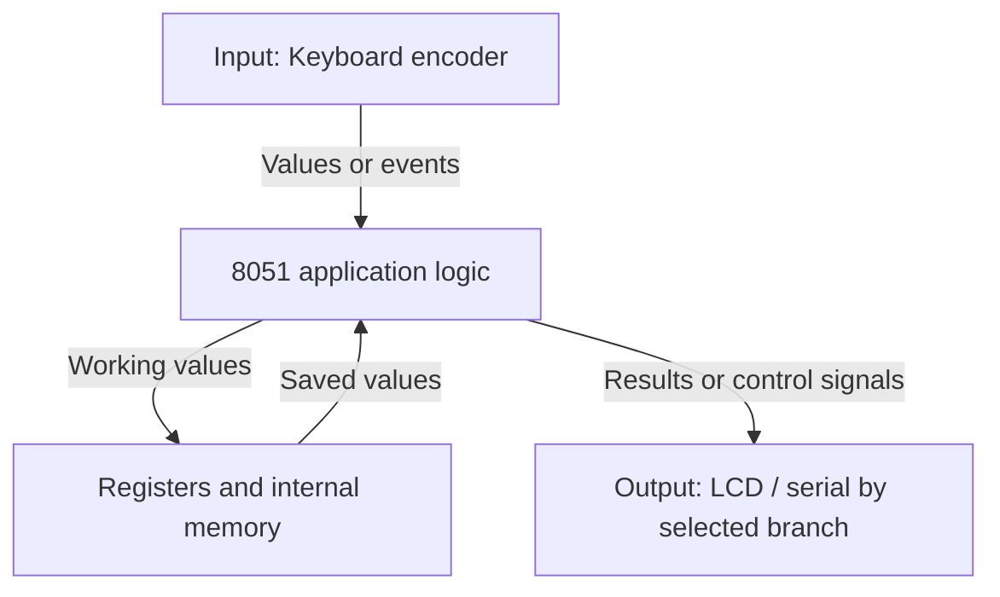

# Interrupt Driven Keypad Control

[Group overview](../../README.md) · [Compare implementations](../README.md)

Respond to an external interrupt by decoding a key and sending the selected message.

**Implementation:** External Interrupt Number Words

**Input:** keyboard encoder.  
**Output:** LCD / serial by selected branch.

## Inputs and results

| Parameter | Description |
| --- | --- |
| Input | External interrupt 1 and an encoder key |
| Output | A response on the LCD and serial interface |

## Worked example

For decoded key 1, the documented handler sends ONE. The serial sequence begins with a carriage return.

### Calculation details

Trigger external interrupt 1 with decoded key 1. A equals 31H, so the handler clears the LCD and transmits a carriage return. It sends O, N and E to COUT and WRDATA. The serial byte sequence is 0DH, 4FH, 4EH, 45H, and the LCD receives ONE.

## Program operation

1. Initialize interrupt support.
2. External interrupt enters handler.
3. Decode key and choose response.
4. Send response through output routines.
5. Return from interrupt to suspended program.

### Functional flowchart

[Detailed control flow](source-flow.md)

### Simplified block diagram

**Port registers:** `P1`, `P2`, `P3.2`, `P3.5`, `P3.6`, `P3.7`.

## Technical limitations

No additional defect was recorded in the earlier source review. This is not evidence of a successful build or hardware test.

## Build and test

1. Open the [assembly source](source.asm) in an 8051 assembler or simulator.
2. Review the technical limitations and configure the peripherals required by this implementation.
3. Check the expected result using the example inputs.
