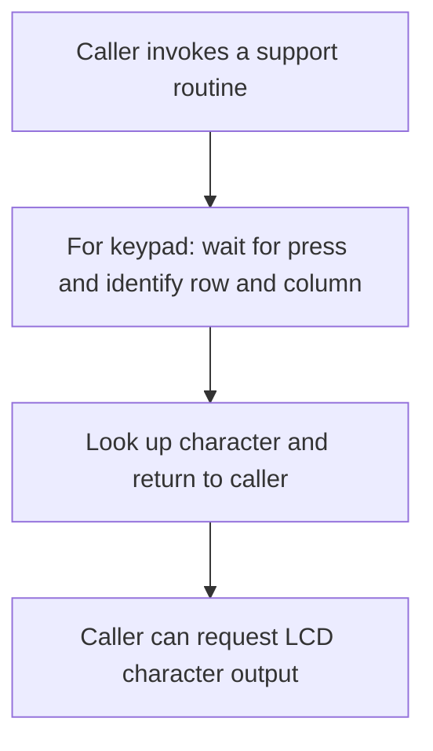
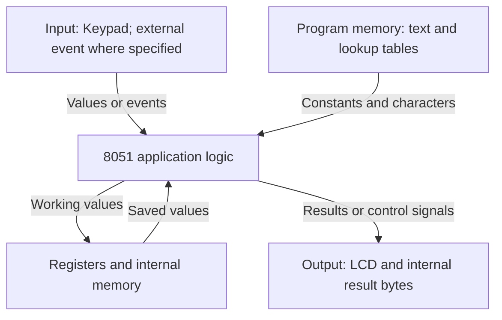

# Keypad And LCD Routines

[Group overview](../../README.md) · [Compare implementations](../README.md)

Provide support routines that scan a keypad and write characters or commands to an LCD.

**Implementation:** Matrix Keypad LCD Serial Library

**Input:** keypad.  
**Output:** LCD and internal result bytes.

## Inputs and results

| Parameter | Description |
| --- | --- |
| Input | Keypad row and column signals; characters supplied by a calling program |
| Output | A decoded character returned to the caller, or an LCD write |

## Worked example

The documented first keypad-table entry returns the * character, represented by byte 2AH.

### Calculation details

Call KEYPAD with the keypad released, then press the key mapped to the first entry of KCODE0. The scanner selects ROW_0, leaves DPTR pointing at that entry, and MOVC fetches the asterisk. A returns 2AH. Releasing the key lets the next call accept another press.

## Program operation

1. Caller invokes a support routine.
2. For keypad: wait for press and identify row and column.
3. Look up character and return to caller.
4. Caller can request LCD character output.

### Functional flowchart

[Detailed control flow](source-flow.md)

### Simplified block diagram

**Port registers:** `P0`, `P0.4`, `P0.6`, `P1`, `P1.2`, `P1.3`, `P1.4`, `P1.5`, `P1.6`, `P1.7`.

## Technical limitations

No additional defect was recorded in the earlier source review. This is not evidence of a successful build or hardware test.

## Build and test

1. Open the [assembly source](source.txt) in an 8051 assembler or simulator.
2. Review the technical limitations and configure the peripherals required by this implementation.
3. Check the expected result using the example inputs.
