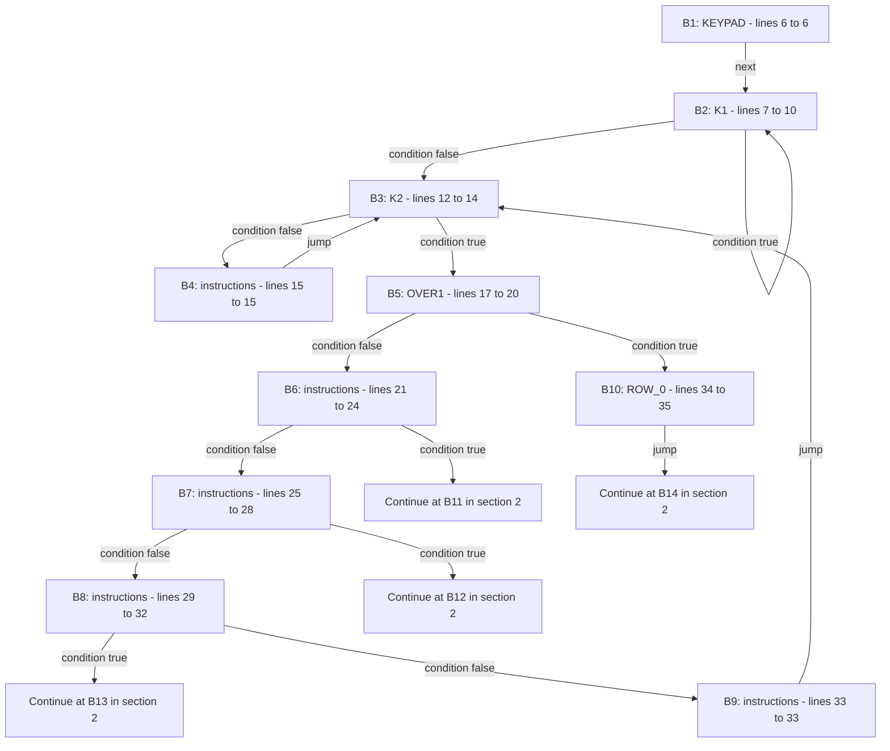
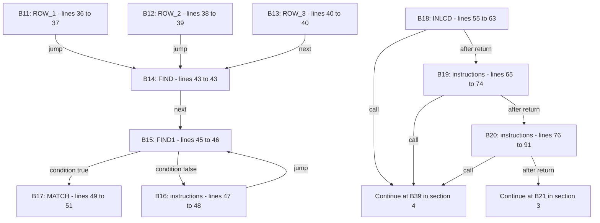
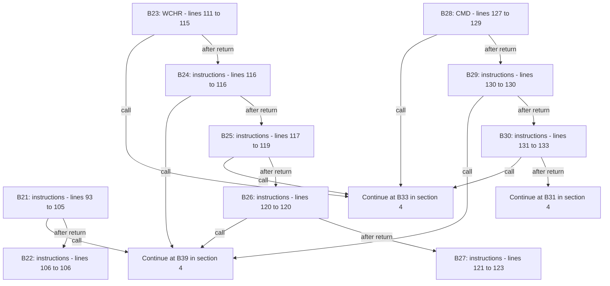
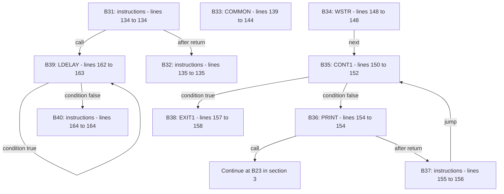
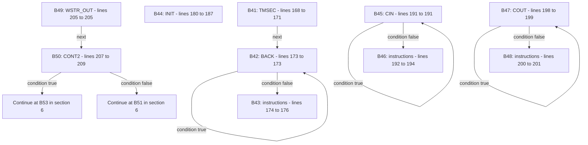
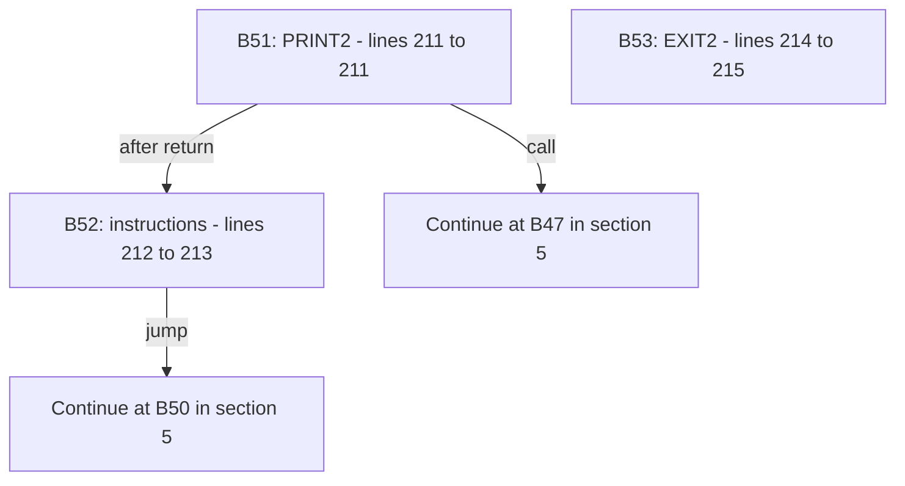

# Program Control Flow

[Back to project](README.md)

Control-flow blocks are indexed by source line. Calls resume at the instruction following the call if the subroutine returns normally.

## Entry locations

Start from the first executable block or the entry selected by the calling application.

## Navigation

[Section 1](#section-1) · [Section 2](#section-2) · [Section 3](#section-3) · [Section 4](#section-4) · [Section 5](#section-5) · [Section 6](#section-6)

## Section 1



### B1

```asm
MOV P0,#01110000B
```

### B2

```asm
MOV P0,#01110000B
MOV A,P0
ANL A,#01110000B
CJNE A,#01110000B,K1
```

### B3

```asm
MOV A,P0
ANL A,#01110000B
CJNE A,#01110000B,OVER1
```

### B4

```asm
SJMP K2
```

### B5

```asm
MOV P0,#01111110B
MOV A,P0
ANL A,#01110000B
CJNE A,#01110000B,ROW_0
```

### B6

```asm
MOV P0,#01111101B
MOV A,P0
ANL A,#01110000B
CJNE A,#01110000B,ROW_1
```

### B7

```asm
MOV P0,#01111011B
MOV A,P0
ANL A,#01110000B
CJNE A,#01110000B,ROW_2
```

### B8

```asm
MOV P0,#01110111B
MOV A,P0
ANL A,#01110000B
CJNE A,#01110000B,ROW_3
```

### B9

```asm
LJMP K2
```

### B10

```asm
MOV DPTR,#KCODE0
SJMP FIND
```

## Section 2



### B11

```asm
MOV DPTR,#KCODE1
SJMP FIND
```

### B12

```asm
MOV DPTR,#KCODE2
SJMP FIND
```

### B13

```asm
MOV DPTR,#KCODE3
```

### B14

```asm
RLC A
```

### B15

```asm
RLC A
JNC MATCH
```

### B16

```asm
INC DPTR
SJMP FIND1
```

### B17

Return to the instruction following the active call.

```asm
CLR A
MOVC A,@A+DPTR
RET
```

### B18

```asm
CLR P1.3
CLR P1.7
CLR P1.6
SETB P1.5
CLR P1.4
SETB P1.2
CLR P1.2
ACALL LDELAY
```

### B19

```asm
SETB P1.2
CLR P1.2
SETB P1.7
CLR P1.6
CLR P1.5
CLR P1.4
SETB P1.2
CLR P1.2
ACALL LDELAY
```

### B20

```asm
CLR P1.7
CLR P1.6
CLR P1.5
CLR P1.4
SETB P1.2
CLR P1.2
SETB P1.7
SETB P1.6
SETB P1.5
SETB P1.4
SETB P1.2
CLR P1.2
ACALL LDELAY
```

## Section 3



### B21

```asm
CLR P1.7
CLR P1.6
CLR P1.5
CLR P1.4
SETB P1.2
CLR P1.2
SETB P1.6
SETB P1.5
SETB P1.2
CLR P1.2
ACALL LDELAY
```

### B22

Return to the instruction following the active call.

```asm
RET
```

### B23

```asm
PUSH ACC
PUSH B
SETB P1.3
MOV B,A
ACALL COMMON
```

### B24

```asm
ACALL LDELAY
```

### B25

```asm
MOV A,B
SWAP A
ACALL COMMON
```

### B26

```asm
ACALL LDELAY
```

### B27

Return to the instruction following the active call.

```asm
POP B
POP ACC
RET
```

### B28

```asm
CLR P1.3
MOV B,A
ACALL COMMON
```

### B29

```asm
ACALL LDELAY
```

### B30

```asm
MOV A,B
SWAP A
ACALL COMMON
```

## Section 4



### B31

```asm
ACALL LDELAY
```

### B32

Return to the instruction following the active call.

```asm
RET
```

### B33

Return to the instruction following the active call.

```asm
ANL a,#11110000B
ANL P1, #00001111B
ORL P1,A
SETB P1.2
CLR P1.2
RET
```

### B34

```asm
PUSH    ACC
```

### B35

```asm
CLR     A
MOVC    A,@A+DPTR
JZ Exit1
```

### B36

```asm
ACALL    WCHR
```

### B37

```asm
INC DPTR
AJMP    CONT1
```

### B38

Return to the instruction following the active call.

```asm
POP     ACC
RET
```

### B39

```asm
MOV R0, #50
DJNZ R0, $
```

### B40

Return to the instruction following the active call.

```asm
RET
```

## Section 5



### B41

```asm
MOV   TMOD,#21H
MOV   TL0,#0CAH
MOV   TH0,#27H
SETB  TR0
```

### B42

```asm
JNB   TF0,BACK
```

### B43

Return to the instruction following the active call.

```asm
CLR   TR0
CLR   TF0
RET
```

### B44

Return to the instruction following the active call.

```asm
CLR SM0
SETB SM1
SETB REN
MOV TMOD, #21H
MOV TH1, #0FAH
MOV TL1, #0FAH
SETB TR1
RET
```

### B45

```asm
JNB RI, CIN
```

### B46

Return to the instruction following the active call.

```asm
CLR RI
MOV A,SBUF
RET
```

### B47

```asm
MOV SBUF,A
JNB TI, $
```

### B48

Return to the instruction following the active call.

```asm
CLR TI
RET
```

### B49

```asm
PUSH    ACC
```

### B50

```asm
CLR     A
MOVC    A,@A+DPTR
JZ Exit2
```

## Section 6



### B51

```asm
ACALL    COUT
```

### B52

```asm
INC DPTR
AJMP    CONT2
```

### B53

Return to the instruction following the active call.

```asm
POP     ACC
RET
```
