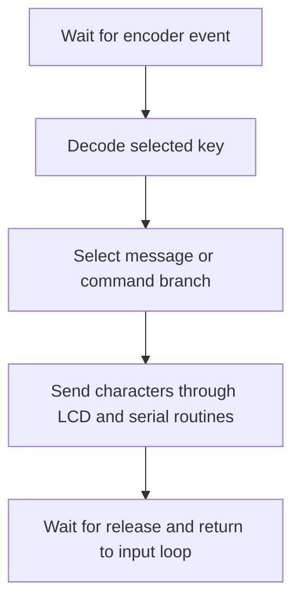
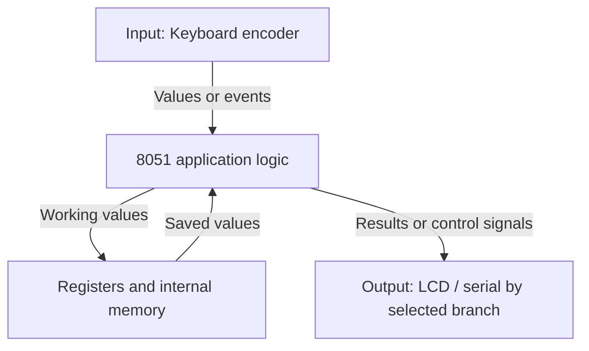

# Keypad Controlled LCD And Serial Output

[Group overview](../../README.md) · [Compare implementations](../README.md)

Use an encoder key to select a message and send characters to the LCD and serial interface.

**Implementation:** Encoder Number Word Selector

**Input:** keyboard encoder.  
**Output:** LCD / serial by selected branch.

## Inputs and results

| Parameter | Description |
| --- | --- |
| Input | An encoder key and, in supported branches, serial input |
| Output | A selected word or response on the output interfaces |

## Worked example

Selecting key 3 in the documented word branch sends THREE. A separate version’s key-1 branch sends ONE.

### Calculation details

Select key 1. ASCII 31H matches the first branch. The program clears the LCD, sends carriage return, then sends O, N and E to the serial transmitter and display routines. The expected word is ONE.

## Program operation

1. Wait for encoder event.
2. Decode selected key.
3. Select message or command branch.
4. Send characters through LCD and serial routines.
5. Wait for release and return to input loop.

### Functional flowchart

[Detailed control flow](source-flow.md)

### Simplified block diagram

**Port registers:** `P1`, `P2`, `P3.0`, `P3.2`, `P3.3`, `P3.4`.

## Technical limitations

No additional defect was recorded in the earlier source review. This is not evidence of a successful build or hardware test.

## Build and test

1. Open the [assembly source](source.asm) in an 8051 assembler or simulator.
2. Review the technical limitations and configure the peripherals required by this implementation.
3. Check the expected result using the example inputs.
