# Program Control Flow

[Back to project](README.md)

Control-flow blocks are indexed by source line. Calls resume at the instruction following the call if the subroutine returns normally.

## Entry locations

- `ORG 0H` begins at B1.

## Navigation

[Section 1](#section-1) · [Section 2](#section-2) · [Section 3](#section-3) · [Section 4](#section-4) · [Section 5](#section-5) · [Section 6](#section-6) · [Section 7](#section-7) · [Section 8](#section-8) · [Section 9](#section-9) · [Section 10](#section-10) · [Section 11](#section-11) · [Section 12](#section-12) · [Section 13](#section-13) · [Section 14](#section-14) · [Section 15](#section-15) · [Section 16](#section-16)

## Destinations requiring review

`HERE2`, `SIX`. A repeated label is also unresolved because it has more than one candidate target.

## Section 1

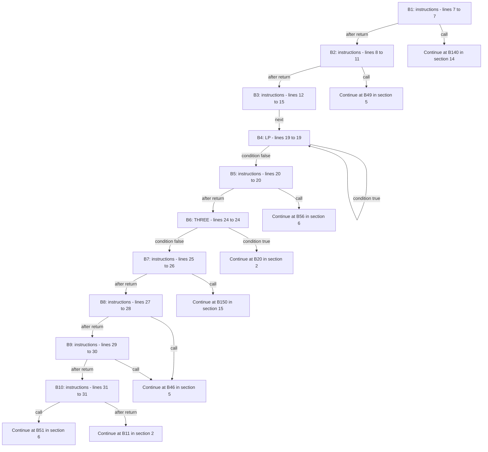

### B1

```asm
ACALL LCD_INI
```

### B2

```asm
MOV P1,#0FFH
SETB DAV
MOV A,#80H
ACALL WRCMD40
```

### B3

```asm
MOV TMOD ,#20H
MOV TH1,#-3
MOV SCON,#50H
SETB TR1
```

### B4

```asm
JNB DAV,LP
```

### B5

```asm
ACALL KEY
```

### B6

```asm
CJNE A,#'3',FOUR
```

### B7

```asm
MOV A,#1
ACALL WRCMD
```

### B8

```asm
MOV A,#0DH
ACALL SEND
```

### B9

```asm
MOV A,#'T'
ACALL SEND
```

### B10

```asm
ACALL WRDATA
```

## Section 2

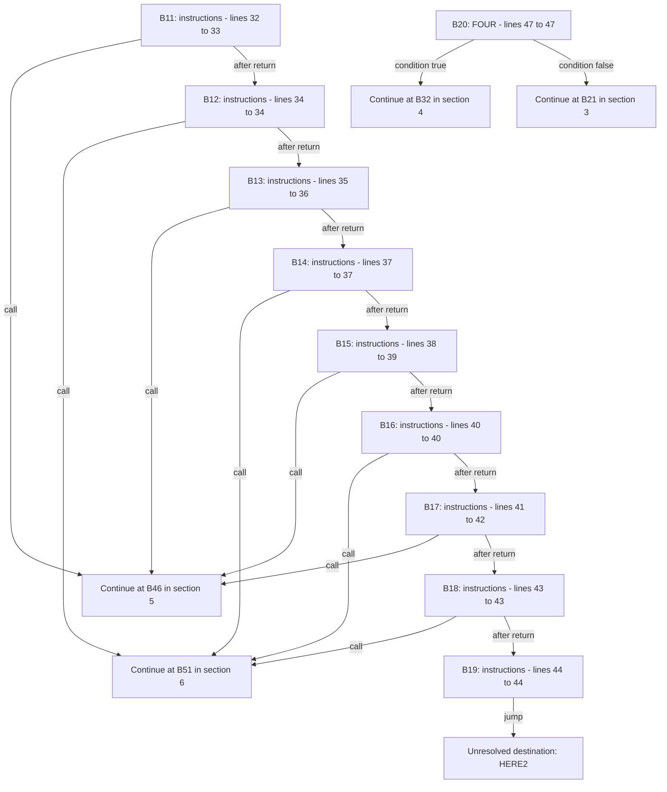

### B11

```asm
MOV A,#'H'
ACALL SEND
```

### B12

```asm
ACALL WRDATA
```

### B13

```asm
MOV A,#'R'
ACALL SEND
```

### B14

```asm
ACALL WRDATA
```

### B15

```asm
MOV A,#'E'
ACALL SEND
```

### B16

```asm
ACALL WRDATA
```

### B17

```asm
MOV A,#'E'
ACALL SEND
```

### B18

```asm
ACALL WRDATA
```

### B19

```asm
AJMP  HERE2
```

### B20

```asm
CJNE A,#'4',FIVE
```

## Section 3

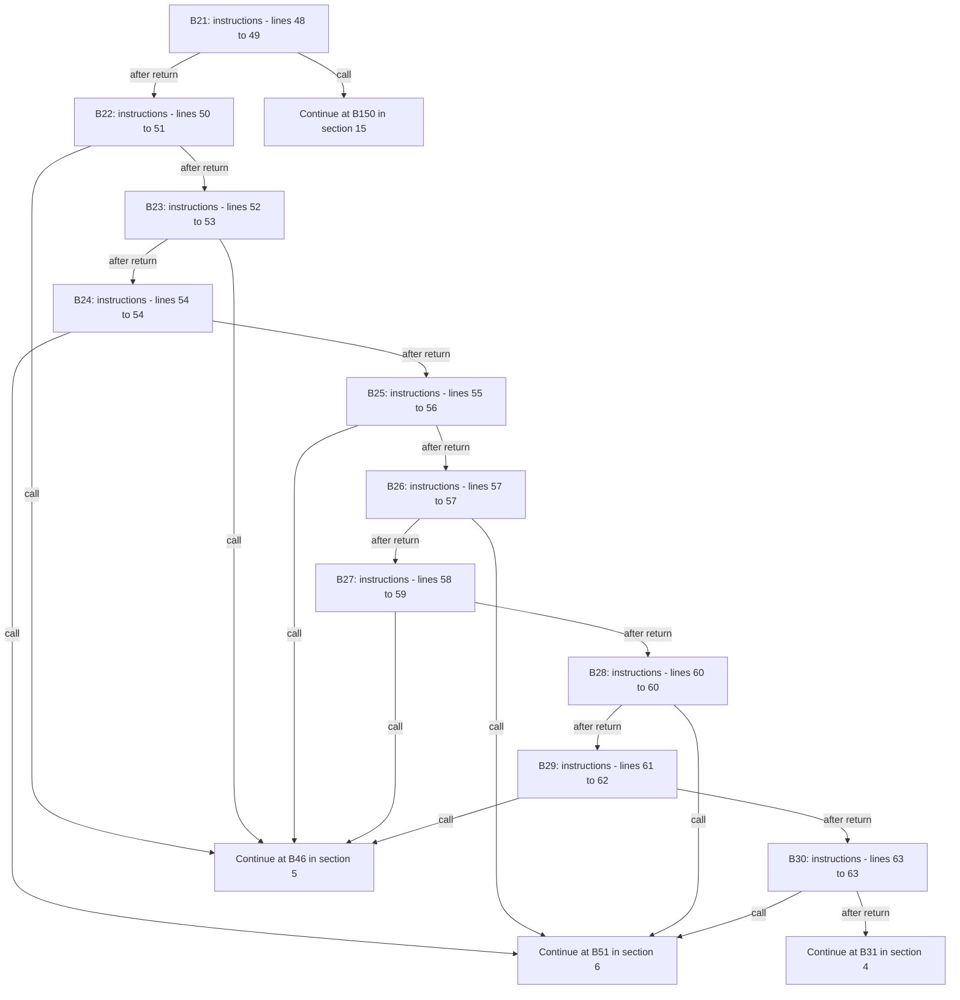

### B21

```asm
MOV A,#1
ACALL WRCMD
```

### B22

```asm
MOV A,#0DH
ACALL SEND
```

### B23

```asm
MOV A,#'F'
ACALL SEND
```

### B24

```asm
ACALL WRDATA
```

### B25

```asm
MOV A,#'O'
ACALL SEND
```

### B26

```asm
ACALL WRDATA
```

### B27

```asm
MOV A,#'U'
ACALL SEND
```

### B28

```asm
ACALL WRDATA
```

### B29

```asm
MOV A,#'R'
ACALL SEND
```

### B30

```asm
ACALL WRDATA
```

## Section 4


### B31

```asm
AJMP  HERE2
```

### B32

```asm
CJNE A,#'5',SIX
```

### B33

```asm
MOV A,#1
ACALL WRCMD
```

### B34

```asm
MOV A,#0DH
ACALL SEND
```

### B35

```asm
MOV A,#'F'
ACALL SEND
```

### B36

```asm
ACALL WRDATA
```

### B37

```asm
MOV A,#'I'
ACALL SEND
```

### B38

```asm
ACALL WRDATA
```

### B39

```asm
MOV A,#'V'
ACALL SEND
```

### B40

```asm
ACALL WRDATA
```

## Section 5

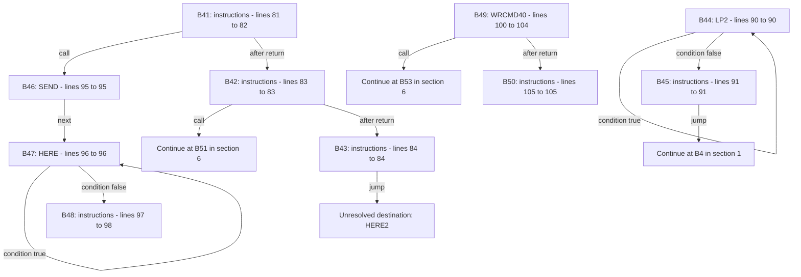

### B41

```asm
MOV A,#'E'
ACALL SEND
```

### B42

```asm
ACALL WRDATA
```

### B43

```asm
AJMP  HERE2
```

### B44

```asm
JB DAV,LP2
```

### B45

```asm
AJMP LP
```

### B46

```asm
MOV SBUF,A
```

### B47

```asm
JNB TI,HERE
```

### B48

Return to the instruction following the active call.

```asm
CLR TI
RET
```

### B49

```asm
MOV P2,A
CLR RS
SETB E
CLR E
ACALL WT40
```

### B50

Return to the instruction following the active call.

```asm
RET
```

## Section 6

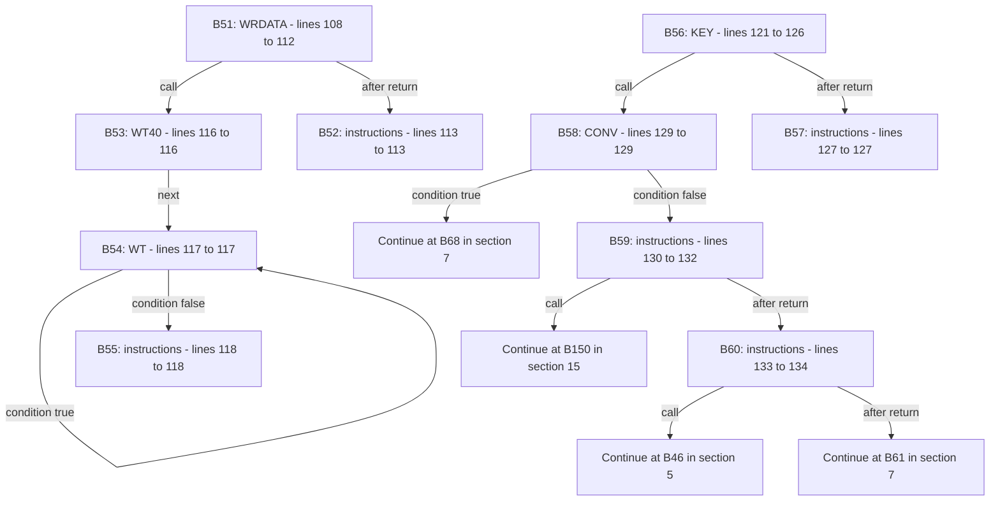

### B51

```asm
MOV P2,A
SETB RS
SETB E
CLR E
ACALL WT40
```

### B52

Return to the instruction following the active call.

```asm
RET
```

### B53

```asm
MOV R0,#19
```

### B54

```asm
DJNZ R0,WT
```

### B55

Return to the instruction following the active call.

```asm
RET
```

### B56

```asm
CLR OE
NOP
MOV A,P1
SETB OE
ANL A,#0FH
ACALL CONV
```

### B57

Return to the instruction following the active call.

```asm
RET
```

### B58

```asm
cjne A, #0, k1
```

### B59

```asm
mov A, #'1'
MOV A,#1
ACALL WRCMD
```

### B60

```asm
MOV A,#0DH
ACALL SEND
```

## Section 7

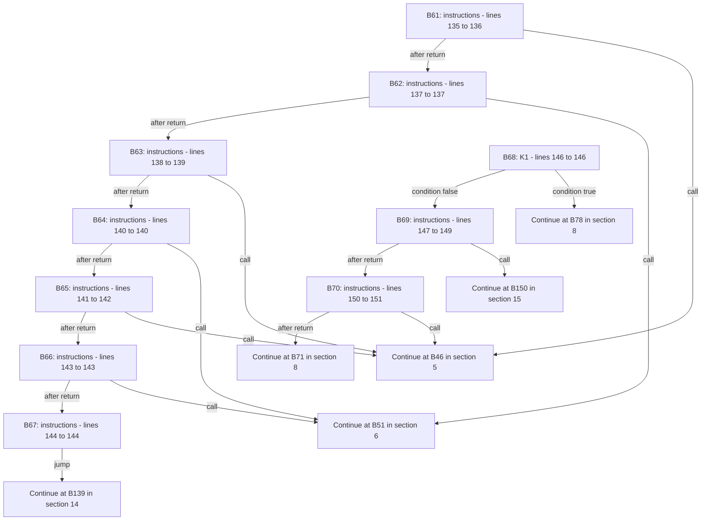

### B61

```asm
MOV A,#'O'
ACALL SEND
```

### B62

```asm
ACALL WRDATA
```

### B63

```asm
MOV A,#'N'
ACALL SEND
```

### B64

```asm
ACALL WRDATA
```

### B65

```asm
MOV A,#'E'
ACALL SEND
```

### B66

```asm
ACALL WRDATA
```

### B67

```asm
jmp got_it
```

### B68

```asm
cjne A, #1, k2
```

### B69

```asm
mov A, #'2'
MOV A,#1
ACALL WRCMD
```

### B70

```asm
MOV A,#0DH
ACALL SEND
```

## Section 8

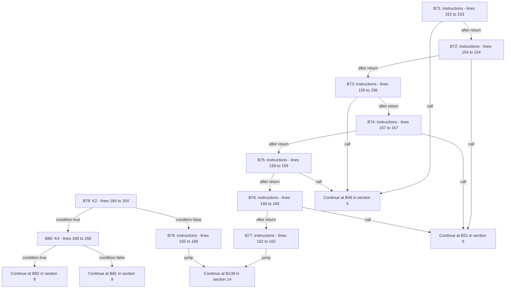

### B71

```asm
MOV A,#'T'
ACALL SEND
```

### B72

```asm
ACALL WRDATA
```

### B73

```asm
MOV A,#'O'
ACALL SEND
```

### B74

```asm
ACALL WRDATA
```

### B75

```asm
MOV A,#'W'
ACALL SEND
```

### B76

```asm
ACALL WRDATA
```

### B77

```asm
jmp got_it
```

### B78

```asm
cjne A, #2, k4
```

### B79

```asm
mov A, #'3'
jmp got_it
```

### B80

```asm
cjne A, #4, k5
```

## Section 9

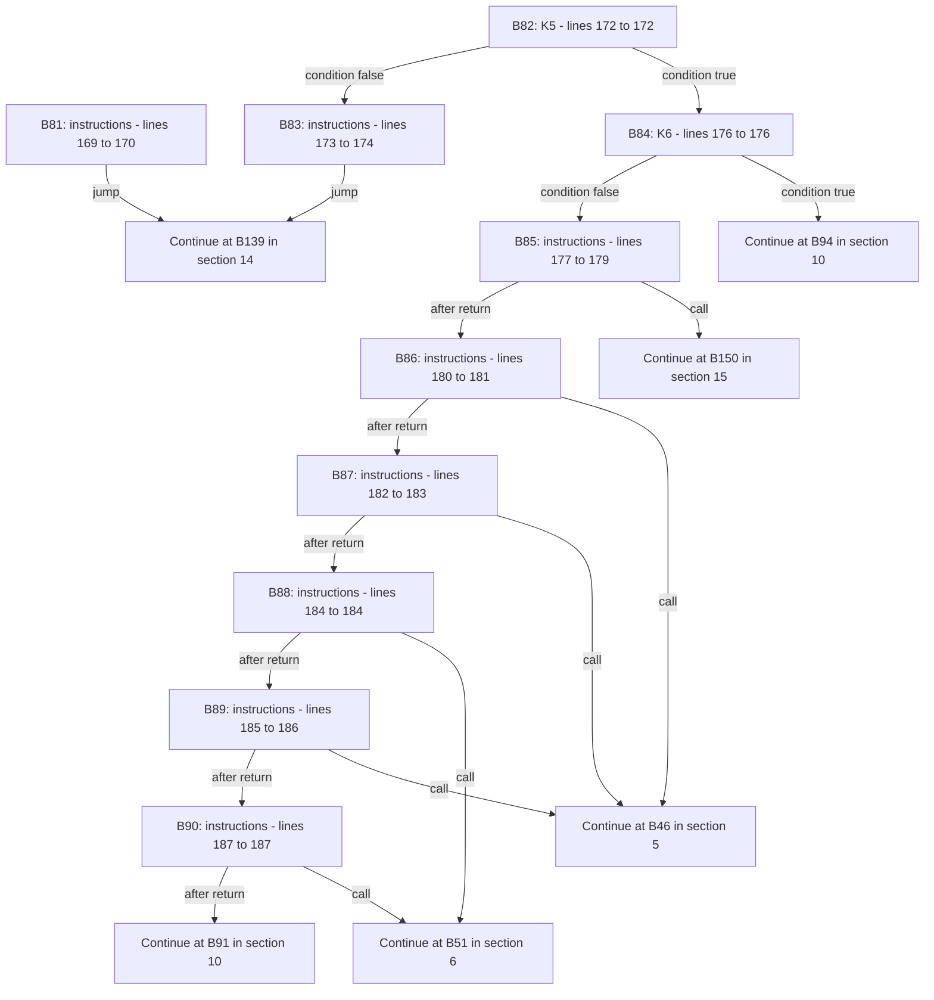

### B81

```asm
mov A, #'4'
jmp got_it
```

### B82

```asm
cjne A, #5, k6
```

### B83

```asm
mov A, #'5'
jmp got_it
```

### B84

```asm
cjne A, #6, k8
```

### B85

```asm
mov A, #'6'
MOV A,#1
ACALL WRCMD
```

### B86

```asm
MOV A,#0DH
ACALL SEND
```

### B87

```asm
MOV A,#'s'
ACALL SEND
```

### B88

```asm
ACALL WRDATA
```

### B89

```asm
MOV A,#'i'
ACALL SEND
```

### B90

```asm
ACALL WRDATA
```

## Section 10

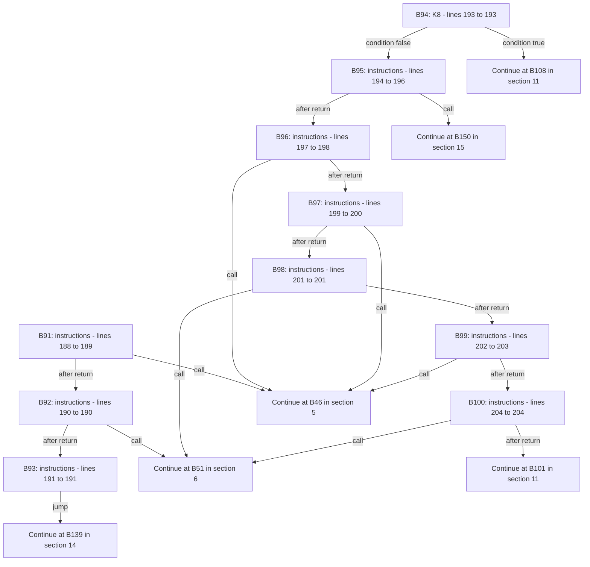

### B91

```asm
MOV A,#'x'
ACALL SEND
```

### B92

```asm
ACALL WRDATA
```

### B93

```asm
jmp got_it
```

### B94

```asm
cjne A, #8, k9
```

### B95

```asm
mov A, #'7'
MOV A,#1
ACALL WRCMD
```

### B96

```asm
MOV A,#0DH
ACALL SEND
```

### B97

```asm
MOV A,#'s'
ACALL SEND
```

### B98

```asm
ACALL WRDATA
```

### B99

```asm
MOV A,#'e'
ACALL SEND
```

### B100

```asm
ACALL WRDATA
```

## Section 11

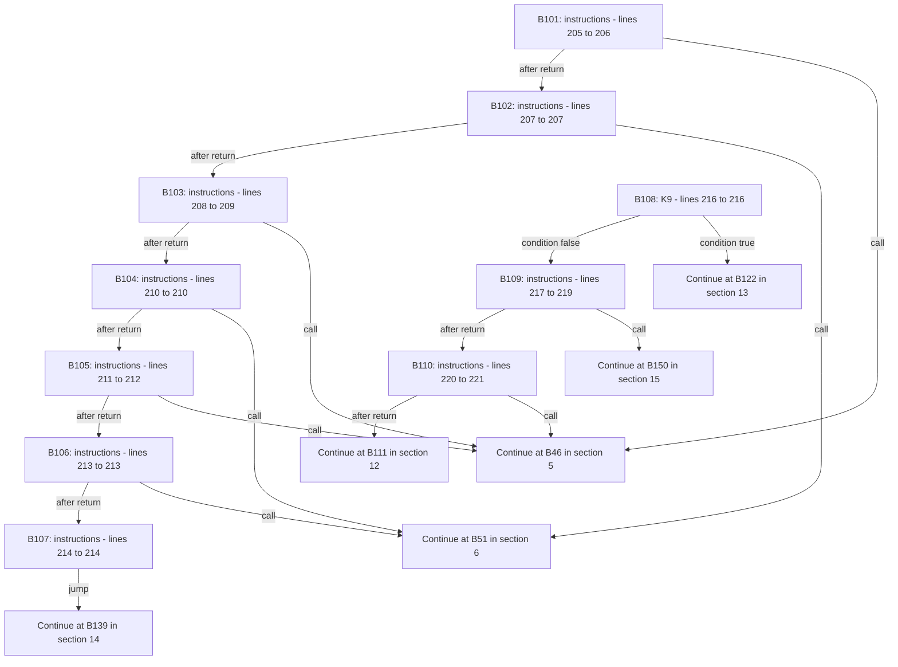

### B101

```asm
MOV A,#'v'
ACALL SEND
```

### B102

```asm
ACALL WRDATA
```

### B103

```asm
MOV A,#'e'
ACALL SEND
```

### B104

```asm
ACALL WRDATA
```

### B105

```asm
MOV A,#'n'
ACALL SEND
```

### B106

```asm
ACALL WRDATA
```

### B107

```asm
jmp got_it
```

### B108

```asm
cjne A, #9, k10
```

### B109

```asm
mov A, #'8'
MOV A,#1
ACALL WRCMD
```

### B110

```asm
MOV A,#0DH
ACALL SEND
```

## Section 12

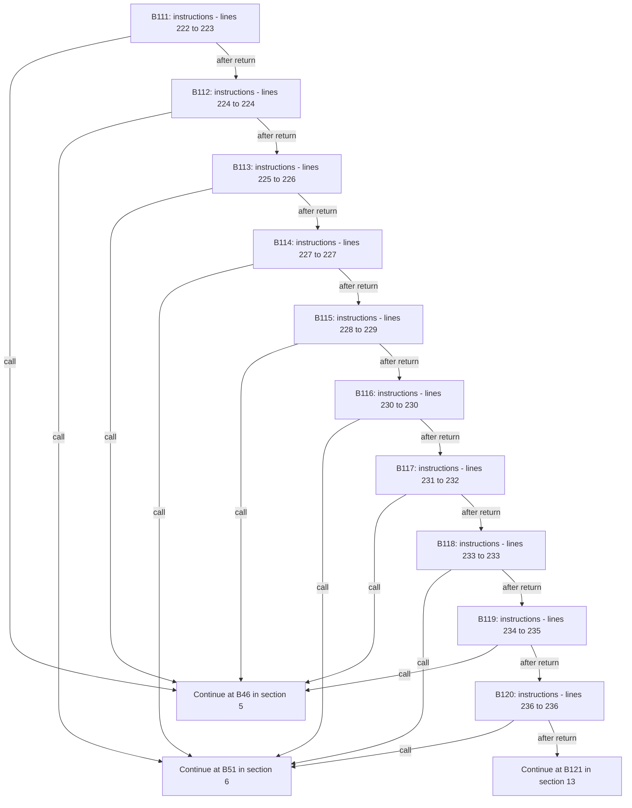

### B111

```asm
MOV A,#'e'
ACALL SEND
```

### B112

```asm
ACALL WRDATA
```

### B113

```asm
MOV A,#'i'
ACALL SEND
```

### B114

```asm
ACALL WRDATA
```

### B115

```asm
MOV A,#'g'
ACALL SEND
```

### B116

```asm
ACALL WRDATA
```

### B117

```asm
MOV A,#'h'
ACALL SEND
```

### B118

```asm
ACALL WRDATA
```

### B119

```asm
MOV A,#'t'
ACALL SEND
```

### B120

```asm
ACALL WRDATA
```

## Section 13

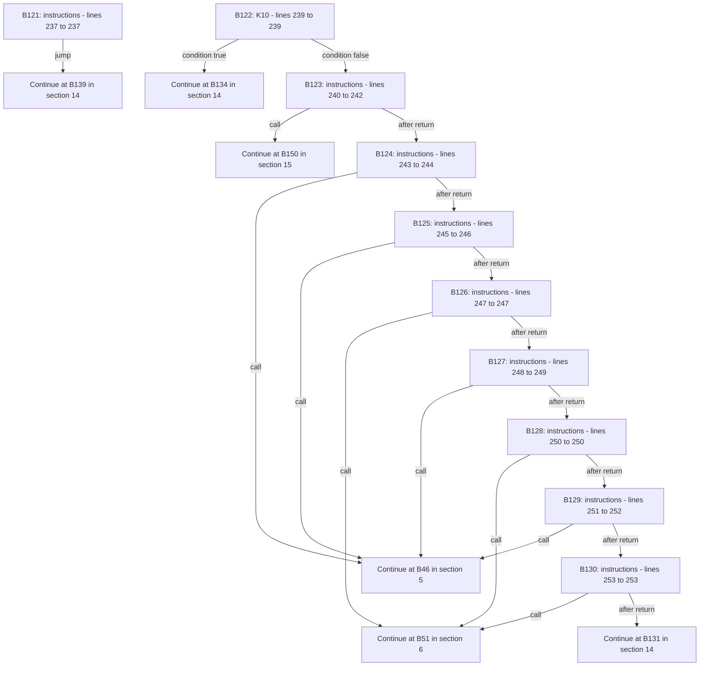

### B121

```asm
jmp got_it
```

### B122

```asm
cjne A, #10, k12
```

### B123

```asm
mov A, #'9'
MOV A,#1
ACALL WRCMD
```

### B124

```asm
MOV A,#0DH
ACALL SEND
```

### B125

```asm
MOV A,#'n'
ACALL SEND
```

### B126

```asm
ACALL WRDATA
```

### B127

```asm
MOV A,#'i'
ACALL SEND
```

### B128

```asm
ACALL WRDATA
```

### B129

```asm
MOV A,#'n'
ACALL SEND
```

### B130

```asm
ACALL WRDATA
```

## Section 14

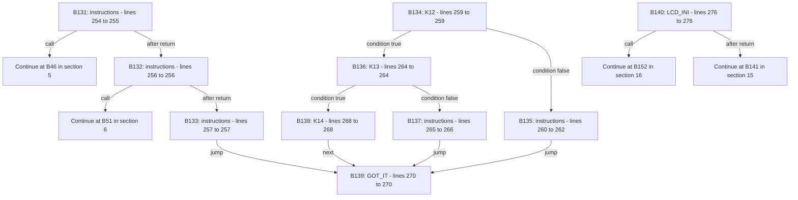

### B131

```asm
MOV A,#'e'
ACALL SEND
```

### B132

```asm
ACALL WRDATA
```

### B133

```asm
jmp got_it
```

### B134

```asm
cjne A, #12, k13
```

### B135

```asm
mov A, #'*'
jmp got_it
```

### B136

```asm
cjne A, #13, k14
```

### B137

```asm
mov A, #'0'
jmp got_it
```

### B138

```asm
mov A, # '#'
```

### B139

Return to the instruction following the active call.

```asm
ret
```

### B140

```asm
ACALL WAIT
```

## Section 15

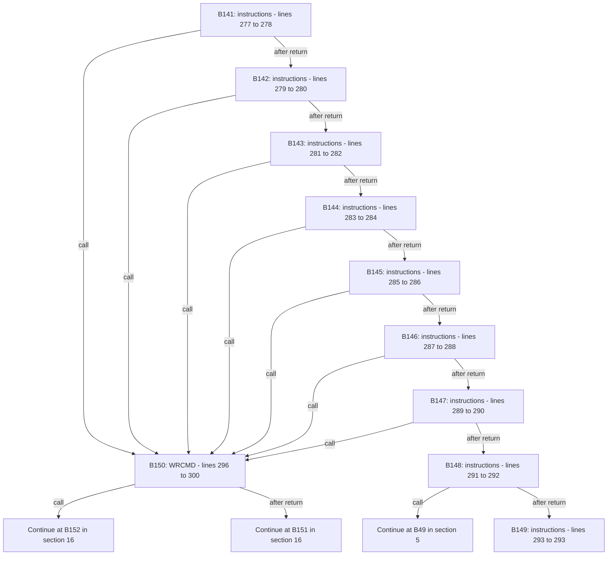

### B141

```asm
MOV A,#38H
ACALL WRCMD
```

### B142

```asm
MOV A,#038H
ACALL WRCMD
```

### B143

```asm
MOV A,#038H
ACALL WRCMD
```

### B144

```asm
MOV A,#038H
ACALL WRCMD
```

### B145

```asm
MOV A,#8
ACALL WRCMD
```

### B146

```asm
MOV A,#1
ACALL WRCMD
```

### B147

```asm
MOV A,#6
ACALL WRCMD
```

### B148

```asm
MOV A,#0FH
ACALL WRCMD40
```

### B149

Return to the instruction following the active call.

```asm
RET
```

### B150

```asm
MOV P2,A
CLR RS
SETB E
CLR E
ACALL WAIT
```

## Section 16

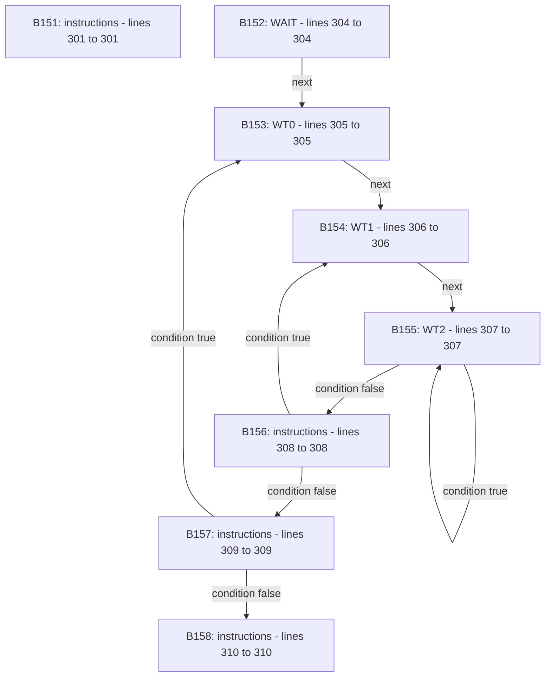

### B151

Return to the instruction following the active call.

```asm
RET
```

### B152

```asm
MOV R5,#1
```

### B153

```asm
MOV R6,#28
```

### B154

```asm
MOV R7,#255
```

### B155

```asm
DJNZ R7,WT2
```

### B156

```asm
DJNZ R6,WT1
```

### B157

```asm
DJNZ R5,WT0
```

### B158

Return to the instruction following the active call.

```asm
RET
```
