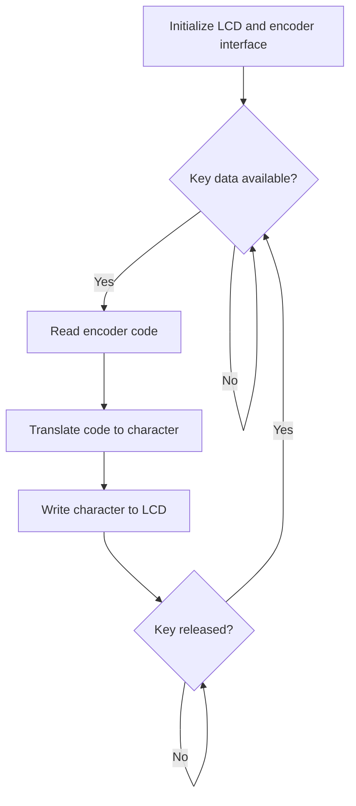
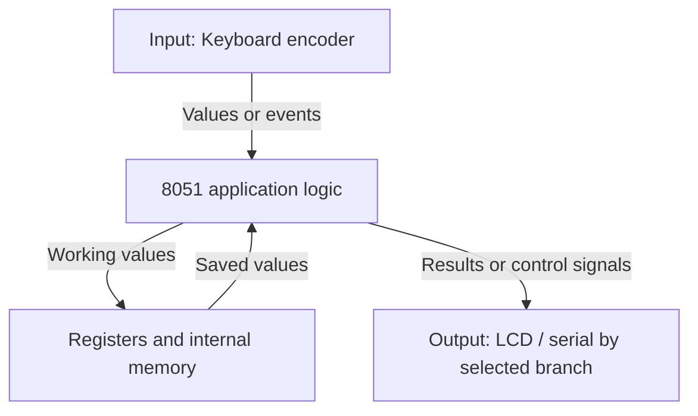

# Keypad Echo To LCD

[Group overview](../../README.md) · [Compare implementations](../README.md)

Show a decoded key on the LCD, then wait for its release before accepting another press.

**Implementation:** Encoder Character LCD Output

**Input:** keyboard encoder.  
**Output:** LCD / serial by selected branch.

## Inputs and results

| Parameter | Description |
| --- | --- |
| Input | Encoder key code and data-available signal |
| Output | The corresponding LCD character |

## Worked example

Encoder code 0 maps to the character 1. Pressing and releasing that key produces one character output on the normal path.

### Calculation details

Press the encoder key whose low nibble is 0. When DAV is asserted, KEY reads P1 and masks it with 0FH. CONV maps 0 to ASCII 31H. WRDATA places 31H on P2 and strobes E with RS set, so the LCD receives the character 1. Release DAV to accept another key.

## Program operation

### Functional flowchart

[Detailed control flow](source-flow.md)

### Simplified block diagram

**Port registers:** `P1`, `P2`, `P3.0`, `P3.1`, `P3.2`, `P3.3`.

## Technical limitations

- has a malformed character literal in `mov A, #6'`.
- has a malformed character literal in `mov A, #0'`.

## Build and test

1. Open the [assembly source](source.asm) in an 8051 assembler or simulator.
2. Review the technical limitations and configure the peripherals required by this implementation.
3. Check the expected result using the example inputs.
