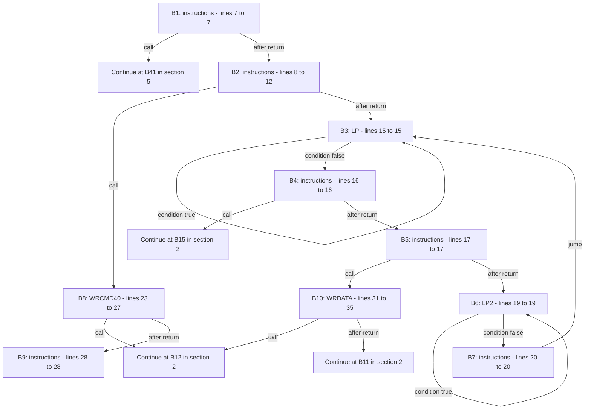
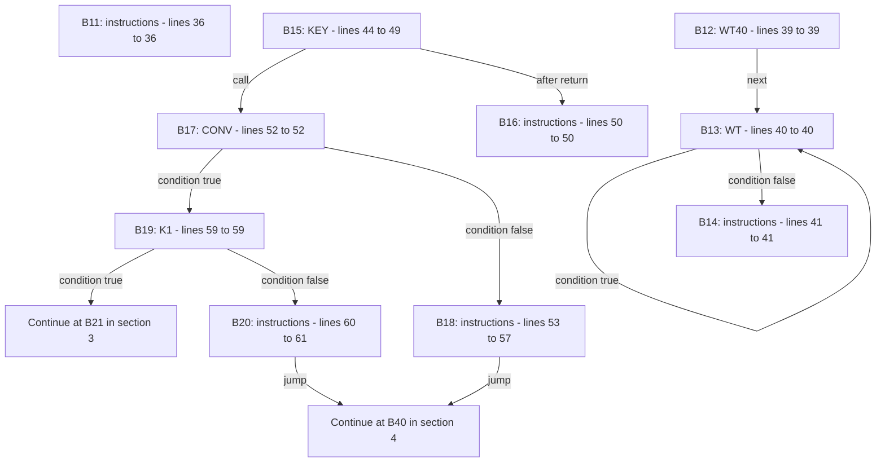
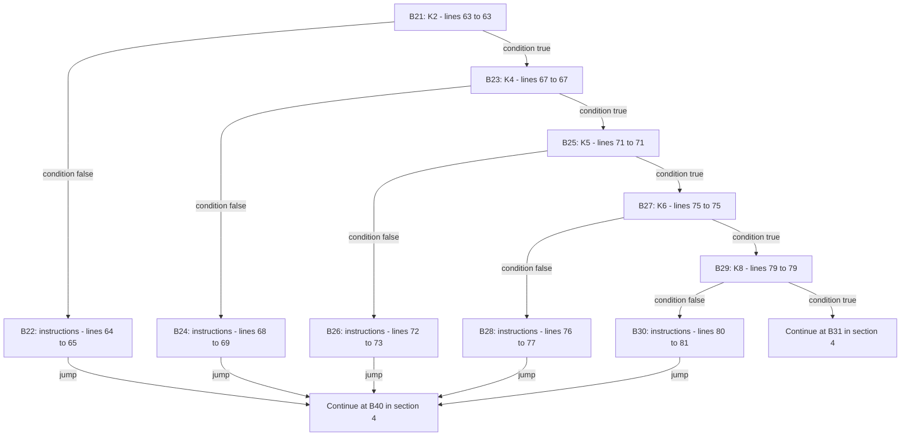
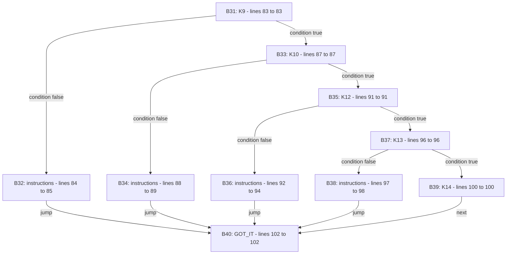
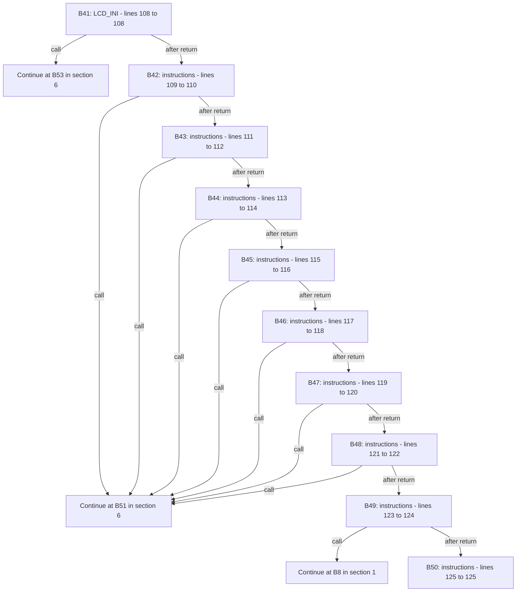
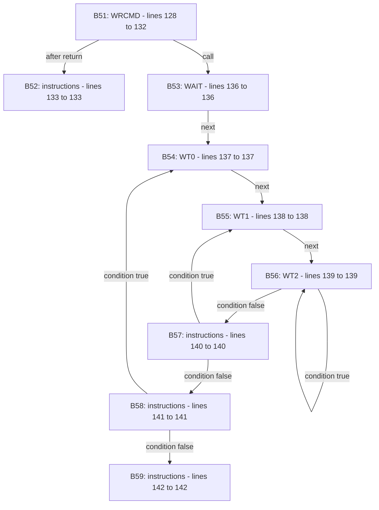

# Program Control Flow

[Back to project](README.md)

Control-flow blocks are indexed by source line. Calls resume at the instruction following the call if the subroutine returns normally.

## Entry locations

- `ORG 0H` begins at B1.

## Navigation

[Section 1](#section-1) · [Section 2](#section-2) · [Section 3](#section-3) · [Section 4](#section-4) · [Section 5](#section-5) · [Section 6](#section-6)

## Section 1



### B1

```asm
ACALL LCD_INI
```

### B2

```asm
MOV P1,#0FFH
SETB DAV
MOV A,#80H
ACALL WRCMD40
```

### B3

```asm
JNB DAV,LP
```

### B4

```asm
ACALL KEY
```

### B5

```asm
ACALL WRDATA
```

### B6

```asm
JB DAV,LP2
```

### B7

```asm
SJMP LP
```

### B8

```asm
MOV P2,A
CLR RS
SETB E
CLR E
ACALL WT40
```

### B9

Return to the instruction following the active call.

```asm
RET
```

### B10

```asm
MOV P2,A
SETB RS
SETB E
CLR E
ACALL WT40
```

## Section 2



### B11

Return to the instruction following the active call.

```asm
RET
```

### B12

```asm
MOV R0,#19
```

### B13

```asm
DJNZ R0,WT
```

### B14

Return to the instruction following the active call.

```asm
RET
```

### B15

```asm
CLR OE
NOP
MOV A,P1
SETB OE
ANL A,#0FH
ACALL CONV
```

### B16

Return to the instruction following the active call.

```asm
RET
```

### B17

```asm
cjne A, #0, k1
```

### B18

```asm
mov A, #'1'
MOV 30,#"O"
MOV 31,#"N"
MOV 32,#"E"
jmp got_it
```

### B19

```asm
cjne A, #1, k2
```

### B20

```asm
mov A, #'2'
jmp got_it
```

## Section 3



### B21

```asm
cjne A, #2, k4
```

### B22

```asm
mov A, #'3'
jmp got_it
```

### B23

```asm
cjne A, #4, k5
```

### B24

```asm
mov A, #'4'
jmp got_it
```

### B25

```asm
cjne A, #5, k6
```

### B26

```asm
mov A, #'5'
jmp got_it
```

### B27

```asm
cjne A, #6, k8
```

### B28

```asm
mov A, #'6'
jmp got_it
```

### B29

```asm
cjne A, #8, k9
```

### B30

```asm
mov A, #'7'
jmp got_it
```

## Section 4



### B31

```asm
cjne A, #9, k10
```

### B32

```asm
mov A, #'8'
jmp got_it
```

### B33

```asm
cjne A, #10, k12
```

### B34

```asm
mov A, #'9'
jmp got_it
```

### B35

```asm
cjne A, #12, k13
```

### B36

```asm
mov A, #'*'
jmp got_it
```

### B37

```asm
cjne A, #13, k14
```

### B38

```asm
mov A, #'0'
jmp got_it
```

### B39

```asm
mov A, # '#'
```

### B40

Return to the instruction following the active call.

```asm
ret
```

## Section 5



### B41

```asm
ACALL WAIT
```

### B42

```asm
MOV A,#38H
ACALL WRCMD
```

### B43

```asm
MOV A,#038H
ACALL WRCMD
```

### B44

```asm
MOV A,#038H
ACALL WRCMD
```

### B45

```asm
MOV A,#038H
ACALL WRCMD
```

### B46

```asm
MOV A,#8
ACALL WRCMD
```

### B47

```asm
MOV A,#1
ACALL WRCMD
```

### B48

```asm
MOV A,#6
ACALL WRCMD
```

### B49

```asm
MOV A,#0FH
ACALL WRCMD40
```

### B50

Return to the instruction following the active call.

```asm
RET
```

## Section 6



### B51

```asm
MOV P2,A
CLR RS
SETB E
CLR E
ACALL WAIT
```

### B52

Return to the instruction following the active call.

```asm
RET
```

### B53

```asm
MOV R5,#1
```

### B54

```asm
MOV R6,#28
```

### B55

```asm
MOV R7,#255
```

### B56

```asm
DJNZ R7,WT2
```

### B57

```asm
DJNZ R6,WT1
```

### B58

```asm
DJNZ R5,WT0
```

### B59

Return to the instruction following the active call.

```asm
RET
```
