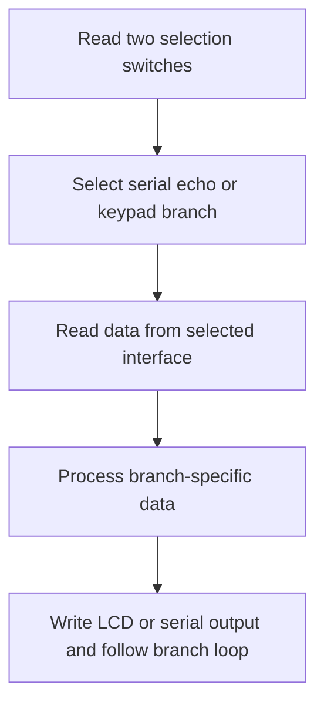
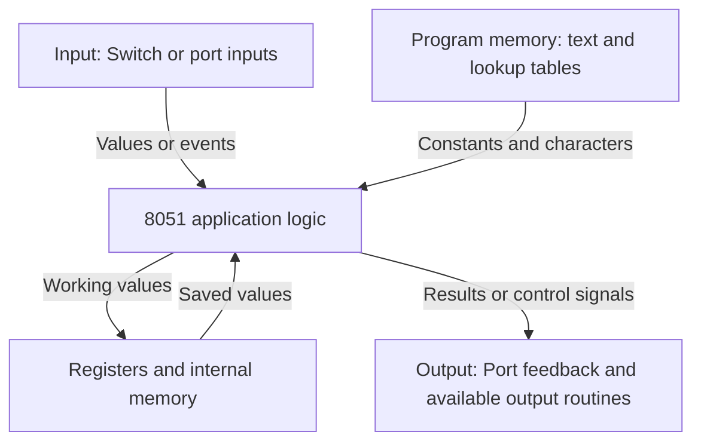

# Switch Controlled Serial And Keypad Display

[Group overview](../../README.md) · [Compare implementations](../README.md)

Use two switches to select serial echo or keypad processing.

**Implementation:** Switch Selected Echo And Sum

**Input:** switch or port inputs.  
**Output:** port feedback and available output routines.

## Inputs and results

| Parameter | Description |
| --- | --- |
| Input | P2.4 and P2.3, plus serial data or keypad entries |
| Output | LCD and serial characters, or the keypad branch’s result |

## Worked example

Set P2.4 to 1 and P2.3 to 0, then receive A. The echo branch sends A followed by a space.

### Calculation details

Set P2.4 = 1 and P2.3 = 0, then send ASCII A on the serial input. The mask gives 10H, selecting OFFON. The received 41H differs from carriage return, so STORE writes A to the LCD and transmits 41H followed by a space (20H).

## Program operation

1. Read two selection switches.
2. Select serial echo or keypad branch.
3. Read data from selected interface.
4. Process branch-specific data.
5. Write LCD or serial output and follow branch loop.

### Functional flowchart

[Detailed control flow](source-flow.md)

### Simplified block diagram

**Port registers:** `P0`, `P0.4`, `P0.6`, `P1`, `P1.2`, `P1.3`, `P1.4`, `P1.5`, `P1.6`, `P1.7`, `P2`.

## Technical limitations

No additional defect was recorded in the earlier source review. This is not evidence of a successful build or hardware test.

## Build and test

1. Open the [assembly source](source.asm) in an 8051 assembler or simulator.
2. Review the technical limitations and configure the peripherals required by this implementation.
3. Check the expected result using the example inputs.
